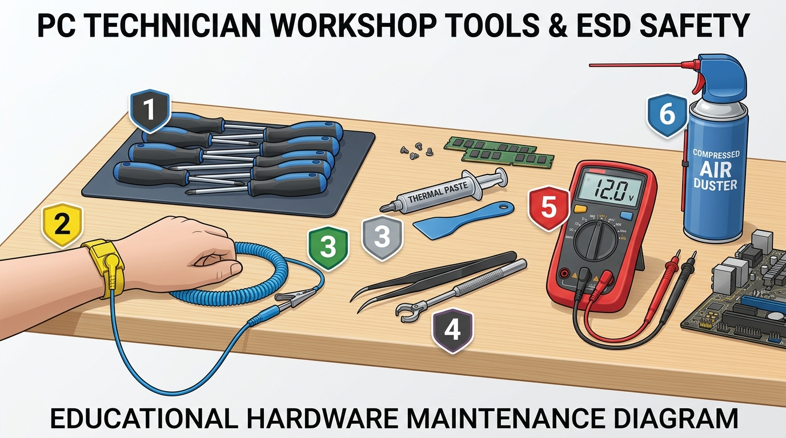

# 5.2 Eines de Taller, Protocol de Muntatge i Diagnosi d'Avaries

El manteniment d'equips microinformàtics és una de les competències troncals d'un tècnic en Sistemes Microinformàtics i Xarxes. Combina la destresa manual i mecànica en el muntatge i neteja de components amb la capacitat analítica i lògica per diagnosticar i resoldre fallades de maquinari de forma metòdica.

---

## 1. L'Espai de Treball i les Eines del Tècnic de Taller

Per treballar amb seguretat i evitar danys accidentals en el maquinari, el banc de treball ha d'estar net, ben il·luminat i equipat amb l'instrumental adequat:



### Llegenda de l'Instrumental de Taller (veure imatge):

| Número | Eina / Equipament | Ús Principal en el Taller Microinformàtic | Recomanació d'Ús |
| :---: | :--- | :--- | :--- |
| **1** | **Joc de Tornavisos d'Estrella (Phillips PH2)** | Subjecció de la placa base, font d'alimentació, discs durs i targetes PCIe. | Utilitzar tornavisos amb **punta imantada** per evitar que els caragols caiguen entre els circuits de la placa. |
| **2** | **Polsera Antiestàtica (ESD)** | Descarrega l'electricitat estàtica acumulada al cos humà cap a terra. | S'ha de col·locar cenyida al canell i fixar la pinça de cocodril a una part metàl·lica sense pintar del xassís del PC o a terra. |
| **3** | **Xeringa de Pasta Tèrmica i Espàtula** | Omple les imperfeccions microscòpiques d'aire entre la CPU i la base de coure del dissipador. | Aplicar una xicoteta quantitat (mida d'un gra d'arròs o una gota central de $\approx 5\text{ mm}$) o estendre finament amb espàtula. **Massa pasta és perjudicial!** |
| **4** | **Pinces de Precisió i Agafador Mecànic** | Rescatar caragols o *jumpers* caiguts en zones d'accés estret de la caixa. | Evita haver d'agitar la caixa de l'ordinador per fer caure caragols perduts. |
| **5** | **Polímetre Digital (Multímetre)** | Mesura de tensions de la font d'alimentació, continuïtat de cables i piles CMOS. | Sempre en mode $\text{DCV}$ ($20\text{ V}$) per a circuits interns. |
| **6** | **Esprai d'Aire Comprimit / Bufador Elèctric** | Neteja de pols incrustada en les aletes d'alumini de dissipadors i radiadors. | **Bloquejar les aspes dels ventiladors** amb el dit abans de bufar per evitar que giren a revolucions extremes i generen corrent paràsit per efecte dinamo cap a la placa! |

---

## 2. Protocol Pas a Pas de Muntatge d'un Ordinador

Per garantir que l'equip funciona abans de tancar-lo a la caixa, els tècnics professionals segueixen un ordre d'acoblament rigorós:

### Fase 1: Premuntatge fora de la caixa (*Test Bench*)
1. Col·loca la placa base sobre la seua pròpia caixa de cartó (mai sobre la borsa antiestàtica per la seua cara exterior, ja que pot ser lleument conductora).
2. Obre la palanca del sòcol CPU, alinea el triangle daurat del processador amb el del sòcol i deixa caure el xip suaument sense forçar. Tanca la palanca.
3. Instal·la els mòduls de memòria RAM a les ranures **2 i 4 (Dual Channel)** pressionant fermament fins a sentir el "clic" dels tancaments laterals.
4. Instal·la el disc SSD M.2 NVMe al sòcol primari i cargola el dissipador tèrmic amb el seu *thermal pad*.
5. Aplica una gota de pasta tèrmica sobre la CPU i munta el dissipador, connectant el cable del ventilador al connector **CPU_FAN**.

---

### Fase 2: Integració a la Caixa del PC
1. Instal·la la font d'alimentació (PSU) a la part inferior de la caixa, orientant el ventilador cap a la reixeta exterior amb filtre de pols.
2. Col·loca la xapa metàl·lica de connexions posteriors (**I/O Shield**) i cargola els **separadors de llautó (*standoffs*)** a la caixa exactament a les posicions que coincideixen amb els forats de la placa base (un separador mal col·locat en un punt cec farà curtcircuit directe amb la placa!).
3. Introdueix la placa base i fixa-la amb caragols sense estrènyer en excés.
4. Connecta el cablejat d'alimentació:
   - **ATX 24 pins** al lateral de la placa.
   - **EPS 8 pins (4+4)** a la part superior per a la CPU.
5. Connecta els cables del panell frontal (**F_PANEL**):
   - **POWER SW:** Botó d'encesa (sense polaritat).
   - **RESET SW:** Botó de reinici (sense polaritat).
   - **POWER LED (+ / -):** LED indicador d'encesa (respectar polaritat).
   - **HDD LED (+ / -):** LED d'activitat de disc (respectar polaritat).
   - Cables d'àudio frontal (**HD AUDIO**) i ports **USB 3.0 / USB 2.0**.
6. Insereix la targeta gràfica dedicada a la primera ranura **PCIe $\times 16$**, cargola la xapa posterior a la caixa i connecta els cables d'alimentació **PCIe de 8 pins (6+2)**.

---

## 3. Diagnòstic d'Avaries: La Seqüència POST i Codis de Xiulets

Quan es prem el botó d'encesa, la placa base executa el **POST** (*Power-On Self-Test*), un conjunt d'instruccions de diagnòstic per verificar que els components essencials estan presents i funcionen correctament abans de donar vídeo.

### 1. Codis de Xiulets de l'Altaveu de la Placa (*Buzzer / PC Speaker*)
Si la placa disposa d'altaveu de diagnòstic, emetrà una combinació de xiulets que indica el tipus de fallada:

| Codi de Xiulets (BIOS Award / AMI) | Significat de la Fallada | Causa Probable i Solució |
| :--- | :--- | :--- |
| **1 xiulet curt** | **POST superat amb èxit** | Funcionament normal; la pantalla encén i comença a carregar el SO. |
| **Xiulets curts repetitius i constants** | **Error de memòria RAM** | Mòdul mal inserit, brutícia a les ranures o memòria defectuosa. Netejar contactes amb goma d'esborrar i provar mòdul a mòdul. |
| **1 xiulet llarg i 2 o 3 xiulets curts** | **Error de targeta gràfica (VGA)** | Targeta mal encaixada a la ranura PCIe o sense alimentació externa PCIe de 8 pins connectada. |
| **Xiulets llargs continus** | **Error greu de memòria o placa** | Incompatibilitat de mòduls o tensió de RAM incorrecta. |
| **Cap xiulet i ventiladors apagats** | **Falta d'alimentació o curtcircuit** | Font d'alimentació cremada, cable ATX 24p desconnectat o botó Power SW defectuós. |

---

### 2. LEDs de Depuració Ràpida (*EZ Debug LEDs*)
Les plaques base modernes inclouen 4 xicotets díodes LED agrupats que s'encenen durant l'arrencada i s'apaguen en superar cada fase:

```
[ CPU ]  -->  [ DRAM ]  -->  [ VGA ]  -->  [ BOOT ]
 (Roig)        (Taronja)       (Blanc)       (Verd)
```

- Si el LED es queda **fix en CPU (Roig):** Sòcol mal tancat, pins doblegats o BIOS sense actualitzar per suportar el model de processador instal·lat.
- Si es queda **fix en DRAM (Taronja):** Fallada de contacte o perfil XMP inestable.
- Si es queda **fix en VGA (Blanc):** Targeta gràfica no detectada o cable HDMI/DisplayPort connectat per error a la placa base en lloc de la targeta gràfica.
- Si es queda **fix en BOOT (Verd):** Maquinari correcte, però no es troba cap disc amb sistema operatiu arrencable.
