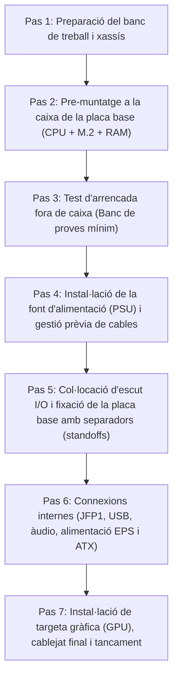

# 5.2 El Protocol de Muntatge Pas a Pas (Els 7 Passos d'Or)

  

    Progression de la sessió: 5.2 Protocol Metòdic de Muntatge
    0 / 75 pts
  

  

    

  

  

    1. Muntatge Fora de Caixa
    2. Fixació i Standoffs
    3. Integració Final
  

Muntar un equip informàtic no és una tasca improvisada. Seguir una seqüència estructurada garanteix la màxima seguretat per als components, estalvia temps i evita haver de desmuntar l'equip sencer en cas de fallada d'arrencada.

---

## Els 7 Passos d'Or del Muntatge Professional

---

## Detall Operatiu de Cada Pas

### Pas 1: Preparació del banc de treball i caixa
- Retira els dos panells laterals del xassís.
- Instal·la els **separadors hexagonals de coure (*standoffs*)** a la safata metàl·lica exactament a les posicions que corresponguen al factor de forma de la placa (ATX o mATX).

> [!CAUTION]
> **El perill mortal d'un standoff mal col·locat:** Si deixes un separador de coure en una posició on la placa base no té cap forat de cargol, aquest tocarà directament les pistes de soldadura posteriors. En encendre l'equip es produirà un curtcircuit massiu que destruirà la placa base de manera instantània.

### Pas 2: Pre-muntatge fora de caixa
Col·loca la placa base sobre la seua pròpia caixa de cartó (mai damunt d'una bossa electroestàtica):
1. **Instal·la la CPU:** Fes coincidir la fletxa daurada amb la marca del sòcol. Tanca la palanca.
2. **Instal·la els SSDs NVMe M.2:** Retira els protectors de plàstic blau dels coixinets tèrmics del dissipador M.2 abans de collar-lo.
3. **Instal·la la memòria RAM:** Fes coincidir l'osca i pressiona ambdós extrems fins a escoltar el doble clic dels pestells a les ranures A2 i B2.
4. **Instal·la el dissipador:** Aplica pasta tèrmica (mida d'un gra de pèsol al centre o patró en creu) i cargola el dissipador en diagonal creuada per repartir la pressió.

### Pas 3: Banc de proves mínim (*Breadboarding*)
Abans d'encaixar la placa dins de la caixa, connecta els cables ATX de 24 pins i EPS de 8 pins de la font d'alimentació, connecta un monitor i fes un pont d'1 segon amb la punta d'un tornavís pla entre els dos pins de `POWER SW`. Si l'equip arriba a la pantalla de la UEFI, el conjunt funciona perfectament i ja es pot allotjar al xassís.

### Pas 4 a 7: Muntatge intern i connexions
- Instal·la la PSU orientant el ventilador cap avall (si la caixa disposa de reixa de ventilació inferior amb filtre antipols).
- Si la placa no disposa d'escut I/O preinstal·lat, fixa l'escut metàl·lic a la finestra posterior del xassís fent pressió fins a encaixar el clic perimetral.
- Introdueix la placa inclinada amb cura per no doblegar les llengüetes metàl·liques de l'escut I/O dins dels ports USB o HDMI.
- Col·loca la targeta gràfica a la primera ranura PCIe x16 (la més propera a la CPU), assegura-la amb cargols al xassís i connecta els cables PCIe d'alimentació auxiliar.

---

## Reptes Interactius (Avalua els teus coneixements)

  
Repte 1: Conseqüències d'un Standoff Sobrant

  
Un tècnic principiant canvia una placa base ATX per una Micro-ATX, però oblida desenroscar un dels separadors de coure (standoffs) inferiors de la safata de la caixa. Què pot ocórrer en prémer el botó d'encesa?

  

    <label style="display:flex; align-items:center; gap:8px; cursor:pointer;"><input type="radio" name="mme_0502_q1" value="a"> Res, els separadors estan aïllats elèctricament.</label>
    <label style="display:flex; align-items:center; gap:8px; cursor:pointer;"><input type="radio" name="mme_0502_q1" value="b"> El separador metàl·lic farà contacte directe amb pistes vives de soldadura posterior del PCB, provocant un curtcircuit que pot danyar la placa base i activar la protecció SCP de la font.</label>
    <label style="display:flex; align-items:center; gap:8px; cursor:pointer;"><input type="radio" name="mme_0502_q1" value="c"> L'equip funcionarà més fred perquè el metall dissipa calor.</label>
    <label style="display:flex; align-items:center; gap:8px; cursor:pointer;"><input type="radio" name="mme_0502_q1" value="d"> La memòria RAM funcionarà a la meitat de velocitat.</label>
  

  <button class="btn-check" data-correct="b" data-feedback="Correcte! Els separadors només han d'estar presents on coincideixen exactament amb els forats de massa de la placa. Un separador fantasma és una de les causes típiques de curtcircuit de banc.">Comprova la resposta</button>
  

  
Repte 2: Avantatge del Pre-muntatge Fora de Caixa

  
Per quina raó tècnica i d'ergonomia es recomana instal·lar la CPU, el dissipador, els SSD M.2 i la memòria RAM sobre la caixa de cartó abans d'introduir la placa base a l'interior del xassís?

  

    <label style="display:flex; align-items:center; gap:8px; cursor:pointer;"><input type="radio" name="mme_0502_q2" value="a"> Perquè dins de la caixa l'espai és molt reduït i és difícil aplicar la pressió uniforme necessària sobre la RAM o collar els suports del dissipador sense danyar el PCB.</label>
    <label style="display:flex; align-items:center; gap:8px; cursor:pointer;"><input type="radio" name="mme_0502_q2" value="b"> Perquè la caixa metàl·lica desmagnetitza el processador.</label>
    <label style="display:flex; align-items:center; gap:8px; cursor:pointer;"><input type="radio" name="mme_0502_q2" value="c"> Perquè Windows no es pot instal·lar si la placa està collada al xassís.</label>
    <label style="display:flex; align-items:center; gap:8px; cursor:pointer;"><input type="radio" name="mme_0502_q2" value="d"> Perquè els cargols de la caixa bloquegen les pistes de la memòria.</label>
  

  <button class="btn-check" data-correct="a" data-feedback="Molt bé! Muntar fora de la caixa permet total llibertat de moviments, una inspecció visual clara del tancament del sòcol i fer una prova d'arrencada prèvia (*breadboarding*).">Comprova la resposta</button>
  

  
Repte 3: Fixació del Dissipador i Pressió Tèrmica

  
Com s'han d'ajustar els cargols d'un dissipador de CPU que utilitza ressorts de pressió?

  

    <label style="display:flex; align-items:center; gap:8px; cursor:pointer;"><input type="radio" name="mme_0502_q3" value="a"> Collar un cargol al màxim i després passar al següent.</label>
    <label style="display:flex; align-items:center; gap:8px; cursor:pointer;"><input type="radio" name="mme_0502_q3" value="b"> Donar unes poques voltes de manera alternada en creu (patró X) fins que tots arriben al límit del ressort de forma progressiva i equilibrada.</label>
    <label style="display:flex; align-items:center; gap:8px; cursor:pointer;"><input type="radio" name="mme_0502_q3" value="c"> Deixar-los fluixos perquè puga entrar aire fred.</label>
    <label style="display:flex; align-items:center; gap:8px; cursor:pointer;"><input type="radio" name="mme_0502_q3" value="d"> Utilitzar una pistola elèctrica d'impacte.</label>
  

  <button class="btn-check" data-correct="b" data-feedback="Exacte! El patró en creu alternat garanteix una distribució perfectament homogènia de la pasta tèrmica i evita deformar el substrat del sòcol o partir una cantonada del die de silici.">Comprova la resposta</button>
  

---

  <h3 style="color: #1e40af; margin-top: 0;">Lliurament de l'Activitat a Aules</h3>
  

    Completa la tasca pràctica: <strong>Act02 - Checklist Metòdica del Protocol de Muntatge</strong>. Genera el PDF oficial per a Aules.
  

  

    <input type="text" class="student-name-input" placeholder="El teu nom i cognoms..." style="padding: 8px 12px; border: 1px solid #94a3b8; border-radius: 6px; flex-grow: 1; min-width: 240px;">
    <button class="btn-generate-aules-pdf btn-aules-dl" data-module="MME" data-unit="UD05" data-activity="Act02" style="background: #2563eb; color: #fff; border: none; padding: 8px 16px; border-radius: 6px; cursor: pointer; font-weight: 600;">Generar PDF Aules</button>
  

