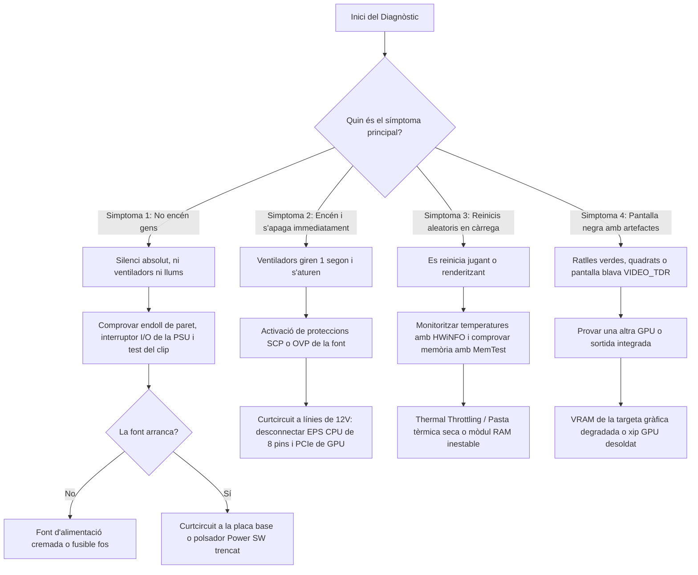

# 5.4 Diagnòstic Sistemàtic d'Avaries de Maquinari

  

    Progression de la sessió: 5.4 Resolució Sistemàtica d'Avaries
    0 / 75 pts
  

  

    

  

  

    1. Metodologia Científica
    2. Els 4 Símptomes Crítics
    3. Banc Mínim
  

El diagnòstic de fallades microinformàtiques no es basa en la intuïció ni en canviar peces a l'atzar, sinó en aplicar un mètode científic d'aïllament de variables, descartant components de forma lògica i reproduïble.

---

## 1. El Mètode d'Aïllament per Substitució

Quan un equip falla, el protocol professional segueix aquest cicle:
1. **Recollida d'informació i símptomes:** Preguntar a l'usuari què va passar just abans de la fallada (pujada de tensió elèctrica, olor de cremat, actualització de sistema, cop físic).
2. **Inspecció visual externa i interna:** Buscar condensadors unflats o amb líquid electrolític vessat, cables pelats o desconnectats, acumulació massiva de pols als dissipadors o olor d'ozó.
3. **Muntatge mínim sobre banc de proves (*Breadboarding*):** Extreure la placa del xassís per descartar que la caixa metàl·lica estiga provocant un curtcircuit ocult.
4. **Substitució pas a pas amb component conegut en bon estat (*Known Good Component*):** Canviar només **un sol component cada vegada** (primer la font, després la memòria RAM, etc.). Si canvies dos components alhora, mai sabràs quin era el responsable de la fallada.

---

## 2. Arbre de Decisió per als 4 Símptomes Clàssics d'Avaria

---

## 3. Resolució de Problemes Freqüents a Taller

| Símptoma Observat | Causa Tècnica Fonamental | Acció de Resolució Immediata |
| :--- | :--- | :--- |
| **L'equip encén però no hi ha senyal de vídeo (Pantalla Negra)** | El cable de vídeo està connectat a la placa base en lloc de la GPU dedicada, o la RAM no fa bon contacte. | Connectar el cable HDMI/DisplayPort a la GPU. Si persisteix, netejar contactes de la RAM amb alcohol isopropílic i provar un sol mòdul a la ranura A2. |
| **Soroll agut i continu en exigir a la GPU (*Coil Whine*)** | Ressonància magnètica de les bobines d'inducció del VRM sotmeses a alts amperatges. | No és un defecte perillós. Es pot mitigar activant V-Sync o limitant els fotogrames per segon (FPS) al panell de control. |
| **La màquina perd l'hora i data en desendollar-la de la paret** | La pila de botó de liti de la placa base està esgotada. | Substituir la pila de botó per una **CR2032 de $3\text{ V}$ nova** i desar de nou els paràmetres a la UEFI. |
| **L'ordinador s'apaga bruscament als 5 minuts d'encendre's** | Bomba de la refrigeració líquida aturada o plàstic protector del dissipador no retirat. | Comprovar que la bomba estiga connectada a `AIO_PUMP` a 12V fixos i verificar que no hi haja plàstic a la base del coure. |

---

## Reptes Interactius (Avalua els teus coneixements)

  
Repte 1: Diagnosi de Màquina que no Encén Gens

  
Un equip arriba al taller sense cap resposta en prémer el botó d'encesa: no s'encén cap llum ni gira cap ventilador. Abans de comprar cap recanvi, quina és la primera comprovació que ha de fer el tècnic?

  

    <label style="display:flex; align-items:center; gap:8px; cursor:pointer;"><input type="radio" name="mme_0504_q1" value="a"> Formatar el disc SSD NVMe.</label>
    <label style="display:flex; align-items:center; gap:8px; cursor:pointer;"><input type="radio" name="mme_0504_q1" value="b"> Comprovar el cable de corrent de paret, l'interruptor I/O de la font, i provar el polsador fent un pont curt als dos pins de Power SW amb la punta d'un tornavís.</label>
    <label style="display:flex; align-items:center; gap:8px; cursor:pointer;"><input type="radio" name="mme_0504_q1" value="c"> Canviar el processador per un altre de generació anterior.</label>
    <label style="display:flex; align-items:center; gap:8px; cursor:pointer;"><input type="radio" name="mme_0504_q1" value="d"> Reinstal·lar els controladors gràfics.</label>
  

  <button class="btn-check" data-correct="b" data-feedback="Correcte! Sempre cal descartar l'alimentació externa i el propi polsador del panell frontal abans de diagnosticar la font o la placa base com a mortes.">Comprova la resposta</button>
  

  
Repte 2: Diagnosi d'Artefactes Gràfics a la Pantalla

  
Un ordinador mostra petites línies horitzontals roses i patrons de quadrats estranys (coneguts com a «artefactes») tant a l'escriptori de Windows com en jocs 3D. Quin component és el principal sospitós de la fallada?

  

    <label style="display:flex; align-items:center; gap:8px; cursor:pointer;"><input type="radio" name="mme_0504_q2" value="a"> La memòria VRAM o el xip gràfic de la targeta dedicada amb microfissures de soldadura o degradació tèrmica.</label>
    <label style="display:flex; align-items:center; gap:8px; cursor:pointer;"><input type="radio" name="mme_0504_q2" value="b"> La font d'alimentació té massa potència.</label>
    <label style="display:flex; align-items:center; gap:8px; cursor:pointer;"><input type="radio" name="mme_0504_q2" value="c"> El disc dur SSD està massa ple.</label>
    <label style="display:flex; align-items:center; gap:8px; cursor:pointer;"><input type="radio" name="mme_0504_q2" value="d"> La pila CR2032 està descarregada.</label>
  

  <button class="btn-check" data-correct="a" data-feedback="Molt bé! Els artefactes visuals són el símptoma clàssic de corrupció de memòria gràfica de vídeo (VRAM) o problemes físics en el silici de la GPU deguts a estrès tèrmic continuat.">Comprova la resposta</button>
  

  
Repte 3: Pèrdua de Paràmetres UEFI i Data

  
Cada matí quan l'equip de l'oficina s'encén després d'estar desendollat tota la nit de la regleta, mostra el missatge «CMOS Checksum Error: Defaults Loaded» i l'hora s'ha reiniciat a l'any 2020. Com se soluciona aquesta incidència?

  

    <label style="display:flex; align-items:center; gap:8px; cursor:pointer;"><input type="radio" name="mme_0504_q3" value="a"> Reemplaçant la placa base sencera.</label>
    <label style="display:flex; align-items:center; gap:8px; cursor:pointer;"><input type="radio" name="mme_0504_q3" value="b"> Substituint la pila de botó CR2032 de 3 V situada a la placa base, que manté la memòria volàtil RTC/CMOS quan no hi ha corrent extern.</label>
    <label style="display:flex; align-items:center; gap:8px; cursor:pointer;"><input type="radio" name="mme_0504_q3" value="c"> Canviant el cable Ethernet.</label>
    <label style="display:flex; align-items:center; gap:8px; cursor:pointer;"><input type="radio" name="mme_0504_q3" value="d"> Instal·lant un segon mòdul de memòria RAM.</label>
  

  <button class="btn-check" data-correct="b" data-feedback="Exacte! La cel·la de liti CR2032 alimenta el rellotge de temps real (RTC) i la SRAM de configuració. Quan el seu voltatge baixa de 2.7 V, la placa perd les dades si es talla la corrent elèctrica.">Comprova la resposta</button>
  

---

  <h3 style="color: #1e40af; margin-top: 0;">Lliurament de l'Activitat a Aules</h3>
  

    Completa la tasca pràctica: <strong>Act04 - Resolució de Casos Pràctics d'Avaries de Maquinari</strong>. Genera el PDF oficial per a Aules.
  

  

    <input type="text" class="student-name-input" placeholder="El teu nom i cognoms..." style="padding: 8px 12px; border: 1px solid #94a3b8; border-radius: 6px; flex-grow: 1; min-width: 240px;">
    <button class="btn-generate-aules-pdf btn-aules-dl" data-module="MME" data-unit="UD05" data-activity="Act04" style="background: #2563eb; color: #fff; border: none; padding: 8px 16px; border-radius: 6px; cursor: pointer; font-weight: 600;">Generar PDF Aules</button>
  

