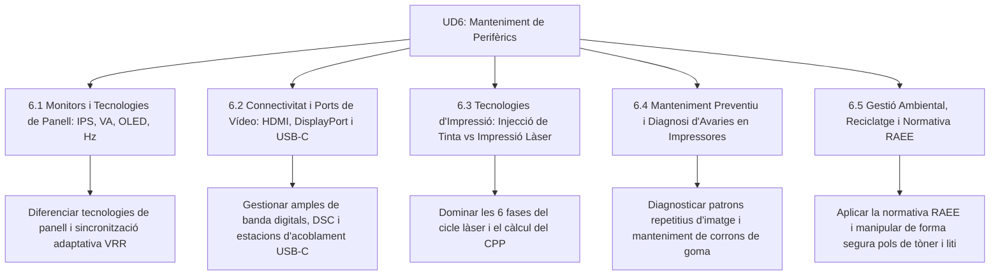

# UD6 Manteniment de Perifèrics: Pantalles i Impressores

Benvingut a la **Unitat Didàctica 6** del mòdul professional de **Muntatge i Manteniment d'Equips (MME)**. Aquesta unitat se centra en els dos perifèrics d'eixida més complexos i determinants en l'entorn microinformàtic: els monitors visuals d'alta resolució i les impressores mecàniques i electrofotogràfiques, a més de la gestió ecològica dels residus electrònics (RAEE).

---

## Mapa d'Aprenentatge de la Unitat

---

## Sessions d'Estudi i Activitats Pràctiques

1. [**6.1 Monitors i Tecnologies de Panell (IPS, VA, OLED, Hz)**](ut0601.html)
   - Comparativa de tecnologies de panell: TN, VA, IPS i OLED.
   - Freqüència de refresc (Hz), temps de resposta GtG i efecte fantasma (*ghosting*).
   - Sincronització de fotogrames: AMD FreeSync i NVIDIA G-Sync contra el *tearing*.

2. [**6.2 Ports i Interfícies de Vídeo: HDMI, DisplayPort i USB-C**](ut0602.html)
   - HDMI 2.1b vs DisplayPort 1.4/2.1 (amplada de banda i ganxos de seguretat).
   - DisplayPort Alt Mode sobre USB-C i càrrega Power Delivery en monitors dock.
   - Compressió d'imatge DSC (*Display Stream Compression*) i Daisy Chaining (MST).

3. [**6.3 Tecnologies d'Impressió: Injecció de Tinta vs Impressió Làser**](ut0603.html)
   - Injecció piezoelèctrica vs tèrmica d'injectors líquids.
   - El cicle electrofotogràfic làser en 6 fases: càrrega, exposició, revelat, transferència, fusió i neteja.
   - Comparativa de cost per pàgina (CPP) i comportament davant la inactivitat.

4. [**6.4 Manteniment Preventiu i Diagnosi d'Avaries en Impressores**](ut0604.html)
   - Diagnosi de patrons d'impressió i càlcul de circumferència de defectes de tambor OPC.
   - Avaries de fusor: despreniment de tòner en passar el dit.
   - Manteniment de corrons de presa (*pick-up rollers*) i desembús metòdic de paper.

5. [**6.5 Gestió Ambiental, Reciclatge i Normativa RAEE**](ut0605.html)
   - El marc legal de gestió de residus d'aparells elèctrics i electrònics (RAEE).
   - Principis 1x1 i 1x0 en comerços de tecnologia.
   - Seguretat crítica amb pols de tòner (respiració i risc de deflagració) i piles de liti.

---

## Reptes Globals d'Avaluació de la Unitat (+100 pts)

  
Repte Global 1: Selecció de Monitor per a Disseny i Fotografia

  
Una agència de publicitat et demana equipar 10 llocs de treball per a edició de vídeo 4K i fotografia professional. Els usuaris necessiten colors 100% reals, angles de visió amplis i connectar el portàtil amb un sol cable que transmeta imatge i recarregue l'equip. Quina configuració de pantalla és la idònia?

  

    <label style="display:flex; align-items:center; gap:8px; cursor:pointer;"><input type="radio" name="mme_06_global_q1" value="a"> Monitor TN amb connexió VGA i 240 Hz.</label>
    <label style="display:flex; align-items:center; gap:8px; cursor:pointer;"><input type="radio" name="mme_06_global_q1" value="b"> Monitor amb panell IPS 4K, calibratge d'origen 100% sRGB / 98% DCI-P3 i port USB-C amb DP Alt Mode i Power Delivery de 90 W.</label>
    <label style="display:flex; align-items:center; gap:8px; cursor:pointer;"><input type="radio" name="mme_06_global_q1" value="c"> Televisor clàssic de 32 polzades amb euroconnector.</label>
    <label style="display:flex; align-items:center; gap:8px; cursor:pointer;"><input type="radio" name="mme_06_global_q1" value="d"> Monitor VA de 1080p sense calibratge.</label>
  

  <button class="btn-check" data-correct="b" data-feedback="Correcte! El panell IPS garanteix la màxima fidelitat cromàtica i angles de visió de 178º, mentre que l'USB-C amb DP Alt Mode i Power Delivery permet la comoditat del cable únic.">Comprova la resposta</button>
  

  
Repte Global 2: Diagnosi d'Avaria en Cicle Làser

  
Un client porta al taller una impressora làser d'oficina que imprimeix pàgines completament negres de dalt a baix, com si s'haguera abocat un cubell de pintura sobre tot el full. Quina és la fallada elèctrica més probable?

  

    <label style="display:flex; align-items:center; gap:8px; cursor:pointer;"><input type="radio" name="mme_06_global_q2" value="a"> El corró de càrrega primària (PCR) o la seua connexió d'alta tensió ha fallat, deixant el tambor amb 0 V; en conseqüència, tot el tòner carregat negativament és atret de forma massiva a tota la superfície.</label>
    <label style="display:flex; align-items:center; gap:8px; cursor:pointer;"><input type="radio" name="mme_06_global_q2" value="b"> El cable de xarxa RJ45 està cremat.</label>
    <label style="display:flex; align-items:center; gap:8px; cursor:pointer;"><input type="radio" name="mme_06_global_q2" value="c"> La unitat fusora està massa calenta.</label>
    <label style="display:flex; align-items:center; gap:8px; cursor:pointer;"><input type="radio" name="mme_06_global_q2" value="d"> El paper és massa blanc.</label>
  

  <button class="btn-check" data-correct="a" data-feedback="Molt bé! Si el PCR no aplica la tensió negativa uniforme de -600V al tambor, no hi ha repulsió electroestàtica i el corró revelador transfereix tòner negre a tota l'àrea del full.">Comprova la resposta</button>
  

  
Repte Global 3: Resolució d'Incidència d'Alimentació de Paper

  
Una impressora amb 4 anys d'ús intensiu a una assessoria mostra constantment l'error «Safata 1 buida / Carregueu paper» tot i que la safata està plena fins a dalt. Els engranatges es mouen durant 2 segons però cap full entra a la màquina. Quina reparació ràpida resol l'avaria?

  

    <label style="display:flex; align-items:center; gap:8px; cursor:pointer;"><input type="radio" name="mme_06_global_q3" value="a"> Reinstal·lar el sistema operatiu de l'ordinador.</label>
    <label style="display:flex; align-items:center; gap:8px; cursor:pointer;"><input type="radio" name="mme_06_global_q3" value="b"> Netejar o substituir el rodet d'arrossegament de goma (pick-up roller), la superfície del qual ha quedat polida i relliscosa per acumulació de pols de paper.</label>
    <label style="display:flex; align-items:center; gap:8px; cursor:pointer;"><input type="radio" name="mme_06_global_q3" value="c"> Canviar el cartutx de tòner.</label>
    <label style="display:flex; align-items:center; gap:8px; cursor:pointer;"><input type="radio" name="mme_06_global_q3" value="d"> Posar oli de cotxe als sensors.</label>
  

  <button class="btn-check" data-correct="b" data-feedback="Exacte! Els pick-up rollers perden tracció quan la goma es cristal·litza o s'impregna de fibra de cel·lulosa. Netejar-los amb drap humit o substituir la goma restaura l'arrossegament.">Comprova la resposta</button>
  

  
Repte Global 4: Compliment Ambiental RAEE al Taller

  
Quin procediment és legalment i ambientalment correcte per a gestionar els cartutxos de tòner buits i les plaques mare defectuoses que s'acumulen al taller després de les reparacions?

  

    <label style="display:flex; align-items:center; gap:8px; cursor:pointer;"><input type="radio" name="mme_06_global_q4" value="a"> Llençar-los al contenidor verd de vidre o al contenidor blau de paper.</label>
    <label style="display:flex; align-items:center; gap:8px; cursor:pointer;"><input type="radio" name="mme_06_global_q4" value="b"> Emmagatzemar-los en contenidors homologats identificats i lliurar-los periòdicament a un gestor de residus autoritzat (SCRAP) o a l'ecoparc municipal, obtenint el document de traçabilitat de trasllat.</label>
    <label style="display:flex; align-items:center; gap:8px; cursor:pointer;"><input type="radio" name="mme_06_global_q4" value="c"> Cremar-los a una foguera controlada.</label>
    <label style="display:flex; align-items:center; gap:8px; cursor:pointer;"><input type="radio" name="mme_06_global_q4" value="d"> Vendre'ls com a ferralla no declarada a particulars.</label>
  

  <button class="btn-check" data-correct="b" data-feedback="Molt bé! La llei de residus obliga els tallers a documentar la traçabilitat dels components electrònics mitjançant sistemes col·lectius de responsabilitat ampliada del productor (SCRAP).">Comprova la resposta</button>
  

---

  <h3 style="color: #1e40af; margin-top: 0;">Lliurament del Projecte Global de la Unitat a Aules</h3>
  

    Envia el dossier complet de la Unitat Didàctica 6: <strong>Dossier Tècnic de Manteniment de Perifèrics, Diagnosi d'Impressores i Gestió RAEE</strong>. Genera el PDF oficial per a Aules.
  

  

    <input type="text" class="student-name-input" placeholder="El teu nom i cognoms..." style="padding: 8px 12px; border: 1px solid #94a3b8; border-radius: 6px; flex-grow: 1; min-width: 240px;">
    <button class="btn-generate-aules-pdf btn-aules-dl" data-module="MME" data-unit="UD06" data-activity="Global" style="background: #2563eb; color: #fff; border: none; padding: 8px 16px; border-radius: 6px; cursor: pointer; font-weight: 600;">Generar PDF Aules</button>
  

