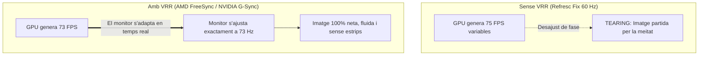

# 6.1 Monitors i Tecnologies de Panell (IPS, VA, OLED, Hz)

  

    Progression de la sessió: 6.1 Tecnologies de Pantalla
    0 / 75 pts
  

  

    

  

  

    1. Panells LCD vs OLED
    2. Freqüència i Resposta
    3. VRR (FreeSync / G-Sync)
  

El monitor és el perifèric d'eixida principal mitjançant el qual l'usuari interactua amb el sistema. Triar el panell adequat requereix conèixer a fons les propietats òptiques dels vidres líquids, els díodes orgànics i la cinètica de refresc d'imatge.

---

## 1. Tecnologies de Panell: TN, VA, IPS i OLED

| Tecnologia | Nivell de Contrast Natiu | Angles de Visió | Fidelitat del Color | Temps de Resposta (GtG) | Ús Professional Predominant |
| :--- | :--- | :--- | :--- | :--- | :--- |
| **TN** (*Twisted Nematic*) | Pobre ($1000:1$) | Molt limitats (distorsió en mirar des d'angles). | Pobre (escala de grisos deficient). | Molt ràpid ($1\text{ ms}$). | Equips d'oficina barats o eSports antics. |
| **VA** (*Vertical Alignment*) | **Molt Alt ($3000:1\text{ a }5000:1$)** | Mitjans (lleu pèrdua lateral). | Bo (negres molt profunds). | Lent en transicions fosques (*black smearing*). | Multimèdia, cinema, consum de continguts i simuladors. |
| **IPS** (*In-Plane Switching*) | Mitjà ($1000:1\text{ a }1500:1$) | **Excel·lents ($178^\circ$)** | **Màxima precisió (sRGB, DCI-P3)**. | Ràpid ($1\text{ a }4\text{ ms}$). | Disseny gràfic, edició fotogràfica, CAD i ús general avançat. |
| **OLED / QD-OLED** | **Infinit ($\infty:1$)** (píxels autoemissius apagats). | Perfectes des de qualsevol angle. | Extraordinària (gama cromàtica màxima). | **Instantani ($0.03\text{ ms}$)**. | Producció audiovisual d'alt nivell i gaming premium. |

> [!NOTE]
> **Risc de marcatge (*Burn-in*) en panells OLED:** A diferència dels panells LCD tradicionals que utilitzen una tira de llum posterior LED (*backlight*), a les pantalles OLED cada subpíxel emet la seua pròpia llum orgànica. Si es deixen imatges estàtiques (com la barra de tasques de Windows o logotips) durant centenars d'hores amb brillantor màxima, els díodes es degraden de forma desigual deixant una ombra permanent.

---

## 2. Freqüència de Refresc (Hz) vs Temps de Resposta (ms)

- **Freqüència de Refresc (*Refresh Rate*, Hz):** Nombre de vegades per segon que el monitor redibuixa la imatge completa a la pantalla ($60\text{ Hz} = 60\text{ fps}$, $144\text{ Hz}$, $240\text{ Hz}$). Una freqüència més alta redueix la fatiga visual i ofereix una suavitat de moviment dràsticament superior.
- **Temps de Resposta GtG (*Grey-to-Grey*):** Temps en mil·lisegons que triga un cristall líquid a canviar d'un estat de gris a un altre. Si el temps de resposta és lent ($>10\text{ ms}$), es produeix un rastre borronós darrere dels objectes en moviment anomenat **efecte fantasma (*ghosting*)**.

---

## 3. Sincronització Adaptativa: FreeSync i G-Sync

Quan la targeta gràfica (GPU) genera fotogrames a un ritme diferent de la taxa de refresc fixa del monitor, es produeixen dos fenòmens desagradables:
1. **Estripament (*Tearing*):** La pantalla mostra parts de dos fotogrames diferents alhora, donant la sensació de trencament horitzontal de la imatge.
2. **Entrebancament (*Stuttering*):** Si s'activa el V-Sync tradicional i la GPU baixa de 60 FPS, la taxa cau sobtadament a 30 FPS generant tironets molests.

- **AMD FreeSync:** Estàndard obert basat en el protocol *VESA Adaptive-Sync* compatible amb connexions DisplayPort i HDMI.
- **NVIDIA G-Sync:** Tecnologia de sincronització dinàmica de NVIDIA.

---

## Reptes Interactius (Avalua els teus coneixements)

  
Repte 1: Elecció de Panell per a Disseny Gràfic

  
Un client que treballa professionalment en edició fotogràfica i maquetació publicitària et demana assessorament per triar un monitor amb màxima fidelitat cromàtica i angles de visió amplis sense distorsió de color lateral. Quin panell LCD és el recomanat?

  

    <label style="display:flex; align-items:center; gap:8px; cursor:pointer;"><input type="radio" name="mme_0601_q1" value="a"> Panell TN (Twisted Nematic)</label>
    <label style="display:flex; align-items:center; gap:8px; cursor:pointer;"><input type="radio" name="mme_0601_q1" value="b"> Panell IPS (In-Plane Switching)</label>
    <label style="display:flex; align-items:center; gap:8px; cursor:pointer;"><input type="radio" name="mme_0601_q1" value="c"> Panell monocrom passiu</label>
    <label style="display:flex; align-items:center; gap:8px; cursor:pointer;"><input type="radio" name="mme_0601_q1" value="d"> Panell CRT d'electrons</label>
  

  <button class="btn-check" data-correct="b" data-feedback="Correcte! La tecnologia IPS orienta els vidres líquids de manera paral·lela al substrat, oferint una reproducció de color extremadament precisa i angles de visió de 178 graus.">Comprova la resposta</button>
  

  
Repte 2: Resolució de l'Efecte Tearing

  
Un usuari nota que quan fa moviments ràpids de càmera en videojocs, la imatge sembla 'trencar-se' o tallar-se horitzontalment en dues meitats descompassades (tearing). Quina tecnologia de sincronització resol aquest problema sincronitzant els Hz del monitor amb els FPS de la GPU?

  

    <label style="display:flex; align-items:center; gap:8px; cursor:pointer;"><input type="radio" name="mme_0601_q2" value="a"> Augmentar el volum dels altaveus.</label>
    <label style="display:flex; align-items:center; gap:8px; cursor:pointer;"><input type="radio" name="mme_0601_q2" value="b"> VRR (Variable Refresh Rate) mitjançant AMD FreeSync o NVIDIA G-Sync.</label>
    <label style="display:flex; align-items:center; gap:8px; cursor:pointer;"><input type="radio" name="mme_0601_q2" value="c"> Reduir la memòria RAM del PC.</label>
    <label style="display:flex; align-items:center; gap:8px; cursor:pointer;"><input type="radio" name="mme_0601_q2" value="d"> Utilitzar un cable VGA analògic.</label>
  

  <button class="btn-check" data-correct="b" data-feedback="Molt bé! La taxa de refresc variable (VRR) adapta la freqüència física del monitor al ritme exacte de fotogrames renderitzats per la GPU, eliminant el tearing per complet.">Comprova la resposta</button>
  

  
Repte 3: Particularitat del Contrast en Pantalles OLED

  
Per què es diu tècnicament que una pantalla amb tecnologia OLED té una relació de contrast 'infinita'?

  

    <label style="display:flex; align-items:center; gap:8px; cursor:pointer;"><input type="radio" name="mme_0601_q3" value="a"> Perquè per a representar el color negre, cada díode orgànic s'apaga completament de forma individual, emetent zero lúmens de llum.</label>
    <label style="display:flex; align-items:center; gap:8px; cursor:pointer;"><input type="radio" name="mme_0601_q3" value="b"> Perquè la seua resolució és de 16K.</label>
    <label style="display:flex; align-items:center; gap:8px; cursor:pointer;"><input type="radio" name="mme_0601_q3" value="c"> Perquè consumeix zero watts d'energia elèctrica.</label>
    <label style="display:flex; align-items:center; gap:8px; cursor:pointer;"><input type="radio" name="mme_0601_q3" value="d"> Perquè utilitza vidre reflectant de mirall.</label>
  

  <button class="btn-check" data-correct="a" data-feedback="Exacte! En no requerir panell de retroil·luminació comú, el negre pur s'aconsegueix apagant el subpíxel; en dividir la brillantor blanca màxima entre zero llum, el contrast matemàtic és infinit.">Comprova la resposta</button>
  

---

  <h3 style="color: #1e40af; margin-top: 0;">Lliurament de l'Activitat a Aules</h3>
  

    Completa la tasca pràctica: <strong>Act01 - Estudi Comparatiu de Tecnologies de Panell i Mesura de Temps de Resposta</strong>. Genera el PDF oficial per a Aules.
  

  

    <input type="text" class="student-name-input" placeholder="El teu nom i cognoms..." style="padding: 8px 12px; border: 1px solid #94a3b8; border-radius: 6px; flex-grow: 1; min-width: 240px;">
    <button class="btn-generate-aules-pdf btn-aules-dl" data-module="MME" data-unit="UD06" data-activity="Act01" style="background: #2563eb; color: #fff; border: none; padding: 8px 16px; border-radius: 6px; cursor: pointer; font-weight: 600;">Generar PDF Aules</button>
  

