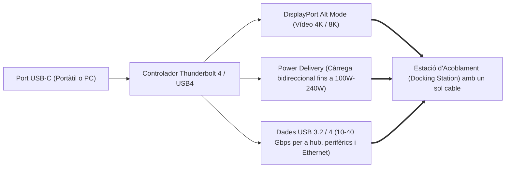

# 6.2 Ports i Interfícies de Vídeo: HDMI, DisplayPort i USB-C

  

    Progression de la sessió: 6.2 Connectivitat i Ports de Vídeo
    0 / 75 pts
  

  

    

  

  

    1. HDMI vs DisplayPort
    2. USB-C i Thunderbolt
    3. Ample de Banda i DSC
  

La transmissió de senyal de vídeo digital ha superat els antics connectors analògics VGA (D-Sub 15) i DVI. Els estàndards dominants en informàtica actual són **DisplayPort**, **HDMI** i els nous modes alternatius sobre **USB-C**.

---

## 1. Comparativa Tècnica: HDMI vs DisplayPort

| Especificació | **HDMI 2.1b** | **DisplayPort 1.4a / 2.1** |
| :--- | :--- | :--- |
| **Ample de banda brut màxim** | $48\text{ Gbps}$ (FRL: *Fixed Rate Link*) | **$32.4\text{ Gbps}$ (DP 1.4)** / **$80\text{ Gbps}$ (DP 2.1 UHBR20)** |
| **Resolució / Hz màxim natiu** | 4K a 120 Hz / 8K a 60 Hz | 4K a 240 Hz / 8K a 120 Hz (amb DSC) |
| **Retenció mecànica (pestell)** | Sense pestell (fixació per fricció). | **Pestell mecànic amb botó d'alliberament**. |
| **Àmbit d'aplicació principal** | Televisors de saló, consoles de jocs (PS5, Xbox) i projectors. | **Monitors de PC professionals i gaming d'alt rendiment**. |
| **Connexió en cadena (MST)** | No suportada (un cable per pantalla). | **Suporta Daisy Chaining (MST)**: encadenar múltiples monitors amb un sol port. |

> [!WARNING]
> **No estires mai un cable DisplayPort sense prémer el botó:** La majoria de connectors DisplayPort incorporen dos ganxos metàl·lics de retenció. Si un usuari estira el cable amb força sense prémer el polsador superior, arrencarà el connector femella soldat a la targeta gràfica, inutilitzant la GPU.

---

## 2. Transmissió de Vídeo per USB-C: DisplayPort Alt Mode

El connector físic reversible **USB Type-C** no només transporta dades USB o energia elèctrica (Power Delivery fins a 240 W), sinó que pot reconfigurar els seus parells diferencials interns d'alta velocitat mitjançant el mode alternatiu **DisplayPort Alt Mode (DP Alt Mode)**.

Aquest protocol permet que un sol cable USB-C connectat a un monitor amb funció *Docking*:
1. Envie la senyal de vídeo digital 4K des del portàtil cap a la pantalla.
2. Alimente i carregue la bateria del portàtil.
3. Done servei al teclat, ratolí i cable de xarxa connectats directament als ports USB posteriors del monitor.

---

## 3. Compressió de Flux de Visualització (DSC: Display Stream Compression)

Quan la resolució (ex. 4K o 8K) i la taxa de refresc (ex. 144 Hz o 240 Hz amb profunditat de color de 10 bits HDR) superen l'ample de banda físic del cable, s'aplica l'algorisme de compressió **DSC**:
- És un algorisme de compressió visualment sense pèrdues (*visually lossless*).
- Redueix el cabal de dades necessari fins a una proporció de $3:1$ amb una latència imperceptible d'un sol microsegon.

---

## Reptes Interactius (Avalua els teus coneixements)

  
Repte 1: Connexió de Múltiples Monitors en Cadena

  
Una empresa vol connectar dos monitors d'oficina a un ordinador utilitzant una sola sortida de vídeo de la GPU, connectant el primer monitor a la placa i el segon monitor encadenat al primer. Quina interfície de vídeo suporta nativament aquesta funció anomenada Daisy Chaining (MST)?

  

    <label style="display:flex; align-items:center; gap:8px; cursor:pointer;"><input type="radio" name="mme_0602_q1" value="a"> VGA Analògic</label>
    <label style="display:flex; align-items:center; gap:8px; cursor:pointer;"><input type="radio" name="mme_0602_q1" value="b"> DisplayPort (mitjançant MST: Multi-Stream Transport)</label>
    <label style="display:flex; align-items:center; gap:8px; cursor:pointer;"><input type="radio" name="mme_0602_q1" value="c"> HDMI 1.4</label>
    <label style="display:flex; align-items:center; gap:8px; cursor:pointer;"><input type="radio" name="mme_0602_q1" value="d"> DVI-D Single Link</label>
  

  <button class="btn-check" data-correct="b" data-feedback="Correcte! DisplayPort permet la tecnologia Multi-Stream Transport (MST) per a multiplexar diversos fluxos de vídeo independents a través d'un sol cable i connector de sortida.">Comprova la resposta</button>
  

  
Repte 2: Seguretat Mecànica en DisplayPort

  
Un client arriba al taller amb la ranura de sortida de la targeta gràfica destrossada i amb peces de coure arrencades de la placa. Què ha causat probablement aquest dany físic?

  

    <label style="display:flex; align-items:center; gap:8px; cursor:pointer;"><input type="radio" name="mme_0602_q2" value="a"> Va estirar fortament del cable DisplayPort sense prémer el botó mecànic que replega els ganxos de fixació de seguretat.</label>
    <label style="display:flex; align-items:center; gap:8px; cursor:pointer;"><input type="radio" name="mme_0602_q2" value="b"> Va configurar la resolució a 4K.</label>
    <label style="display:flex; align-items:center; gap:8px; cursor:pointer;"><input type="radio" name="mme_0602_q2" value="c"> El cable tenia massa velocitat de refresc.</label>
    <label style="display:flex; align-items:center; gap:8px; cursor:pointer;"><input type="radio" name="mme_0602_q2" value="d"> Va activar el mode HDR a Windows.</label>
  

  <button class="btn-check" data-correct="a" data-feedback="Molt bé! Els cables DisplayPort tenen ganxos mecànics per evitar desconnexions accidentals. Estirar sense prémer el botó d'alliberament destrossa el connector soldat de la targeta.">Comprova la resposta</button>
  

  
Repte 3: Funcionalitat del DisplayPort Alt Mode en USB-C

  
Quina capacitat tècnica permet connectar un ordinador portàtil modern a un monitor mitjançant un sol cable USB Type-C?

  

    <label style="display:flex; align-items:center; gap:8px; cursor:pointer;"><input type="radio" name="mme_0602_q3" value="a"> Transmetre vídeo digital nadiu d'alta definició, carregar la bateria del portàtil (Power Delivery) i interconnectar els perifèrics connectats al monitor de forma simultània.</label>
    <label style="display:flex; align-items:center; gap:8px; cursor:pointer;"><input type="radio" name="mme_0602_q3" value="b"> Duplicar la velocitat del processador.</label>
    <label style="display:flex; align-items:center; gap:8px; cursor:pointer;"><input type="radio" name="mme_0602_q3" value="c"> Transformar la pantalla LCD en pantalla tàctil de forma automàtica.</label>
    <label style="display:flex; align-items:center; gap:8px; cursor:pointer;"><input type="radio" name="mme_0602_q3" value="d"> Substituir el xip de la BIOS de la màquina.</label>
  

  <button class="btn-check" data-correct="a" data-feedback="Exacte! L'estàndard DP Alt Mode juntament amb USB-PD unifica la càrrega elèctrica, la senyalització audiovisual i el concentrador de perifèrics en una sola connexió simplificada.">Comprova la resposta</button>
  

---

  <h3 style="color: #1e40af; margin-top: 0;">Lliurament de l'Activitat a Aules</h3>
  

    Completa la tasca pràctica: <strong>Act02 - Anàlisi d'Ample de Banda de Vídeo, DSC i Adaptadors de Senyal</strong>. Genera el PDF oficial per a Aules.
  

  

    <input type="text" class="student-name-input" placeholder="El teu nom i cognoms..." style="padding: 8px 12px; border: 1px solid #94a3b8; border-radius: 6px; flex-grow: 1; min-width: 240px;">
    <button class="btn-generate-aules-pdf btn-aules-dl" data-module="MME" data-unit="UD06" data-activity="Act02" style="background: #2563eb; color: #fff; border: none; padding: 8px 16px; border-radius: 6px; cursor: pointer; font-weight: 600;">Generar PDF Aules</button>
  

