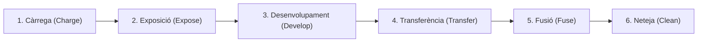

# 6.3 Tecnologies d'Impressió: Injecció de Tinta vs Impressió Làser

  

    Progression de la sessió: 6.3 Tecnologies d'Impressió
    0 / 75 pts
  

  

    

  

  

    1. Injecció de Tinta
    2. El Cicle Làser en 6 Fases
    3. Consumibles i Cost
  

Les impressores continuen sent perifèrics mecànics i electroquímics indispensables en oficines, centres educatius i llars. Comprendre el seu funcionament intern és essencial per al manteniment preventiu i la resolució d'incidències tècniques.

---

## 1. Impressores d'Injecció de Tinta (*Inkjet*)

Expulsen gotes microscòpiques de tinta líquida (de 1 a 5 picolitres) directament sobre el paper a través de centenars d'injectors microscòpics.

### Tecnologies d'Expulsió
1. **Tèrmica / Bubble Jet (Canon, HP):** Una resistència s'escalfa a més de $300^\circ\text{C}$ en microsegons, vaporitzant una bombolla de gas que empeny la gota cap enfora.
2. **Piezoelèctrica (Epson):** Un cristall de quars canvia físicament de forma en rebre un impuls elèctric, actuant com una bomba d'èmbol d'altíssima precisió. Permet utilitzar tintes basades en pigments sense degradar-les per calor.

---

## 2. El Cicle Electrofotogràfic Làser (Les 6 Fases Clau)

La impressió làser utilitza pols de tòner (resina plàstica termo-fusible amb pigments i òxids de ferro) i un cilindre fotoconductor d'alumini revestit de seleni o compostos orgànics (**tambor OPC**).

1. **Càrrega (*Charge*):** El corró de càrrega primària (PCR) aplica una càrrega electroestàtica negativa uniforme d'uns $-600\text{ V}$ sobre tota la superfície del tambor OPC en rotació.
2. **Exposició (*Expose*):** Un díode làser reflectit en un mirall poligonal giratori projecta el text sobre el tambor. Els punts il·luminats perden la seua càrrega negativa, creant una **imatge electroestàtica invisible (*latenta*)** a $-100\text{ V}$.
3. **Desenvolupament (*Develop*):** El corró magnètic atrau pols de tòner carregat negativament. El tòner és repel·lit per les zones de $-600\text{ V}$ i s'adhereix exclusivament a les zones exposades pel làser (atracció per menor potencial negatiu).
4. **Transferència (*Transfer*):** El paper passa entre el tambor i el corró de transferència, que té una forta càrrega positiva ($+600\text{ V}$ a $+1000\text{ V}$), arrancant el tòner del tambor i fixant-lo per electricitat estàtica sobre el paper.
5. **Fusió (*Fuse*):** El paper passa per la **unitat fusora**, composta per un corró calefactor a **$180^\circ\text{C} - 200^\circ\text{C}$** i un corró de goma de pressió. La resina plàstica es fon i queda incrustada permanentment entre les fibres del paper (per això els fulls surten calents).
6. **Neteja (*Clean*):** Una fulla de goma (*cleaning blade*) raspa el tòner residual que no s'ha transferit i el diposita en un recipient de residus, mentre un llum d'esborrat descarrega el tambor per al següent cicle.

---

## 3. Comparativa Operativa: Injecció vs Làser

| Criteri de Decisió | Injecció de Tinta (Cartutxos / Tancs) | Impressió Làser (Tòner) |
| :--- | :--- | :--- |
| **Cost per pàgina (CPP)** | Alt en cartutxos estàndard; molt baix en tancs de tinta continus (EcoTank). | **Molt baix i predictible en monocrom i grans volums**. |
| **Velocitat (PPM)** | De 8 a 15 pàgines per minut. | **Molt ràpida (de 30 a 60+ pàgines per minut)**. |
| **Comportament davant la inactivitat** | Els injectors **s'assequen i s'obstrueixen** si passa 1 mes sense imprimir. | **No s'asseca mai**: el tòner és pols seca i pot estar mesos sense ús. |
| **Resistència a l'aigua i llum** | La tinta líquida pot córrer-se si el full s'humiteja. | Resistent a l'aigua i dissolvents (resina plàstica fosa). |

---

## Reptes Interactius (Avalua els teus coneixements)

  
Repte 1: Identificació de Fases en el Cicle Làser

  
En quin component de la impressora làser es fon físicament la pols de tòner mitjançant una combinació d'alta pressió mecànica i una temperatura d'uns 200 °C per incrustar-la permanentment al paper?

  

    <label style="display:flex; align-items:center; gap:8px; cursor:pointer;"><input type="radio" name="mme_0603_q1" value="a"> El corró de recollida de paper (pick-up roller)</label>
    <label style="display:flex; align-items:center; gap:8px; cursor:pointer;"><input type="radio" name="mme_0603_q1" value="b"> La unitat fusora (fuser unit)</label>
    <label style="display:flex; align-items:center; gap:8px; cursor:pointer;"><input type="radio" name="mme_0603_q1" value="c"> El tambor fotoconductor OPC</label>
    <label style="display:flex; align-items:center; gap:8px; cursor:pointer;"><input type="radio" name="mme_0603_q1" value="d"> El mirall poligonal del làser</label>
  

  <button class="btn-check" data-correct="b" data-feedback="Correcte! El fusor escalfa el polímer plàstic del tòner fins al seu punt de fusió mentre un corró de silicona a pressió el premsa contra els porus del paper.">Comprova la resposta</button>
  

  
Repte 2: Elecció de Tecnologia per a Ús Esporàdic

  
Un usuari imprimeix exclusivament documents de text (factures i contractes) una vegada cada dos o tres mesos. Quina tecnologia d'impressió s'ha de recomanar per evitar el problema recurrent dels injectors ressecs?

  

    <label style="display:flex; align-items:center; gap:8px; cursor:pointer;"><input type="radio" name="mme_0603_q2" value="a"> Impressora d'injecció tèrmica barata de cartutxos tricolor.</label>
    <label style="display:flex; align-items:center; gap:8px; cursor:pointer;"><input type="radio" name="mme_0603_q2" value="b"> Impressora làser monocrom (utilitza pols seca de tòner que no conté líquids i no s'obstruirà mai per evaporació).</label>
    <label style="display:flex; align-items:center; gap:8px; cursor:pointer;"><input type="radio" name="mme_0603_q2" value="c"> Impressora d'agulles matricial.</label>
    <label style="display:flex; align-items:center; gap:8px; cursor:pointer;"><input type="radio" name="mme_0603_q2" value="d"> Plotter de tall industrial.</label>
  

  <button class="btn-check" data-correct="b" data-feedback="Molt bé! El gran inconvenient de la injecció de tinta és l'evaporació del solvent als injectors durant períodes d'inactivitat. El tòner làser roman inalterat durant anys.">Comprova la resposta</button>
  

  
Repte 3: Funcionament del Tambor Fotoconductor (OPC)

  
Quina és la propietat física essencial que fa possible el funcionament del tambor OPC d'una impressora làser?

  

    <label style="display:flex; align-items:center; gap:8px; cursor:pointer;"><input type="radio" name="mme_0603_q3" value="a"> És un material aïllant a la foscor que es torna conductor elèctric en rebre llum (fotoconductor), permetent que les zones il·luminades pel làser descarreguen la seua tensió electroestàtica.</label>
    <label style="display:flex; align-items:center; gap:8px; cursor:pointer;"><input type="radio" name="mme_0603_q3" value="b"> Absorbeix l'oxigen de l'aire per crear un buit.</label>
    <label style="display:flex; align-items:center; gap:8px; cursor:pointer;"><input type="radio" name="mme_0603_q3" value="c"> S'escalfa a 500 graus per cremar el paper.</label>
    <label style="display:flex; align-items:center; gap:8px; cursor:pointer;"><input type="radio" name="mme_0603_q3" value="d"> Genera tinta líquida mitjançant condensació ambiental.</label>
  

  <button class="btn-check" data-correct="a" data-feedback="Exacte! La fotoconductivitat permet que la llum del làser 'dibuixe' línies de baixa càrrega elèctrica que després atrauran magnèticament la pols de tòner en la fase de revelat.">Comprova la resposta</button>
  

---

  <h3 style="color: #1e40af; margin-top: 0;">Lliurament de l'Activitat a Aules</h3>
  

    Completa la tasca pràctica: <strong>Act03 - Càlcul de CPP (Cost per Pàgina) i Comparativa Funcional de Tecnologies d'Impressió</strong>. Genera el PDF oficial per a Aules.
  

  

    <input type="text" class="student-name-input" placeholder="El teu nom i cognoms..." style="padding: 8px 12px; border: 1px solid #94a3b8; border-radius: 6px; flex-grow: 1; min-width: 240px;">
    <button class="btn-generate-aules-pdf btn-aules-dl" data-module="MME" data-unit="UD06" data-activity="Act03" style="background: #2563eb; color: #fff; border: none; padding: 8px 16px; border-radius: 6px; cursor: pointer; font-weight: 600;">Generar PDF Aules</button>
  

