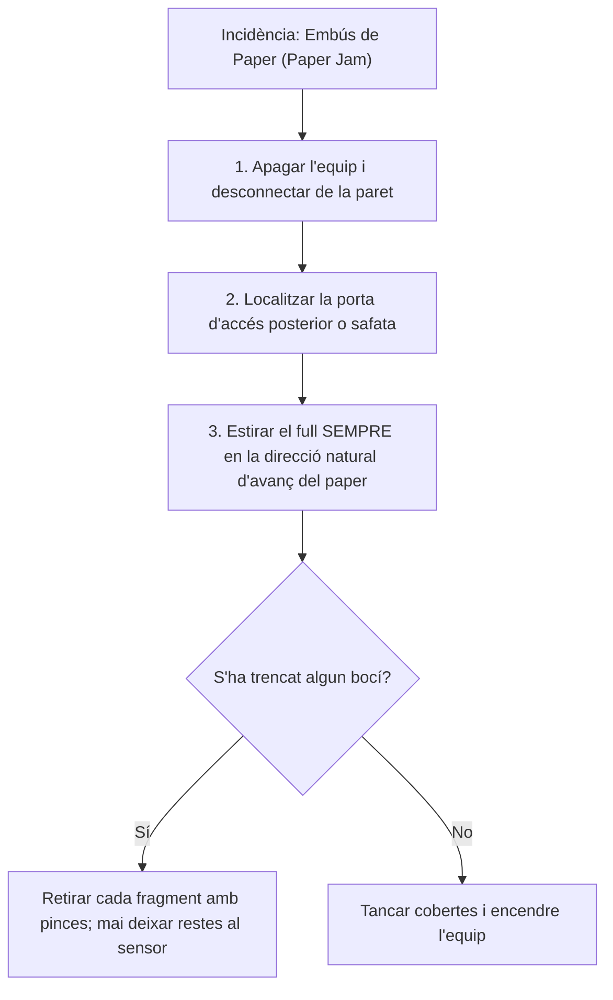

# 6.4 Manteniment Preventiu i Diagnosi d'Avaries en Impressores

  

    Progression de la sessió: 6.4 Diagnosi i Manteniment d'Impressores
    0 / 75 pts
  

  

    

  

  

    1. Avaries de Tòner i Fusor
    2. Resolució d'Injectors
    3. Alimentació de Paper
  

Les impressores combinen mecànica de precisió, motors pas a pas, corrons de goma, altes temperatures i elements químics líquids o en pols. Representen una de les fonts més habituals de tiquets d'incidències al departament de suport microinformàtic.

---

## 1. Taula de Diagnosi d'Avaries d'Imatge en Impressores Làser

| Defecte Observat a la Pàgina Impressa | Causa Física Fonamental | Protocol de Resolució Tècnica |
| :--- | :--- | :--- |
| **Ratlles o taques negres que es repeteixen de manera periòdica cada certs centímetres** | Dany físic, rascada o resta de tòner enganxat al **tambor OPC** o al corró de càrrega. | Mesurar la distància entre repeticions: $D = \pi \times d_{\text{tambor}}$. Si coincideix amb la circumferència del tambor, netejar o substituir el tambor. |
| **La tinta o el tòner es desprèn o s'esborra en passar el dit pel full** | **Fallada de la unitat fusora**: la làmpada calefactora no arriba a la temperatura de fusió ($180^\circ\text{C}$) o el corró de pressió està trencat. | Comprovar la continuïtat elèctrica de la resistència tèrmica del fusor o substituir el conjunt fusor (*fuser kit*). |
| **Fons completament gris fosc o pàgina totalment negra** | Pèrdua de càrrega d'alt voltatge al corró PCR o fallada de massa del tambor. | Comprovar els contactes metàl·lics de polarització del xassís amb el cartutx de tòner. |
| **Franges blanques verticals buides sense text** | El tòner s'està esgotant o el vidre del mirall làser està brut de pols. | Extraure el cartutx i agitar-lo suaument en sentit horitzontal per redistribuir la pols restant, i netejar el vidre òptic del díode làser. |

---

## 2. Diagnosi i Manteniment en Impressores d'Injecció de Tinta

### Patró de Comprovació d'Injectors (*Nozzle Check*)
Quan una impressió presenta ratlles horitzontals blanques o colors descolorits, s'ha d'imprimir la pàgina de diagnosi de test d'injectors des del programari de manteniment:
- Si falten segments al patró escalonat, hi ha injectors bloquejats per tinta seca.
- **Cicle de neteja automàtic:** La bomba de purga (*purge unit*) xucla tinta a través del capçal per dissoldre l'obstrucció cap a la unitat de recollida de residus (*waste ink pad*).

> [!CAUTION]
> **No abusar de neteges de capçal seguides:** Cada cicle consumeix entre un 5% i un 10% del volum total de tinta del cartutx i omple les esponges absorbents de residus. Si dues neteges consecutives no resolen el problema, cal aplicar un líquid netejador específic o alcohol isopropílic a la base del capçal amb tovallola de cel·lulosa.

---

## 3. Sistemes Mecànics d'Arrossegament i Embussos de Paper

Els components d'alimentació de paper que pateixen desgast mecànic són:
1. **Rodets de recollida (*Pick-up Rollers*):** Rodets de cautxú rugós que agafen el full superior de la safata. Amb el temps, la pols de paper (*paper dust*) poleix la goma fent-la lluent i relliscosa, provocant fallades de presa de full (*misfeed* o missatge de «safata buida» quan hi ha paper).
   - *Manteniment:* Neteja amb drap lleument humit amb aigua destil·lada o producte regenerador de cautxú (*rubber rejuvenator*). Mai utilitzar alcohol, ja que resseca i esququerda la goma.
2. **Pads de separació (*Separation Pads*):** Eviten que s'alimenten dos fulls simultàniament. Quan es desgasten, la impressora agafa paquets de múltiples pàgines alhora.

---

## Reptes Interactius (Avalua els teus coneixements)

  
Repte 1: Diagnosi de Tòner que s'Esborra amb el Dit

  
Un usuari es queixa que els documents impresos per la seua làser surten amb el text perfectament nítid, però si passes el dit o doblegues el full, la lletra s'escampa i es desprèn en forma de pols negra. Quin conjunt mecànic ha fallat?

  

    <label style="display:flex; align-items:center; gap:8px; cursor:pointer;"><input type="radio" name="mme_0604_q1" value="a"> La targeta de xarxa Wi-Fi de la impressora.</label>
    <label style="display:flex; align-items:center; gap:8px; cursor:pointer;"><input type="radio" name="mme_0604_q1" value="b"> La unitat fusora (fuser), que no està assolint la temperatura necessària per a fondre la resina plàstica del tòner al paper.</label>
    <label style="display:flex; align-items:center; gap:8px; cursor:pointer;"><input type="radio" name="mme_0604_q1" value="c"> La memòria RAM de la placa base del PC.</label>
    <label style="display:flex; align-items:center; gap:8px; cursor:pointer;"><input type="radio" name="mme_0604_q1" value="d"> El cartutx de tinta està caducat.</label>
  

  <button class="btn-check" data-correct="b" data-feedback="Correcte! El procés de fusió requereix calor i pressió. Si el fusor falla o té la resistència tallada, el tòner només està dipositat per electricitat estàtica i es desprèn fàcilment.">Comprova la resposta</button>
  

  
Repte 2: Resolució de Patrons Repetitius en Làser

  
En una impressora làser apareix una taca negra de mig centímetre que es repeteix exactament 4 vegades al llarg de cada full a una distància regular de 7.5 cm entre elles. Com esbrina el tècnic quina peça provoca la taca?

  

    <label style="display:flex; align-items:center; gap:8px; cursor:pointer;"><input type="radio" name="mme_0604_q2" value="a"> Mesurant el diàmetre dels corrons interns: dividint la distància de 7.5 cm entre el número pi (π ≈ 3.1416), obtenim el diàmetre exacte del corró afectat (d ≈ 2.38 cm, corresponent al tambor OPC).</label>
    <label style="display:flex; align-items:center; gap:8px; cursor:pointer;"><input type="radio" name="mme_0604_q2" value="b"> Canviant el cable USB del sistema.</label>
    <label style="display:flex; align-items:center; gap:8px; cursor:pointer;"><input type="radio" name="mme_0604_q2" value="c"> Reinstal·lant el controlador de Windows.</label>
    <label style="display:flex; align-items:center; gap:8px; cursor:pointer;"><input type="radio" name="mme_0604_q2" value="d"> Posant paper de 120 grams.</label>
  

  <button class="btn-check" data-correct="a" data-feedback="Molt bé! La repetició matemàtica periòdica d'un defecte en impressió làser correspon estrictament al perímetre de rotació (C = π * d) del corró que té el dany físic.">Comprova la resposta</button>
  

  
Repte 3: Protocol Segur per a Desembussar Paper

  
Com s'ha d'extreure un full de paper que ha quedat encallat a l'interior d'una impressora?

  

    <label style="display:flex; align-items:center; gap:8px; cursor:pointer;"><input type="radio" name="mme_0604_q3" value="a"> Estirar en sentit contrari a l'avanç amb un ganivet metàl·lic.</label>
    <label style="display:flex; align-items:center; gap:8px; cursor:pointer;"><input type="radio" name="mme_0604_q3" value="b"> Estirar suaument amb les dues mans en la direcció natural del recorregut del paper a través dels corrons per evitar danyar els engranatges i sensors òptics.</label>
    <label style="display:flex; align-items:center; gap:8px; cursor:pointer;"><input type="radio" name="mme_0604_q3" value="c"> Donar cops a la safata exterior.</label>
    <label style="display:flex; align-items:center; gap:8px; cursor:pointer;"><input type="radio" name="mme_0604_q3" value="d"> Polvoritzar oli lubricant 3-en-1 sobre el corró.</label>
  

  <button class="btn-check" data-correct="b" data-feedback="Exacte! Estirar en contra del sentit de gir força els engranatges i pot partir les palanquetes dels sensors de pas de paper. Mai s'han d'introduir objectes punxeguts de metall.">Comprova la resposta</button>
  

---

  <h3 style="color: #1e40af; margin-top: 0;">Lliurament de l'Activitat a Aules</h3>
  

    Completa la tasca pràctica: <strong>Act04 - Guia de Diagnosi d'Avaries d'Impressió i Manteniment Preventiu de Corrons</strong>. Genera el PDF oficial per a Aules.
  

  

    <input type="text" class="student-name-input" placeholder="El teu nom i cognoms..." style="padding: 8px 12px; border: 1px solid #94a3b8; border-radius: 6px; flex-grow: 1; min-width: 240px;">
    <button class="btn-generate-aules-pdf btn-aules-dl" data-module="MME" data-unit="UD06" data-activity="Act04" style="background: #2563eb; color: #fff; border: none; padding: 8px 16px; border-radius: 6px; cursor: pointer; font-weight: 600;">Generar PDF Aules</button>
  

