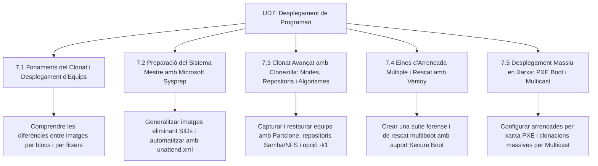

# UD7 Desplegament de Programari amb Imatges de Disc

Benvingut a la **Unitat Didàctica 7** del mòdul professional de **Muntatge i Manteniment d'Equips (MME)**. Aquesta unitat et capacita per a clonar, mantenir i desplegar parcs informàtics complets de forma automatitzada, utilitzant les eines més potents de la indústria: Sysprep, Clonezilla, Ventoy i servidors d'arrencada PXE amb transmissió massiva per Multicast.

---

## Mapa d'Aprenentatge de la Unitat

---

## Sessions d'Estudi i Activitats Pràctiques

1. [**7.1 Fonaments del Clonat i Desplegament d'Equips**](ut0701.html)
   - El cicle de vida del parc informàtic i la màquina mestra (*Golden Image*).
   - Imatges a nivell de bloc (*sector-by-sector*) vs nivell de fitxer (WIM/DISM).
   - El motor d'eficiència Partclone i els avantatges a les aules d'informàtica.

2. [**7.2 Preparació del Sistema Mestre amb Microsoft Sysprep**](ut0702.html)
   - El problema del SID duplicat en dominis Active Directory.
   - L'ordre de generalització: `sysprep.exe /generalize /oobe /shutdown`.
   - Automatització d'instal·lacions desateses amb fitxers `unattend.xml`.

3. [**7.3 Clonat Avançat amb Clonezilla: Modes, Repositoris i Algorismes**](ut0703.html)
   - Modes operatius: `device-image` (savedisk/restoredisk) vs `device-device`.
   - Connexió de repositoris remots a `/home/partimag` (Samba, NFS, USB).
   - Algorismes de compressió multinucli (*zstd*, *pigz*) i redimensionament proporcional (`-k1`).

4. [**7.4 Eines d'Arrencada Múltiple i Rescat amb Ventoy**](ut0704.html)
   - Arquitectura de particionat de Ventoy (partició de dades exFAT + partició VTOYEFI).
   - La suite de rescat indispensable: Clonezilla, Rescuezilla, Hiren's BootCD PE i MemTest86.
   - Gestió de claus de seguretat amb MokManager i compatibilitat Secure Boot.

5. [**7.5 Desplegament Massiu en Xarxa: PXE Boot i Multicast**](ut0705.html)
   - El protocol d'arrencada PXE mitjançant serveis DHCP i TFTP.
   - Comparativa de cabal: Unicast (col·lapse) vs Multicast (emissió única paral·lela).
   - Requisit de commutació IGMP Snooping i plataformes Clonezilla Server i FOG Project.

---

## Reptes Globals d'Avaluació de la Unitat (+100 pts)

  
Repte Global 1: Seqüència Integral de Desplegament

  
Quina és la seqüència cronològica correcta d'accions per a preparar i desplegar una imatge mestra de Windows en 25 ordinadors nous d'un institut?

  

    <label style="display:flex; align-items:center; gap:8px; cursor:pointer;"><input type="radio" name="mme_07_global_q1" value="a"> Clonar el disc directament, encendre els 25 equips i després executar Sysprep en cadascun.</label>
    <label style="display:flex; align-items:center; gap:8px; cursor:pointer;"><input type="radio" name="mme_07_global_q1" value="b"> Configurar l'equip mestre completament -> Executar `sysprep /generalize /oobe /shutdown` -> Arrancar immediatament des d'USB/PXE amb Clonezilla sense iniciar Windows -> Capturar la imatge al repositori -> Desplegar la imatge als 25 equips destinataris.</label>
    <label style="display:flex; align-items:center; gap:8px; cursor:pointer;"><input type="radio" name="mme_07_global_q1" value="c"> Formatar tots els equips amb Ventoy i instal·lar Windows un a un amb el DVD.</label>
    <label style="display:flex; align-items:center; gap:8px; cursor:pointer;"><input type="radio" name="mme_07_global_q1" value="d"> Executar MemTest86 als 25 equips simultàniament.</label>
  

  <button class="btn-check" data-correct="b" data-feedback="Correcte! Aquesta és la seqüència professional canònica: preparar el patró, generalitzar el SID, capturar el disc en fred i desplegar massivament.">Comprova la resposta</button>
  

  
Repte Global 2: Resolució de Col·lisions de SID

  
Dos ordinadors clonats sense Sysprep s'intenten unir a un domini corporatiu de Windows Server. Quina incidència es manifestarà a la xarxa?

  

    <label style="display:flex; align-items:center; gap:8px; cursor:pointer;"><input type="radio" name="mme_07_global_q2" value="a"> Es cremarà la targeta de xarxa dels equips.</label>
    <label style="display:flex; align-items:center; gap:8px; cursor:pointer;"><input type="radio" name="mme_07_global_q2" value="b"> En compartir el mateix identificador de seguretat (SID), el controlador de domini sobreescriurà el compte d'un equip sobre l'altre, provocant pèrdua de confiança de domini, errors d'inici de sessió i conflictes de polítiques GPO.</label>
    <label style="display:flex; align-items:center; gap:8px; cursor:pointer;"><input type="radio" name="mme_07_global_q2" value="c"> La velocitat de connexió caurà a 10 Mbps.</label>
    <label style="display:flex; align-items:center; gap:8px; cursor:pointer;"><input type="radio" name="mme_07_global_q2" value="d"> La resolució de pantalla canviarà automàticament a 800x600.</label>
  

  <button class="btn-check" data-correct="b" data-feedback="Molt bé! Active Directory utilitza el SID per identificar unívocament les màquines. Dos SIDs idèntics generen col·lisions que trenquen la relació de confiança amb el domini.">Comprova la resposta</button>
  

  
Repte Global 3: Disseny d'una Aula amb Desplegament Multicast

  
Com a administrador de l'institut, has de renovar 35 equips d'una aula d'informàtica cada trimestre. Quin equipament i configuració de xarxa garanteix el temps mínim de clonació sense alterar la feina dels altres departaments?

  

    <label style="display:flex; align-items:center; gap:8px; cursor:pointer;"><input type="radio" name="mme_07_global_q3" value="a"> Connectar els 35 equips per Wi-Fi 2.4 GHz i clonar amb un disc USB compartit.</label>
    <label style="display:flex; align-items:center; gap:8px; cursor:pointer;"><input type="radio" name="mme_07_global_q3" value="b"> Un servidor Clonezilla Server o FOG Project amb interfície Gigabit/10G, arrencada per xarxa PXE i switches gestionats amb suport i activació d'IGMP Snooping per enviar la imatge per Multicast.</label>
    <label style="display:flex; align-items:center; gap:8px; cursor:pointer;"><input type="radio" name="mme_07_global_q3" value="c"> Portar un llapis USB de màquina en màquina durant 3 dies.</label>
    <label style="display:flex; align-items:center; gap:8px; cursor:pointer;"><input type="radio" name="mme_07_global_q3" value="d"> Utilitzar discos òptics DVD-RW regravables.</label>
  

  <button class="btn-check" data-correct="b" data-feedback="Exacte! La combinació de PXE (sense necessitat de tocar físicament els equips), Multicast (un sol flux compartit) i IGMP Snooping (trànsit aïllat a l'aula) és la solució òptima d'enginyeria.">Comprova la resposta</button>
  

  
Repte Global 4: Recuperació davant d'Infecció Massiva

  
Un grup d'alumnes infecta accidentalment amb ransomware les màquines d'un laboratori. Quina és la resposta més ràpida i eficaç del tècnic de manteniment?

  

    <label style="display:flex; align-items:center; gap:8px; cursor:pointer;"><input type="radio" name="mme_07_global_q4" value="a"> Intentar desxifrar els fitxers un a un buscant claus per Internet.</label>
    <label style="display:flex; align-items:center; gap:8px; cursor:pointer;"><input type="radio" name="mme_07_global_q4" value="b"> Llançar una tasca de restauració d'imatge PXE per xarxa utilitzant la imatge mestre certificada, retornant tots els ordinadors al seu estat original net i funcional en menys de 10 minuts.</label>
    <label style="display:flex; align-items:center; gap:8px; cursor:pointer;"><input type="radio" name="mme_07_global_q4" value="c"> Canviar els discs SSD físics de tots els ordinadors.</label>
    <label style="display:flex; align-items:center; gap:8px; cursor:pointer;"><input type="radio" name="mme_07_global_q4" value="d"> Pagar el rescat exigit pel programari maliciós.</label>
  

  <button class="btn-check" data-correct="b" data-feedback="Molt bé! El desplegament automatitzat permet una recuperació davant de desastres instantània, tornant les màquines a un estat net i certificat en minuts.">Comprova la resposta</button>
  

---

  <h3 style="color: #1e40af; margin-top: 0;">Lliurament del Projecte Global de la Unitat a Aules</h3>
  

    Envia el dossier complet de la Unitat Didàctica 7: <strong>Dossier Tècnic de Desplegament de Programari amb Sysprep, Clonezilla, Ventoy i PXE Multicast</strong>. Genera el PDF oficial per a Aules.
  

  

    <input type="text" class="student-name-input" placeholder="El teu nom i cognoms..." style="padding: 8px 12px; border: 1px solid #94a3b8; border-radius: 6px; flex-grow: 1; min-width: 240px;">
    <button class="btn-generate-aules-pdf btn-aules-dl" data-module="MME" data-unit="UD07" data-activity="Global" style="background: #2563eb; color: #fff; border: none; padding: 8px 16px; border-radius: 6px; cursor: pointer; font-weight: 600;">Generar PDF Aules</button>
  

