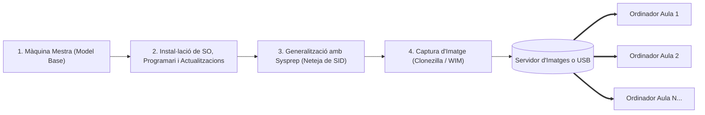

# 7.1 Fonaments del Clonat i Desplegament d'Equips

  

    Progression de la sessió: 7.1 Fonaments del Clonat
    0 / 75 pts
  

  

    

  

  

    1. Per què clonem?
    2. Bloc vs Fitxer
    3. La Màquina Mestra
  

En un entorn corporatiu o en un centre educatiu amb centenars d'ordinadors, instal·lar el sistema operatiu, les actualitzacions i el programari d'aplicació màquina per màquina de forma manual és inviable. El **clonat de sistemes** permet replicar una configuració exacta en qüestió de minuts.

---

## 1. El Cicle de Desplegament Informàtic

El procediment professional consta de tres grans etapes:
1. **Creació del Patró (*Gold Image* o Màquina Mestra):** Es munta un ordinador de referència, s'instal·la el sistema operatiu base (Windows o Linux), tots els controladors necessaris, els programes ofimàtics i acadèmics, i s'apliquen les polítiques de seguretat.
2. **Generalització del Sistema:** S'eliminen els identificadors de seguretat únics (SID) i informació específica de maquinari perquè la imatge puga funcionar en altres equips sense conflictes de xarxa.
3. **Captura i Desplegament:** Es captura el disc sencer en un fitxer d'imatge comprimit i es replica als equips destinataris mitjançant discs USB o a través de la xarxa local.

---

## 2. Tecnologies de Captura: Nivell de Bloc vs Nivell de Fitxer

| Característica | Imatge a **Nivell de Bloc** (*Sector-by-Sector*) | Imatge a **Nivell de Fitxer** (*File-Based*) |
| :--- | :--- | :--- |
| **Com funciona** | Copia els sectors físics del disc cru (Raw LBA), ignorant sovint l'estructura interna del sistema de fitxers. | Llegeix el sistema de fitxers i empaqueta els fitxers i carpetes individuals (com el format `.wim`). |
| **Eines líders** | **Clonezilla (Partclone)**, Rescuezilla, Norton Ghost clàssic, `dd`. | **Microsoft DISM / WIM**, ImageX, macrium reflect. |
| **Independència de maquinari** | Baixa: requereix que el disc de destí siga d'igual o major capacitat que l'espai utilitzat. | Alta: es pot desplegar sobre qualsevol mida de disc o format de partició. |
| **Velocitat de clonat** | **Extremadament ràpida** (copia seqüencial contínua a màxima velocitat del bus SATA/NVMe). | Més lenta (ha de recrear metadades, permisos NTFS i enllaços simbòlics). |
| **Suport de Sistemes** | Universal (Windows, Linux ext4/btrfs, macOS APFS, BSD). | Específica per al sistema operatiu suportat. |

> [!NOTE]
> **Partclone (el motor intel·ligent de Clonezilla):** A diferència de l'ordre antiga de Linux `dd` que copia tots els sectors buits del disc (ocupant per exemple 500 GB encara que només n'hi haja 20 GB de fitxers), **Partclone** identifica els blocs que realment contenen dades, clonant només els sectors ocupats i reduint el temps de còpia a pocs minuts.

---

## 3. Avantatges del Desplegament per Imatges a les Aules d'Informàtica

- **Restauració instantània davant d'infeccions:** Si un ordinador queda infectat per un virus o desconfigurat per un usuari, no es perd temps depurant: es restaura la imatge de fàbrica en 5 minuts.
- **Homogeneïtat total:** Tots els equips tenen exactament les mateixes rutes de fitxers, versions de compiladors i programari educatiu.
- **Auditoria de llicències senzilla:** La imatge conté exclusivament el programari autoritzat per la Conselleria o l'empresa.

---

## Reptes Interactius (Avalua els teus coneixements)

  
Repte 1: Concepte de Màquina Mestra

  
Quin és el rol tècnic de la 'Màquina Mestra' o 'Golden Image' en un procés de clonat informàtic?

  

    <label style="display:flex; align-items:center; gap:8px; cursor:pointer;"><input type="radio" name="mme_0701_q1" value="a"> És un equip que es manté sempre encès per donar accés a Internet.</label>
    <label style="display:flex; align-items:center; gap:8px; cursor:pointer;"><input type="radio" name="mme_0701_q1" value="b"> És l'ordinador de referència configurat de forma òptima amb tot el programari i paràmetres desitjats a partir del qual es capturarà la imatge per replicar-la als altres equips.</label>
    <label style="display:flex; align-items:center; gap:8px; cursor:pointer;"><input type="radio" name="mme_0701_q1" value="c"> És el servidor principal que gestiona les còpies de seguretat al núvol.</label>
    <label style="display:flex; align-items:center; gap:8px; cursor:pointer;"><input type="radio" name="mme_0701_q1" value="d"> És l'ordinador que té el processador més car del taller.</label>
  

  <button class="btn-check" data-correct="b" data-feedback="Correcte! La màquina mestra és el patró certificat que serveix de motlle idèntic per estalviar centenars d'hores de configuracions repetitives.">Comprova la resposta</button>
  

  
Repte 2: Avantatge de Partclone sobre dd Tradicional

  
Per quina raó tècnica eines com Clonezilla (mitjançant el motor Partclone) són molt més ràpides que l'ordre clàssica `dd` en clonar un disc de 1 TB que només té 30 GB de dades útils ocupades?

  

    <label style="display:flex; align-items:center; gap:8px; cursor:pointer;"><input type="radio" name="mme_0701_q2" value="a"> Perquè Partclone augmenta el voltatge del disc dur.</label>
    <label style="display:flex; align-items:center; gap:8px; cursor:pointer;"><input type="radio" name="mme_0701_q2" value="b"> Perquè Partclone entén l'estructura del sistema de fitxers i només copia i comprimeix els blocs que contenen dades reals, ignorant completament els sectors buits del disc.</label>
    <label style="display:flex; align-items:center; gap:8px; cursor:pointer;"><input type="radio" name="mme_0701_q2" value="c"> Perquè Partclone no necessita memòria RAM per funcionar.</label>
    <label style="display:flex; align-items:center; gap:8px; cursor:pointer;"><input type="radio" name="mme_0701_q2" value="d"> Perquè utilitza intel·ligència artificial per inventar-se els fitxers.</label>
  

  <button class="btn-check" data-correct="b" data-feedback="Molt bé! `dd` és cec a l'estructura lògica i copiaria inútilment 970 GB de zeros buits; Partclone només processa els 30 GB reals utilitzats.">Comprova la resposta</button>
  

  
Repte 3: Comparativa de Tecnologies de Desplegament

  
Quin és el principal inconvenient d'un clonat a nivell de bloc en comparació amb un format a nivell de fitxer com Windows WIM/DISM?

  

    <label style="display:flex; align-items:center; gap:8px; cursor:pointer;"><input type="radio" name="mme_0701_q3" value="a"> Que no es pot restaurar en un disc dur que tinga una capacitat física menor que l'espai de sectors ocupat per la partició original.</label>
    <label style="display:flex; align-items:center; gap:8px; cursor:pointer;"><input type="radio" name="mme_0701_q3" value="b"> Que només funciona en ordinadors portàtils.</label>
    <label style="display:flex; align-items:center; gap:8px; cursor:pointer;"><input type="radio" name="mme_0701_q3" value="c"> Que esborra la contrasenya del router de l'institut.</label>
    <label style="display:flex; align-items:center; gap:8px; cursor:pointer;"><input type="radio" name="mme_0701_q3" value="d"> Que no admet discs amb connexió SATA.</label>
  

  <button class="btn-check" data-correct="a" data-feedback="Exacte! En copiar estructures rígides de blocs LBA, restaurar sobre un suport físicament més reduït que la mida de la partició original requereix redimensionar prèviament la partició.">Comprova la resposta</button>
  

---

  <h3 style="color: #1e40af; margin-top: 0;">Lliurament de l'Activitat a Aules</h3>
  

    Completa la tasca pràctica: <strong>Act01 - Disseny del Pla de Desplegament Informàtic per a una Aula d'Institut</strong>. Genera el PDF oficial per a Aules.
  

  

    <input type="text" class="student-name-input" placeholder="El teu nom i cognoms..." style="padding: 8px 12px; border: 1px solid #94a3b8; border-radius: 6px; flex-grow: 1; min-width: 240px;">
    <button class="btn-generate-aules-pdf btn-aules-dl" data-module="MME" data-unit="UD07" data-activity="Act01" style="background: #2563eb; color: #fff; border: none; padding: 8px 16px; border-radius: 6px; cursor: pointer; font-weight: 600;">Generar PDF Aules</button>
  

