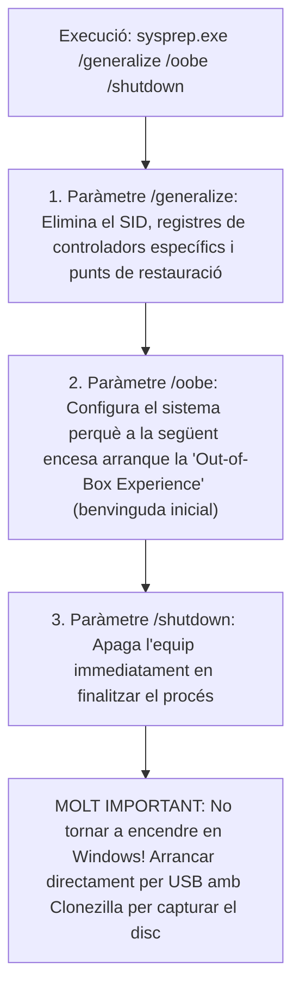

# 7.2 Preparació del Sistema Mestre amb Microsoft Sysprep

<div class="interactive-progress-tracker" style="background: #f8fafc; border: 1px solid #e2e8f0; border-radius: 8px; padding: 16px; margin-bottom: 24px;">
  <div style="display: flex; justify-content: space-between; align-items: center; margin-bottom: 8px;">
    <span style="font-weight: 600; color: #1e293b;">Progression de la sessió: 7.2 Generalització amb Sysprep</span>
    <span style="font-weight: 700; color: #2563eb;" id="tracker-score">0 / 75 pts</span>
  </div>
  <div style="width: 100%; background: #e2e8f0; height: 8px; border-radius: 4px; overflow: hidden;">
    <div id="tracker-bar" style="width: 0%; height: 100%; background: #2563eb; transition: width 0.3s ease;"></div>
  </div>
  <div style="display: flex; justify-content: space-between; font-size: 0.8rem; color: #64748b; margin-top: 6px;">
    <span>1. El Problema del SID</span>
    <span>2. Comandes de Sysprep</span>
    <span>3. Fitxers de Resposta</span>
  </div>
</div>

Si clones un sistema operatiu Windows directament d'una màquina a una altra sense preparar-lo prèviament, es produiran greus conflictes de seguretat i de xarxa en unir els equips a un domini corporatiu (*Active Directory*). L'eina oficial de Microsoft per a resoldre aquest problema és **Sysprep** (*System Preparation Tool*).

---

## 1. El Problema del SID Duplicat (*Security Identifier*)

Durant la instal·lació inicial de Windows, el sistema genera un **SID de màquina** únic, que és una cadena alfanumèrica criptogràfica (ex. `S-1-5-21-3623811015-3361044348-30300820-1013`).

Quan connectes dos ordinadors amb el mateix SID a un domini de xarxa:
- Els controladors de domini no poden distingir quin dels dos equips està realitzant una sol·licitud d'autenticació o accés a recursos compartits.
- Els servidors d'actualitzacions (WSUS) o antivirus gestionats centralitzadament sobreescriuen el registre d'una màquina sobre l'altra.
- Les llicències i certificats digitals locals entren en col·lisió.

---

## 2. Execució de Sysprep: L'Ordre de Generalització

L'executable de Sysprep es troba integrat de fàbrica a la ruta del sistema:
```
C:\Windows\System32\Sysprep\sysprep.exe
```

Per a preparar la màquina mestra per a la clonació, cal obrir una consola de comandes (*PowerShell* o *cmd*) com a **Administrador** i executar:

```powershell
# Execució de Sysprep en mode línia de comandes:
cd C:\Windows\System32\Sysprep
.\sysprep.exe /generalize /oobe /shutdown
```



> [!CAUTION]
> **No deixes que la màquina mestra torne a carregar Windows!**
> Si en acabar Sysprep encens la màquina i deixes que Windows arrenque des del disc dur, Windows regenerarà un nou SID local i finalitzarà la fase OOBE, havent de repetir tot el procés novament. Cal capturar la imatge arrancant directament des d'un medi extern (USB de Clonezilla).

---

## 3. Automatització amb Fitxers de Resposta (`unattend.xml`)

Per a evitar que cada ordinador clonat demane manualment a l'usuari la selecció d'idioma, distribució de teclat, acceptació de llicència (EULA), nom d'usuari i contrasenya, es pot passar un fitxer XML de resposta desatesa creat amb **Windows SIM** (*System Image Manager*):

```powershell
.\sysprep.exe /generalize /oobe /shutdown /unattend:C:\unattend.xml
```

Aquest fitxer injecta automàticament:
- Codi de llicència per volum (KMS / MAK).
- Creació d'usuaris locals amb contrasenya predeterminada.
- Unió automàtica al domini corporatiu de l'institut.

---

## Reptes Interactius (Avalua els teus coneixements)

<div class="interactive-challenge-card" data-points="25" style="border: 1px solid #cbd5e1; border-radius: 8px; padding: 18px; margin-bottom: 20px; background: #ffffff;">
  <div style="font-weight: 700; color: #1e293b; margin-bottom: 8px;">Repte 1: Finalitat del Paràmetre /generalize</div>
  <p style="color: #475569; font-size: 0.95rem;">Quina és la funció tècnica crítica del paràmetre `/generalize` en executar l'eina Sysprep abans de capturar una imatge de Windows?</p>
  <div style="display: flex; flex-direction: column; gap: 8px; margin: 12px 0;">
    <label style="display:flex; align-items:center; gap:8px; cursor:pointer;"><input type="radio" name="mme_0702_q1" value="a"> Esborrar tots els documents personals de l'escriptori.</label>
    <label style="display:flex; align-items:center; gap:8px; cursor:pointer;"><input type="radio" name="mme_0702_q1" value="b"> Eliminar el SID únic de la màquina i els controladors específics de maquinari per a permetre que la imatge puga desplegar-se en altres ordinadors amb maquinari diferent sense col·lisions d'identitat de seguretat.</label>
    <label style="display:flex; align-items:center; gap:8px; cursor:pointer;"><input type="radio" name="mme_0702_q1" value="c"> Desactivar el tallafocs de Windows de forma permanent.</label>
    <label style="display:flex; align-items:center; gap:8px; cursor:pointer;"><input type="radio" name="mme_0702_q1" value="d"> Convertir el disc dur a format FAT32.</label>
  </div>
  <button class="btn-check" data-correct="b" data-feedback="Correcte! `/generalize` desvincula el sistema del maquinari concret i elimina el SID, garantint que cada equip clonat genere un nou identificador únic en iniciar-se.">Comprova la resposta</button>
  <div class="feedback-msg" style="display:none; margin-top: 10px; font-weight: 600;"></div>
</div>

<div class="interactive-challenge-card" data-points="25" style="border: 1px solid #cbd5e1; border-radius: 8px; padding: 18px; margin-bottom: 20px; background: #ffffff;">
  <div style="font-weight: 700; color: #1e293b; margin-bottom: 8px;">Repte 2: Error Crític Post-Sysprep</div>
  <p style="color: #475569; font-size: 0.95rem;">Després d'executar amb èxit l'ordre `sysprep.exe /generalize /oobe /shutdown`, l'equip s'apaga correctament. Quina acció s'ha d'evitar terminantment a continuació?</p>
  <div style="display: flex; flex-direction: column; gap: 8px; margin: 12px 0;">
    <label style="display:flex; align-items:center; gap:8px; cursor:pointer;"><input type="radio" name="mme_0702_q2" value="a"> Encendre l'ordinador i permetre que Windows torne a arrencar des del disc dur abans de capturar la imatge amb un USB live.</label>
    <label style="display:flex; align-items:center; gap:8px; cursor:pointer;"><input type="radio" name="mme_0702_q2" value="b"> Connectar el llapis USB de Clonezilla.</label>
    <label style="display:flex; align-items:center; gap:8px; cursor:pointer;"><input type="radio" name="mme_0702_q2" value="c"> Desendollar el cable de corrent per seguretat.</label>
    <label style="display:flex; align-items:center; gap:8px; cursor:pointer;"><input type="radio" name="mme_0702_q2" value="d"> Seleccionar el menú de boot amb F11/F12.</label>
  </div>
  <button class="btn-check" data-correct="a" data-feedback="Molt bé! Si Windows torna a arrencar des del disc, s'executa l'assistent OOBE i es regenera el SID, arruïnant el procés de generalització que acabaves de fer.">Comprova la resposta</button>
  <div class="feedback-msg" style="display:none; margin-top: 10px; font-weight: 600;"></div>
</div>

<div class="interactive-challenge-card" data-points="25" style="border: 1px solid #cbd5e1; border-radius: 8px; padding: 18px; margin-bottom: 20px; background: #ffffff;">
  <div style="font-weight: 700; color: #1e293b; margin-bottom: 8px;">Repte 3: Finalitat de la Fase OOBE</div>
  <p style="color: #475569; font-size: 0.95rem;">Què significa l'acrònim OOBE i què fa el paràmetre `/oobe` a Sysprep?</p>
  <div style="display: flex; flex-direction: column; gap: 8px; margin: 12px 0;">
    <label style="display:flex; align-items:center; gap:8px; cursor:pointer;"><input type="radio" name="mme_0702_q3" value="a"> Out-of-Box Experience: configura el sistema perquè quan l'usuari final encenga la màquina aparega l'assistent de configuració inicial (idioma, xarxa i creació de compte).</label>
    <label style="display:flex; align-items:center; gap:8px; cursor:pointer;"><input type="radio" name="mme_0702_q3" value="b"> Only Office Basic Edition: instal·la la suite ofimàtica per defecte.</label>
    <label style="display:flex; align-items:center; gap:8px; cursor:pointer;"><input type="radio" name="mme_0702_q3" value="c"> Open Optical Binary Encoding: xifra el disc dur.</label>
    <label style="display:flex; align-items:center; gap:8px; cursor:pointer;"><input type="radio" name="mme_0702_q3" value="d"> Overclock Operation Base Engine: augmenta la freqüència de la CPU.</label>
  </div>
  <button class="btn-check" data-correct="a" data-feedback="Exacte! L'experiència fora de la caixa (OOBE) és la pantalla inicial de benvinguda que prepara el sistema com si acabara d'eixir nou de la botiga.">Comprova la resposta</button>
  <div class="feedback-msg" style="display:none; margin-top: 10px; font-weight: 600;"></div>
</div>

---

<div class="aules-delivery-card" style="background: #eff6ff; border: 1px solid #bfdbfe; border-radius: 8px; padding: 20px; margin-top: 28px;">
  <h3 style="color: #1e40af; margin-top: 0;">Lliurament de l'Activitat a Aules</h3>
  <p style="color: #1e3a8a; font-size: 0.95rem;">
    Completa la tasca pràctica: <strong>Act02 - Generalització d'una Imatge Mestra amb Sysprep i Auditoria de SID</strong>. Genera el PDF oficial per a Aules.
  </p>
  <div style="display: flex; gap: 12px; margin-top: 12px; flex-wrap: wrap;">
    <input type="text" class="student-name-input" placeholder="El teu nom i cognoms..." style="padding: 8px 12px; border: 1px solid #94a3b8; border-radius: 6px; flex-grow: 1; min-width: 240px;">
    <button class="btn-generate-aules-pdf btn-aules-dl" data-module="MME" data-unit="UD07" data-activity="Act02" style="background: #2563eb; color: #fff; border: none; padding: 8px 16px; border-radius: 6px; cursor: pointer; font-weight: 600;">Generar PDF Aules</button>
  </div>
</div>
