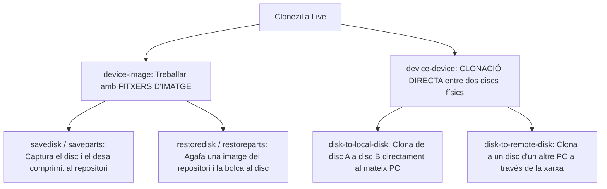

# 7.3 Clonat Avançat amb Clonezilla: Modes, Repositoris i Algorismes

  

    Progression de la sessió: 7.3 Clonat amb Clonezilla
    0 / 75 pts
  

  

    

  

  

    1. Modes de Clonat
    2. Repositoris Remots
    3. Paràmetres Experts
  

**Clonezilla** és la distribució lliure de codi obert per excel·lència per a la clonació i restauració de discs i particions en tallers de manteniment informàtic.

---

## 1. Els Dos Grans Modes d'Operació

Quan Clonezilla arrenca en memòria RAM, presenta dues opcions bàsiques:

- **`device-image` (Mode Imatge):** Guarda un disc o particions individuals com un conjunt de fitxers dividits i comprimits dins d'una carpeta (*repositori*). És el mètode habitual per crear còpies de seguretat o imatges mestres per a desplegar a múltiples màquines.
- **`device-device` (Mode Disc a Disc):** Clona directament el contingut d'un disc font a un disc destinatari connectat a la mateixa màquina (ideal per substituir un disc mecànic HDD lent per un SSD nou).

---

## 2. Tipus de Repositoris d'Imatges (`/home/partimag`)

Clonezilla necessita muntar un espai d'emmagatzematge on guardar o descarregar les imatges. Aquest directori virtual s'anomena `/home/partimag` i pot ser:
1. **Local dev:** Una partició d'un disc dur extern USB o segon disc intern formatat en NTFS, exFAT o ext4.
2. **Samba Server (SMB):** Carpeta compartida d'un servidor Windows o NAS mitjançant usuari i contrasenya.
3. **NFS Server:** Carpeta de xarxa d'un servidor Linux (molt més ràpid que Samba per al trànsit massiu de xarxa).
4. **SSH Server:** Servidor remot utilitzant el protocol SFTP xifrat.

---

## 3. Algorismes de Compressió i Paràmetres Avançats

- **Algorismes de Compressió:**
  - `-z1p` (*pigz*): Gzip paral·lelitzat que aprofita tots els nuclis de la CPU. Molt ràpid i compatible.
  - `-z9p` (*zstd*): Algorisme d'última generació (Zstandard de Facebook). Ofereix un equilibri imbatible entre màxima velocitat de descompressió (fins a $1.5\text{ GB/s}$) i alta taxa de compressió.
- **Opcions d'experts clau en restauració:**
  - `-k1`: Crea la taula de particions proporcionalment a la mida del disc de destí (molt útil si restaures una imatge feta en un disc de 250 GB sobre un SSD nou d'1 TB perquè la partició s'expandisca automàticament ocupant tot l'espai).
  - `-r`: Redimensiona el sistema de fitxers automàticament en finalitzar.

---

## Reptes Interactius (Avalua els teus coneixements)

  
Repte 1: Elecció de Mode a Clonezilla

  
Un client arriba al taller amb un portàtil que té un disc dur HDD lent de 500 GB i vol substituir-lo per un SSD de 500 GB. Connectes el nou SSD mitjançant un adaptador SATA a USB al portàtil. Quin mode de Clonezilla és el més directe sense necessitat de guardar fitxers intermedis?

  

    <label style="display:flex; align-items:center; gap:8px; cursor:pointer;"><input type="radio" name="mme_0703_q1" value="a"> device-image (savedisk)</label>
    <label style="display:flex; align-items:center; gap:8px; cursor:pointer;"><input type="radio" name="mme_0703_q1" value="b"> device-device (disk-to-local-disk)</label>
    <label style="display:flex; align-items:center; gap:8px; cursor:pointer;"><input type="radio" name="mme_0703_q1" value="c"> restoredisk</label>
    <label style="display:flex; align-items:center; gap:8px; cursor:pointer;"><input type="radio" name="mme_0703_q1" value="d"> MemTest86</label>
  

  <button class="btn-check" data-correct="b" data-feedback="Correcte! El mode device-device (clonació directa disc a disc) bolca els sectors directament del disc d'origen al de destí en un sol pas ràpid.">Comprova la resposta</button>
  

  
Repte 2: El Repositori d'Imatges /home/partimag

  
A Clonezilla, quin és el propòsit del directori de muntatge anomenat `/home/partimag`?

  

    <label style="display:flex; align-items:center; gap:8px; cursor:pointer;"><input type="radio" name="mme_0703_q2" value="a"> És la carpeta on s'instal·len els jocs de Linux.</label>
    <label style="display:flex; align-items:center; gap:8px; cursor:pointer;"><input type="radio" name="mme_0703_q2" value="b"> És el punt de muntatge del repositori (unitat USB o recurs compartit per xarxa Samba/NFS) on Clonezilla llegirà o escriurà els fitxers d'imatge comprimits.</label>
    <label style="display:flex; align-items:center; gap:8px; cursor:pointer;"><input type="radio" name="mme_0703_q2" value="c"> És la memòria cau de la targeta de so.</label>
    <label style="display:flex; align-items:center; gap:8px; cursor:pointer;"><input type="radio" name="mme_0703_q2" value="d"> És una partició protegida que no es pot esborrar mai.</label>
  

  <button class="btn-check" data-correct="b" data-feedback="Molt bé! `/home/partimag` és el magatzem d'imatges. Qualsevol recurs (USB extern, NAS, NFS o disc local) s'ha de muntar obligatòriament en aquesta ruta.">Comprova la resposta</button>
  

  
Repte 3: Paràmetre d'Ajust Proporcional -k1

  
Si captures una imatge d'un SSD de 250 GB i la restaures en un equip que té un SSD nou d'1 TB sense activar cap opció avançada, el disc restaurat només mostrarà 250 GB i 750 GB quedaran com a 'espai no assignat'. Quin paràmetre de Clonezilla evita això creant la taula de particions de forma proporcional a la nova capacitat?

  

    <label style="display:flex; align-items:center; gap:8px; cursor:pointer;"><input type="radio" name="mme_0703_q3" value="a"> L'opció d'experts -k1 (crear taula de particions proporcionalment).</label>
    <label style="display:flex; align-items:center; gap:8px; cursor:pointer;"><input type="radio" name="mme_0703_q3" value="b"> L'opció -q (apagada ràpida).</label>
    <label style="display:flex; align-items:center; gap:8px; cursor:pointer;"><input type="radio" name="mme_0703_q3" value="c"> L'opció -f (forçar formatat en FAT16).</label>
    <label style="display:flex; align-items:center; gap:8px; cursor:pointer;"><input type="radio" name="mme_0703_q3" value="d"> No és possible, cal comprar un altre disc de 250 GB.</label>
  

  <button class="btn-check" data-correct="a" data-feedback="Exacte! El paràmetre `-k1` recalcula la geometria i expandeix la partició principal proporcionalment a l'espai total del disc destinatari, estalviant passos manuals posteriors.">Comprova la resposta</button>
  

---

  <h3 style="color: #1e40af; margin-top: 0;">Lliurament de l'Activitat a Aules</h3>
  

    Completa la tasca pràctica: <strong>Act03 - Captura i Restauració d'Imatges de Disc amb Clonezilla</strong>. Genera el PDF oficial per a Aules.
  

  

    <input type="text" class="student-name-input" placeholder="El teu nom i cognoms..." style="padding: 8px 12px; border: 1px solid #94a3b8; border-radius: 6px; flex-grow: 1; min-width: 240px;">
    <button class="btn-generate-aules-pdf btn-aules-dl" data-module="MME" data-unit="UD07" data-activity="Act03" style="background: #2563eb; color: #fff; border: none; padding: 8px 16px; border-radius: 6px; cursor: pointer; font-weight: 600;">Generar PDF Aules</button>
  

