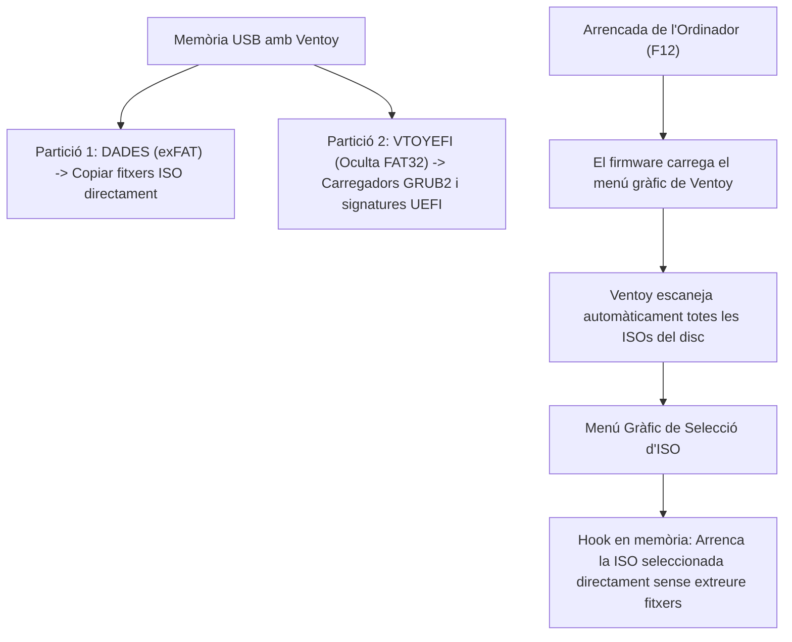

# 7.4 Eines d'Arrencada Múltiple i Rescat amb Ventoy

  

    Progression de la sessió: 7.4 Multi-Boot amb Ventoy
    0 / 75 pts
  

  

    

  

  

    1. El problema de Rufus
    2. Com funciona Ventoy
    3. La Caixa Suïssa de Rescat
  

Històricament, per a provar o instal·lar diferents sistemes operatius calia formatar una memòria USB cada vegada amb programes com Rufus o BalenaEtcher. **Ventoy** ha revolucionat el manteniment microinformàtic en permetre crear unitats **USB Multiboot** on només cal arrossegar els fitxers `.iso` com si fóra un llapis de dades normal.

---

## 1. Funcionament Intern de Ventoy

Quan instal·les Ventoy en un llapis USB (de 32 GB, 64 GB o 128 GB), el programa particiona la unitat en dues particions:
1. **Partició 1 (Dades / exFAT o NTFS):** Ocupa pràcticament tot el volum. És visible a Windows/Linux com un disc extraïble normal on pots copiar fitxers `.iso`, `.img`, `.vhd` o documents personals.
2. **Partició 2 (VTOYEFI / FAT):** Petita partició oculta d'uns 32 MB que conté els carregadors d'arrencada UEFI x64, UEFI ARM64 i BIOS Legacy (GRUB2 modificat per l'autor de Ventoy).

---

## 2. El Kit Suís Definitiu del Tècnic Informàtic

Un tècnic professional ha de portar sempre a la butxaca un USB amb Ventoy carregat amb aquesta suite d'utilitats indispensables:

| Imatge ISO Inclosa | Finalitat Professional al Taller |
| :--- | :--- |
| **Windows 11 x64 Oficial** | Instal·lació neta del sistema operatiu més recent. |
| **Ubuntu Desktop LTS / Debian** | Sistema alternatiu per recuperar dades quan Windows no arrenca. |
| **Clonezilla Live** | Captura i clonat ràpid de particions i discs complets. |
| **Rescuezilla** | Alternativa amb interfície gràfica intuïtiva i navegador web integrat compatible amb imatges de Clonezilla. |
| **Hiren's BootCD PE x64** | Entorn Windows 10/11 PE amb centenars d'utilitats de diagnosi (reseteig de contrasenyes oblidades, CrystalDiskInfo, recerca de virus). |
| **MemTest86 / MemTest86+** | Comprovació d'integritat de cel·les de memòria RAM. |

> [!TIP]
> **Ventoy i Secure Boot:** Ventoy és totalment compatible amb **Secure Boot**. La primera vegada que arrenques en un equip amb Secure Boot habilitat, apareixerà una pantalla blava de *MokManager*. Només cal seleccionar l'opció `Enroll Key from disk`, triar la clau pública de Ventoy (`ENROLL_THIS_KEY_IN_MOKMANAGER.cer`) i reiniciar. A partir d'eixe moment arrencarà de forma transparent.

---

## Reptes Interactius (Avalua els teus coneixements)

  
Repte 1: Avantatge Radical de Ventoy

  
Quina és la millora funcional decisiva que ofereix Ventoy davant d'eines clàssiques com Rufus?

  

    <label style="display:flex; align-items:center; gap:8px; cursor:pointer;"><input type="radio" name="mme_0704_q1" value="a"> Que no requereix formatar ni cremar la memòria USB cada vegada que vols afegir una imatge nova: s'instal·la una sola vegada i permet arrossegar desenes de fitxers .iso diferents a la partició de dades.</label>
    <label style="display:flex; align-items:center; gap:8px; cursor:pointer;"><input type="radio" name="mme_0704_q1" value="b"> Que augmenta la mida del llapis USB de 16 GB a 1 TB mitjançant núvol.</label>
    <label style="display:flex; align-items:center; gap:8px; cursor:pointer;"><input type="radio" name="mme_0704_q1" value="c"> Que només funciona en equips sense memòria RAM.</label>
    <label style="display:flex; align-items:center; gap:8px; cursor:pointer;"><input type="radio" name="mme_0704_q1" value="d"> Que substitueix la targeta gràfica per programari.</label>
  

  <button class="btn-check" data-correct="a" data-feedback="Correcte! Amb Ventoy només copies els fitxers .iso com qualsevol fitxer normal; en arrencar l'equip, el seu menú detecta automàticament totes les imatges disponibles.">Comprova la resposta</button>
  

  
Repte 2: Utilitat de Hiren's BootCD PE

  
Un client ha oblidat la contrasenya del seu compte d'administrador local de Windows i necessita recuperar urgentment documents personals del seu perfil. Quina eina de rescat inclosa habitualment al llapis de Ventoy permet restablir contrasenyes locals de Windows?

  

    <label style="display:flex; align-items:center; gap:8px; cursor:pointer;"><input type="radio" name="mme_0704_q2" value="a"> FurMark</label>
    <label style="display:flex; align-items:center; gap:8px; cursor:pointer;"><input type="radio" name="mme_0704_q2" value="b"> Hiren's BootCD PE (mitjançant utilitats com Lazesoft Password Recovery o NT Password Edit)</label>
    <label style="display:flex; align-items:center; gap:8px; cursor:pointer;"><input type="radio" name="mme_0704_q2" value="c"> Cinebench R23</label>
    <label style="display:flex; align-items:center; gap:8px; cursor:pointer;"><input type="radio" name="mme_0704_q2" value="d"> 3DMark</label>
  

  <button class="btn-check" data-correct="b" data-feedback="Molt bé! Hiren's BootCD PE arrenca un entorn autònom Windows en memòria RAM amb eines específiques per desbloquejar o buidar les contrasenyes de l'arxiu SAM de Windows.">Comprova la resposta</button>
  

  
Repte 3: Compatibilitat amb Secure Boot

  
Com aconsegueix Ventoy arrencar imatges ISO en equips moderns que tenen el mecanisme Secure Boot obligatòriament activat a la UEFI?

  

    <label style="display:flex; align-items:center; gap:8px; cursor:pointer;"><input type="radio" name="mme_0704_q3" value="a"> Mitjançant la utilitat MokManager, que permet registrar la clau criptogràfica pública del certificat de Ventoy a la base de dades MOK de la UEFI de la placa.</label>
    <label style="display:flex; align-items:center; gap:8px; cursor:pointer;"><input type="radio" name="mme_0704_q3" value="b"> Enganyant la placa base canviant l'adreça MAC.</label>
    <label style="display:flex; align-items:center; gap:8px; cursor:pointer;"><input type="radio" name="mme_0704_q3" value="c"> Obligant a desconnectar la targeta gràfica.</label>
    <label style="display:flex; align-items:center; gap:8px; cursor:pointer;"><input type="radio" name="mme_0704_q3" value="d"> Ventoy no és compatible amb Secure Boot.</label>
  

  <button class="btn-check" data-correct="a" data-feedback="Exacte! El gestor MOK (Machine Owner Key) permet que el propietari de l'equip valide el certificat oficial de Ventoy una sola vegada, permetent arrencar qualsevol ISO de forma segura.">Comprova la resposta</button>
  

---

  <h3 style="color: #1e40af; margin-top: 0;">Lliurament de l'Activitat a Aules</h3>
  

    Completa la tasca pràctica: <strong>Act04 - Creació i Prova d'un Dispositiu USB Multi-Boot amb Ventoy i Eines Forenses</strong>. Genera el PDF oficial per a Aules.
  

  

    <input type="text" class="student-name-input" placeholder="El teu nom i cognoms..." style="padding: 8px 12px; border: 1px solid #94a3b8; border-radius: 6px; flex-grow: 1; min-width: 240px;">
    <button class="btn-generate-aules-pdf btn-aules-dl" data-module="MME" data-unit="UD07" data-activity="Act04" style="background: #2563eb; color: #fff; border: none; padding: 8px 16px; border-radius: 6px; cursor: pointer; font-weight: 600;">Generar PDF Aules</button>
  

