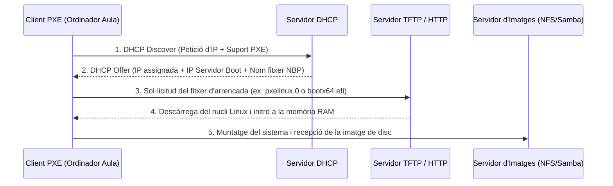
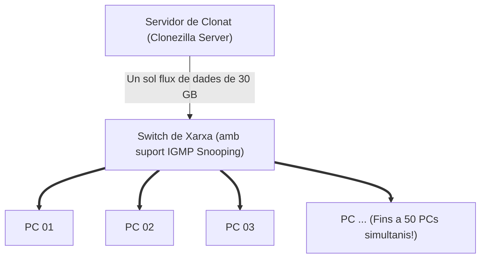

# 7.5 Desplegament Massiu en Xarxa: PXE Boot i Multicast

  

    Progression de la sessió: 7.5 Desplegament Massiu PXE
    0 / 75 pts
  

  

    

  

  

    1. Arrencada PXE
    2. Unicast vs Multicast
    3. Servidors de Clonat
  

Quan cal desplegar una imatge en una aula amb 30 o 40 ordinadors, connectar un llapis USB màquina per màquina requereix massa temps. La solució corporativa estàndard és l'**arrencada per xarxa PXE** i la transmissió simultània per **Multicast**.

---

## 1. Com Funciona l'Arrencada per Xarxa PXE?

**PXE** (*Preboot eXecution Environment*) és un estàndard integrat a la ROM de les targetes de xarxa (NIC) i la UEFI que permet a un equip encendre's i descarregar el seu sistema operatiu directament des d'un servidor a través del cable Ethernet.

---

## 2. La Màgia del Multicast contra l'Embut d'Unicast

Imagina una aula amb 30 ordinadors connectats a un switch Gigabit ($1\text{ Gbps} = 125\text{ MB/s}$) i una imatge de disc de $30\text{ GB}$.

### Escenari A: Transmissió Unicast (Tradicional)
El servidor ha d'enviar la imatge 30 vegades de manera individual:
$$\text{Dades totals a transmetre} = 30\text{ ordinadors} \times 30\text{ GB} = 900\text{ GB}$$
L'ample de banda del servidor es divideix entre els 30 equips ($\frac{125\text{ MB/s}}{30} \approx 4\text{ MB/s}$ per màquina). El procés trigarà **més de 2 hores**.

### Escenari B: Transmissió Multicast (Clonezilla Server / FOG Project)
El servidor emet un **únic flux de paquets de dades a una adreça IP de grup Multicast** (ex. `239.255.1.1`). El switch de xarxa replica els paquets a tots els ports connectats:
$$\text{Dades totals a transmetre pel servidor} = \text{Exactament } 30\text{ GB (una sola emissió!)}$$
Tots els 30 ordinadors reben el flux simultàniament a velocitat de xarxa completa ($\approx 100\text{ MB/s}$). Tota l'aula queda clonada en **només 5 a 8 minuts**.

> [!WARNING]
> **Requisit de xarxa: IGMP Snooping:** Per a desplegar per Multicast sense saturar la xarxa del centre, el switch gestionat ha de tenir activada la funció **IGMP Snooping**. Si el switch no suporta IGMP, transformarà el trànsit Multicast en Broadcast inundant tots els ports i bloquejant la xarxa de tot l'institut durant la clonació.

---

## 3. Servidors de Desplegament Lliures: Clonezilla Server i FOG Project

- **Clonezilla Server Edition (DRBL - Diskless Remote Boot in Linux):** Solució lleugera que converteix qualsevol màquina Linux en un servidor de desplegament PXE massiu en pocs minuts.
- **FOG Project:** Plataforma web completa de gestió de parcs informàtics. Permet programar clonacions des del navegador, despertar equips automàticament mitjançant **Wake-on-LAN (WoL)** durant la nit, canviar el nom de màquina i unir els equips a l'Active Directory de forma 100% desatesa.

---

## Reptes Interactius (Avalua els teus coneixements)

  
Repte 1: Avantatge Clau de la Transmissió Multicast

  
Per què la tecnologia Multicast és la millor solució per a clonar simultàniament 30 ordinadors d'una aula informàtica connectats a una mateixa xarxa local?

  

    <label style="display:flex; align-items:center; gap:8px; cursor:pointer;"><input type="radio" name="mme_0705_q1" value="a"> Perquè envia la imatge mitjançant ones de ràdio FM.</label>
    <label style="display:flex; align-items:center; gap:8px; cursor:pointer;"><input type="radio" name="mme_0705_q1" value="b"> Perquè el servidor emet un únic flux continu de dades que el switch replica simultàniament a tots els equips del grup, estalviant ample de banda i clonant totes les màquines en el mateix temps que costaria clonar-ne una de sola.</label>
    <label style="display:flex; align-items:center; gap:8px; cursor:pointer;"><input type="radio" name="mme_0705_q1" value="c"> Perquè no necessita que els ordinadors tinguen targeta de xarxa.</label>
    <label style="display:flex; align-items:center; gap:8px; cursor:pointer;"><input type="radio" name="mme_0705_q1" value="d"> Perquè esborra els virus de la memòria cau.</label>
  

  <button class="btn-check" data-correct="b" data-feedback="Correcte! A diferència d'Unicast on el servidor ha d'enviar 30 còpies independents saturant la xarxa, Multicast emet una sola còpia en paral·lel per a tots.">Comprova la resposta</button>
  

  
Repte 2: Protocols Implicats en PXE Boot

  
Quins dos serveis de xarxa són imprescindibles per a permetre que un client PXE obtinga una adreça de xarxa i descarregue el seu fitxer inicial d'arrencada (*Network Bootstrap Program*)?

  

    <label style="display:flex; align-items:center; gap:8px; cursor:pointer;"><input type="radio" name="mme_0705_q2" value="a"> Servidor DHCP (per a assignar IP i opcions 66/67) i servidor TFTP/HTTP (per a descarregar el carregador d'arrencada).</label>
    <label style="display:flex; align-items:center; gap:8px; cursor:pointer;"><input type="radio" name="mme_0705_q2" value="b"> Servidor SMTP i servidor POP3 de correu electrònic.</label>
    <label style="display:flex; align-items:center; gap:8px; cursor:pointer;"><input type="radio" name="mme_0705_q2" value="c"> Bluetooth i NFC.</label>
    <label style="display:flex; align-items:center; gap:8px; cursor:pointer;"><input type="radio" name="mme_0705_q2" value="d"> Protocol Telnet exclusivament.</label>
  

  <button class="btn-check" data-correct="a" data-feedback="Molt bé! El servidor DHCP facilita la configuració IP i indica l'adreça del servidor TFTP (Next Server) i el nom del fitxer binari d'arrencada PXE.">Comprova la resposta</button>
  

  
Repte 3: Rol del Protocol IGMP Snooping

  
Què ocorre en una xarxa local durant un desplegament per Multicast si els switches de la instal·lació NO tenen habilitada la característica IGMP Snooping?

  

    <label style="display:flex; align-items:center; gap:8px; cursor:pointer;"><input type="radio" name="mme_0705_q3" value="a"> Els ordinadors es reinicien automàticament.</label>
    <label style="display:flex; align-items:center; gap:8px; cursor:pointer;"><input type="radio" name="mme_0705_q3" value="b"> El switch tracta el trànsit multicast com a broadcast, inundant absolutament tots els ports de la xarxa i col·lapsant la connectivitat de tot l'edifici.</label>
    <label style="display:flex; align-items:center; gap:8px; cursor:pointer;"><input type="radio" name="mme_0705_q3" value="c"> La imatge s'esborra del servidor.</label>
    <label style="display:flex; align-items:center; gap:8px; cursor:pointer;"><input type="radio" name="mme_0705_q3" value="d"> S'activa el ventilador de la font d'alimentació a màxima potència.</label>
  

  <button class="btn-check" data-correct="b" data-feedback="Exacte! L'IGMP Snooping permet al switch 'escoltar' quins ports concrets s'han unit al grup multicast per enviar els paquets només a eixos equips i no a tota la xarxa.">Comprova la resposta</button>
  

---

  <h3 style="color: #1e40af; margin-top: 0;">Lliurament de l'Activitat a Aules</h3>
  

    Completa la tasca pràctica: <strong>Act05 - Configuració d'un Servidor de Desplegament PXE i Prova Multicast en Xarxa</strong>. Genera el PDF oficial per a Aules.
  

  

    <input type="text" class="student-name-input" placeholder="El teu nom i cognoms..." style="padding: 8px 12px; border: 1px solid #94a3b8; border-radius: 6px; flex-grow: 1; min-width: 240px;">
    <button class="btn-generate-aules-pdf btn-aules-dl" data-module="MME" data-unit="UD07" data-activity="Act05" style="background: #2563eb; color: #fff; border: none; padding: 8px 16px; border-radius: 6px; cursor: pointer; font-weight: 600;">Generar PDF Aules</button>
  

