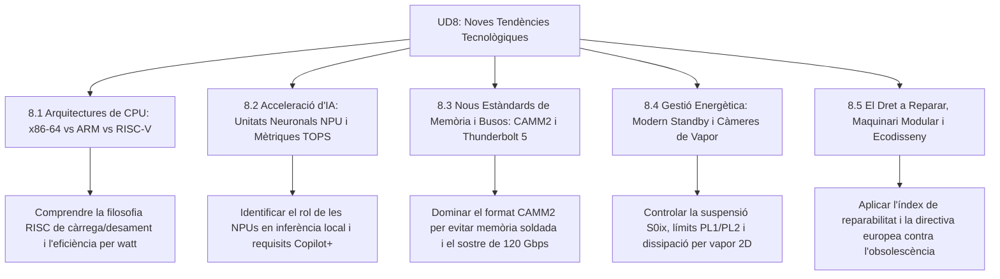

# UD8 Noves Tendències en Arquitectura i Maquinari Microinformàtic

Benvingut a la **Unitat Didàctica 8** del mòdul professional de **Muntatge i Manteniment d'Equips (MME)**. Aquesta unitat analitza les innovacions d'avantguarda que estan redefinint el món del maquinari: la transició històrica cap a arquitectures ARM i RISC-V, la integració de xips neuronals (NPU) per a IA local, els nous formats físics com CAMM2 i Thunderbolt 5, i el moviment global pel Dret a Reparar i la sostenibilitat tecnològica.

---

## Mapa d'Aprenentatge de la Unitat

---

## Sessions d'Estudi i Activitats Pràctiques

1. [**8.1 Arquitectures de Processador: x86-64 vs ARM vs RISC-V**](ut0801.html)
   - Comparativa filosòfica: CISC vs RISC (conjunt d'instruccions i cicles d'execució).
   - L'expansió d'ARM a l'escriptori (Apple Silicon, Snapdragon X Elite i emulació x86).
   - L'estàndard obert i modular RISC-V lliure de drets comercials.

2. [**8.2 Acceleració d'Intel·ligència Artificial: NPUs i TOPS**](ut0802.html)
   - El triangle de càlcul: per què la CPU i GPU no són suficients per a inferència continuada.
   - Rendiment en TOPS (*Trillions of Operations Per Second*) i requisits Copilot+ PC ($\ge 40\text{ TOPS}$).
   - Privadesa local i efectes d'estudi sense dependència del núvol.

3. [**8.3 Nous Estàndards de Memòria i Connectivitat: CAMM2 i Thunderbolt 5**](ut0803.html)
   - L'obsolescència de SO-DIMM i el nou estàndard per compressió CAMM2 / LPCAMM2.
   - Arquitectura de Memòria Unificada (UMA) per a CPU i GPU compartides.
   - Thunderbolt 5: senyalització PAM-3, mode asimètric a 120 Gbps i PCIe extern.

4. [**8.4 Gestió Energètica Avançada: ACPI Modern Standby i Càmeres de Vapor**](ut0804.html)
   - Del mode de suspensió S3 clàssic a Modern Standby (S0ix) i prevenció d'escalfament a la motxilla.
   - Límits de potència dinàmica a la CPU: PL1, PL2 i finestra temporal Tau.
   - Refrigeració per canvi de fase líquid-gas en càmeres de vapor 2D de perfil ultradelgat.

5. [**8.5 El Dret a Reparar, Maquinari Modular i Ecodisseny**](ut0805.html)
   - La Directiva Europea del Dret a Reparar: peces originals durant 7-10 anys i esquemàtics públics.
   - Índex oficial de reparabilitat (cargols estàndard vs coles industrials).
   - El model modular de Framework Laptop i la lluita contra el *part pairing*.

---

## Reptes Globals d'Avaluació de la Unitat (+100 pts)

  
Repte Global 1: Tendències en Arquitectura de Processadors

  
Un client vol renovar la flota de portàtils de la seua empresa comercial. Busquen que la bateria dure tota la jornada laboral de 14 hores sense carregar, que no pesen gens i que tinguen potència per a ofimàtica avançada i videotrucades amb IA. Quina arquitectura de processador és la recomanació més innovadora?

  

    <label style="display:flex; align-items:center; gap:8px; cursor:pointer;"><input type="radio" name="mme_08_global_q1" value="a"> Equips amb processadors basats en arquitectura ARM moderna (com Qualcomm Snapdragon X Elite o Apple Silicon M-Series) amb NPU de més de 40 TOPS integrada.</label>
    <label style="display:flex; align-items:center; gap:8px; cursor:pointer;"><input type="radio" name="mme_08_global_q1" value="b"> Estacions de treball mòbils x86 amb refrigeració líquida i 3 kg de pes.</label>
    <label style="display:flex; align-items:center; gap:8px; cursor:pointer;"><input type="radio" name="mme_08_global_q1" value="c"> Portàtils amb processadors Intel Pentium de 10 anys d'antiguitat.</label>
    <label style="display:flex; align-items:center; gap:8px; cursor:pointer;"><input type="radio" name="mme_08_global_q1" value="d"> Equips sense processador que funcionen només amb xarxa mòbil 3G.</label>
  

  <button class="btn-check" data-correct="a" data-feedback="Correcte! Els SoC ARM amb arquitectura RISC ultraeficient i acceleradors neuronals dedicats ofereixen la màxima autonomia per watt del mercat actual.">Comprova la resposta</button>
  

  
Repte Global 2: Diferència Funcional de la NPU

  
Per què la integració d'una NPU de 45 TOPS permet estalviar més bateria que utilitzar una potent targeta gràfica dedicada NVIDIA RTX per a tasques d'intel·ligència artificial com la traducció de veu en viu?

  

    <label style="display:flex; align-items:center; gap:8px; cursor:pointer;"><input type="radio" name="mme_08_global_q2" value="a"> Perquè la NPU no té circuits elèctrics.</label>
    <label style="display:flex; align-items:center; gap:8px; cursor:pointer;"><input type="radio" name="mme_08_global_q2" value="b"> Perquè la NPU està dissenyada exclusivament per a multiplicacions matricials d'enter reduït (INT8) que consumeixen menys de 5 W, mentre que activar la GPU dedicada exigiria encendre desenes de mòduls VRM i consumir entre 60 W i 120 W.</label>
    <label style="display:flex; align-items:center; gap:8px; cursor:pointer;"><input type="radio" name="mme_08_global_q2" value="c"> Perquè la targeta gràfica només pot mostrar text en blanc i negre.</label>
    <label style="display:flex; align-items:center; gap:8px; cursor:pointer;"><input type="radio" name="mme_08_global_q2" value="d"> Perquè la NPU funciona amb energia solar.</label>
  

  <button class="btn-check" data-correct="b" data-feedback="Molt bé! La hiperespecialització de silici permet a la NPU operar amb un consum insignificant, convertint-la en l'aliat perfecte per a inferència en portàtils.">Comprova la resposta</button>
  

  
Repte Global 3: Sostenibilitat i Format CAMM2

  
Quin greu problema mediambiental i de reparabilitat resol el nou format estàndard de memòria CAMM2 en equips portàtils?

  

    <label style="display:flex; align-items:center; gap:8px; cursor:pointer;"><input type="radio" name="mme_08_global_q3" value="a"> Elimina la necessitat de soldar la memòria RAM LPDDR a la placa base en portàtils fins, permetent que el mòdul puga ser substituït o ampliat fàcilment per un tècnic si s'avaria o si l'usuari necessita més capacitat.</label>
    <label style="display:flex; align-items:center; gap:8px; cursor:pointer;"><input type="radio" name="mme_08_global_q3" value="b"> Evita haver d'instal·lar sistema operatiu.</label>
    <label style="display:flex; align-items:center; gap:8px; cursor:pointer;"><input type="radio" name="mme_08_global_q3" value="c"> Fa que el teclat siga resistent a l'aigua.</label>
    <label style="display:flex; align-items:center; gap:8px; cursor:pointer;"><input type="radio" name="mme_08_global_q3" value="d"> Duplica la capacitat del disc dur.</label>
  

  <button class="btn-check" data-correct="a" data-feedback="Exacte! Fins ara els ultrabooks sacrificaven la reparabilitat soldant la memòria. CAMM2 aconsegueix les mateixes altes freqüències en un format desmuntable cargolat.">Comprova la resposta</button>
  

  
Repte Global 4: Criteris de l'Índex de Reparabilitat

  
Quin dels següents factors penalitza greument la puntuació d'un ordinador portàtil en el nou Índex de Reparabilitat europeu?

  

    <label style="display:flex; align-items:center; gap:8px; cursor:pointer;"><input type="radio" name="mme_08_global_q4" value="a"> L'ús massiu de cola adhesiva permanent per fixar la bateria al xassís i cargols propietaris no estàndard que requereixen eines especials per obrir la carcassa.</label>
    <label style="display:flex; align-items:center; gap:8px; cursor:pointer;"><input type="radio" name="mme_08_global_q4" value="b"> Tenir una pantalla de 14 polzades.</label>
    <label style="display:flex; align-items:center; gap:8px; cursor:pointer;"><input type="radio" name="mme_08_global_q4" value="c"> Utilitzar un connector de càrrega USB Type-C universal.</label>
    <label style="display:flex; align-items:center; gap:8px; cursor:pointer;"><input type="radio" name="mme_08_global_q4" value="d"> Incloure un manual tècnic en format PDF amb codi QR.</label>
  

  <button class="btn-check" data-correct="a" data-feedback="Molt bé! L'adhesiu industrial que impedeix extreure la bateria amb seguretat i els cargols exòtics són les principals traves contra el dret a reparar dels usuaris.">Comprova la resposta</button>
  

---

  <h3 style="color: #1e40af; margin-top: 0;">Lliurament del Projecte Global de la Unitat a Aules</h3>
  

    Envia el dossier complet de la Unitat Didàctica 8: <strong>Dossier Tecnològic de Noves Tendències en Arquitectura Microinformàtica, NPUs i Ecodisseny</strong>. Genera el PDF oficial per a Aules.
  

  

    <input type="text" class="student-name-input" placeholder="El teu nom i cognoms..." style="padding: 8px 12px; border: 1px solid #94a3b8; border-radius: 6px; flex-grow: 1; min-width: 240px;">
    <button class="btn-generate-aules-pdf btn-aules-dl" data-module="MME" data-unit="UD08" data-activity="Global" style="background: #2563eb; color: #fff; border: none; padding: 8px 16px; border-radius: 6px; cursor: pointer; font-weight: 600;">Generar PDF Aules</button>
  

