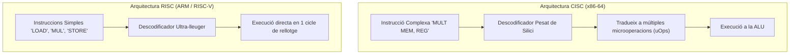

# 8.1 Arquitectures de Processador: x86-64 vs ARM vs RISC-V

  

    Progression de la sessió: 8.1 Arquitectures de CPU
    0 / 75 pts
  

  

    

  

  

    1. CISC vs RISC
    2. ARM a l'Escriptori
    3. RISC-V Obert
  

Durant més de quatre dècades, l'arquitectura **x86/x86-64** d'Intel i AMD ha dominat absolutament el mercat dels ordinadors personals i servidors. Tanmateix, l'exigència d'una eficiència energètica radical ha impulsat una transició tecnològica històrica cap a les arquitectures **ARM** i l'estàndard obert **RISC-V**.

---

## 1. Filosofia de Disseny: CISC vs RISC

| Característica | **CISC** (*Complex Instruction Set Computer*) | **RISC** (*Reduced Instruction Set Computer*) |
| :--- | :--- | :--- |
| **Arquitectura de referència** | **x86 / x86-64** (Intel Core, AMD Ryzen). | **ARM** (Apple Silicon, Snapdragon X Elite, Cortex) i **RISC-V**. |
| **Joc d'instruccions** | Gran nombre d'instruccions complexes de longitud variable ($1\text{ a }15\text{ bytes}$). | Conjunt reduït d'instruccions simples de longitud fixa ($32\text{ o }64\text{ bits}$). |
| **Cicles per instrucció** | Una sola instrucció pot trigar diversos cicles de rellotge a completar-se. | La immensa majoria d'instruccions s'executen en **un sol cicle de rellotge**. |
| **Accés a memòria** | Les instruccions poden operar directament sobre dades de la memòria RAM. | Arquitectura **Load/Store**: només les instruccions de càrrega i desament accedeixen a RAM; els càlculs es fan als registres. |
| **Descodificació de silici** | Descodificadors complexos que consumeixen molta energia en escalfar el xip. | Descodificadors senzills, permetent dedicar més àrea de silici a nuclis i memòria cau amb molt baix consum. |

---

## 2. La Revolució d'ARM a l'Escriptori i Portàtils

Històricament, ARM estava relegat a dispositius mòbils (telèfons intel·ligents i tauletes) a causa de la seua potència limitada. Aquest paradigma es va trencar amb l'arribada d'**Apple Silicon (xips M1, M2, M3, M4)** i els processadors **Qualcomm Snapdragon X Elite**:
- **Eficiència per Watt Imbatible:** Aconsegueixen el mateix rendiment de processament que una CPU x86 de sobretaula consumint una tercera part de l'energia elèctrica ($20\text{ W}$ davant de $65\text{ W}-125\text{ W}$).
- **Emulació Transparent i Traducció Binària:** Sistemes com *Rosetta 2* a macOS o la capa d'emulació *Prism* a Windows 11 on ARM permeten executar aplicacions x86-64 antigues sense que l'usuari note pèrdua apreciable de velocitat.

---

## 3. L'Estàndard Obert RISC-V

**RISC-V** és una arquitectura de joc d'instruccions (ISA) de codi obert i lliure de drets (sense dependre de llicències comercials d'Intel, AMD o Arm Ltd). 
- Permet a qualsevol empresa o centre d'investigació dissenyar xips a mida sense pagar *royalties*.
- S'està expandint ràpidament en controladors de discs SSD, microcontroladors IoT i promet ser la base de la pròxima generació de processadors lliures.

---

## Reptes Interactius (Avalua els teus coneixements)

  
Repte 1: Filosofia de Disseny Load/Store

  
Quina característica fonamental distingeix el funcionament de les instruccions en una arquitectura RISC com ARM respecte a CISC?

  

    <label style="display:flex; align-items:center; gap:8px; cursor:pointer;"><input type="radio" name="mme_0801_q1" value="a"> No utilitza cap registre intern.</label>
    <label style="display:flex; align-items:center; gap:8px; cursor:pointer;"><input type="radio" name="mme_0801_q1" value="b"> Segueix el model Load/Store: les operacions aritmètiques s'executen exclusivament sobre registres interns en un sol cicle, i només ordres específiques carreguen o desen dades a la memòria RAM.</label>
    <label style="display:flex; align-items:center; gap:8px; cursor:pointer;"><input type="radio" name="mme_0801_q1" value="c"> Requereix sempre refrigeració líquida amb nitrogen.</label>
    <label style="display:flex; align-items:center; gap:8px; cursor:pointer;"><input type="radio" name="mme_0801_q1" value="d"> No pot executar programes en llenguatge C.</label>
  

  <button class="btn-check" data-correct="b" data-feedback="Correcte! L'arquitectura Load/Store simplifica dràsticament el maquinari de la CPU, permetent instruccions d'execució d'un cicle i reduint l'escalfament.">Comprova la resposta</button>
  

  
Repte 2: Avantatge d'Eficiència d'ARM en Equips Portàtils

  
Per quina raó tècnica els processadors basats en ARM com Apple Silicon o Snapdragon X Elite han aconseguit autonomies de bateria de més de 18 hores en portàtils mantenint un alt rendiment?

  

    <label style="display:flex; align-items:center; gap:8px; cursor:pointer;"><input type="radio" name="mme_0801_q2" value="a"> Perquè desactiven la pantalla cada 2 minuts.</label>
    <label style="display:flex; align-items:center; gap:8px; cursor:pointer;"><input type="radio" name="mme_0801_q2" value="b"> Perquè la seua arquitectura RISC simplificada requereix molts menys transistors per a la descodificació d'instruccions, reduint dràsticament la dissipació de calor per efecte Joule i el consum en watts per tasca executada.</label>
    <label style="display:flex; align-items:center; gap:8px; cursor:pointer;"><input type="radio" name="mme_0801_q2" value="c"> Perquè utilitzen bateries d'automòbil elèctric.</label>
    <label style="display:flex; align-items:center; gap:8px; cursor:pointer;"><input type="radio" name="mme_0801_q2" value="d"> Perquè no tenen memòria cau L1 ni L2.</label>
  

  <button class="btn-check" data-correct="b" data-feedback="Molt bé! Menys complexitat en el descodificador de silici es tradueix directament en menor consum energètic i una eficiència per watt substancialment superior a la d'arquitectures x86 històriques.">Comprova la resposta</button>
  

  
Repte 3: Particularitat de RISC-V

  
Quina és la gran diferència comercial i legal de RISC-V respecte a x86 (Intel/AMD) i ARM?

  

    <label style="display:flex; align-items:center; gap:8px; cursor:pointer;"><input type="radio" name="mme_0801_q3" value="a"> És un estàndard obert lliure de royalties que qualsevol fabricant pot implementar i modificar lliurement sense dependre de llicències propietàries privades.</label>
    <label style="display:flex; align-items:center; gap:8px; cursor:pointer;"><input type="radio" name="mme_0801_q3" value="b"> Només es pot programar en llenguatge Python.</label>
    <label style="display:flex; align-items:center; gap:8px; cursor:pointer;"><input type="radio" name="mme_0801_q3" value="c"> És propietat exclusiva de Microsoft.</label>
    <label style="display:flex; align-items:center; gap:8px; cursor:pointer;"><input type="radio" name="mme_0801_q3" value="d"> Funciona sense electricitat.</label>
  

  <button class="btn-check" data-correct="a" data-feedback="Exacte! RISC-V és el Linux del disseny de maquinari de processadors: un estàndard obert, modular i lliure de llicències restrictives.">Comprova la resposta</button>
  

---

  <h3 style="color: #1e40af; margin-top: 0;">Lliurament de l'Activitat a Aules</h3>
  

    Completa la tasca pràctica: <strong>Act01 - Estudi Comparatiu d'Arquitectures x86-64, ARM i RISC-V</strong>. Genera el PDF oficial per a Aules.
  

  

    <input type="text" class="student-name-input" placeholder="El teu nom i cognoms..." style="padding: 8px 12px; border: 1px solid #94a3b8; border-radius: 6px; flex-grow: 1; min-width: 240px;">
    <button class="btn-generate-aules-pdf btn-aules-dl" data-module="MME" data-unit="UD08" data-activity="Act01" style="background: #2563eb; color: #fff; border: none; padding: 8px 16px; border-radius: 6px; cursor: pointer; font-weight: 600;">Generar PDF Aules</button>
  

