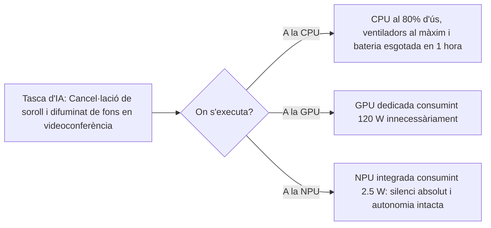

# 8.2 Acceleració d'Intel·ligència Artificial: NPUs i TOPS

  

    Progression de la sessió: 8.2 Acceleradors Neurals NPU
    0 / 75 pts
  

  

    

  

  

    1. Què és una NPU?
    2. Mètriques TOPS
    3. Casos d'Ús Locals
  

El processament d'algorismes d'aprenentatge profund (*Deep Learning*) i models d'intel·ligència artificial generativa exigeix un volum ingent d'operacions matricials. Per evitar saturar la CPU o malgastar energia a la GPU, ha nascut un tercer nucli de silici: la **NPU** (*Neural Processing Unit*).

---

## 1. La Trinitat de Processament: CPU vs GPU vs NPU

| Unitat de Càlcul | Especialitat Arquitectònica | Eficiència en Algorismes d'IA | Consum Energètic Típic |
| :--- | :--- | :--- | :--- |
| **CPU** | Execució seqüencial complexa, baixa latència mono-fil, ramificacions de codi. | Molt deficient (poc paral·lelisme matricial). | $45\text{ W} - 150\text{ W}$ |
| **GPU** | Computació massivament paral·lela en coma flotant (FP32/FP16) amb milers de xicotets nuclis. | Excel·lent en potència bruta per a entrenar models. | **Molt alt ($150\text{ W} - 450\text{ W}$)** |
| **NPU** | **Xarxes de multiplicació matricial i acumulació (MAC)** optimitzades per a precisió reduïda (INT8 / FP16). | **Extraordinària per a inferència en temps real**. | **Ultra-baix ($2\text{ W} - 10\text{ W}$)** |

---

## 2. La Mètrica de Rendiment: Què són els TOPS?

La potència d'una NPU es mesura en **TOPS** (*Trillions of Operations Per Second* - Bilions d'operacions per segon en català/espanyol, on 1 bilió europeu són $10^{12}$ operacions):

$$1\text{ TOPS} = 10^{12}\text{ operacions matemàtiques per segon}$$

- Per a ser certificat com un **PC Copilot+** segons els requisits oficials de Microsoft, la NPU integrada ha de proporcionar un rendiment mínim de **$\ge 40\text{ TOPS}$** de manera sostinguda (aconseguit per processadors com Qualcomm Snapdragon X Elite, AMD Ryzen AI 300 o Intel Core Ultra sèrie 200V Lunar Lake).

---

## 3. Aplicacions Pràctiques al Maquinari Microinformàtic

Executar models d'IA **localment** a la NPU en lloc d'enviar les dades a servidors al núvol aporta tres avantatges decisius:
1. **Privadesa total:** Les dades mèdiques, confidencials o documents empresarials mai surten del xip de l'ordinador.
2. **Latència zero:** Les respostes són immediates, sense dependre de la velocitat de connexió a Internet ni caigudes de servei extern.
3. **Optimització audiovisual:** Efectes d'estudi de Windows (*Windows Studio Effects*): enquadrament automàtic de càmera, contacte visual simulat i aïllament de veu per intel·ligència artificial sense degradar el rendiment del sistema.

---

## Reptes Interactius (Avalua els teus coneixements)

  
Repte 1: Rol Específic de la NPU

  
Per quina raó els fabricants inclouen una NPU dedicada al processador en lloc de deixar que la targeta gràfica (GPU) execute totes les tasques d'intel·ligència artificial?

  

    <label style="display:flex; align-items:center; gap:8px; cursor:pointer;"><input type="radio" name="mme_0802_q1" value="a"> Perquè la GPU no sap multiplicar.</label>
    <label style="display:flex; align-items:center; gap:8px; cursor:pointer;"><input type="radio" name="mme_0802_q1" value="b"> Per eficiència energètica: la NPU executa la inferència d'IA consumint només entre 2 i 5 W, mentre que activar la GPU consumiria més de 100 W, esgotant la bateria i escalfant l'equip.</label>
    <label style="display:flex; align-items:center; gap:8px; cursor:pointer;"><input type="radio" name="mme_0802_q1" value="c"> Perquè la NPU substitueix el disc dur SSD.</label>
    <label style="display:flex; align-items:center; gap:8px; cursor:pointer;"><input type="radio" name="mme_0802_q1" value="d"> Perquè la memòria RAM no admet càlculs d'IA.</label>
  

  <button class="btn-check" data-correct="b" data-feedback="Correcte! La NPU està hiperespecialitzada en càlculs matricials de baixa precisió (INT8), assolint una eficiència per watt immensament superior a qualsevol GPU generalista.">Comprova la resposta</button>
  

  
Repte 2: Requisit de TOPS per a Copilot+ PC

  
Quina potència mínima de NPU en la mètrica TOPS exigeix oficialment l'estàndard Microsoft Copilot+ PC per a executar funcions avançades d'IA local a Windows 11?

  

    <label style="display:flex; align-items:center; gap:8px; cursor:pointer;"><input type="radio" name="mme_0802_q2" value="a"> Com a mínim 40 TOPS.</label>
    <label style="display:flex; align-items:center; gap:8px; cursor:pointer;"><input type="radio" name="mme_0802_q2" value="b"> 5 TOPS.</label>
    <label style="display:flex; align-items:center; gap:8px; cursor:pointer;"><input type="radio" name="mme_0802_q2" value="c"> 500 TOPS.</label>
    <label style="display:flex; align-items:center; gap:8px; cursor:pointer;"><input type="radio" name="mme_0802_q2" value="d"> 1 TOPS.</label>
  

  <button class="btn-check" data-correct="a" data-feedback="Molt bé! Microsoft estableix la barrera dels 40 TOPS per garantir que els models locals (SLM de 3B a 7B paràmetres) s'executen de forma fluida i en temps real.">Comprova la resposta</button>
  

  
Repte 3: Avantatge de Privadesa de la Inferència Local

  
Quin avantatge estratègic aporta executar la transcripció i resum de reunions mitjançant la NPU local del PC en comparació amb enviar l'àudio a una API d'IA al núvol?

  

    <label style="display:flex; align-items:center; gap:8px; cursor:pointer;"><input type="radio" name="mme_0802_q3" value="a"> Que la informació confidencial no surt físicament de la memòria de l'equip, complint estrictament les normatives de protecció de dades (RGPD) i sense consumir dades de connexió.</label>
    <label style="display:flex; align-items:center; gap:8px; cursor:pointer;"><input type="radio" name="mme_0802_q3" value="b"> Que l'àudio sona més fort als altaveus.</label>
    <label style="display:flex; align-items:center; gap:8px; cursor:pointer;"><input type="radio" name="mme_0802_q3" value="c"> Que la NPU formata el disc automàticament.</label>
    <label style="display:flex; align-items:center; gap:8px; cursor:pointer;"><input type="radio" name="mme_0802_q3" value="d"> No hi ha cap diferència.</label>
  

  <button class="btn-check" data-correct="a" data-feedback="Exacte! El processament 'On-Device' garanteix la sobirania de les dades de l'usuari i immunitat davant fallades de xarxa o filtracions de servidors remots.">Comprova la resposta</button>
  

---

  <h3 style="color: #1e40af; margin-top: 0;">Lliurament de l'Activitat a Aules</h3>
  

    Completa la tasca pràctica: <strong>Act02 - Anàlisi de Rendiment en TOPS de NPUs i Prova d'Efectes Locals</strong>. Genera el PDF oficial per a Aules.
  

  

    <input type="text" class="student-name-input" placeholder="El teu nom i cognoms..." style="padding: 8px 12px; border: 1px solid #94a3b8; border-radius: 6px; flex-grow: 1; min-width: 240px;">
    <button class="btn-generate-aules-pdf btn-aules-dl" data-module="MME" data-unit="UD08" data-activity="Act02" style="background: #2563eb; color: #fff; border: none; padding: 8px 16px; border-radius: 6px; cursor: pointer; font-weight: 600;">Generar PDF Aules</button>
  

