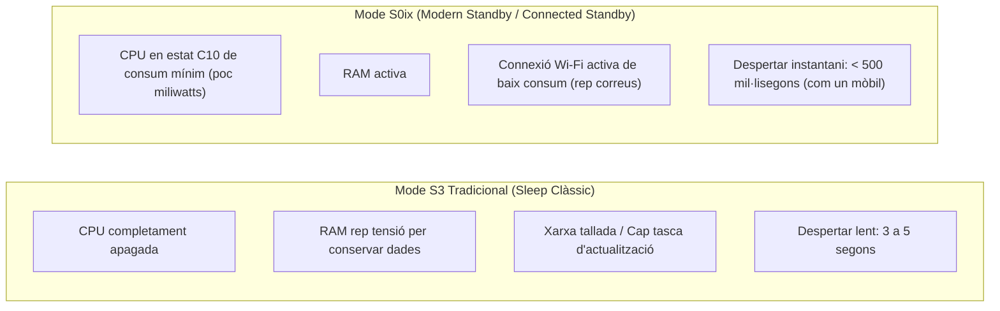

# 8.4 Gestió Energètica Avançada: ACPI Modern Standby i Càmeres de Vapor

  

    Progression de la sessió: 8.4 Gestió Energètica i Refrigeració
    0 / 75 pts
  

  

    

  

  

    1. S0ix vs S3
    2. Límits PL1 / PL2 / Tau
    3. Càmeres de Vapor
  

L'eficiència tèrmica i energètica ja no és només qüestió de col·locar dissipadors més grans. Els sistemes moderns utilitzen protocols intel·ligents de gestió d'estats de son i tecnologies avançades de transferència de calor per canvi de fase líquid-gas.

---

## 1. La Transició dels Estats ACPI: De S3 (Suspend to RAM) a S0ix (Modern Standby)

L'estàndard **ACPI** (*Advanced Configuration and Power Interface*) regula com el sistema operatiu i el firmware controlen el consum elèctric de cada perifèric.

> [!WARNING]
> **El problema del portàtil calent a la motxilla:** Si un equip amb Modern Standby (S0ix) té un problema de controladors o s'activa una actualització de Windows mentre està guardat dins d'una funda o motxilla de transport, els ventiladors no poden agafar aire i l'equip s'escalfarà perillosament podent entrar en fallada tèrmica.

---

## 2. Gestió de Potència Dinàmica a la CPU: PL1, PL2 i Tau

En processadors d'alt rendiment, la freqüència i el consum no són estàtics. El firmware regula el funcionament segons tres paràmetres crítics:
- **PL1 (*Power Limit 1*):** El sostre de potència continu que la CPU pot mantenir indefinidament (sol coincidir amb el TDP nominal, ex. 65 W o 125 W).
- **PL2 (*Power Limit 2*):** El sostre de potència màxim absolut que la CPU pot consumir durant pics de càrrega intensa (pot arribar a $250\text{ W}-300\text{ W}$).
- **Tau (*Time Window*):** El temps màxim (en segons, habitualment de 28 a 56 segons) que el processador té permés funcionar a PL2 abans de baixar obligatòriament a PL1 per protegir la temperatura i els components elèctrics del VRM.

---

## 3. Refrigeració Avançada per Càmera de Vapor (*Vapor Chamber*)

En ordinadors portàtils ultracompactes i targetes gràfiques de gamma alta, els tubs de calor convencionals de coure (*heatpipes*) cilíndrics no ofereixen prou superfície de contacte. S'utilitzen **càmeres de vapor**:
- És una cambra de coure aplanada i segellada al buit que conté una estructura capil·lar porosa interna i una gota d'aigua desionitzada purificada.
- Quan la base s'escalfa, l'aigua s'evapora instantàniament en dues dimensions (2D), repartint la calor de manera completament homogènia per tota la superfície del dissipador d'aletes.
- El vapor es condensa a les zones fredes i retorna per capil·laritat cap al centre del xip en un cicle continu i silenciós.

---

## Reptes Interactius (Avalua els teus coneixements)

  
Repte 1: Diferència Clau de Modern Standby (S0ix)

  
Quina és la diferència principal del mode d'espera Modern Standby (S0ix) respecte al clàssic estat de suspensió S3?

  

    <label style="display:flex; align-items:center; gap:8px; cursor:pointer;"><input type="radio" name="mme_0804_q1" value="a"> S0ix manté l'equip en un estat de molt baix consum connectat a la xarxa per rebre notificacions i permet un despertar instantani com el d'un smartphone, mentre que S3 desconnectava completament la CPU i perifèrics.</label>
    <label style="display:flex; align-items:center; gap:8px; cursor:pointer;"><input type="radio" name="mme_0804_q1" value="b"> S0ix apaga l'ordinador tallant el corrent de la paret.</label>
    <label style="display:flex; align-items:center; gap:8px; cursor:pointer;"><input type="radio" name="mme_0804_q1" value="c"> S0ix requereix un disc dur mecànic.</label>
    <label style="display:flex; align-items:center; gap:8px; cursor:pointer;"><input type="radio" name="mme_0804_q1" value="d"> S0ix és exclusiu de televisors intel·ligents.</label>
  

  <button class="btn-check" data-correct="a" data-feedback="Correcte! Modern Standby emula l'experiència mòbil: l'equip roman connectat en segon pla i es desperta en menys de mig segon en obrir la tapa.">Comprova la resposta</button>
  

  
Repte 2: Comportament del Paràmetre PL2 en Processadors

  
Per què un processador que té un TDP base de 65 W (PL1) pot arribar a consumir 180 W durant els primers segons d'un procés de renderitzat?

  

    <label style="display:flex; align-items:center; gap:8px; cursor:pointer;"><input type="radio" name="mme_0804_q2" value="a"> Perquè la placa base està en curtcircuit.</label>
    <label style="display:flex; align-items:center; gap:8px; cursor:pointer;"><input type="radio" name="mme_0804_q2" value="b"> Perquè el mecanisme de potència permet activar l'estat PL2 (Power Limit 2) durant una finestra temporal definida (Tau) per oferir màxima freqüència turbo en tasques curtes abans de reduir el consum a PL1 per estabilitat tèrmica.</label>
    <label style="display:flex; align-items:center; gap:8px; cursor:pointer;"><input type="radio" name="mme_0804_q2" value="c"> Perquè la memòria RAM està saturada.</label>
    <label style="display:flex; align-items:center; gap:8px; cursor:pointer;"><input type="radio" name="mme_0804_q2" value="d"> Perquè la font d'alimentació està defectuosa.</label>
  

  <button class="btn-check" data-correct="b" data-feedback="Molt bé! La gestió PL1/PL2/Tau equilibra la velocitat ràpida en ràfegues amb la seguretat tèrmica en treballs prolongats.">Comprova la resposta</button>
  

  
Repte 3: Avantatge de la Càmera de Vapor sobre els Tubs Convencionals

  
Quin avantatge físic ofereix una cambra de vapor (*vapor chamber*) respecte als heatpipes tubulars cilíndrics en portàtils ultracompactes?

  

    <label style="display:flex; align-items:center; gap:8px; cursor:pointer;"><input type="radio" name="mme_0804_q3" value="a"> Dispersa la calor de manera plana i uniforme en dues dimensions (2D) cobrint tota l'àrea del die de silici i el VRM simultàniament amb un perfil d'espai molt més prim.</label>
    <label style="display:flex; align-items:center; gap:8px; cursor:pointer;"><input type="radio" name="mme_0804_q3" value="b"> No necessita aigua ni fluid refrigerant.</label>
    <label style="display:flex; align-items:center; gap:8px; cursor:pointer;"><input type="radio" name="mme_0804_q3" value="c"> Emet vapor visible a través del teclat.</label>
    <label style="display:flex; align-items:center; gap:8px; cursor:pointer;"><input type="radio" name="mme_0804_q3" value="d"> Funciona mitjançant un motor elèctric d'inducció.</label>
  

  <button class="btn-check" data-correct="a" data-feedback="Exacte! La càmera de vapor estén el gradient tèrmic en superfície bidimensional homogènia, eliminant els punts calents crítics en xassissos mil·limètrics.">Comprova la resposta</button>
  

---

  <h3 style="color: #1e40af; margin-top: 0;">Lliurament de l'Activitat a Aules</h3>
  

    Completa la tasca pràctica: <strong>Act04 - Configuració d'Estats de Son ACPI i Telemetria de Límits de Potència PL1/PL2</strong>. Genera el PDF oficial per a Aules.
  

  

    <input type="text" class="student-name-input" placeholder="El teu nom i cognoms..." style="padding: 8px 12px; border: 1px solid #94a3b8; border-radius: 6px; flex-grow: 1; min-width: 240px;">
    <button class="btn-generate-aules-pdf btn-aules-dl" data-module="MME" data-unit="UD08" data-activity="Act04" style="background: #2563eb; color: #fff; border: none; padding: 8px 16px; border-radius: 6px; cursor: pointer; font-weight: 600;">Generar PDF Aules</button>
  

