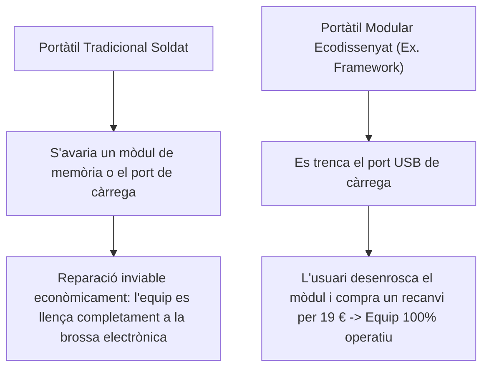

# 8.5 El Dret a Reparar, Maquinari Modular i Ecodisseny

<div class="interactive-progress-tracker" style="background: #f8fafc; border: 1px solid #e2e8f0; border-radius: 8px; padding: 16px; margin-bottom: 24px;">
  <div style="display: flex; justify-content: space-between; align-items: center; margin-bottom: 8px;">
    <span style="font-weight: 600; color: #1e293b;">Progression de la sessió: 8.5 Sostenibilitat i Dret a Reparar</span>
    <span style="font-weight: 700; color: #2563eb;" id="tracker-score">0 / 75 pts</span>
  </div>
  <div style="width: 100%; background: #e2e8f0; height: 8px; border-radius: 4px; overflow: hidden;">
    <div id="tracker-bar" style="width: 0%; height: 100%; background: #2563eb; transition: width 0.3s ease;"></div>
  </div>
  <div style="display: flex; justify-content: space-between; font-size: 0.8rem; color: #64748b; margin-top: 6px;">
    <span>1. Moviment Right to Repair</span>
    <span>2. Índex de Reparabilitat</span>
    <span>3. Ecodisseny i Modularitat</span>
  </div>
</div>

Durant l'última dècada, molts fabricants han adoptat pràctiques d'obsolescència programada: components soldats (RAM, SSD, Wi-Fi), ús excessiu de cola adhesiva en bateries i bloqueig de recanvis mitjançant xips criptogràfics (*part pairing*). El moviment internacional pel **Dret a Reparar (*Right to Repair*)** i les noves directives de la Unió Europea estan canviant radicalment el panorama de la indústria.

---

## 1. El Marc Legal Europeu pel Dret a Reparar

La nova Directiva del Parlament Europeu obliga els fabricants a complir criteris estrictes:
1. **Disponibilitat obligatòria de recanvis:** Obligació de subministrar recanvis originals durant un mínim de **7 a 10 anys** després de retirar l'equip del mercat (bateries, pantalles, teclats, connectors de càrrega).
2. **Accés públic a manuals de reparació i esquemàtics:** Facilitar diagrames elèctrics i manuals oficials de desmuntatge sense restriccions a tallers independents i usuaris.
3. **Prohibició de traves de programari:** Prohibir que els fabricants desactivin funcions mitjançant actualitzacions de firmware si s'instal·la una pantalla o bateria d'un proveïdor compatible certificat.

---

## 2. L'Índex de Reparabilitat Oficial

A semblança de l'etiqueta energètica d'electrodomèstics, la Unió Europea i països com França exigeixen una nota visible de l'**1 al 10** en el punt de venda:

```
[ ÍNDEX DE REPARABILITAT: 8.4 / 10 ]  --> Color Verd (Fàcilment reparable)
  - Disponibilitat de documentació tècnica (manuals).
  - Facilitat de desmuntatge (cargols estàndard Torx/Phillips vs cola adhesiva).
  - Preu dels recanvis respecte al preu total de l'equip nou.
  - Temps d'entrega de les peces de recanvi.
```

---

## 3. L'Arquitectura Modular: L'Exemple del Framework Laptop

Projectes com el **Framework Laptop** demostren que la tecnologia modular no només és viable, sinó desitjable:
- Totes les peces tenen codis **QR** impresos que condueixen directament a guies oficials de reparació i comanda de recanvis.
- Els ports externs són **targetes modulars extraïbles** (*Expansion Cards* USB-C, HDMI, DisplayPort, lector MicroSD) que l'usuari pot intercanviar a voluntat.
- La placa base es pot substituir per una de nova generació (ex. passar d'Intel 11a gen a AMD Ryzen 7000 o noves generacions) conservant exactament la mateixa pantalla, xassís metàl·lic, bateria i teclat, estalviant fins a un 70% de la petjada ecològica de fabricació.



---

## Reptes Interactius (Avalua els teus coneixements)

<div class="interactive-challenge-card" data-points="25" style="border: 1px solid #cbd5e1; border-radius: 8px; padding: 18px; margin-bottom: 20px; background: #ffffff;">
  <div style="font-weight: 700; color: #1e293b; margin-bottom: 8px;">Repte 1: Pilars de la Directiva Europea del Dret a Reparar</div>
  <p style="color: #475569; font-size: 0.95rem;">Quina de les següents mesures és una exigència legal obligatòria de la normativa europea sobre reparabilitat d'equips informàtics?</p>
  <div style="display: flex; flex-direction: column; gap: 8px; margin: 12px 0;">
    <label style="display:flex; align-items:center; gap:8px; cursor:pointer;"><input type="radio" name="mme_0805_q1" value="a"> Garantir peces de recanvi originals i manuals públics de reparació durant un mínim de 7 a 10 anys després de la venda de l'equip.</label>
    <label style="display:flex; align-items:center; gap:8px; cursor:pointer;"><input type="radio" name="mme_0805_q1" value="b"> Regalar un ordinador nou cada 2 anys a tots els usuaris.</label>
    <label style="display:flex; align-items:center; gap:8px; cursor:pointer;"><input type="radio" name="mme_0805_q1" value="c"> Prohibir l'ús de tornavisos al taller.</label>
    <label style="display:flex; align-items:center; gap:8px; cursor:pointer;"><input type="radio" name="mme_0805_q1" value="d"> Exigir que els portàtils no tinguen bateria.</label>
  </div>
  <button class="btn-check" data-correct="a" data-feedback="Correcte! La llei lluita contra l'obsolescència obligant a proveir components de recanvi i documentació oberta per evitar el fem electrònic prematur.">Comprova la resposta</button>
  <div class="feedback-msg" style="display:none; margin-top: 10px; font-weight: 600;"></div>
</div>

<div class="interactive-challenge-card" data-points="25" style="border: 1px solid #cbd5e1; border-radius: 8px; padding: 18px; margin-bottom: 20px; background: #ffffff;">
  <div style="font-weight: 700; color: #1e293b; margin-bottom: 8px;">Repte 2: El Perill del Bloqueig per Part Pairing</div>
  <p style="color: #475569; font-size: 0.95rem;">Què és la pràctica nociva coneguda com a 'part pairing' o serialització de peces que combaten les noves lleis de reparació?</p>
  <div style="display: flex; flex-direction: column; gap: 8px; margin: 12px 0;">
    <label style="display:flex; align-items:center; gap:8px; cursor:pointer;"><input type="radio" name="mme_0805_q2" value="a"> Un mètode per pintar els components del mateix color.</label>
    <label style="display:flex; align-items:center; gap:8px; cursor:pointer;"><input type="radio" name="mme_0805_q2" value="b"> El bloqueig artificial per programari en el qual la placa mare comprova criptogràficament el número de sèrie de la pantalla o bateria nova i desactiva funcions si la reparació no s'ha fet al servei tècnic oficial autoritzat.</label>
    <label style="display:flex; align-items:center; gap:8px; cursor:pointer;"><input type="radio" name="mme_0805_q2" value="c"> Connectar dos discs durs en RAID.</label>
    <label style="display:flex; align-items:center; gap:8px; cursor:pointer;"><input type="radio" name="mme_0805_q2" value="d"> Utilitzar dos mòduls de memòria en Dual-Channel.</label>
  </div>
  <button class="btn-check" data-correct="b" data-feedback="Molt bé! La serialització forçada és un mecanisme anticompetitiu que impedeix a tallers de barri i usuaris canviar peces sense programari propietari del fabricant.">Comprova la resposta</button>
  <div class="feedback-msg" style="display:none; margin-top: 10px; font-weight: 600;"></div>
</div>

<div class="interactive-challenge-card" data-points="25" style="border: 1px solid #cbd5e1; border-radius: 8px; padding: 18px; margin-bottom: 20px; background: #ffffff;">
  <div style="font-weight: 700; color: #1e293b; margin-bottom: 8px;">Repte 3: Avantatge del Maquinari Modular</div>
  <p style="color: #475569; font-size: 0.95rem;">Quin és l'impacte ambiental i econòmic d'un portàtil de disseny modular com el Framework Laptop quan l'usuari vol actualitzar el processador després de 4 anys?</p>
  <div style="display: flex; flex-direction: column; gap: 8px; margin: 12px 0;">
    <label style="display:flex; align-items:center; gap:8px; cursor:pointer;"><input type="radio" name="mme_0805_q3" value="a"> Pot comprar únicament la placa base actualitzada amb el nou processador i canviar-la ell mateix amb un tornavís, conservant la pantalla, carcassa, teclat, memòria i bateria de l'equip antic.</label>
    <label style="display:flex; align-items:center; gap:8px; cursor:pointer;"><input type="radio" name="mme_0805_q3" value="b"> Ha de llençar el portàtil i comprar-ne un altre sencer obligatòriament.</label>
    <label style="display:flex; align-items:center; gap:8px; cursor:pointer;"><input type="radio" name="mme_0805_q3" value="c"> L'equip consumeix el doble de bateria.</label>
    <label style="display:flex; align-items:center; gap:8px; cursor:pointer;"><input type="radio" name="mme_0805_q3" value="d"> La pantalla perd la seua resolució nativa.</label>
  </div>
  <button class="btn-check" data-correct="a" data-feedback="Exacte! La modularitat desacobla l'actualització del xip del desgast dels perifèrics mecànics, reduint la petjada ecològica i el cost de renovació dràsticament.">Comprova la resposta</button>
  <div class="feedback-msg" style="display:none; margin-top: 10px; font-weight: 600;"></div>
</div>

---

<div class="aules-delivery-card" style="background: #eff6ff; border: 1px solid #bfdbfe; border-radius: 8px; padding: 20px; margin-top: 28px;">
  <h3 style="color: #1e40af; margin-top: 0;">Lliurament de l'Activitat a Aules</h3>
  <p style="color: #1e3a8a; font-size: 0.95rem;">
    Completa la tasca pràctica: <strong>Act05 - Auditoria de Reparabilitat d'un Portàtil segons la Guia Europea i Proposta d'Ecodisseny</strong>. Genera el PDF oficial per a Aules.
  </p>
  <div style="display: flex; gap: 12px; margin-top: 12px; flex-wrap: wrap;">
    <input type="text" class="student-name-input" placeholder="El teu nom i cognoms..." style="padding: 8px 12px; border: 1px solid #94a3b8; border-radius: 6px; flex-grow: 1; min-width: 240px;">
    <button class="btn-generate-aules-pdf btn-aules-dl" data-module="MME" data-unit="UD08" data-activity="Act05" style="background: #2563eb; color: #fff; border: none; padding: 8px 16px; border-radius: 6px; cursor: pointer; font-weight: 600;">Generar PDF Aules</button>
  </div>
</div>
