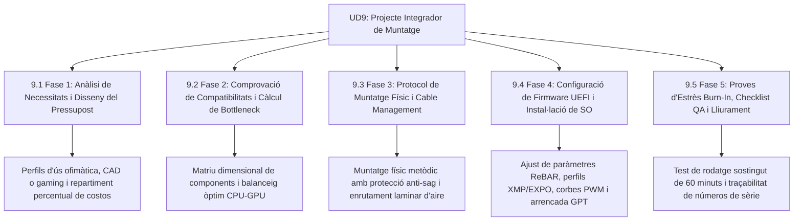

# UD9 Projecte Integrador de Muntatge i Control de Qualitat

Benvingut a la **Unitat Didàctica 9** del mòdul professional de **Muntatge i Manteniment d'Equips (MME)**. Aquesta unitat és la culminació pràctica de tot el curs acadèmic: integra totes les competències professionals adquirides en un projecte real complet, des de la primera entrevista amb el client fins a la signatura de l'acta de recepció i lliurament després de superar el banc de proves d'estrès.

---

## Mapa d'Aprenentatge de la Unitat

---

## Sessions d'Estudi i Activitats Pràctiques

1. [**9.1 Fase 1: Anàlisi de Necessitats i Disseny del Pressupost**](ut0901.html)
   - Perfils d'ús: ofimàtica administrativa, estació de treball CAD/Render i gaming.
   - Distribució percentual equilibrada del pressupost per component.
   - Estructura formal d'un pressupost comercial i marc legal de garanties (3 anys).

2. [**9.2 Fase 2: Comprovació Integral de Compatibilitats i Bottleneck**](ut0902.html)
   - Matriu dimensional: alçada de cooler, llargària de GPU i format de caixa/PSU.
   - Concepte i càlcul de coll d'ampolla (*bottleneck*): CPU vs GPU vs RAM.
   - Dimensionament de la font d'alimentació amb marge de seguretat del 30-40%.

3. [**9.3 Fase 3: Protocol de Muntatge i Cable Management**](ut0903.html)
   - Acoblament en banc de proves i prevenció del fenomen de 'GPU Sag' amb suports verticals.
   - Gestió professional de cablejat per evitar turbulències en el túnel d'aire.
   - Ús d'alicates de tall ras per a brides i protecció dels cables.

4. [**9.4 Fase 4: Configuració de Firmware UEFI i Instal·lació de SO**](ut0904.html)
   - Llista de comprovació UEFI: detecció de maquinari, XMP/EXPO i Resizable BAR.
   - Calibratge de corbes de ventilació PWM per a màxim silenci operatiu.
   - Instal·lació neta del sistema operatiu sobre taules de particions GPT.

5. [**9.5 Fase 5: Proves d'Estrès, Llista de Verificació QA i Lliurament**](ut0905.html)
   - Bateria d'estrès continuada (*burn-in testing*) de 60 minuts (Prime95 + FurMark + MemTest86).
   - Llista de verificació completa de control de qualitat (*QA Checklist*).
   - Elaboració de l'acta oficial de lliurament tècnic amb traçabilitat de números de sèrie.

---

## Reptes Globals d'Avaluació de la Unitat (+100 pts)

  
Repte Global 1: Disseny Integral d'una Estació CAD

  
Un enginyer et sol·licita un pressupost de 1.800 € per a una estació de càlcul estructural i renderitzat arquitectònic. Com distribueixes de manera professional la inversió?

  

    <label style="display:flex; align-items:center; gap:8px; cursor:pointer;"><input type="radio" name="mme_09_global_q1" value="a"> Prioritzar una CPU amb gran nombre de nuclis de càlcul, 64 GB de memòria RAM d'alta velocitat, un SSD NVMe PCIe 4.0/5.0 amb gran capacitat de transferència, una targeta gràfica equilibrada i una font modular certificada 80 PLUS Gold.</label>
    <label style="display:flex; align-items:center; gap:8px; cursor:pointer;"><input type="radio" name="mme_09_global_q1" value="b"> Gastar 1.500 € en la targeta gràfica i posar una CPU bàsica de 2 nuclis amb 8 GB de RAM.</label>
    <label style="display:flex; align-items:center; gap:8px; cursor:pointer;"><input type="radio" name="mme_09_global_q1" value="c"> Comprar una caixa de disseny de 800 € i components d'ocasió.</label>
    <label style="display:flex; align-items:center; gap:8px; cursor:pointer;"><input type="radio" name="mme_09_global_q1" value="d"> Comprar dos ordinadors d'ofimàtica de 900 € i lligar-los amb corda.</label>
  

  <button class="btn-check" data-correct="a" data-feedback="Correcte! En CAD i càlcul científic, la CPU multinúcli, la quantitat massiva de RAM i l'amplada de banda d'emmagatzematge són els pilars que eviten colls d'ampolla.">Comprova la resposta</button>
  

  
Repte Global 2: Protocol d'Intervenció davant d'Avaries en Banc de Proves

  
Durant el test d'estrès de 60 minuts d'un ordinador nou, als 15 minuts de càrrega l'equip s'apaga sobtadament com si hagueren desconnectat el cable de corrent. En tocar la part posterior de la font d'alimentació, està cremant. Quina acció tècnica s'ha de prendre?

  

    <label style="display:flex; align-items:center; gap:8px; cursor:pointer;"><input type="radio" name="mme_09_global_q2" value="a"> Tornar a encendre la màquina immediatament.</label>
    <label style="display:flex; align-items:center; gap:8px; cursor:pointer;"><input type="radio" name="mme_09_global_q2" value="b"> Aturar la prova, revisar si el ventilador de la font d'alimentació està bloquejat o si la font està sobredimensionada per sota del consum real de pic, substituint la unitat per una font de major potència i certificació de qualitat.</label>
    <label style="display:flex; align-items:center; gap:8px; cursor:pointer;"><input type="radio" name="mme_0905_q2" value="c"> Canviar el ratolí USB de port.</label>
    <label style="display:flex; align-items:center; gap:8px; cursor:pointer;"><input type="radio" name="mme_09_global_q2" value="d"> Reinstal·lar el navegador web.</label>
  

  <button class="btn-check" data-correct="b" data-feedback="Molt bé! Una apagada sobtada per calor a la font indica que ha saltat la protecció OTP (Over Temperature Protection) o OPP (Over Power Protection), exigint una revisió elèctrica immediata.">Comprova la resposta</button>
  

  
Repte Global 3: Verificació de Paràmetres Crítics a UEFI

  
Quins tres ajustos a la UEFI són determinants per a considerar que una màquina està professionalment afinada abans del lliurament?

  

    <label style="display:flex; align-items:center; gap:8px; cursor:pointer;"><input type="radio" name="mme_09_global_q3" value="a"> Perfil XMP/EXPO activat per a la RAM, Resizable BAR habilitat per a la GPU i corbes de ventilació PWM calibrades per a un funcionament silenciós en repòs.</label>
    <label style="display:flex; align-items:center; gap:8px; cursor:pointer;"><input type="radio" name="mme_09_global_q3" value="b"> Desactivar la targeta de so i la connexió USB.</label>
    <label style="display:flex; align-items:center; gap:8px; cursor:pointer;"><input type="radio" name="mme_09_global_q3" value="c"> Posar la data en l'any 1999.</label>
    <label style="display:flex; align-items:center; gap:8px; cursor:pointer;"><input type="radio" name="mme_09_global_q3" value="d"> Deixar els ventiladors girant al 100% de continu.</label>
  

  <button class="btn-check" data-correct="a" data-feedback="Exacte! Aquesta tríada garanteix que la memòria funcione a la seua velocitat real, que la gràfica no tinga coll d'ampolla PCIe i que l'usuari gaudisca d'un equip silenciós.">Comprova la resposta</button>
  

  
Repte Global 4: Signatura de Conformitat i Traçabilitat

  
Quin document tanca oficialment el projecte de muntatge i certifica que el client accepta la màquina amb totes les comprovacions de qualitat superades?

  

    <label style="display:flex; align-items:center; gap:8px; cursor:pointer;"><input type="radio" name="mme_09_global_q4" value="a"> L'acta oficial de recepció i lliurament signada per ambdues parts, acompanyada de la llista de verificació QA i el registre de números de sèrie de tots els components.</label>
    <label style="display:flex; align-items:center; gap:8px; cursor:pointer;"><input type="radio" name="mme_09_global_q4" value="b"> Un missatge de text informal de WhatsApp.</label>
    <label style="display:flex; align-items:center; gap:8px; cursor:pointer;"><input type="radio" name="mme_09_global_q4" value="c"> La capsa buida de la placa base.</label>
    <label style="display:flex; align-items:center; gap:8px; cursor:pointer;"><input type="radio" name="mme_09_global_q4" value="d"> El tiquet de compra del supermercat.</label>
  

  <button class="btn-check" data-correct="a" data-feedback="Molt bé! L'acta de lliurament formalitza la garantia legal, documenta l'estat òptim de la màquina i dóna validesa al procés d'auditoria tècnica.">Comprova la resposta</button>
  

---

  <h3 style="color: #1e40af; margin-top: 0;">Lliurament del Projecte Final Integrador a Aules</h3>
  

    Envia el projecte complet integrador de final de mòdul: <strong>Memòria Tècnica de Muntatge, Checklist de Control de Qualitat (QA) i Acta de Lliurament</strong>. Genera el PDF oficial per a Aules.
  

  

    <input type="text" class="student-name-input" placeholder="El teu nom i cognoms..." style="padding: 8px 12px; border: 1px solid #94a3b8; border-radius: 6px; flex-grow: 1; min-width: 240px;">
    <button class="btn-generate-aules-pdf btn-aules-dl" data-module="MME" data-unit="UD09" data-activity="Global" style="background: #2563eb; color: #fff; border: none; padding: 8px 16px; border-radius: 6px; cursor: pointer; font-weight: 600;">Generar PDF Aules</button>
  

