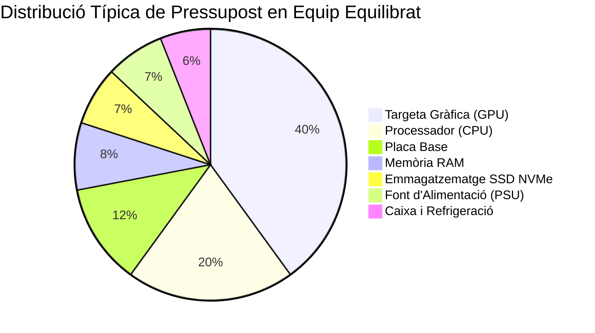

# 9.1 Fase 1: Anàlisi de Necessitats i Disseny del Pressupost

  

    Progression de la sessió: 9.1 Anàlisi de Requisits i Pressupost
    0 / 75 pts
  

  

    

  

  

    1. Perfils d'Usuari
    2. Repartiment Pressupostari
    3. La Proposta Tècnica
  

El projecte integrador de muntatge comença molt abans d'agafar el tornavís. La primera fase consisteix a escoltar el client, analitzar l'entorn de treball on operarà la màquina i dissenyar una configuració que maximize el rendiment per euro invertit sense sobredimensionar ni crear colls d'ampolla.

---

## 1. Els Tres Grans Perfils d'Ús Informàtic

| Perfil d'Usuari | Prioritats de Maquinari Crític | Objectiu de Rendiment Clau | Component Menys Prioritari |
| :--- | :--- | :--- | :--- |
| **Ofimàtica i Gestió Corporativa** | Fiabilitat, baix consum, silenci i mida compacta (Micro-ATX o Mini-ITX). | Arrencada ràpida del SO, multitasca web fluida i suport d'ofimàtica. | Targeta gràfica dedicada (s'utilitzen gràfics integrats iGPU). |
| **Estació de Treball CAD / Edició 4K** | **CPU multinúcli massiva (P+E cores), gran quantitat de RAM (32-64 GB) i emmagatzematge NVMe ràpid**. | Temps mínim de renderitzat 3D, càlcul científic i estabilitat tèrmica absoluta. | Il·luminació RGB o xassissos decoratius amb vidre. |
| **Gaming Competitiu / Disseny 3D en Temps Real** | **Targeta Gràfica (GPU) potent i CPU amb alt rendiment mono-fil (elevada freqüència de rellotge i gran memòria cau L3)**. | Mantenir taxes de fotogrames estables ($>144\text{ FPS}$) a alta resolució. | Quantitats desproporcionades de RAM (16 a 32 GB són suficients). |

---

## 2. Model de Distribució Percentual del Pressupost

Una regla empírica recomanada per evitar desequilibris en equips de gamma mitjana-alta ($1000\text{ €} - 1500\text{ €}$):

> [!TIP]
> **No estalviar mai a la Font d'Alimentació:** Destinar menys del 7-8% del pressupost a la font o triar models genèrics sense certificació 80 PLUS posa en risc mortal components cars com la GPU o la placa base davant de qualsevol pujada de tensió.

---

## 3. Elaboració del Pressupost Oficial

El pressupost presentat al client ha de contenir:
1. Marca, model comercial complet i codi de fabricant (MPN / SKU) de cada peça.
2. Preu unitari net (base imposable), percentatge d'IVA aplicable (21%) i total.
3. Desglossament de la mà d'obra de muntatge, configuració de firmware i test d'estrès.
4. Termini de garantia oficial legal (3 anys a Espanya segons el Reial Decret Legislatiu 1/2007).

---

## Reptes Interactius (Avalua els teus coneixements)

  
Repte 1: Assessorament de Perfil Ofimàtic

  
Un despatx d'advocats et demana pressupost per a 5 ordinadors destinats exclusivament a processar textos a Word, gestionar correu i navegar per la seu electrònica judicial. Quin component seria un balafiament innecessari incloure al pressupost?

  

    <label style="display:flex; align-items:center; gap:8px; cursor:pointer;"><input type="radio" name="mme_0901_q1" value="a"> Una targeta gràfica dedicada d'alta gamma de 600 € amb 16 GB de VRAM.</label>
    <label style="display:flex; align-items:center; gap:8px; cursor:pointer;"><input type="radio" name="mme_0901_q1" value="b"> Un disc SSD NVMe de 500 GB.</label>
    <label style="display:flex; align-items:center; gap:8px; cursor:pointer;"><input type="radio" name="mme_0901_q1" value="c"> 16 GB de memòria RAM.</label>
    <label style="display:flex; align-items:center; gap:8px; cursor:pointer;"><input type="radio" name="mme_0901_q1" value="d"> Una font d'alimentació amb certificació 80 PLUS Bronze.</label>
  

  <button class="btn-check" data-correct="a" data-feedback="Correcte! Les tasques administratives queden perfectament cobertes pels gràfics integrats (iGPU) del processador, estalviant centenars d'euros i consum elèctric.">Comprova la resposta</button>
  

  
Repte 2: Prioritat en Estació de Disseny i Renderització

  
Un estudi d'arquitectura necessita un equip per a renderitzar plànols complexos en 3D i modelatge BIM. Quina combinació de components ha de rebre la major atenció en el pressupost?

  

    <label style="display:flex; align-items:center; gap:8px; cursor:pointer;"><input type="radio" name="mme_0901_q2" value="a"> Processador de molts nuclis d'alt rendiment, gran capacitat de RAM (mínim 32 a 64 GB) i disc NVMe d'alta velocitat de lectura/escriptura.</label>
    <label style="display:flex; align-items:center; gap:8px; cursor:pointer;"><input type="radio" name="mme_0901_q2" value="b"> Una caixa transparent amb 10 ventiladors d'il·luminació RGB multicolor.</label>
    <label style="display:flex; align-items:center; gap:8px; cursor:pointer;"><input type="radio" name="mme_0901_q2" value="c"> Un disc dur mecànic de 5400 RPM com a disc d'arrencada.</label>
    <label style="display:flex; align-items:center; gap:8px; cursor:pointer;"><input type="radio" name="mme_0901_q2" value="d"> Un teclat mecànic gaming amb tecles programables.</label>
  

  <button class="btn-check" data-correct="a" data-feedback="Molt bé! Els motors de renderitzat exigeixen màxima concurrència de càlcul (CPU/GPU) i carregar estructures geomètriques pesades a la memòria RAM sense colls d'ampolla.">Comprova la resposta</button>
  

  
Repte 3: Garantia Legal Oficial a Espanya

  
Quin és el termini legal de garantia vigent a Espanya per a equips informàtics nous venuts a consumidors particulars?

  

    <label style="display:flex; align-items:center; gap:8px; cursor:pointer;"><input type="radio" name="mme_0901_q3" value="a"> 6 mesos.</label>
    <label style="display:flex; align-items:center; gap:8px; cursor:pointer;"><input type="radio" name="mme_0901_q3" value="b"> 3 anys.</label>
    <label style="display:flex; align-items:center; gap:8px; cursor:pointer;"><input type="radio" name="mme_0901_q3" value="c"> 1 any.</label>
    <label style="display:flex; align-items:center; gap:8px; cursor:pointer;"><input type="radio" name="mme_0901_q3" value="d"> 10 anys.</label>
  

  <button class="btn-check" data-correct="b" data-feedback="Exacte! Des de la reforma del text refós de la Llei General per a la Defensa dels Consumidors i Usuaris l'any 2022, el termini legal de garantia a Espanya és de 3 anys.">Comprova la resposta</button>
  

---

  <h3 style="color: #1e40af; margin-top: 0;">Lliurament de l'Activitat a Aules</h3>
  

    Completa la tasca pràctica: <strong>Act01 - Elaboració d'un Pressupost Tècnic Professional Comparatiu</strong>. Genera el PDF oficial per a Aules.
  

  

    <input type="text" class="student-name-input" placeholder="El teu nom i cognoms..." style="padding: 8px 12px; border: 1px solid #94a3b8; border-radius: 6px; flex-grow: 1; min-width: 240px;">
    <button class="btn-generate-aules-pdf btn-aules-dl" data-module="MME" data-unit="UD09" data-activity="Act01" style="background: #2563eb; color: #fff; border: none; padding: 8px 16px; border-radius: 6px; cursor: pointer; font-weight: 600;">Generar PDF Aules</button>
  

