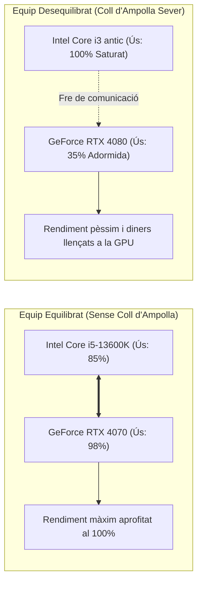

# 9.2 Fase 2: Comprovació Integral de Compatibilitats i Bottleneck

  

    Progression de la sessió: 9.2 Compatibilitat i Coll d'Ampolla
    0 / 75 pts
  

  

    

  

  

    1. Dimensions Físiques
    2. Elèctrica i TDP
    3. Càlcul de Bottleneck
  

Abans de tramitar la comanda dels components, el tècnic ha de verificar amb precisió mil·limètrica que totes les peces encaixen físicament i són elèctricament coherents.

---

## 1. La Matriu de Comprovació Dimensional Física

La majoria de devolucions de maquinari es produeixen per incompatibilitats d'espai físic dins de la caixa:

| Paràmetre Dimensional | Què s'ha de comprovar al manual tècnic? | Risc d'incompatibilitat greu |
| :--- | :--- | :--- |
| **Alçada màxima del dissipador CPU** | Comparar la cota d'alçada del *cooler* (ex. $160\text{ mm}$) amb l'espai lliure de la caixa (ex. màx $155\text{ mm}$). | El panell lateral de vidre de la caixa **no podrà tancar-se** o xocarà contra el dissipador. |
| **Longitud màxima de la GPU** | Mesurar la llargària de la targeta gràfica (ex. $320\text{ mm}$) respecte a l'espai interior del xassís. | La targeta xocarà contra els ventiladors frontals o la bomba d'aigua líquida AIO. |
| **Espai lliure per a la RAM (*RAM Clearance*)** | L'alçada dels dissipadors dels mòduls RAM respecte al ventilador davanter del dissipador de torre. | El ventilador del dissipador xoca contra la memòria i s'ha de desplaçar cap amunt tocant el vidre. |
| **Format i longitud de la font (PSU)** | Fonts ATX llargues ($>160\text{ mm}$) respecte a la gàbia de discs de 3.5 polzades inferior. | Manca d'espai per enrutar els cables rígids a la part baixa. |

---

## 2. El Concepte de Coll d'Ampolla (*Bottleneck*)

Es produeix un **coll d'ampolla** quan un dels components del sistema assoleix el $100\%$ de la seua capacitat de treball mentre un altre component molt més potent està infrautilitzat (ex. al $40\%$), limitant el rendiment global de l'equip.

### Tipus de Bottleneck Habituals
1. **CPU Bottleneck:** Ocorre quan la CPU és massa feble o lenta per a alimentar la GPU amb instruccions de dibuix (*Draw Calls*). Símptoma típic: la GPU no passa del 50-60% d'ús i apareixen estrebades brusques (*stuttering*).
2. **RAM Bottleneck:** Memòria funcionant en un sol canal (*Single-Channel*) o a freqüències molt baixes, limitant l'ample de banda del controlador de memòria (IMC).

---

## Reptes Interactius (Avalua els teus coneixements)

  
Repte 1: Comprovació d'Alçada de Dissipador

  
El manual de la caixa seleccionada indica: 'CPU Cooler Height Limit: 155 mm'. El client vol muntar un dissipador Thermalright Peerless Assassin que mesura exactament 157 mm d'alçada. Què succeirà si es manté aquesta elecció?

  

    <label style="display:flex; align-items:center; gap:8px; cursor:pointer;"><input type="radio" name="mme_0902_q1" value="a"> No hi ha cap problema, el metall és elàstic.</label>
    <label style="display:flex; align-items:center; gap:8px; cursor:pointer;"><input type="radio" name="mme_0902_q1" value="b"> Els extrems dels tubs de calor xocaran contra el panell lateral de vidre trempat, impedint tancar la caixa o fent que el vidre esclate en collar-lo.</label>
    <label style="display:flex; align-items:center; gap:8px; cursor:pointer;"><input type="radio" name="mme_0902_q1" value="c"> El processador funcionarà a 10 graus menys.</label>
    <label style="display:flex; align-items:center; gap:8px; cursor:pointer;"><input type="radio" name="mme_0902_q1" value="d"> La memòria RAM es desconfigurarà.</label>
  

  <button class="btn-check" data-correct="b" data-feedback="Correcte! Les toleràncies mecàniques de les caixes són estrictes. Un excedent de 2 mm impedeix el tancament del panell lateral.">Comprova la resposta</button>
  

  
Repte 2: Diagnosi de Coll d'Ampolla de CPU

  
Durant una sessió de treball o videojoc, un usuari monitoritza el maquinari amb MSI Afterburner i observa que la CPU està constantment al 100% d'ús a tots els nuclis, mentre que la targeta gràfica dedicada roman al 45% d'ús. Quin fenomen reflecteix aquest escenari?

  

    <label style="display:flex; align-items:center; gap:8px; cursor:pointer;"><input type="radio" name="mme_0902_q2" value="a"> Un clar coll d'ampolla de CPU (CPU Bottleneck): la GPU no pot desplegar el seu potencial perquè el processador està saturat i no pot preparar les instruccions al mateix ritme.</label>
    <label style="display:flex; align-items:center; gap:8px; cursor:pointer;"><input type="radio" name="mme_0902_q2" value="b"> Que la targeta gràfica està cremada.</label>
    <label style="display:flex; align-items:center; gap:8px; cursor:pointer;"><input type="radio" name="mme_0902_q2" value="c"> Que el monitor té massa contrast.</label>
    <label style="display:flex; align-items:center; gap:8px; cursor:pointer;"><input type="radio" name="mme_0902_q2" value="d"> Que la font d'alimentació té massa watts.</label>
  

  <button class="btn-check" data-correct="a" data-feedback="Molt bé! La saturació del 100% de la CPU combinada amb baixa activitat de GPU és la signatura evident d'un greu coll d'ampolla de processador.">Comprova la resposta</button>
  

  
Repte 3: Compatibilitat Elèctrica de la Font

  
Si una configuració té un consum estimat total de pic de 450 W a la línia de +12 V, quina potència nominal de font d'alimentació amb certificat 80 PLUS és la més recomanable per garantir eficiència energètica i marge de seguretat?

  

    <label style="display:flex; align-items:center; gap:8px; cursor:pointer;"><input type="radio" name="mme_0902_q3" value="a"> Una font de 300 W barata.</label>
    <label style="display:flex; align-items:center; gap:8px; cursor:pointer;"><input type="radio" name="mme_0902_q3" value="b"> Una font d'entre 650 W i 750 W (operant entre el 50% i el 60% de càrrega, zona de màxima eficiència de la corba 80 PLUS).</label>
    <label style="display:flex; align-items:center; gap:8px; cursor:pointer;"><input type="radio" name="mme_0902_q3" value="c"> Una font industrial de 2000 W.</label>
    <label style="display:flex; align-items:center; gap:8px; cursor:pointer;"><input type="radio" name="mme_0902_q3" value="d"> La potència és indiferent.</label>
  

  <button class="btn-check" data-correct="b" data-feedback="Exacte! Dimensionar amb un 30-40% de marge per sobre del consum de pic garanteix silenci del ventilador de la PSU, estabilitat davant microtalls i màxima eficiència elèctrica.">Comprova la resposta</button>
  

---

  <h3 style="color: #1e40af; margin-top: 0;">Lliurament de l'Activitat a Aules</h3>
  

    Completa la tasca pràctica: <strong>Act02 - Matriu de Compatibilitats Mecàniques i Càlcul de Coll d'Ampolla</strong>. Genera el PDF oficial per a Aules.
  

  

    <input type="text" class="student-name-input" placeholder="El teu nom i cognoms..." style="padding: 8px 12px; border: 1px solid #94a3b8; border-radius: 6px; flex-grow: 1; min-width: 240px;">
    <button class="btn-generate-aules-pdf btn-aules-dl" data-module="MME" data-unit="UD09" data-activity="Act02" style="background: #2563eb; color: #fff; border: none; padding: 8px 16px; border-radius: 6px; cursor: pointer; font-weight: 600;">Generar PDF Aules</button>
  

