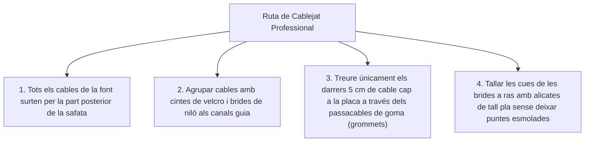

# 9.3 Fase 3: Protocol de Muntatge i Cable Management

  

    Progression de la sessió: 9.3 Acoblament i Gestió de Cablejat
    0 / 75 pts
  

  

    

  

  

    1. Execució de Muntatge
    2. Cable Management
    3. Optimització del Flux
  

La fase d'acoblament físic converteix una col·lecció de caixes individuals en un equip informàtic funcional. El nivell d'acabat professional es mesura directament per la neteja de la instal·lació i la cura en el guiatge de cables (*Cable Management*).

---

## 1. Bones Pràctiques en l'Acoblament Físic

- **Comprovació de Standoffs:** Assegurar que els separadors hexagonals coincideixen exactament amb els forats de la placa base abans de collar.
- **Pasta Tèrmica d'Alt Rendiment:** Aplicar un punt central de la mida d'un gra de pèsol (uns $4\text{ a }5\text{ mm}$ de diàmetre) o creu fina, comprovant que no hi haja plàstics protectors a la base de coure del dissipador.
- **Inserció de la Memòria RAM:** Pressionar fins a escoltar el doble clic ferm a les ranures A2 i B2.
- **Suport Anti-Sag per a Gràfiques Pesades:** Si la GPU supera els $28\text{ cm}$ o té 3 ventiladors, instal·lar un suport metàl·lic vertical de subjecció per evitar que el pes de la targeta deforme o esberle la ranura PCIe x16 amb el pas del temps.

---

## 2. L'Art del Cable Management Professional

El guiatge de cables no és una simple qüestió estètica per a caixes amb vidre; té dues funcions tècniques crítiques:
1. **Evitar turbulències en el flux d'aire:** Els cables solts davant dels ventiladors bloquegen l'entrada d'aire fresc, augmentant la temperatura del sistema en $3^\circ\text{C}-7^\circ\text{C}$.
2. **Prevenir atrapaments de pales:** Un cable descontrolat que toque les aspes d'un ventilador en rotació generarà soroll continu o bloquejarà el motor provocant un sobreescalfament.

---

## Reptes Interactius (Avalua els teus coneixements)

  
Repte 1: Prevenció de Deformació PCIe (GPU Sag)

  
Un equip munta una targeta gràfica d'alta gamma de 3 ranures de gruix i 1.8 kg de pes. Quin accessori és obligatori instal·lar al xassís per protegir la integritat física de la placa base?

  

    <label style="display:flex; align-items:center; gap:8px; cursor:pointer;"><input type="radio" name="mme_0903_q1" value="a"> Un suport de subjecció mecànic anti-sag per a sostenir l'extrem volat de la GPU i descarregar el pes de la ranura PCIe x16.</label>
    <label style="display:flex; align-items:center; gap:8px; cursor:pointer;"><input type="radio" name="mme_0903_q1" value="b"> Cinta aïllant negra al voltant dels ventiladors.</label>
    <label style="display:flex; align-items:center; gap:8px; cursor:pointer;"><input type="radio" name="mme_0903_q1" value="c"> Un segon cable HDMI.</label>
    <label style="display:flex; align-items:center; gap:8px; cursor:pointer;"><input type="radio" name="mme_0903_q1" value="d"> Una pila de botó addicional.</label>
  

  <button class="btn-check" data-correct="a" data-feedback="Correcte! El fenomen de 'GPU Sag' pot partir les soldadures de la ranura PCIe o corbar el PCB de la gràfica si no es recolza amb un suport ferm.">Comprova la resposta</button>
  

  
Repte 2: Finalitat Tècnica del Cable Management

  
A banda de l'ordre visual, quin és el principal benefici tècnic d'enrutar tots els cables per darrere de la placa base?

  

    <label style="display:flex; align-items:center; gap:8px; cursor:pointer;"><input type="radio" name="mme_0903_q2" value="a"> Augmenta la velocitat del rellotge de la memòria RAM.</label>
    <label style="display:flex; align-items:center; gap:8px; cursor:pointer;"><input type="radio" name="mme_0903_q2" value="b"> Deixa lliure el túnel central de flux d'aire per permetre que els ventiladors frontals introduïsquen aire fresc directament a la CPU i GPU sense obstacles ni turbulències.</label>
    <label style="display:flex; align-items:center; gap:8px; cursor:pointer;"><input type="radio" name="mme_0903_q2" value="c"> Fa que la font consumisca la meitat de corrent.</label>
    <label style="display:flex; align-items:center; gap:8px; cursor:pointer;"><input type="radio" name="mme_0903_q2" value="d"> Evita la instal·lació d'antivirus.</label>
  

  <button class="btn-check" data-correct="b" data-feedback="Molt bé! Els cables desordenats actuen com una barrera tèrmica que impedeix la circulació laminar d'aire fresc generant bosses d'aire calent al xassís.">Comprova la resposta</button>
  

  
Repte 3: Eina Recomanada per a Brides al Taller

  
Amb quina eina s'han de tallar les cues sobrants de les brides de niló utilitzades per subjectar els cables?

  

    <label style="display:flex; align-items:center; gap:8px; cursor:pointer;"><input type="radio" name="mme_0903_q3" value="a"> Unes alicates de tall ras (flush cutter) que tallen la brida al límit exacte sense deixar arestes punxegudes que puguen tallar la mà del tècnic en futures intervencions.</label>
    <label style="display:flex; align-items:center; gap:8px; cursor:pointer;"><input type="radio" name="mme_0903_q3" value="b"> Un encenedor de gas per cremar el plàstic.</label>
    <label style="display:flex; align-items:center; gap:8px; cursor:pointer;"><input type="radio" name="mme_0903_q3" value="c"> Unes tisores de cuina deixant puntes triangulars esmolades.</label>
    <label style="display:flex; align-items:center; gap:8px; cursor:pointer;"><input type="radio" name="mme_0903_q3" value="d"> No s'han de tallar mai.</label>
  

  <button class="btn-check" data-correct="a" data-feedback="Exacte! Les alicates de tall pla deixen el capçal de la brida suau i net, prevenint talls accidentals quan es manipulen cables més endavant.">Comprova la resposta</button>
  

---

  <h3 style="color: #1e40af; margin-top: 0;">Lliurament de l'Activitat a Aules</h3>
  

    Completa la tasca pràctica: <strong>Act03 - Dossier Gràfic de Muntatge i Control d'Enrutament de Cables</strong>. Genera el PDF oficial per a Aules.
  

  

    <input type="text" class="student-name-input" placeholder="El teu nom i cognoms..." style="padding: 8px 12px; border: 1px solid #94a3b8; border-radius: 6px; flex-grow: 1; min-width: 240px;">
    <button class="btn-generate-aules-pdf btn-aules-dl" data-module="MME" data-unit="UD09" data-activity="Act03" style="background: #2563eb; color: #fff; border: none; padding: 8px 16px; border-radius: 6px; cursor: pointer; font-weight: 600;">Generar PDF Aules</button>
  

