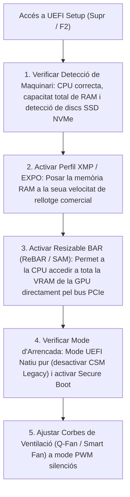

# 9.4 Fase 4: Configuració de Firmware UEFI i Instal·lació de SO

  

    Progression de la sessió: 9.4 Ajust de Firmware i Sistema Operatiu
    0 / 75 pts
  

  

    

  

  

    1. Paràmetres Clau UEFI
    2. Corbes de Ventilació
    3. Instal·lació Neta de SO
  

Un cop acabat el muntatge físic, arriba el moment d'encendre l'equip per primera vegada. El primer destí és la interfície de configuració de la **UEFI** per optimitzar els paràmetres de rendiment, seguretat i silenci abans d'instal·lar el sistema operatiu.

---

## 1. La Llista de Comprovació Obligatòria a la UEFI

En la primera encesa (prement repetidament les tecles `Supr` o `F2`):

> [!NOTE]
> **Resizable BAR (ReBAR):** Aquesta tecnologia permet al processador negociar transferències de dades amb la targeta gràfica accedint a tota la memòria de vídeo (ex. 12 GB o 16 GB) en un sol bloc gran, en lloc dels xicotets blocs clàssics de 256 MB. Activar-lo a la UEFI augmenta el rendiment gràfic en videojocs i renderitzat entre un $5\%$ i un $15\%$ de forma gratuïta.

---

## 2. Calibratge de Corbes de Ventilació PWM

Per evitar que l'ordinador semble un avió a reacció només obrir el navegador web, configurem una corba escalonada per temperatura de CPU a la utilitat de ventilació de la placa:
- Fins a **$50^\circ\text{C}$:** Ventiladors al **$30\%-40\%$** (pràcticament inaudibles durant ofimàtica o navegació).
- Entre **$50^\circ\text{C}\text{ i }75^\circ\text{C}$:** Increment progressiu lineal del **$40\%\text{ al }70\%$** (càrrega de treball mitjana).
- A partir de **$85^\circ\text{C}$:** Ventiladors al **$100\%$** (resposta d'emergència per seguretat tèrmica).

---

## 3. Instal·lació Neta del Sistema Operatiu i Controladors

1. **Particionat:** Utilitzar sempre taula de particions **GPT** (*GUID Partition Table*).
2. **Controladors Oficials:** Descarregar els darrers controladors del xipset i targeta gràfica directament des de les webs oficials del fabricant (Intel, AMD, NVIDIA), evitant programari genèric o utilitats de tercers no certificades.

---

## Reptes Interactius (Avalua els teus coneixements)

  
Repte 1: Millora d'Accés Gràfic amb Resizable BAR

  
Quina funció compleix l'opció Resizable BAR (ReBAR) a la configuració de la UEFI?

  

    <label style="display:flex; align-items:center; gap:8px; cursor:pointer;"><input type="radio" name="mme_0904_q1" value="a"> Permet que la CPU accedisca a tota la memòria VRAM de la targeta gràfica de cop a través del bus PCIe, eliminant el límit clàssic de blocs de 256 MB i millorant el rendiment.</label>
    <label style="display:flex; align-items:center; gap:8px; cursor:pointer;"><input type="radio" name="mme_0904_q1" value="b"> Canvia l'idioma de la pantalla a alemany.</label>
    <label style="display:flex; align-items:center; gap:8px; cursor:pointer;"><input type="radio" name="mme_0904_q1" value="c"> Permet connectar auriculars sense cable.</label>
    <label style="display:flex; align-items:center; gap:8px; cursor:pointer;"><input type="radio" name="mme_0904_q1" value="d"> Apaga el monitor quan no s'utilitza.</label>
  

  <button class="btn-check" data-correct="a" data-feedback="Correcte! ReBAR elimina el coll d'ampolla històric de transferència de memòria entre CPU i GPU, aportant un increment de fotogrames immediat.">Comprova la resposta</button>
  

  
Repte 2: Activació de la Freqüència Comercial de RAM

  
Un equip acabat d'acoblar incorpora memòries DDR5 anunciades a 6000 MT/s. En encendre l'ordinador per primera vegada, la UEFI mostra que estan funcionant a 4800 MT/s. Què s'ha de fer abans d'eixir de la UEFI?

  

    <label style="display:flex; align-items:center; gap:8px; cursor:pointer;"><input type="radio" name="mme_0904_q2" value="a"> Canviar els mòduls de memòria per uns altres.</label>
    <label style="display:flex; align-items:center; gap:8px; cursor:pointer;"><input type="radio" name="mme_0904_q2" value="b"> Habilitar el perfil XMP (en plataformes Intel) o EXPO (en plataformes AMD) per carregar el voltatge i les temporitzacions certificades pel fabricant.</label>
    <label style="display:flex; align-items:center; gap:8px; cursor:pointer;"><input type="radio" name="mme_0904_q2" value="c"> Reformatar el disc SSD NVMe.</label>
    <label style="display:flex; align-items:center; gap:8px; cursor:pointer;"><input type="radio" name="mme_0904_q2" value="d"> Connectar un altaveu a la targeta de so.</label>
  

  <button class="btn-check" data-correct="b" data-feedback="Molt bé! Els perfils XMP/EXPO apliquen amb un sol clic la tensió i velocitat garantida del kit, evitant que la memòria funcione amb els paràmetres conservadors JEDEC.">Comprova la resposta</button>
  

  
Repte 3: Requisit de Taula de Particions per a UEFI

  
Quin esquema de taula de particions és obligatori utilitzar en inicialitzar el disc durant la instal·lació d'un sistema operatiu modern en mode UEFI natiu?

  

    <label style="display:flex; align-items:center; gap:8px; cursor:pointer;"><input type="radio" name="mme_0904_q3" value="a"> MBR (Master Boot Record)</label>
    <label style="display:flex; align-items:center; gap:8px; cursor:pointer;"><input type="radio" name="mme_0904_q3" value="b"> GPT (GUID Partition Table)</label>
    <label style="display:flex; align-items:center; gap:8px; cursor:pointer;"><input type="radio" name="mme_0904_q3" value="c"> FAT16</label>
    <label style="display:flex; align-items:center; gap:8px; cursor:pointer;"><input type="radio" name="mme_0904_q3" value="d"> ISO 9660</label>
  

  <button class="btn-check" data-correct="b" data-feedback="Exacte! L'estàndard UEFI requereix la taula GPT per gestionar la partició de sistema EFI (ESP) i habilitar Secure Boot.">Comprova la resposta</button>
  

---

  <h3 style="color: #1e40af; margin-top: 0;">Lliurament de l'Activitat a Aules</h3>
  

    Completa la tasca pràctica: <strong>Act04 - Guia de Paràmetres Òptims de UEFI, Corbes PWM i Validació d'Instal·lació</strong>. Genera el PDF oficial per a Aules.
  

  

    <input type="text" class="student-name-input" placeholder="El teu nom i cognoms..." style="padding: 8px 12px; border: 1px solid #94a3b8; border-radius: 6px; flex-grow: 1; min-width: 240px;">
    <button class="btn-generate-aules-pdf btn-aules-dl" data-module="MME" data-unit="UD09" data-activity="Act04" style="background: #2563eb; color: #fff; border: none; padding: 8px 16px; border-radius: 6px; cursor: pointer; font-weight: 600;">Generar PDF Aules</button>
  

