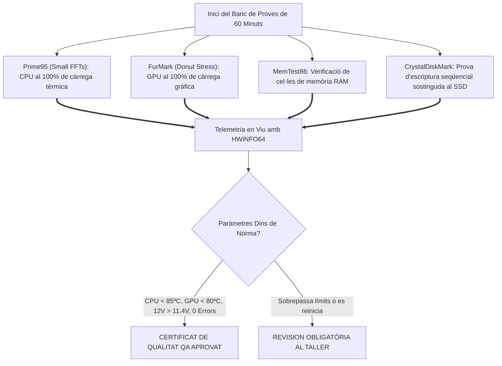

# 9.5 Fase 5: Proves d'Estrès, Llista de Verificació QA i Lliurament

  

    Progression de la sessió: 9.5 Control de Qualitat i Lliurament
    0 / 75 pts
  

  

    

  

  

    1. Banc de Burn-In
    2. Checklist de QA
    3. Acta de Lliurament
  

L'última fase del cicle professional és el **Control de Qualitat (*Quality Assurance - QA*)**. Cap ordinador es pot entregar al client sense haver superat una bateria de proves d'estrès continuades i sense signar l'acta de lliurament amb el registre complet de números de sèrie dels components.

---

## 1. El Protocol de Prova d'Estrès Continuada (*Burn-In Testing*)

El test de rodatge (*burn-in*) té una durada mínima de **60 minuts** i sotmet tots els subsistemes a càrrega sostinguda simultània:

---

## 2. La Llista de Verificació de Control de Qualitat (*QA Checklist*)

Abans de col·locar el precinte de garantia al xassís, el tècnic marca cadascun dels punts de control:
- [ ] **Mecànica:** Tots els cargols de placa, font i targetes estan fermament ajustats; el suport anti-sag està instal·lat.
- [ ] **Tèrmica:** Temperatura en repòs (*idle*) de CPU $\le 45^\circ\text{C}$; en màxima càrrega $\le 85^\circ\text{C}$.
- [ ] **Elèctrica:** Línia de $+12\text{V}$ mesurada per sobre d'$11.80\text{ V}$ sota màxim consum combinat.
- [ ] **Àudio i Frontal:** Comprovats connectors d'auriculars frontals, micròfon i tots els ports USB 3.0 / USB-C de la caixa.
- [ ] **Xarxa:** Port Ethernet provat a $1\text{ Gbps}$ / $2.5\text{ Gbps}$ i Wi-Fi/Bluetooth connectant correctament.
- [ ] **Neteja:** Panells de vidre lliures de petjades i interior completament buit de pols o restes de cables.

---

## 3. L'Acta Oficial de Lliurament al Client

L'acta de recepció i lliurament és el document legal de conformitat que protegeix tant al client com a l'empresa de manteniment:
1. **Identificació de l'Equip:** Marca, model del xassís i número de bastidor o codi intern de taller.
2. **Traçabilitat de Peces:** Taula detallada amb el **número de sèrie (S/N)** individual de la CPU, placa base, memòries RAM, SSDs, GPU i font d'alimentació (vital per a tramitar garanties amb el fabricant).
3. **Informe d'Assaig:** Captures de pantalla adjuntes de la telemetria de HWiNFO64 i resultats de Cinebench / MemTest.
4. **Signatura de Recepció:** Signatura de conformitat del client conforme l'equip s'entrega en perfecte estat operatiu i amb els precintes intactes.

---

## Reptes Interactius (Avalua els teus coneixements)

  
Repte 1: Importància del Burn-In Test

  
Per quina raó professional és obligatori sotmetre un ordinador acabat de muntar a un test d'estrès continuat de 60 minuts abans d'entregar-lo al client?

  

    <label style="display:flex; align-items:center; gap:8px; cursor:pointer;"><input type="radio" name="mme_0905_q1" value="a"> Per descarregar la bateria de la placa base.</label>
    <label style="display:flex; align-items:center; gap:8px; cursor:pointer;"><input type="radio" name="mme_0905_q1" value="b"> Perquè la majoria de defectes de fàbrica o errors d'acoblament (pasta tèrmica mal aplicada, fonts febles, perfils XMP inestables) es manifesten durant la primera hora sota màxima càrrega de treball tèrmica i elèctrica.</label>
    <label style="display:flex; align-items:center; gap:8px; cursor:pointer;"><input type="radio" name="mme_0905_q1" value="c"> Perquè Windows no funciona sense aquest test.</label>
    <label style="display:flex; align-items:center; gap:8px; cursor:pointer;"><input type="radio" name="mme_0905_q1" value="d"> Per comprovar la velocitat del ratolí.</label>
  

  <button class="btn-check" data-correct="b" data-feedback="Correcte! És la clàssica corba de la banyera en fiabilitat: les fallades prematures de maquinari ocorren en les primeres hores de càrrega intensa.">Comprova la resposta</button>
  

  
Repte 2: Registre de Números de Sèrie a l'Acta

  
Per què és imprescindible anotar cadascun dels números de sèrie (S/N) dels components físics a l'acta de lliurament tècnic?

  

    <label style="display:flex; align-items:center; gap:8px; cursor:pointer;"><input type="radio" name="mme_0905_q2" value="a"> Per garantir la traçabilitat davant de reclamacions de garantia oficial del fabricant i demostrar de manera inequívoca quina peça exacta es va instal·lar a la màquina.</label>
    <label style="display:flex; align-items:center; gap:8px; cursor:pointer;"><input type="radio" name="mme_0905_q2" value="b"> Perquè la policia puga rastrejar l'adreça IP.</label>
    <label style="display:flex; align-items:center; gap:8px; cursor:pointer;"><input type="radio" name="mme_0905_q2" value="c"> Perquè el sistema operatiu funcione més ràpid.</label>
    <label style="display:flex; align-items:center; gap:8px; cursor:pointer;"><input type="radio" name="mme_0905_q2" value="d"> Per poder vendre les peces a tercers.</label>
  

  <button class="btn-check" data-correct="a" data-feedback="Molt bé! La traçabilitat per S/N protegeix el servei tècnic contra fraus i assegura que el client puga tramitar garanties legals directament amb els fabricants.">Comprova la resposta</button>
  

  
Repte 3: Criteri de Rebuig en Control de Qualitat

  
Durant els últims 10 minuts de la prova de 60 minuts, la temperatura de la CPU es manté a 98 °C i HWiNFO64 marca l'alerta 'Thermal Throttling: YES' amb una caiguda sobtada de freqüència. Pot superar l'equip el control de qualitat?

  

    <label style="display:flex; align-items:center; gap:8px; cursor:pointer;"><input type="radio" name="mme_0905_q3" value="a"> Sí, perquè l'equip no s'ha apagat del tot.</label>
    <label style="display:flex; align-items:center; gap:8px; cursor:pointer;"><input type="radio" name="mme_0905_q3" value="b"> No; l'equip ha fallat el control de qualitat tèrmic. S'ha de rebutjar el lliurament immediatament, desmuntar el dissipador, verificar la pasta tèrmica, comprovar la pressió de contacte i revisar el flux d'aire de la caixa.</label>
    <label style="display:flex; align-items:center; gap:8px; cursor:pointer;"><input type="radio" name="mme_0905_q3" value="c"> Sí, si el client promet no jugar a videojocs.</label>
    <label style="display:flex; align-items:center; gap:8px; cursor:pointer;"><input type="radio" name="mme_0905_q3" value="d"> Sí, abaixant la brillantor del monitor.</label>
  

  <button class="btn-check" data-correct="b" data-feedback="Exacte! El 'Thermal Throttling' significa que la CPU s'està ofegant en calor i reduint la seua velocitat per no cremar-se. L'equip no és apte per a entrega professional.">Comprova la resposta</button>
  

---

  <h3 style="color: #1e40af; margin-top: 0;">Lliurament de l'Activitat a Aules</h3>
  

    Completa la tasca pràctica: <strong>Act05 - Dossier de Control de Qualitat (QA), Bateria de Proves de Càrrega i Acta de Lliurament Tècnic</strong>. Genera el PDF oficial per a Aules.
  

  

    <input type="text" class="student-name-input" placeholder="El teu nom i cognoms..." style="padding: 8px 12px; border: 1px solid #94a3b8; border-radius: 6px; flex-grow: 1; min-width: 240px;">
    <button class="btn-generate-aules-pdf btn-aules-dl" data-module="MME" data-unit="UD09" data-activity="Act05" style="background: #2563eb; color: #fff; border: none; padding: 8px 16px; border-radius: 6px; cursor: pointer; font-weight: 600;">Generar PDF Aules</button>
  

