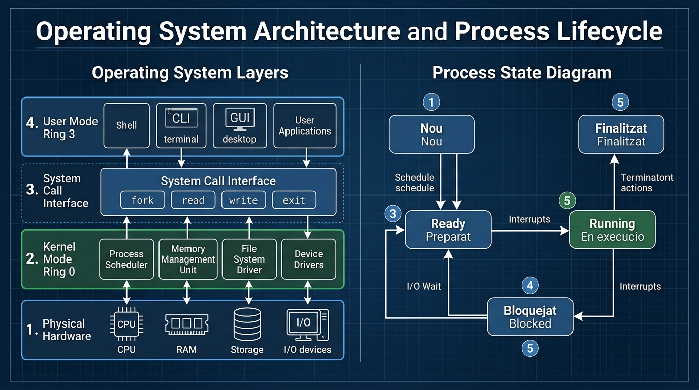

# 📘 UD2 — Introducció als Sistemes Informàtics i Sistemes Operatius

La **Unitat Didàctica 2** analitza els fonaments de l'arquitectura d'un sistema informàtic, el paper essencial del sistema operatiu com a gestor de recursos, la transició entre espai d'usuari i espai de nucli (*kernel*), el cicle de vida dels processos i la lògica de gestió del sistema d'arxius.

---

## 🖼️ Infografia Tècnica: Arquitectura del SO i Cicle de Vida dels Processos

Aquesta infografia resumeix de forma visual els dos grans pilars que sustenten qualsevol sistema operatiu modern (GNU/Linux o Microsoft Windows):

### 🔍 Llegenda Tècnica i Desglossament de l'Esquema:

#### 1. Capes del Sistema Operatiu (*Operating System Layers* - Panell Esquerre)
1. **Maquinari Físic (*Physical Hardware*):**
   - Compost per la CPU (Unitat Central de Processament), memòria RAM primària, controladors de disc i emmagatzematge, i interfícies d'entrada/eixida (E/S).
2. **Mode Nucli / Ring 0 (*Kernel Mode Ring 0*):**
   - El nivell de màxim privilegi del processador. Executa el planificador de processos (*Process Scheduler*), la unitat de gestió de memòria virtual (*Memory Management Unit - MMU*), el subsistema d'arxius (*File System Driver*) i els controladors de dispositius (*Device Drivers*). Té accés complet i directe a totes les instruccions de maquinari.
3. **Interfície de Crides al Sistema (*System Call Interface - Syscalls*):**
   - La frontera segura entre el món de l'usuari i el nucli. Funcions primitives com `fork()`, `read()`, `write()`, `open()` i `exit()` permeten a les aplicacions demanar serveis al nucli sense comprometre la integritat del maquinari.
4. **Mode Usuari / Ring 3 (*User Mode Ring 3*):**
   - Nivell d'accés restringit on s'executen els programes de l'usuari, terminals de comandes (*Shell*, Bash, PowerShell), entorns gràfics (*GUI desktop*) i programari ofimàtic o navegadors. Si una aplicació cau en aquest nivell, no bloqueja el sistema operatiu complet.

---

#### 2. Diagrama d'Estats del Procés (*Process State Diagram* - Panell Dret)
1. **Nou (*New / Nou*):** El procés s'està creant a la memòria a partir d'un executable emmagatzemat a disc. S'assigna un PID (*Process ID*) i un bloc de control de procés (**PCB** - *Process Control Block*).
2. **Preparat (*Ready / Preparat*):** El procés disposa de tots els recursos de memòria requerits i es troba a la cua d'espera de la CPU aguardant que el planificador li assigne temps d'execució (*CPU Quantum*).
3. **En execució (*Running / En execució*):** Les instruccions del procés s'estan executant directament en un nucli de la CPU.
4. **Bloquejat (*Blocked / Waiting / Bloquejat*):** El procés no pot continuar perquè està esperant un esdeveniment extern (per exemple, lectura d'un fitxer lent a disc, resposta d'un paquet de xarxa o pulsació de teclat). En acabar l'espera, torna a l'estat **Preparat**.
5. **Finalitzat (*Terminated / Finalitzat*):** El procés ha completat les seues instruccions o ha estat cancel·lat per un senyal extern (`kill`, `SIGTERM`, `SIGKILL`). El nucli allibera tota la memòria RAM assignada i esborra el seu PCB.

---

## 📐 Càlculs d'Adreçament de Memòria i Sistemes de Numeració

Els sistemes operatius gestionen l'espai de memòria mitjançant busos d'adreces de $n$ bits. La quantitat màxima de posicions de memòria directament adreçables és:

$$\text{Capacitat Màxima Adreçable} = 2^n \text{ bytes}$$

Per exemple:
- En una arquitectura clàssica de **32 bits**:
  $$2^{32} \text{ bytes} = 4.294.967.296 \text{ bytes} = 4 \text{ GiB}$$
  Aquest límit explica per què un sistema operatiu de 32 bits no pot aprofitar més de 4 GiB de RAM física.
- En una arquitectura moderna de **64 bits** (x86-64 / AMD64):
  $$2^{64} \text{ bytes} = 18.446.744.073.709.551.616 \text{ bytes} = 16 \text{ EiB (Exbibytes)}$$

---

## 📑 Continguts i Apartats de la Unitat

| Apartat | Títol | Descripció |
| :---: | :--- | :--- |
| **[2.3](./ut0203.md)** | **El Sistema Informàtic i Funcions del SO** | Estructura maquinari/programari, funcions del nucli i gestió d'E/S. |
| **[2.4](./ut0204.md)** | **Gestió de Processos i Fils** | Cicle de vida, PCB, algorismes de planificació (FIFO, Round Robin, Prioritat). |
| **[2.8](./ut0208.md)** | **Sistemes de Numeració** | Conversió Binari, Decimal i Hexadecimal en adreces de memòria. |
| **[2.10](./ut0210.md)** | **El Sistema d'Arxius** | Jerarquia de directoris, metadades (inodos, MFT) i rutes relatives vs absolutes. |
| **[2.12](./ut0212.md)** | **Permisos i Atributs de Seguretat** | Model POSIX (`rwx`, càlcul octal `chmod`) i llistes de control d'accés (ACL) a Windows. |
| **[2.13](./ut0213.md)** | **Sistemes Transaccionals i Journaling** | Integritat del sistema de fitxers, tolerància a fallades i eines `fsck` / `chkdsk`. |
