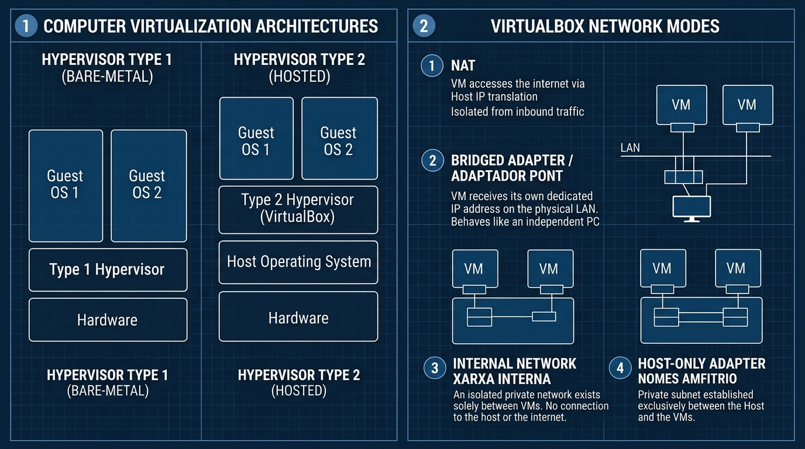

# 📘 UD3 — Virtualització i Màquines Virtuals

La **Unitat Didàctica 3** aborda una de les tecnologies més disruptives i essencials en l'administració de sistemes moderna: la **virtualització de plataformes**. Aquesta tècnica permet executar múltiples sistemes operatius complets i independents de forma concurrent sobre una mateixa màquina física.

---

## 🖼️ Infografia Tècnica: Arquitectura de Virtualització i Modes de Xarxa

L'esquema següent mostra la diferència fonamental entre hipervisors Tipus 1 i Tipus 2, així com els quatre modes de connexió de xarxa en entorns de laboratori (Oracle VirtualBox):

### 🔍 Llegenda Tècnica i Desglossament de l'Esquema:

#### 1. Arquitectures de Virtualització (*Panel 1*)
- **Hipervisor Tipus 1 (Bare-Metal o Natiu):**
  - S'executa directament sobre el maquinari físic de la màquina sense cap sistema operatiu amfitrió previ.
  - El mateix hipervisor gestiona la CPU, la memòria i els controladors d'E/S amb un rendiment proper al 98-99% del maquinari natiu (*quasi-zero overhead*).
  - Exemples industrials: **VMware ESXi**, **Proxmox VE (KVM natiu)**, **Microsoft Hyper-V Server**, **Xen**.
  - Ús habitual: Centres de processament de dades (CPDs), servidors corporatius i plataformes cloud (AWS, Azure, Google Cloud).
- **Hipervisor Tipus 2 (Hosted o Allotjat):**
  - S'executa com una aplicació ordinària dins d'un sistema operatiu amfitrió convencional (*Host OS*, com Windows 11 o Ubuntu Desktop).
  - Requereix que totes les crides a maquinari passen a través del sistema amfitrió, introduint una xicoteta pèrdua de rendiment (*overhead*).
  - Exemples d'estació de treball: **Oracle VM VirtualBox**, **VMware Workstation Pro / Player**, **Parallels Desktop**.
  - Ús habitual: Aules de formació professional, laboratoris de proves, desenvolupament de programari i anàlisi de malware aïllat.

---

#### 2. Modes de Xarxa de VirtualBox (*Panel 2*)
1. **1. NAT (*Network Address Translation* - Per Defecte):**
   - La màquina virtual rep una IP privada interna assignada pel motor de VirtualBox (habitualment `10.0.2.15/24`).
   - La VM té accés complet a Internet perquè el *Host* actua com a router/NAT, però **cap equip exterior (ni tan sols el propi ordinador amfitrió) pot iniciar connexions cap a la VM** de manera directa sense configurar reenviament de ports (*Port Forwarding*).
2. **2. Adaptador Pont (*Bridged Adapter* / Adaptador Pont):**
   - La targeta virtual de la VM s'enllaça directament amb la targeta de xarxa física del PC amfitrió (Ethernet o Wi-Fi).
   - La màquina virtual sol·licita la seua pròpia adreça IP directament al router físic de l'aula (com si fóra un ordinador real independent connectat amb cable).
   - Permet visibilitat bidireccional completa amb el *Host*, altres màquines de l'aula i Internet.
3. **3. Xarxa Interna (*Internal Network* / Xarxa Interna):**
   - Crea un commutador (*switch*) virtual completament tancat i invisible des de l'exterior.
   - Les VMs connectades a la mateixa xarxa interna es poden comunicar entre elles, però **no tenen cap accés a Internet ni poden parlar amb l'amfitrió**. Ideal per a laboratoris de serveis de xarxa (servidors DHCP/DNS aïllats).
4. **4. Adaptador Només-Amfitrió (*Host-Only Adapter* / Només Amfitrió):**
   - Crea una subxarxa privada que connecta exclusivament l'ordinador amfitrió amb les seues màquines virtuals.
   - Permet transferir fitxers o connectar-se per SSH des del *Host* a la VM sense exposar la màquina virtual a la xarxa física exterior de l'institut.

---

## 💾 Formats de Disc Virtual i Instantànies (*Snapshots*)

Els discs durs de les màquines virtuals s'emmagatzemen com a fitxers ordinaris en el disc de l'amfitrió:
- **VDI (VirtualBox Disk Image):** Format natiu i optimitzat d'Oracle VirtualBox.
- **VMDK (Virtual Machine Disk):** Format estàndard de VMware, altament interoperable.
- **VHD / VHDX:** Format utilitzat per Microsoft Hyper-V.

### Tipus de Reserva d'Espai:
- **Reservat Dinàmicament (*Thin Provisioning*):** El fitxer de disc creix a mesura que la VM escriu noves dades, ocupant només l'espai realment utilitzat en l'amfitrió.
- **Mida Fixa (*Thick Provisioning*):** Es reserva tot l'espai d'una vegada (per exemple, 50 GB). Ofereix un millor rendiment d'escriptura a canvi d'ocupar espai immediat.

### La Màgia de les Instantànies (*Snapshots*):
Una instantània congela l'estat exacte del disc i la memòria de la VM en un instant temporal. Si una instal·lació falla o el sistema s'infecta amb un virus durant una pràctica, el tècnic pot **revertir l'estat** en segons sense haver de reinstal·lar el sistema operatiu.

---

## 📑 Continguts i Apartats de la Unitat

| Apartat | Títol | Descripció |
| :---: | :--- | :--- |
| **[3.3](./ut0303.md)** | **Fonaments de la Virtualització** | Concepte d'Host vs Guest, emulació vs virtualització assistida per maquinari. |
| **[3.4](./ut0304.md)** | **Tipus d'Hipervisors i Arquitectura** | Anàlisi comparativa d'hipervisors Tipus 1 (Bare-Metal) vs Tipus 2 (Hosted). |
| **[3.7](./ut0307.md)** | **Oracle VM VirtualBox en Detall** | Interfície, paràmetres de memòria, processador, controladors de disc i xarxa. |
| **[3.10](./ut0310.md)** | **Instal·lació de Màquines Guests (Linux/Windows)** | Desplegament pas a pas d'Ubuntu Desktop i Windows 11 en VM. |
| **[3.14](./ut0314.md)** | **Guest Additions i Integració** | Instal·lació de controladors gràfics, carpetes compartides i portapapers bidireccional. |
