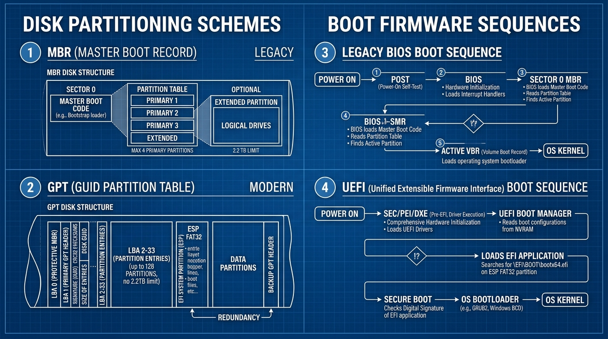

# 📘 UD4 — Instal·lació de Sistemes Operatius, Particionament i Gestors d'Arrencada

La **Unitat Didàctica 4** constitueix el nucli tècnic del muntatge i desplegament de sistemes microinformàtics. S'hi aprofundeix en l'arquitectura dels discs d'emmagatzematge, els esquemes de taules de particions (MBR vs GPT), els firmwares d'arrencada (Legacy BIOS vs UEFI), la seqüència de càrrega del nucli i la convivència de múltiples sistemes operatius (*Dual Boot*).

---

## 🖼️ Infografia Tècnica: Esquemes de Particions i Seqüències d'Arrencada

L'esquema següent detalla l'evolució tecnològica entre els sistemes clàssics basats en MBR/BIOS i els estàndards moderns basats en GPT/UEFI:

### 🔍 Llegenda Tècnica i Desglossament de l'Esquema:

#### 1. MBR (*Master Boot Record* - Clàssic / Legacy - Panell Superior Esquerre)
- Ubicat al primer sector físic del disc dur (**Sector 0**, exactament 512 bytes):
  - **Codi d'arrencada mestre (*Master Boot Code*):** 446 bytes de codi màquina executable per la BIOS.
  - **Taula de particions primàries:** 64 bytes dividits en exactament 4 entrades de 16 bytes cadascuna.
  - **Signatura d'arrencada (*Magic Number*):** 2 bytes finals (`0x55AA`).
- **Limitacions crítiques del MBR:**
  - Només permet un màxim de **4 particions primàries**. Si en calen més, s'ha de convertir una partició primària en *partició estesa*, la qual conté una cadena de particions lògiques (EBR - *Extended Boot Record*).
  - Utilitza camps de 32 bits per emmagatzemar el número de sectors lògics (LBA). Amb sectors estàndard de 512 bytes, la mida màxima adreçable del disc és:
    $$\text{Límit MBR} = 2^{32} \times 512 \text{ bytes} = 2.199.023.255.552 \text{ bytes} \approx 2,2 \text{ TB}$$
    Qualsevol disc dur de 3 TB, 4 TB o superior formatat amb MBR perdrà completament l'espai sobrant més enllà dels 2,2 TB!

---

#### 2. GPT (*GUID Partition Table* - Modern - Panell Inferior Esquerre)
- Integrat en l'estàndard UEFI:
  - **LBA 0 - Protective MBR:** Manté un registre MBR fictici per compatibilitat amb eines antigues de disc, evitant que un programari antic interprete el disc com a no particionat i sobreescriga les dades.
  - **LBA 1 - Primary GPT Header:** Conté l'identificador únic del disc (GUID de 128 bits), la mida de la taula de particions i una suma de comprovació **CRC32** per detectar corrupcions lògiques.
  - **LBA 2-33 - Entrades de particions:** Permet un mínim de **128 particions primàries** de base (sense necessitat de particions esteses ni lògiques).
  - **Partició de Sistema EFI (ESP - *EFI System Partition*):** Partició formatejada obligatòriament en **FAT32** (típicament entre 100 MB i 512 MB) on s'allotgen els fitxers executables `.efi` de càrrega de cada sistema operatiu (`/EFI/boot/bootx64.efi`, `/EFI/ubuntu/grubx64.efi`).
  - **Backup GPT Header:** Al final físic del disc es guarda una còpia exacta de seguretat de tota la taula GPT per a restauració automàtica en cas de dany.
  - **Capacitat màxima:** Utilitza camps LBA de 64 bits:
    $$\text{Límit GPT} = 2^{64} \times 512 \text{ bytes} \approx 9,4 \times 10^{21} \text{ bytes} = 9,4 \text{ ZB (Zettabytes)}$$

---

#### 3. Seqüència d'Arrencada BIOS Clàssica (*Panel Superior Dret*)
1. **Power On $\rightarrow$ POST:** Comprovació d'alimentació i autotest de memòria i perifèrics de la placa base.
2. **BIOS:** Inicialitza els controladors en mode real de 16 bits i llegeix el primer dispositiu de la seqüència d'arrencada configurada en CMOS.
3. **Sector 0 MBR:** La BIOS carrega els 446 bytes del codi mestre del sector 0 a l'adreça de memòria `0x7C00`.
4. **VBR (*Volume Boot Record*):** El codi MBR busca a la taula quina partició està marcada com a **Activa** (*Bootable flag `0x80`*) i salta al primer sector d'eixa partició (VBR).
5. **Càrrega del Nucli:** El codi del VBR carrega el carregador final (com NTLDR a Windows XP o LILO antigament), que finalment inicia el nucli del sistema operatiu.

---

#### 4. Seqüència d'Arrencada UEFI Moderna (*Panel Inferior Dret*)
1. **Power On $\rightarrow$ Fases SEC / PEI / DXE:** Execució en mode protegit de 32/64 bits des del primer cicle de rellotge, inicialitzant controladors natius d'alta velocitat.
2. **UEFI Boot Manager:** Consulta les variables d'arrencada emmagatzemades a la memòria no volàtil **NVRAM** de la placa base (ordre de sistemes: Windows Boot Manager, ubuntu, etc.).
3. **Lectura directa del sistema de fitxers:** El firmware UEFI comprèn de forma nativa el sistema de fitxers FAT32 de la partició **ESP**. No depèn de sectors físics ocults ni codis MBR.
4. **Secure Boot (Arrencada Segura):** Verifica la signatura criptogràfica digital dels fitxers `.efi` contra els certificats emmagatzemats a les claus del maquinari (base de dades `db`), blocant qualsevol programari no signat o *rootkit*.
5. **Execució del Bootloader:** S'executa `bootx64.efi`, que crida a **GRUB 2** (Linux) o **bootmgfw.efi** (Windows BCD), que transfereixen el control al nucli (`vmlinuz` o `ntoskrnl.exe`).

---

## 📑 Continguts i Apartats de la Unitat

| Apartat | Títol | Descripció |
| :---: | :--- | :--- |
| **[4.2](./ut0402.md)** | **Introducció a la Instal·lació de SO** | Fases prèvies, requeriments de maquinari i comprovació de compatibilitat. |
| **[4.5](./ut0405.md)** | **Gestió de Memòria i Memòria Virtual** | Paginació, fitxers de swap (`pagefile.sys`) i particions d'intercanvi a Linux. |
| **[4.8](./ut0408.md)** | **Arquitectura del Sistema Operatiu** | Nuclis monolítics (Linux) vs híbrids (Windows NT) vs microkernels. |
| **[4.10](./ut0410.md)** | **Mètodes d'Instal·lació i Particionament** | Mitjans USB (Rufus/Ventoy), particionament manual amb `gparted` / `diskpart`. |
| **[4.12](./ut0412.md)** | **Carregadors d'Arrencada (Boot Loaders)** | Configuració de GRUB 2 (`/etc/default/grub`), Windows BCD i muntatge de Dual Boot. |
