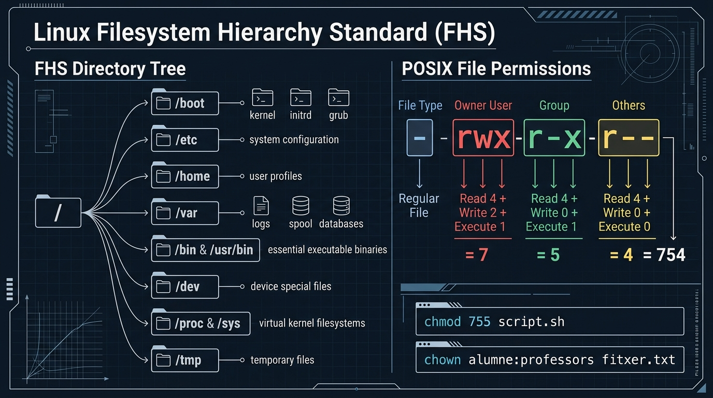

# 📘 UD5 — Tasques Bàsiques de Configuració, Administració i Automatització

La **Unitat Didàctica 5** tanca el recorregut formatiu del mòdul de Sistemes Operatius Monolloc dotant l'alumnat de les competències d'administració diària d'un tècnic: gestió de la jerarquia del sistema de fitxers, domini de la consola d'ordres (CLI), assignació de permisos i drets d'usuari, gestió de programari i automatització de tasques periòdiques de manteniment.

---

## 🖼️ Infografia Tècnica: Jerarquia FHS de Linux i Model de Permisos POSIX

L'esquema següent mostra l'estàndard d'arbre de directoris FHS (*Filesystem Hierarchy Standard*) i el desglossament matemàtic del càlcul de permisos en entorns Unix/Linux:



### 🔍 Llegenda Tècnica i Desglossament de l'Esquema:

#### 1. L'Arbre de Directoris FHS (*FHS Directory Tree* - Panell Esquerre)
En sistemes GNU/Linux no existeixen les lletres d'unitat (`C:`, `D:`) de Windows. Tot el sistema d'emmagatzematge penja d'un únic directori arrel simbolitzat per la barra inclinada `/` (*Root*):
- `/boot`: Conté els components crítics per a l'arrencada: el nucli comprimit (`vmlinuz`), la imatge del disc RAM inicial (`initrd.img`) i els mòduls de configuració del carregador GRUB.
- `/etc`: Directori destinat als fitxers de configuració de tot el sistema en format text pla (`passwd`, `shadow`, `fstab`, `network`, fitxers de serveis). No conté fitxers executables binaris.
- `/home`: Allotja els directoris personals de cada usuari ordinari del sistema (`/home/alumne`, `/home/professora`), on cadascú té control absolut sobre els seus documents.
- `/var`: Dades de mida altament variable durant l'ús del sistema: fitxers de registre d'esdeveniments (*logs* a `/var/log`), cues d'impressió i correu (*spool*), i bases de dades (`/var/lib/mysql`).
- `/bin` i `/usr/bin`: Conté els executables binaris de les ordres essencials del sistema utilitzades tant per l'administrador com pels usuaris (`ls`, `cp`, `bash`, `python3`, `nano`).
- `/dev`: Nodes especials que representen els dispositius físics de maquinari com si foren fitxers (`/dev/sda` per al primer disc, `/dev/nvme0n1` per a un SSD NVMe, `/dev/urandom` per a nombres aleatoris).
- `/proc` i `/sys`: Sistemes de fitxers virtuals generats pel nucli en memòria RAM. Permeten inspeccionar l'estat del maquinari i dels processos en temps real (`/proc/cpuinfo`, `/proc/meminfo`).
- `/tmp`: Directori per a fitxers temporals. Habitualment es buida de forma automàtica a cada reinici del sistema.

---

#### 2. Model de Permisos POSIX (*POSIX File Permissions* - Panell Dret)
Una cadena estàndard de permisos com `-rwxr-xr--` es divideix en 4 segments:
1. **Tipus de recurs (1 caràcter):**
   - `-` : Fitxer regular / ordinari.
   - `d` : Directori.
   - `l` : Enllaç simbòlic (*symbolic link*).
2. **Usuari Propietari (*Owner User* - 3 caràcters):** Permisos per al creador del fitxer (`rwx`).
   $$\text{Lectura (4)} + \text{Escriptura (2)} + \text{Execució (1)} = \mathbf{7}$$
3. **Grup Propietari (*Group* - 3 caràcters):** Permisos per als membres del grup (`r-x`).
   $$\text{Lectura (4)} + \text{Sense Escriptura (0)} + \text{Execució (1)} = \mathbf{5}$$
4. **Altres Usuaris (*Others* - 3 caràcters):** Permisos per a la resta d'usuaris (`r--`).
   $$\text{Lectura (4)} + \text{Sense Escriptura (0)} + \text{Sense Execució (0)} = \mathbf{4}$$
- **Valor Octal Combinat:** `754`
- **Comandaments aplicats a la consola:**
  - `chmod 755 script.sh` : Assigna permisos `rwxr-xr-x` a l'script.
  - `chown alumne:professors fitxer.txt` : Canvia el propietari a `alumne` i el grup a `professors`.

---

## 💻 Taula d'Ordres Equivalents: Windows (CMD / PowerShell) vs Linux (Bash)

| Acció d'Administració | Linux (Bash) | Windows (CMD) | Windows (PowerShell) |
| :--- | :--- | :--- | :--- |
| **Directori de treball actual** | `pwd` | `cd` | `Get-Location` (`pwd`) |
| **Llistar contingut** | `ls -la` | `dir` | `Get-ChildItem` (`dir` / `ls`) |
| **Canviar de directori** | `cd /ruta` | `cd \ruta` | `Set-Location /ruta` |
| **Crear directori** | `mkdir nom_carpeta` | `mkdir nom_carpeta` | `New-Item -ItemType Directory` |
| **Copiar fitxers** | `cp origen desti` | `copy origen desti` | `Copy-Item origen desti` |
| **Moure o reanomenar** | `mv vell nou` | `move vell nou` | `Move-Item vell nou` |
| **Esborrar fitxer** | `rm fitxer` | `del fitxer` | `Remove-Item fitxer` |
| **Visualitzar contingut de text**| `cat fitxer.txt` | `type fitxer.txt` | `Get-Content fitxer.txt` |
| **Netejar la pantalla** | `clear` | `cls` | `Clear-Host` (`cls`) |
| **Configuració de xarxa** | `ip a` / `ip route` | `ipconfig /all` | `Get-NetIPAddress` |

---

## ⏰ Automatització de Tasques: Sintaxi de Crontab

En entorns GNU/Linux, el dimoni `cron` executa tasques programades automàticament segons una expressió de **5 camps temporals**:

```
 ┌───────────── Minut (0 - 59)
 │ ┌────────────── Hora (0 - 23)
 │ │ ┌─────────────── Dia del mes (1 - 31)
 │ │ │ ┌──────────────── Mes de l'any (1 - 12)
 │ │ │ │ ┌───────────────── Dia de la setmana (0 - 7, on 0 i 7 = Diumenge)
 │ │ │ │ │
 * * * * *  /ruta/a/la/comanda_o_script.sh
```

### Exemples pràctics per a classe:
- Executar una còpia de seguretat cada nit a les 02:30:
  ```cron
  30 2 * * * /root/scripts/backup_diari.sh
  ```
- Executar una sincronització de fitxers cada dilluns a les 08:00:
  ```cron
  0 8 * * 1 /usr/local/bin/sync_aules.sh
  ```

---

## 📑 Continguts i Apartats de la Unitat

| Apartat | Títol | Descripció |
| :---: | :--- | :--- |
| **[5.2](./ut0502.md)** | **Introducció a la Configuració del SO** | Tasques d'arrencada inicial, personalització i gestió de dispositius. |
| **[5.3](./ut0503.md)** | **Interfícies d'Usuari (GUI vs CLI)** | Comparativa d'escriptoris gràfics i potència de les consoles d'ordres. |
| **[5.5](./ut0505.md)** | **Gestió del Sistema d'Arxius FHS** | Estructura en arbre, punts de muntatge (`mount`, `/etc/fstab`) i enllaços durs/simbòlics. |
| **[5.9](./ut0509.md)** | **Automatització de Tasques Periòdiques** | Programació amb `cron` a Linux i el Programador de Tasques (*Task Scheduler*) a Windows. |
| **[5.14](./ut0514.md)** | **Pràctica 3: Permisos i Propietat a Linux** | Taller pràctic de gestió d'usuaris, grups i permisos amb `chmod` i `chown`. |
