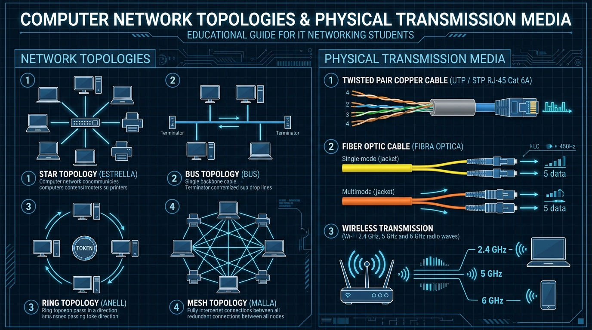

# 📘 UD1 — Introducció a les Xarxes Locals, Topologies i Mitjans de Transmissió

La **Unitat Didàctica 1** estableix els fonaments teòrics i físics de les telecomunicacions i la informàtica de xarxa. S'hi analitzen les formes en què els equips s'organitzen espacialment i lògicament, així com els mitjans guiats (coure i fibra) i no guiats (ones electromagnètiques) utilitzats per transportar la informació binària.

---

## 🖼️ Infografia Tècnica: Topologies de Xarxa i Mitjans de Transmissió

L'esquema següent sintetitza les principals topologies físiques d'interconnexió i els mitjans de transmissió utilitzats en el desplegament de xarxes corporatives:

### 🔍 Llegenda Tècnica i Desglossament de l'Esquema:

#### 1. Topologies de Xarxa (*Network Topologies* - Panell Esquerre)
1. **Topologia en Estrella (*Star Topology* - 1):**
   - Tots els dispositius (ordinadors, portàtils, impressores) es connecten directament a un punt central d'interconnexió (un *switch* o commutador de xarxa).
   - **Avantatge clau:** Si falla un cable individual o un equip client, la resta de la xarxa continua funcionant sense cap afectació.
   - **Desavantatge:** Si falla l'equip central (el switch), tota la xarxa s'atura (*Single Point of Failure*). És la topologia hegemònica a les xarxes Ethernet modernes.
2. **Topologia en Bus (*Bus Topology* - 2):**
   - Els equips es connecten a un únic cable troncal compartit (*backbone*). Als dos extrems del cable cal instal·lar **terminadors resistius de 50 $\Omega$** per absorbir el senyal elèctric i evitar rebots.
   - **Desavantatge crític:** Si el cable es talla en qualsevol punt, tota la xarxa queda inoperativa. Freqüents col·lisions de dades.
3. **Topologia en Anell (*Ring Topology* - 3):**
   - Cada node es connecta exactament a altres dos nodes veïns formant un bucle tancat.
   - La informació viatja en un únic sentit mitjançant un testimoni especial (**Token Passing** com a IBM Token Ring). Només pot transmetre l'equip que té la possessió del testimoni, eliminant completament les col·lisions.
4. **Topologia en Malla (*Mesh Topology* - 4):**
   - Tots els nodes estan connectats directament entre ells (malla completa) o amb múltiples camins alternatius (malla parcial).
   - **Fórmula de connexions en malla completa:** Per a $N$ nodes es requereixen:
     $$C = \frac{N(N-1)}{2} \text{ enllaços físics}$$
   - **Avantatge:** Màxima redundància i tolerància a fallades. Ús típic: Troncal d'Internet, xarxes militars i interconnexió de CPDs.

---

#### 2. Mitjans Físics de Transmissió (*Physical Transmission Media* - Panell Dret)
1. **Cable de Parell Trenat de Coure (*Twisted Pair Copper Cable* - 1):**
   - Format per 4 parells de fils de coure aïllats i trenats entre si per cancel·lar les interferències electromagnètiques (EMI) i la diafonia (*crosstalk*).
   - Utilitza connectors registrats **RJ-45** (8P8C).
   - **Categories habituals:** Cat 5e (100 MHz, 1 Gbps a 100 m), **Cat 6** (250 MHz, 1 Gbps / 10 Gbps fins a 55 m), **Cat 6A** (500 MHz, 10 Gbps a 100 m garantits).
   - Tipus de blindatge: **UTP** (sense apantallament), **FTP** (pantalla global de paper d'alumini), **STP/S-FTP** (mallat metàl·lic i blindatge individual per parell).
2. **Cable de Fibra Òptica (*Fiber Optic Cable* - 2):**
   - Transmet polsos de llum a través d'un nucli de silici o vidre ultra-pur, sent completament immune a les interferències elèctriques.
   - **Fibra Monomode (SMF - Jaqueta groga):** Nucli ultra-estret ($\approx 9\,\mu\text{m}$). Utilitza làser per transmetre un únic feix de llum rectilini. Abast de desenes de quilòmetres.
   - **Fibra Multimode (MMF - Jaqueta taronja o turquesa aqua OM3/OM4):** Nucli més ample ($50\,\mu\text{m}$ o $62,5\,\mu\text{m}$). Utilitza fonts LED. Abast típic fins a 300-550 metres.
   - Connectors habituals: **LC** (*Lucent Connector* - compacte de petjada xicoteta), **SC** (*Subscriber Connector* - quadrat d'inserció ràpida) i **ST** (baioneta rodona).
3. **Transmissió Sense Fil (*Wireless Transmission* - 3):**
   - Propagació d'ones de ràdio en l'espai mitjançant el protocol IEEE 802.11 (Wi-Fi).
   - Bandes de freqüència:
     - **2.4 GHz:** Major abast i millor penetració en parets, però només 3 canals no solapats (1, 6, 11) i molta saturació.
     - **5 GHz:** Gran amplada de banda, menor interferència, però menor abast davant obstacles.
     - **6 GHz (Wi-Fi 6E / Wi-Fi 7):** Màxima velocitat d'alta densitat sense congestió de dispositius antics.

---

## 📑 Continguts i Apartats de la Unitat

| Apartat | Títol | Descripció |
| :---: | :--- | :--- |
| **[1.1](./ut0101.md)** | **Introducció a les Xarxes Locals** | Definició, beneficis de la compartició de recursos i components bàsics. |
| **[1.3](./ut0103.md)** | **Classificació de les Xarxes** | Abast geogràfic (PAN, LAN, CAN, MAN, WAN) i relació funcional (Client-Servidor vs P2P). |
| **[1.8](./ut0108.md)** | **Topologies Físiques i Lògiques** | Arquitectures d'interconnexió, mètodes d'accés al medi (CSMA/CD vs CSMA/CA). |
| **[1.10](./ut0110.md)** | **Components de les Xarxes Locals** | Targetes de xarxa (NICs), adreces físiques MAC de 48 bits, i equips de xarxa. |
| **[1.13](./ut0113.md)** | **Mitjans de Transmissió Físics** | Paràmetres del coure UTP, estàndards TIA-568A/B, fibra òptica i atenuació. |
