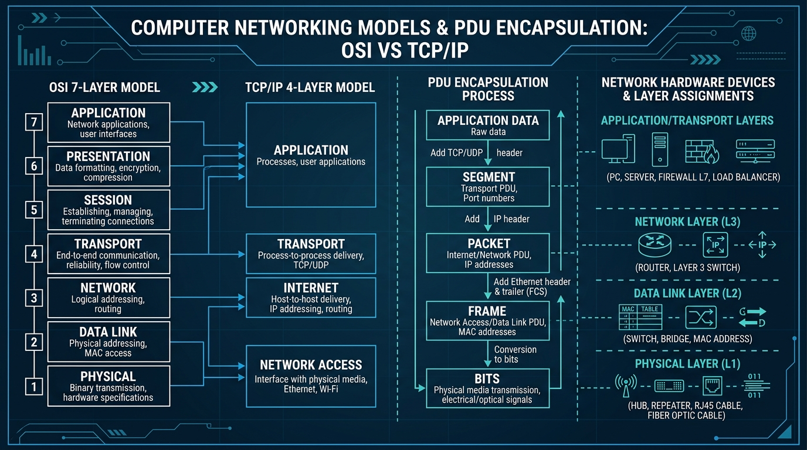

# 📘 UD2 — Arquitectura de Xarxa, Models OSI i TCP/IP, i Cablejat Estructurat

La **Unitat Didàctica 2** aborda l'estudi dels models de referència teòrics i arquitectures de protocols que regeixen el funcionament d'Internet i les xarxes locals modernes, així com els estàndards constructius del cablejat estructurat en edificis corporatius.

---

## 🖼️ Infografia Tècnica: Model OSI vs Model TCP/IP i Encapsulament PDU

L'esquema següent mostra la correspondència directa entre el model teòric OSI de 7 capes i la pila pràctica d'Internet TCP/IP de 4 capes, juntament amb el procés d'encapsulament de dades i els equips de maquinari associats a cada nivell:

### 🔍 Llegenda Tècnica i Desglossament de l'Esquema:

#### 1. Mapeig entre el Model OSI (7 Capes) i TCP/IP (4 Capes)
- **Capa 7 OSI - Aplicació (*Application*):** Interfície directa amb els processos d'usuari i programes (HTTP, HTTPS, DNS, DHCP, SSH, FTP).
- **Capa 6 OSI - Presentació (*Presentation*):** Encarregada de la representació de dades, compressió i encriptació criptogràfica (TLS/SSL, ASCII, JPEG).
- **Capa 5 OSI - Sessió (*Session*):** Estableix, gestiona, sincronitza i finalitza els diàlegs de connexió entre aplicacions remotes (RPC, NetBIOS).
  > **Equivalència:** En la pila **TCP/IP**, aquestes tres capes superiors s'unifiquen en una única **Capa d'Aplicació (*Application Layer*)**.
- **Capa 4 OSI - Transport (*Transport*):** Garanteix la comunicació extrem a extrem entre processos mitjançant **números de port** (0 a 65535).
  - Protocol **TCP** (*Transmission Control Protocol*): Orientat a la connexió, fiable, amb control de flux, assentiment (ACK) i retransmissió de paquets perduts.
  - Protocol **UDP** (*User Datagram Protocol*): No orientat a connexió, ràpid, sense assentiment ni garantia de lliurament (ideal per a veu en temps real VoIP, DNS o vídeo en directe).
  > **Equivalència:** Mapeja directament amb la **Capa de Transport de TCP/IP**.
- **Capa 3 OSI - Xarxa (*Network*):** S'encarrega de l'adreçament lògic global mitjançant **adreces IP** i de l'encaminament (*routing*) de paquets a través de diferents xarxes interconnectades (Protocols IPv4, IPv6, ICMP, OSPF, BGP).
  > **Equivalència:** Mapeja directament amb la **Capa d'Internet de TCP/IP**.
- **Capa 2 OSI - Enllaç de Dades (*Data Link*):** Proporciona trànsit fiable i lliure d'errors locals sobre el medi físic directe mitjançant **adreces físiques MAC** de 48 bits, control d'accés al medi (MAC) i detecció d'errors (FCS / CRC).
- **Capa 1 OSI - Física (*Physical*):** Codificació dels bits en senyals elèctrics (voltatges en coure), polsos òptics (fibra) o ones electromagnètiques de ràdio (Wi-Fi).
  > **Equivalència:** En TCP/IP, les capes 1 i 2 es fusionen en la **Capa d'Accés a la Xarxa (*Network Access Layer*)**.

---

#### 2. El Procés d'Encapsulament de Dades (*PDU Encapsulation*)
A mesura que la informació descendeix per la pila de protocols des de l'aplicació emissora cap al cable, cada capa afegeix la seua pròpia capçalera de control (*Header*):
1. **Dades d'Usuari (*Application Data*):** El text o fitxer brut generat pel programa.
2. **Segment (*Transport PDU*):** S'afig la capçalera TCP/UDP amb els ports d'origen i destinació.
3. **Paquet (*Internet / Network PDU*):** S'afig la capçalera IP amb les adreces IP d'origen i destinació.
4. **Trama (*Network Access / Data Link PDU*):** S'afig la capçalera Ethernet amb les adreces MAC física d'origen i destinació, i la cua **FCS (*Frame Check Sequence*)** al final per a verificar la integritat matemàtica amb un codi CRC32.
5. **Bits (*Physical PDU*):** La trama es converteix en un flux de senyals binaris que viatgen pel medi.

*Al receptor es produeix el procés invers (**Desencapsulament**), eliminant capçaleres fins a lliurar les dades verges a l'aplicació.*

---

#### 3. Assignació d'Equips de Maquinari per Capa
- **Capes 4 a 7 (Aplicació/Transport):** Servidors, ordinadors personals, tallafocs d'aplicació (Firewalls L7 de nova generació / NGFW).
- **Capa 3 (Xarxa):** Encaminadors (*Routers*) i Commutadors multicapa (*Layer 3 Switches*).
- **Capa 2 (Enllaç):** Commutadors Ethernet estàndard (*Switches*), ponts (*Bridges*), targetes de xarxa (NICs).
- **Capa 1 (Física):** Concentradors (*Hubs*), repetidors de senyal, cables de coure RJ-45, transceptors de fibra òptica (SFP).

---

## 📑 Continguts i Apartats de la Unitat

| Apartat | Títol | Descripció |
| :---: | :--- | :--- |
| **[2.3](./ut0203.md)** | **Models ISO/OSI i TCP/IP** | Història, arquitectura de capes i estàndards d'interconnexió. |
| **[2.4](./ut0204.md)** | **Les 7 Capes del Model OSI en Detall** | Funcions específiques de cada nivell, protocols i serveis. |
| **[2.8](./ut0208.md)** | **Encapsulament PDU i Models en Acció** | Flux d'encapsulament, capçaleres de control i anàlisi amb Wireshark. |
| **[2.20](./ut0220.md)** | **Muntatge de Cablejat Estructurat** | Subsistemes EIA/TIA-568, armaris rack, patch panels i canalitzacions. |
| **[2.30](./ut0230.md)** | **Hub vs Switch: Dominis de Xarxa** | Anàlisi de dominis de col·lisió, dominis de difusió i taula de commutació CAM. |
