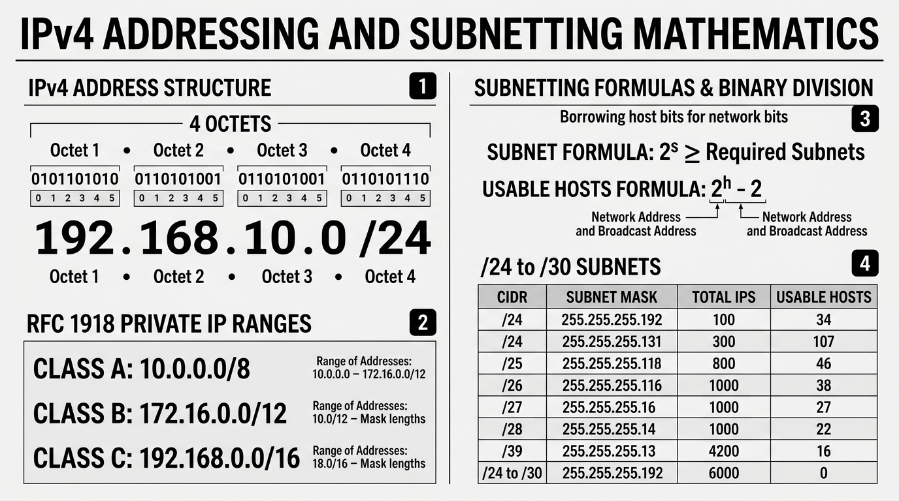

# 📘 UD3 — Interconnexió de la Xarxa, Adreçament IPv4 i Subnetting

La **Unitat Didàctica 3** constitueix el bloc matemàtic i d'enginyeria de xarxes més important de primer curs. S'hi aprofundeix en l'adreçament lògic IPv4, les màscares de subxarxa de longitud fixa (FLSM), el càlcul d'adreces de xarxa i difusió (*broadcast*) mitjançant l'operació lògica AND, i la tècnica de **subnetting** per a optimitzar i segmentar espais d'adreces.

---

## 🖼️ Infografia Tècnica: Adreçament IPv4 i Matemàtiques de Subnetting

L'esquema següent sintetitza l'estructura binària d'una adreça IPv4, els rangs privats establerts pel document RFC 1918 i les fórmules fonamentals de divisió en subxarxes:

### 🔍 Llegenda Tècnica i Desglossament de l'Esquema:

#### 1. Estructura d'una Adreça IPv4 (*Panel 1*)
- Una adreça IPv4 està formada per exactament **32 bits** organitzats en **4 octets** (bytes) separats per punts:
  $$\text{Exemple Decimal:} \quad \mathbf{192.168.10.150 / 24}$$
  $$\text{Representació Binària:} \quad \underbrace{11000000}_{\text{Octet 1 (192)}} . \underbrace{10101000}_{\text{Octet 2 (168)}} . \underbrace{00001010}_{\text{Octet 3 (10)}} . \underbrace{10010110}_{\text{Octet 4 (150)}}$$
- **Notació CIDR (*Classless Inter-Domain Routing* - `/24`):** Indica quants bits d'esquerra a dreta pertanyen a la **porció de xarxa** (*Network ID*). Els bits restants ($32 - 24 = 8\text{ bits}$) pertanyen a la **porció de host** (*Host ID*).

---

#### 2. Rangs d'Adreces Privades RFC 1918 (*Panel 2*)
Per a evitar l'esgotament ràpid d'IPv4, l'IETF va reservar tres rangs especials que **mai s'encaminen a Internet pública**. Poden ser reutilitzats lliurement dins de qualsevol xarxa domèstica o corporativa gràcies a la tecnologia **NAT**:
- **Classe A Privada:** `10.0.0.0/8` $\rightarrow$ Des de `10.0.0.0` fins a `10.255.255.255` ($16.777.216$ adreces per a grans corporacions).
- **Classe B Privada:** `172.16.0.0/12` $\rightarrow$ Des de `172.16.0.0` fins a `172.31.255.255` ($1.048.576$ adreces per a campus universitaris i mitjanes empreses).
- **Classe C Privada:** `192.168.0.0/16` $\rightarrow$ Des de `192.168.0.0` fins a `192.168.255.255` ($65.536$ adreces, organitzades típicament en blocs `/24` per a llars i aules).
- **Adreça de Bucle Local (*Loopback*):** `127.0.0.1` a `127.255.255.254` (adreça que apunta a la pròpia màquina per testejar la pila TCP/IP).
- **Adreça APIPA (*Automatic Private IP Addressing*):** `169.254.0.0/16` (assignada automàticament per Windows quan el servidor DHCP de la xarxa no respon).

---

#### 3. Fórmules Matemàtiques de Subnetting (*Panel 3*)
El **Subnetting** consisteix a "robar" $s$ bits prestats a la porció de host per a crear noves subxarxes més petites:

1. **Càlcul de Noves Subxarxes Creades:**
   $$S = 2^s \ge \text{Subxarxes Necessàries}$$
   *(on $s$ és el nombre de bits robats a l'octet de host).*

2. **Càlcul d'Adreces de Host Útils per Subxarxa:**
   $$H = 2^h - 2$$
   *(on $h = 32 - \text{nova màscara CIDR}$ és el nombre de bits restants per a host).*
   > [!IMPORTANT]
   > Sempre es resten **2 adreces**:
   > - La **primera adreça** (tots els bits de host a $0$): és l'**Adreça de Xarxa (*Network ID*)**.
   > - L'**última adreça** (tots els bits de host a $1$): és l'**Adreça de Difusió (*Broadcast Address*)**.

---

#### 4. Taula de Subxarxes /24 a /30 (*Panel 4*)

| Màscara CIDR | Màscara Decimal Puntejada | Bits Host ($h$) | Total IPs ($2^h$) | Hosts Útils ($2^h - 2$) | Sal de Xarxa |
| :---: | :--- | :---: | :---: | :---: | :---: |
| **/24** | `255.255.255.0` | 8 | 256 | **254** | 256 |
| **/25** | `255.255.255.128` | 7 | 128 | **126** | 128 |
| **/26** | `255.255.255.192` | 6 | 64 | **62** | 64 |
| **/27** | `255.255.255.224` | 5 | 32 | **30** | 32 |
| **/28** | `255.255.255.240` | 4 | 16 | **14** | 16 |
| **/29** | `255.255.255.248` | 3 | 8 | **6** | 8 |
| **/30** | `255.255.255.252` | 2 | 4 | **2** (enllaç punt a punt entre routers) | 4 |

---

## 📑 Continguts i Apartats de la Unitat

| Apartat | Títol | Descripció |
| :---: | :--- | :--- |
| **[3.1](./ut0301.md)** | **Interconnexió d'Equips en Xarxes Locals** | Configuració de targetes IP estàtiques i dinàmiques, passarel·les i DNS. |
| **[3.5](./ut0305.md)** | **Classificació d'Adreces IP** | Classes històriques A, B, C, D (Multicast), E i rangs privats RFC 1918. |
| **[3.6](./ut0306.md)** | **L'Operació Lògica AND** | Càlcul de la xarxa origen i destinació mitjançant màscara de subxarxa. |
| **[3.9](./ut0309.md)** | **Fonaments de Subnetting** | Divisió d'espais de xarxa i planificació corporativa. |
| **[3.17](./ut0317.md)** | **Guia Pràctica de Subnetting Classe C** | Resolució d'exercicis tipus examen pas a pas amb taules completes. |
