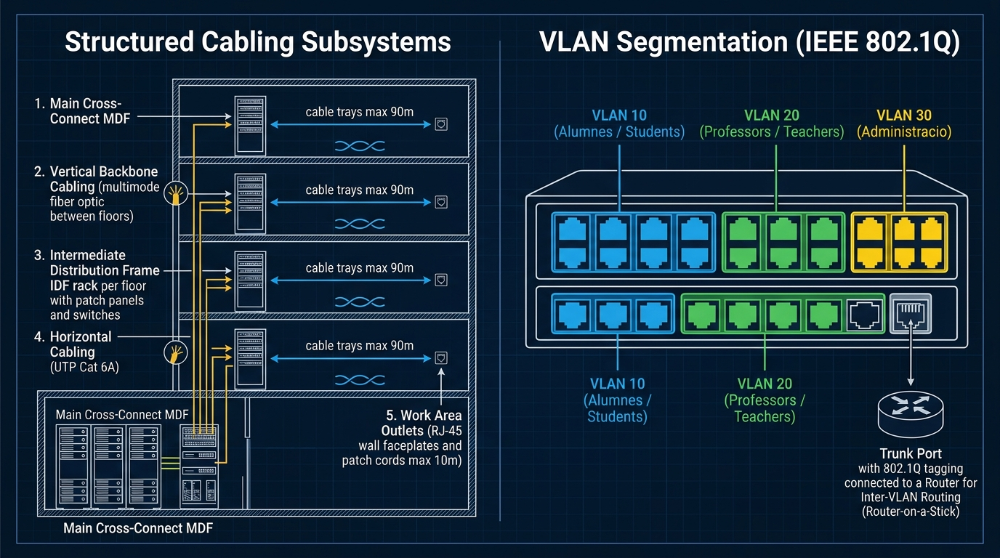

# 📘 UD4 — Instal·lació d'Equips en Xarxa, Wi-Fi i Segmentació en VLANs

La **Unitat Didàctica 4** clou el mòdul de Xarxes Locals amb la configuració de dispositius avançats d'interconnexió: punts d'accés sense fil (Wi-Fi 802.11 ax/ac/n), encaminadors SOHO (*Small Office / Home Office*) i commutadors gestionables mitjançant la creació de **VLANs** (Xarxes d'Àrea Local Virtuals segons l'estàndard **IEEE 802.1Q**).

---

## 🖼️ Infografia Tècnica: Subsistemes de Cablejat Estructurat i Segmentació de VLANs

L'esquema següent mostra la integració física d'un edifici corporatiu mitjançant cablejat estructurat i la seua segmentació lògica en VLANs departamentals:

### 🔍 Llegenda Tècnica i Desglossament de l'Esquema:

#### 1. Subsistemes de Cablejat Estructurat (*Panell Esquerre*)
1. **Repartidor Principal (MDF - *Main Cross-Connect* - 1):**
   - Allotjat a la sala de servidors central de la planta baixa o soterrani. Concentra els routers d'accés WAN/Internet i els commutadors centrals de distribució (*Core Switches*).
2. **Cablejat Vertical o Troncal (*Vertical Backbone Cabling* - 2):**
   - Conductes de comunicació vertical entre plantes realitzades habitualment amb **fibra òptica multimode** (OM3/OM4) per evitar bucles de massa elèctrica i garantir amplades de banda superiors a 10-40 Gbps.
3. **Repartidor de Planta (IDF - *Intermediate Distribution Frame* - 3):**
   - Armari rack de 19 polzades instal·lat a cada pis que conté els panells de pegat (*Patch Panels*) i els switches de distribució local.
4. **Cablejat Horitzontal (*Horizontal Cabling* - 4):**
   - Tirades de cable de coure UTP / STP Categoria 6A que viatgen per safates de sostre o sòl tècnic des del rack de planta fins a cada aula. **Longitud màxima permesa = 90 metres**.
5. **Preses de l'Àrea de Treball (*Work Area Outlets* - 5):**
   - Caixes de connexió a paret amb connectors femella RJ-45. Els latiguillos flexibles d'usuari connecten ordinadors, telèfons VoIP o punts d'accés Wi-Fi (**Longitud màxima = 10 metres totals**).

---

#### 2. Segmentació de VLANs (IEEE 802.1Q - *Panell Dret*)
Una **VLAN** (*Virtual Local Area Network*) permet dividir un commutador físic en múltiples xarxes locals lògiques completament aïllades:
- **VLAN 10 (Alumnes - Ports Blaus):** Els equips connectats a aquests ports només es poden comunicar entre ells. Si un alumne llança un atac de broadcast o difusió, aquest queda confinat exclusivament a la VLAN 10.
- **VLAN 20 (Professors - Ports Verds):** Xarxa aïllada per als ordinadors docents amb accés als servidors de qualificacions.
- **VLAN 30 (Administració - Ports Grocs):** Xarxa de màxima seguretat per a secretaria i direcció.

#### Tipus de Ports al Switch:
- **Ports d'Accés (*Access Ports*):** Pertanyen a una única VLAN. Les trames viatgen **sense etiqueta** (*Untagged*); l'ordinador de l'usuari no sap que està dins d'una VLAN.
- **Port Troncal (*Trunk Port*):** Un enllaç únic d'alta capacitat capaç de transportar trànsit de **múltiples VLANs simultàniament**.
  - Segons l'estàndard **IEEE 802.1Q**, s'afig una etiqueta de 4 bytes a la capçalera de la trama Ethernet que conté el **VLAN ID** (de l'1 al 4094).
  - El port troncal connecta el switch amb un router que realitza l'encaminament entre VLANs (**Router-on-a-Stick** mitjançant subinterfícies virtuals `g0/0.10`, `g0/0.20`, `g0/0.30`).

---

## 📑 Continguts i Apartats de la Unitat

| Apartat | Títol | Descripció |
| :---: | :--- | :--- |
| **[4.1](./ut0401.md)** | **Desplegament i Muntatge d'Equips en Xarxa** | Verificació d'enllaços físics, canalitzacions i instal·lació d'adaptadors. |
| **[4.2](./ut0402.md)** | **Configuració Bàsica de Xarxes Sense Fil** | Estàndards Wi-Fi 802.11 ax/ac/n, SSID, canals de ràdio i bandes 2.4/5 GHz. |
| **[4.6](./ut0406.md)** | **Configuració de Routers SOHO** | Gestió d'interfície WAN/LAN, servidor DHCP, NAT/PAT i reenviaments de ports. |
| **[4.8](./ut0408.md)** | **Seguretat en Xarxes Sense Fil** | Criptografia WPA2-PSK (AES-CCMP) vs WPA3-SAE i autenticació WPA-Enterprise (802.1X). |
| **[4.10](./ut0410.md)** | **Introducció a les VLANs (IEEE 802.1Q)** | Segmentació de dominis de difusió, etiquetatge de trames i pràctiques en Packet Tracer. |
