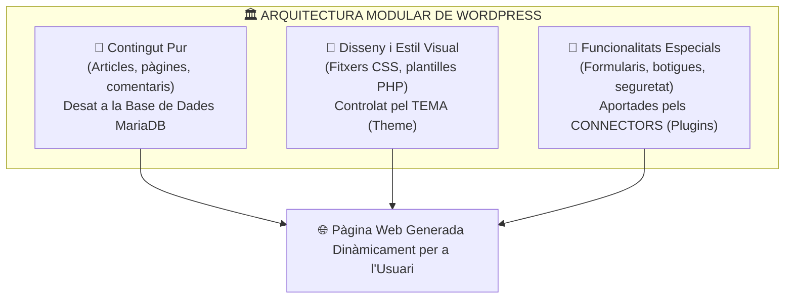

# UT02 — Sistemes de Gestió de Continguts (CMS): WordPress

Un **Sistema de Gestió de Continguts (CMS - *Content Management System*)** és una plataforma web que permet crear, editar, organitzar i publicar contingut digital a Internet sense que els usuaris o editors necessiten coneixements avançats de programació web o llenguatge SQL.

---

## 📌 1. Arquitectura i Separació de Capes d'un CMS

El gran avantatge d'un CMS modern respecte a un lloc web estàtic tradicional és la **desconnexió absoluta entre el contingut, el disseny i la lògica**:



---

## 📌 2. Creació de la Base de Dades i Usuari a MariaDB

Abans de llançar l'assistent d'instal·lació de WordPress, cal crear una base de dades buida amb codificació UTF-8 completa (`utf8mb4`) i un usuari amb permisos exclusius:

```sql
-- Accedir a la consola de MariaDB com a root
sudo mysql

-- 1. Crear la base de dades
CREATE DATABASE db_wordpress CHARACTER SET utf8mb4 COLLATE utf8mb4_unicode_ci;

-- 2. Crear l'usuari amb contrasenya robusta
CREATE USER 'wp_user'@'localhost' IDENTIFIED BY 'ClauMoltSegura2026!';

-- 3. Concedir privilegis totals exclusivament sobre aquesta base de dades
GRANT ALL PRIVILEGES ON db_wordpress.* TO 'wp_user'@'localhost';

-- 4. Aplicar canvis i sortir
FLUSH PRIVILEGES;
EXIT;
```

---

## 📌 3. Desplegament de Fitxers i Permisos del Sistema

```bash
# 1. Descarregar l'última versió en català/valencià
cd /tmp
wget https://ca.wordpress.org/latest-ca.tar.gz

# 2. Descomprimir i moure a l'arrel de publicació d'Apache
tar -xzvf latest-ca.tar.gz
sudo mv wordpress /var/www/wordpress

# 3. Assignar la propietat a l'usuari del servidor web (www-data)
sudo chown -R www-data:www-data /var/www/wordpress

# 4. Establir permisos segurs (directoris 755, fitxers 644)
sudo find /var/www/wordpress/ -type d -exec chmod 755 {} \;
sudo find /var/www/wordpress/ -type f -exec chmod 644 {} \;
```

### Configuració del Virtual Host a `/etc/apache2/sites-available/wordpress.conf`:
```apache
<VirtualHost *:80>
    ServerName wordpress.internal
    DocumentRoot /var/www/wordpress

    <Directory /var/www/wordpress>
        Options FollowSymLinks
        AllowOverride All
        Require all granted
    </Directory>

    ErrorLog ${APACHE_LOG_DIR}/wordpress_error.log
    CustomLog ${APACHE_LOG_DIR}/wordpress_access.log combined
</VirtualHost>
```

```bash
# Habilitar el mòdul de reescriptura d'URLs, el lloc i reiniciar Apache
sudo a2enmod rewrite
sudo a2ensite wordpress.conf
sudo systemctl restart apache2
```

Un cop configurat, s'accedeix amb el navegador a `http://wordpress.internal/` i s'omple l'assistent web introduint el nom de la base de dades (`db_wordpress`), usuari (`wp_user`) i contrasenya. Aquest procés crea automàticament el fitxer clau **`wp-config.php`** i les 12 taules originals a la base de dades.

---

## 📌 4. Gestió d'Usuaris, Rols i Permisos

WordPress disposa d'un sistema de control d'accés basat en rols (*RBAC - Role-Based Access Control*):

| Rol d'Usuari | Capacitats i Permisos | Ús Habitual |
| :--- | :--- | :--- |
| **Administrador** | Accés complet a tots els paràmetres, usuaris, temes i connectors. | Tècnics de sistemes i administradors web. |
| **Editor** | Pot escriure, revisar, publicar i esborrar continguts de **qualsevol usuari**. | Caps de redacció o professors responsables. |
| **Autor** | Pot redactar, pujar imatges i publicar **només els seus propis articles**. | Redactors i periodistes de la plantilla. |
| **Col·laborador** | Pot escriure i editar els seus propis articles, però **no pot publicar-los** (requereix revisió prèvia d'un editor). | Col·laboradors externs puntuals. |
| **Subscriptor** | Només pot consultar continguts privats i modificar el seu propi perfil. | Clients o alumnes registrats. |

---

## 📌 5. Diferència Didàctica: Entrades (*Posts*) vs Pàgines (*Pages*)

- **Entrades (*Posts*):** Són continguts dinàmics associats a una data de publicació, autor i categories. Apareixen al blog ordenades en ordre cronològic invers i admeten comentaris dels lectors.
- **Pàgines estàtiques (*Pages*):** Són continguts atemporals i jeràrquics (poden tindre pàgines mare i filles). S'utilitzen per a la pàgina d'Inici (*Landing Page*), Qui som, On som o Avís Legal.
