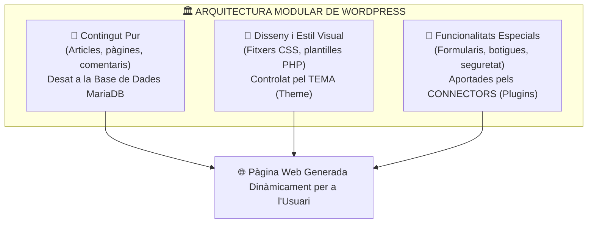

# UT02 — Sistemes de Gestió de Continguts (CMS): WordPress

Un **Sistema de Gestió de Continguts (CMS - *Content Management System*)** és una plataforma web que permet crear, editar, organitzar i publicar contingut digital a Internet sense que els usuaris o editors necessiten coneixements avançats de programació web o llenguatge SQL.

---

## 📌 1. Arquitectura i Separació de Capes d'un CMS

El gran avantatge d'un CMS modern respecte a un lloc web estàtic tradicional és la **desconnexió absoluta entre el contingut, el disseny i la lògica**:

<div style="background: linear-gradient(135deg, #0f172a 0%, #1e293b 100%); border-radius: 12px; padding: 20px; margin: 25px 0; box-shadow: 0 10px 25px -5px rgba(0, 0, 0, 0.3); border: 1px solid #334155;">
  <div style="text-align: center; margin-bottom: 15px;">
    <span style="background: #38bdf8; color: #0f172a; font-weight: 700; font-size: 0.75rem; text-transform: uppercase; letter-spacing: 0.05em; padding: 4px 10px; border-radius: 9999px;">Infografia Tècnica</span>
    <h3 style="color: #f8fafc; margin: 10px 0 5px 0; font-size: 1.25rem;">Arquitectura Interna i Cicle d'Execució de WordPress</h3>
    <p style="color: #94a3b8; font-size: 0.85rem; margin: 0;">Separació estructural entre el Nucli (Core), Directoris de Contingut (wp-content) i la Base de Dades Relacional (MariaDB)</p>
  </div>
  <svg viewBox="0 0 860 280" width="100%" height="100%" xmlns="http://www.w3.org/2000/svg" style="display: block; font-family: system-ui, -apple-system, sans-serif;">
    <defs>
      <linearGradient id="wpCoreGrad" x1="0%" y1="0%" x2="100%" y2="100%">
        <stop offset="0%" stop-color="#3b82f6" stop-opacity="0.25"/>
        <stop offset="100%" stop-color="#1e40af" stop-opacity="0.1"/>
      </linearGradient>
      <linearGradient id="wpContentGrad" x1="0%" y1="0%" x2="100%" y2="100%">
        <stop offset="0%" stop-color="#8b5cf6" stop-opacity="0.25"/>
        <stop offset="100%" stop-color="#6d28d9" stop-opacity="0.1"/>
      </linearGradient>
      <linearGradient id="wpDbGrad" x1="0%" y1="0%" x2="100%" y2="100%">
        <stop offset="0%" stop-color="#10b981" stop-opacity="0.25"/>
        <stop offset="100%" stop-color="#047857" stop-opacity="0.1"/>
      </linearGradient>
    </defs>

    <!-- Bloc 1: Nucli de WordPress -->
    <rect x="20" y="25" width="250" height="200" rx="8" fill="url(#wpCoreGrad)" stroke="#38bdf8" stroke-width="1.5"/>
    <text x="145" y="52" fill="#38bdf8" font-size="12" font-weight="bold" text-anchor="middle">1️⃣ NUCLI (WordPress Core)</text>
    <text x="145" y="70" fill="#94a3b8" font-size="10" text-anchor="middle">Fitxers de Sistema (Actualitzables)</text>
    <line x1="35" y1="85" x2="255" y2="85" stroke="#334155"/>
    <text x="35" y="108" fill="#cbd5e1" font-size="10.5">• <tspan fill="#38bdf8" font-weight="bold">index.php:</tspan> Punt d'entrada HTTP</text>
    <text x="35" y="128" fill="#cbd5e1" font-size="10.5">• <tspan fill="#f59e0b" font-weight="bold">wp-config.php:</tspan> Credencials i claus</text>
    <text x="35" y="148" fill="#cbd5e1" font-size="10.5">• <tspan fill="#94a3b8">/wp-admin:</tspan> Panell d'administració</text>
    <text x="35" y="168" fill="#cbd5e1" font-size="10.5">• <tspan fill="#94a3b8">/wp-includes:</tspan> Llibreries i funcions</text>
    <text x="145" y="205" fill="#38bdf8" font-size="10" text-anchor="middle" font-weight="bold">MAI s'han de modificar a mà!</text>

    <!-- Fletxa 1 a 2 -->
    <path d="M 275 110 L 305 110" stroke="#38bdf8" stroke-width="2"/>
    <text x="290" y="100" fill="#38bdf8" font-size="8" text-anchor="middle">Hooks</text>
    <path d="M 305 130 L 275 130" stroke="#c084fc" stroke-width="2"/>
    <text x="290" y="145" fill="#c084fc" font-size="8" text-anchor="middle">Filtres</text>

    <!-- Bloc 2: wp-content -->
    <rect x="310" y="25" width="250" height="200" rx="8" fill="url(#wpContentGrad)" stroke="#c084fc" stroke-width="1.5"/>
    <text x="435" y="52" fill="#c084fc" font-size="12" font-weight="bold" text-anchor="middle">2️⃣ PERSONALITZACIÓ (/wp-content)</text>
    <text x="435" y="70" fill="#94a3b8" font-size="10" text-anchor="middle">Elements Propis del Lloc Web</text>
    <line x1="325" y1="85" x2="545" y2="85" stroke="#334155"/>
    <text x="325" y="108" fill="#cbd5e1" font-size="10.5">• <tspan fill="#c084fc" font-weight="bold">/themes:</tspan> Plantilles visuals (CSS/PHP)</text>
    <text x="325" y="128" fill="#cbd5e1" font-size="10.5">• <tspan fill="#c084fc" font-weight="bold">/plugins:</tspan> Extensions de funció</text>
    <text x="325" y="148" fill="#cbd5e1" font-size="10.5">• <tspan fill="#cbd5e1">/uploads:</tspan> Imatges i documents (Any/Mes)</text>
    <text x="325" y="168" fill="#cbd5e1" font-size="10.5">• <tspan fill="#94a3b8">languages:</tspan> Fitxers de traducció .mo/.po</text>
    <text x="435" y="205" fill="#c084fc" font-size="10" text-anchor="middle" font-weight="bold">És la carpeta clau del backup físic!</text>

    <!-- Fletxa 2 a 3 -->
    <path d="M 565 110 L 595 110" stroke="#c084fc" stroke-width="2"/>
    <text x="580" y="100" fill="#c084fc" font-size="8" text-anchor="middle">SQL</text>
    <path d="M 595 130 L 565 130" stroke="#34d399" stroke-width="2"/>
    <text x="580" y="145" fill="#34d399" font-size="8" text-anchor="middle">Dades</text>

    <!-- Bloc 3: MariaDB -->
    <rect x="600" y="25" width="240" height="200" rx="8" fill="url(#wpDbGrad)" stroke="#34d399" stroke-width="1.5"/>
    <text x="720" y="52" fill="#34d399" font-size="12" font-weight="bold" text-anchor="middle">3️⃣ BASE DE DADES (MariaDB)</text>
    <text x="720" y="70" fill="#94a3b8" font-size="10" text-anchor="middle">Persistència Relacional (12 Taules)</text>
    <line x1="615" y1="85" x2="825" y2="85" stroke="#334155"/>
    <text x="615" y="108" fill="#cbd5e1" font-size="10.5">• <tspan fill="#34d399" font-weight="bold">wp_posts:</tspan> Text d'entrades i pàgines</text>
    <text x="615" y="128" fill="#cbd5e1" font-size="10.5">• <tspan fill="#cbd5e1">wp_postmeta:</tspan> Metadades i camps extra</text>
    <text x="615" y="148" fill="#cbd5e1" font-size="10.5">• <tspan fill="#34d399" font-weight="bold">wp_users:</tspan> Comptes i hashes claus</text>
    <text x="615" y="168" fill="#cbd5e1" font-size="10.5">• <tspan fill="#cbd5e1">wp_options:</tspan> Ajustos globals i URLs</text>
    <text x="720" y="205" fill="#34d399" font-size="10" text-anchor="middle" font-weight="bold">utf8mb4_unicode_ci</text>

    <!-- Peu informatiu -->
    <rect x="20" y="235" width="820" height="35" rx="6" fill="#1e293b" stroke="#334155"/>
    <text x="430" y="257" fill="#cbd5e1" font-size="10.5" text-anchor="middle">Seguretat de la Instal·lació: <tspan fill="#f59e0b" font-weight="bold">wp-config.php ha de tindre permisos estrictes (chmod 600 o 640) per a evitar que altres usuaris llegeixin la clau de MariaDB.</tspan></text>
  </svg>
</div>



---

## 📌 2. Creació de la Base de Dades i Usuari a MariaDB

Abans de llançar l'assistent d'instal·lació de WordPress, cal crear una base de dades buida amb codificació UTF-8 completa (`utf8mb4`) i un usuari amb permisos exclusius:

```sql
-- Accedir a la consola de MariaDB com a root
sudo mysql

-- 1. Crear la base de dades
CREATE DATABASE db_wordpress CHARACTER SET utf8mb4 COLLATE utf8mb4_unicode_ci;

-- 2. Crear l'usuari amb contrasenya robusta
CREATE USER 'wp_user'@'localhost' IDENTIFIED BY 'ClauMoltSegura2026!';

-- 3. Concedir privilegis totals exclusivament sobre aquesta base de dades
GRANT ALL PRIVILEGES ON db_wordpress.* TO 'wp_user'@'localhost';

-- 4. Aplicar canvis i sortir
FLUSH PRIVILEGES;
EXIT;
```

---

## 📌 3. Desplegament de Fitxers i Permisos del Sistema

```bash
# 1. Descarregar l'última versió en català/valencià
cd /tmp
wget https://ca.wordpress.org/latest-ca.tar.gz

# 2. Descomprimir i moure a l'arrel de publicació d'Apache
tar -xzvf latest-ca.tar.gz
sudo mv wordpress /var/www/wordpress

# 3. Assignar la propietat a l'usuari del servidor web (www-data)
sudo chown -R www-data:www-data /var/www/wordpress

# 4. Establir permisos segurs (directoris 755, fitxers 644)
sudo find /var/www/wordpress/ -type d -exec chmod 755 {} \;
sudo find /var/www/wordpress/ -type f -exec chmod 644 {} \;
```

### Configuració del Virtual Host a `/etc/apache2/sites-available/wordpress.conf`:
```apache
<VirtualHost *:80>
    ServerName wordpress.internal
    DocumentRoot /var/www/wordpress

    <Directory /var/www/wordpress>
        Options FollowSymLinks
        AllowOverride All
        Require all granted
    </Directory>

    ErrorLog ${APACHE_LOG_DIR}/wordpress_error.log
    CustomLog ${APACHE_LOG_DIR}/wordpress_access.log combined
</VirtualHost>
```

```bash
# Habilitar el mòdul de reescriptura d'URLs, el lloc i reiniciar Apache
sudo a2enmod rewrite
sudo a2ensite wordpress.conf
sudo systemctl restart apache2
```

Un cop configurat, s'accedeix amb el navegador a `http://wordpress.internal/` i s'omple l'assistent web introduint el nom de la base de dades (`db_wordpress`), usuari (`wp_user`) i contrasenya. Aquest procés crea automàticament el fitxer clau **`wp-config.php`** i les 12 taules originals a la base de dades.

---

## 📌 4. Gestió d'Usuaris, Rols i Permisos

WordPress disposa d'un sistema de control d'accés basat en rols (*RBAC - Role-Based Access Control*):

| Rol d'Usuari | Capacitats i Permisos | Ús Habitual |
| :--- | :--- | :--- |
| **Administrador** | Accés complet a tots els paràmetres, usuaris, temes i connectors. | Tècnics de sistemes i administradors web. |
| **Editor** | Pot escriure, revisar, publicar i esborrar continguts de **qualsevol usuari**. | Caps de redacció o professors responsables. |
| **Autor** | Pot redactar, pujar imatges i publicar **només els seus propis articles**. | Redactors i periodistes de la plantilla. |
| **Col·laborador** | Pot escriure i editar els seus propis articles, però **no pot publicar-los** (requereix revisió prèvia d'un editor). | Col·laboradors externs puntuals. |
| **Subscriptor** | Només pot consultar continguts privats i modificar el seu propi perfil. | Clients o alumnes registrats. |

---

## 📌 5. Diferència Didàctica: Entrades (*Posts*) vs Pàgines (*Pages*)

- **Entrades (*Posts*):** Són continguts dinàmics associats a una data de publicació, autor i categories. Apareixen al blog ordenades en ordre cronològic invers i admeten comentaris dels lectors.
- **Pàgines estàtiques (*Pages*):** Són continguts atemporals i jeràrquics (poden tindre pàgines mare i filles). S'utilitzen per a la pàgina d'Inici (*Landing Page*), Qui som, On som o Avís Legal.

---

## 📝 Quadern d'Activitats Pràctiques i Reptes de Laboratori

### 🔵 Bloc A: Fonaments i Diagnòstic Tècnic

1. **Arquitectura desacoblada:** Explica per quins motius tècnics un canvi de tema visual (*Theme*) a WordPress mai no destrueix ni esborra els articles o comentaris existents al lloc web.
2. **Joc de caràcters UTF-8 complet:** Per quina raó tècnica és imperatiu utilitzar el conjunt de caràcters `utf8mb4` en lloc de l'antic `utf8` en crear la base de dades a MariaDB? Què passa amb els emojis i certs símbols matemàtics si s'utilitza l'antic `utf8`?
3. **Mòdul `mod_rewrite`:** Per què WordPress requereix activar el mòdul `mod_rewrite` a Apache2 i establir `AllowOverride All` al fitxer de configuració del VirtualHost per a utilitzar els enllaços permanents amigables (*Pretty Permalinks*)?
4. **Seguretat de credencials:** On s'emmagatzemen exactament les claus de la base de dades i les claus de sal (*Salt Keys*) de WordPress? Quins permisos POSIX han de tindre aquest fitxer per a protegir-lo davant altres usuaris locals del servidor?
5. **Diferenciació d'usuaris:** Un redactor en pràctiques necessita redactar notícies però no ha de poder publicar-les directament sense que les supervise el cap de redacció. Quin rol d'usuari de WordPress li correspon?
6. **Mapeig de base de dades:** Quina taula troncal de WordPress desa el títol, contingut i estat de publicació d'una entrada? En quina taula es desen les opcions de configuració generals com la URL del lloc (`siteurl`)?
7. **Límit de memòria PHP:** Si un connector com WooCommerce dóna l'error `Fatal error: Allowed memory size of 134217728 bytes exhausted`, quina directiva de `php.ini` s'ha d'augmentar i quin valor mínim es recomana?
8. **Permisos en l'arrel web:** Si s'executa `chmod -R 777 /var/www/wordpress`, quins riscos de seguretat s'introdueixen i per què és considerat una pràctica totalment inacceptable en entorns reals?
9. **Desactivació d'emergència:** Si un connector provoca una fallada catastròfica (pantalla blanca de la mort - *WSOD*) i bloqueja l'accés a `/wp-admin`, com es pot desactivar aquest connector mitjançant la consola bash sense accedir a la web?
10. **Directori de pujades:** Dins de quina subcarpeta de `/wp-content` s'emmagatzemen les imatges i fitxers PDF que els usuaris pugen des de la biblioteca multimèdia? Com s'organitzen internament?

---

### 🟢 Bloc B: Reptes Pràctics de Laboratori i Comandes

#### 🛠️ Repte 1: Creació i Bastionat de la Base de Dades a MariaDB
Accedeix a la consola del servidor de base de dades i prepara l'entorn amb usuaris aïllats:
```bash
sudo mysql -u root -p
```
Executa les comandes SQL següents substituint les credencials per les de laboratori:
```sql
CREATE DATABASE db_portal_smx CHARACTER SET utf8mb4 COLLATE utf8mb4_unicode_ci;
CREATE USER 'usr_portal'@'localhost' IDENTIFIED BY 'WpPortal_SMX_2026!';
GRANT ALL PRIVILEGES ON db_portal_smx.* TO 'usr_portal'@'localhost';
FLUSH PRIVILEGES;
SHOW DATABASES;
EXIT;
```
*Verificació:* Comprova la connexió des del terminal del sistema amb l'usuari nou:
```bash
mysql -u usr_portal -pWpPortal_SMX_2026! db_portal_smx -e "STATUS;"
```

#### 🛠️ Repte 2: Descàrrega, Desplegament i Permisos POSIX
Descarrega l'últim paquet oficial de WordPress en valencià i desplega'l sota `/var/www/portal`:
```bash
cd /tmp
wget https://ca.wordpress.org/latest-ca.tar.gz
tar -xzvf latest-ca.tar.gz
sudo mkdir -p /var/www/portal
sudo mv wordpress/* /var/www/portal/
sudo chown -R www-data:www-data /var/www/portal
sudo find /var/www/portal -type d -exec chmod 755 {} \;
sudo find /var/www/portal -type f -exec chmod 644 {} \;
ls -ld /var/www/portal
```

#### 🛠️ Repte 3: VirtualHost Apache2 amb Enllaços Amigables
Crea el fitxer `/etc/apache2/sites-available/portal.conf`:
```apache
<VirtualHost *:80>
    ServerName portal.smx.internal
    DocumentRoot /var/www/portal

    <Directory /var/www/portal>
        Options FollowSymLinks
        AllowOverride All
        Require all granted
    </Directory>

    ErrorLog ${APACHE_LOG_DIR}/portal_error.log
    CustomLog ${APACHE_LOG_DIR}/portal_access.log combined
</VirtualHost>
```
Habilita el mòdul de reescriptura, el lloc i comprova la sintaxi del servei:
```bash
sudo a2enmod rewrite
sudo a2ensite portal.conf
sudo apache2ctl configtest
sudo systemctl restart apache2
```

#### 🛠️ Repte 4: Desplegament Desatès amb WP-CLI
Instal·la l'eina de línia d'ordres `wp-cli` i completa la instal·lació sense necessitat d'obrir el navegador:
```bash
# Instal·lar WP-CLI
curl -O https://raw.githubusercontent.com/wp-cli/builds/gh-pages/phar/wp-cli.phar
chmod +x wp-cli.phar
sudo mv wp-cli.phar /usr/local/bin/wp

# Generar wp-config.php
sudo -u www-data wp config create --dbname=db_portal_smx --dbuser=usr_portal --dbpass='WpPortal_SMX_2026!' --path=/var/www/portal

# Executar la instal·lació inicial
sudo -u www-data wp core install \
    --url="http://portal.smx.internal" \
    --title="Portal Corporatiu SMX" \
    --admin_user="admin_smx" \
    --admin_password="SuperClauAdmin2026!" \
    --admin_email="admin@smx.internal" \
    --path=/var/www/portal
```

#### 🛠️ Repte 5: Bastionat de `wp-config.php` i Verificació de Seguretat
Restringeix els permisos del fitxer més crític i verifica la configuració:
```bash
sudo chmod 600 /var/www/portal/wp-config.php
ls -l /var/www/portal/wp-config.php
```
Comprova mitjançant `curl` que el lloc respon amb codi d'estat HTTP `200 OK`:
```bash
curl -I -H "Host: portal.smx.internal" http://127.0.0.1/
```

---

### 🔴 Bloc C: Rúbrica d'Avaluació Competencial per Nivells

| Criteri d'Avaluació | Insuficient (1 - 4) | Suficient (5 - 6) | Notable (7 - 8) | Excel·lent (9 - 10) |
| :--- | :--- | :--- | :--- | :--- |
| **Bases de Dades Relacionals (MariaDB)** | No aconsegueix crear la base de dades o utilitza l'usuari `root` per a WordPress. | Crea la BD i l'usuari amb permisos bàsics però oblida el joc de caràcters `utf8mb4`. | Crea la BD i usuari amb privilegis acurats i joc `utf8mb4` seguint les pautes. | Domina la creació des de CLI, audita els privilegis amb `SHOW GRANTS` i assegura claus robustes. |
| **Desplegament i Permisos POSIX** | Assigna permisos `777` indiscriminadament o deixa fitxers propietat de `root`. | Descomprimeix els fitxers i assigna permisos de forma manual amb algun error menor. | Aplica la jerarquia `755` per a directoris i `644` per a fitxers amb propietat `www-data`. | Aplica permisos granulars complets, protegeix `wp-config.php` amb `600` i justifica cada decisió. |
| **Configuració del Servidor Web (Apache2)** | El VirtualHost no carrega o genera un error de configuració de sintaxi. | El VirtualHost funciona però oblida `AllowOverride All` o el mòdul `rewrite`. | Configura VirtualHost i `mod_rewrite` correctament amb registre de logs independents. | VirtualHost impecable amb suport d'enllaços permanents, logs personalitzats i verificació amb `curl`. |
| **Automatització i Eines Tècniques (WP-CLI)** | Incapaç d'instal·lar WordPress o comet errors crítics en l'assistent web. | Completa la instal·lació manualment a través de l'assistent web del navegador. | Utilitza correctament WP-CLI per a generar el fitxer de configuració i instal·lar el nucli. | Desplega WordPress de forma completament desatesa amb WP-CLI, creant usuaris i categories per comanda. |

