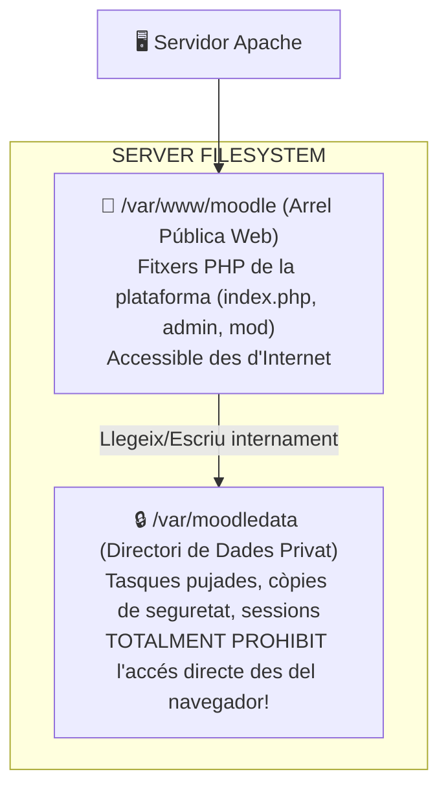
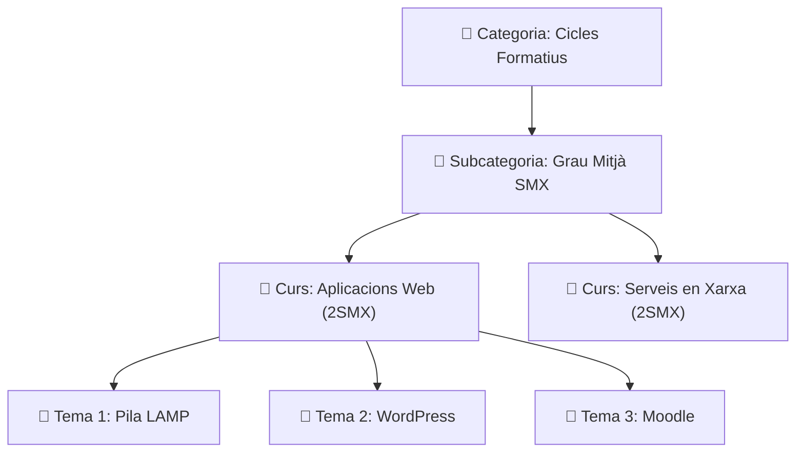

# UT03 — Plataformes de Formació Virtual (LMS): Moodle

Un **Sistema de Gestió de l'Aprenentatge (LMS - *Learning Management System*)** és una aplicació web dissenyada per a administrar, distribuir i avaluar processos formatius en línia o com a suport docent presencial. La plataforma més estesa en l'àmbit educatiu mundial i a la Comunitat Valenciana (a través del portal oficial *Aules*) és **Moodle**.

---

## 📌 1. Arquitectura Tècnica Específica de Moodle

A diferència d'un CMS com WordPress on tot s'ubica sota l'arrel web, Moodle imposa una arquitectura de fitxers estricta per a protegir la privadesa de les dades dels alumnes:

<div style="background: linear-gradient(135deg, #0f172a 0%, #1e293b 100%); border-radius: 12px; padding: 20px; margin: 25px 0; box-shadow: 0 10px 25px -5px rgba(0, 0, 0, 0.3); border: 1px solid #334155;">
  <div style="text-align: center; margin-bottom: 15px;">
    <span style="background: #38bdf8; color: #0f172a; font-weight: 700; font-size: 0.75rem; text-transform: uppercase; letter-spacing: 0.05em; padding: 4px 10px; border-radius: 9999px;">Infografia Tècnica</span>
    <h3 style="color: #f8fafc; margin: 10px 0 5px 0; font-size: 1.25rem;">Arquitectura de Seguretat i Separació de Directoris a Moodle</h3>
    <p style="color: #94a3b8; font-size: 0.85rem; margin: 0;">Aïllament per disseny: Codi executable a l'arrel web pública (/var/www/moodle) vs Magatzem privat de dades (/var/moodledata)</p>
  </div>
  <svg viewBox="0 0 860 280" width="100%" height="100%" xmlns="http://www.w3.org/2000/svg" style="display: block; font-family: system-ui, -apple-system, sans-serif;">
    <defs>
      <linearGradient id="mdlPubGrad" x1="0%" y1="0%" x2="100%" y2="100%">
        <stop offset="0%" stop-color="#3b82f6" stop-opacity="0.25"/>
        <stop offset="100%" stop-color="#1e40af" stop-opacity="0.1"/>
      </linearGradient>
      <linearGradient id="mdlPrivGrad" x1="0%" y1="0%" x2="100%" y2="100%">
        <stop offset="0%" stop-color="#ef4444" stop-opacity="0.25"/>
        <stop offset="100%" stop-color="#991b1b" stop-opacity="0.1"/>
      </linearGradient>
      <linearGradient id="mdlDbGrad" x1="0%" y1="0%" x2="100%" y2="100%">
        <stop offset="0%" stop-color="#10b981" stop-opacity="0.25"/>
        <stop offset="100%" stop-color="#047857" stop-opacity="0.1"/>
      </linearGradient>
    </defs>

    <!-- Bloc 1: Arrel Pública -->
    <rect x="20" y="25" width="250" height="200" rx="8" fill="url(#mdlPubGrad)" stroke="#38bdf8" stroke-width="1.5"/>
    <text x="145" y="52" fill="#38bdf8" font-size="12" font-weight="bold" text-anchor="middle">🌐 ARREL PÚBLICA (/var/www/moodle)</text>
    <text x="145" y="70" fill="#94a3b8" font-size="10" text-anchor="middle">DocumentRoot d'Apache2</text>
    <line x1="35" y1="85" x2="255" y2="85" stroke="#334155"/>
    <text x="35" y="108" fill="#cbd5e1" font-size="10.5">• <tspan fill="#38bdf8" font-weight="bold">index.php:</tspan> Portal d'accés</text>
    <text x="35" y="128" fill="#cbd5e1" font-size="10.5">• <tspan fill="#f59e0b" font-weight="bold">config.php:</tspan> Ruta de dades i DB</text>
    <text x="35" y="148" fill="#cbd5e1" font-size="10.5">• <tspan fill="#94a3b8">/course, /mod:</tspan> Mòduls d'activitat</text>
    <text x="35" y="168" fill="#cbd5e1" font-size="10.5">• <tspan fill="#94a3b8">/admin/cli:</tspan> Manteniment de consola</text>
    <text x="145" y="205" fill="#38bdf8" font-size="10" text-anchor="middle" font-weight="bold">Accessible directament per HTTP</text>

    <!-- Fletxa 1 a 2 -->
    <path d="M 275 110 L 305 110" stroke="#f87171" stroke-width="2"/>
    <text x="290" y="100" fill="#f87171" font-size="8" text-anchor="middle">I/O Disc</text>
    <path d="M 305 130 L 275 130" stroke="#f87171" stroke-width="2"/>
    <text x="290" y="145" fill="#f87171" font-size="8" text-anchor="middle">Streams</text>

    <!-- Bloc 2: Dades Privades -->
    <rect x="310" y="25" width="250" height="200" rx="8" fill="url(#mdlPrivGrad)" stroke="#f87171" stroke-width="1.5"/>
    <text x="435" y="52" fill="#f87171" font-size="12" font-weight="bold" text-anchor="middle">🔒 DADES PRIVADES (/var/moodledata)</text>
    <text x="435" y="70" fill="#94a3b8" font-size="10" text-anchor="middle">FORA de l'Arrel del Servidor Web</text>
    <line x1="325" y1="85" x2="545" y2="85" stroke="#334155"/>
    <text x="325" y="108" fill="#cbd5e1" font-size="10.5">• <tspan fill="#f87171" font-weight="bold">/filedir:</tspan> Tasques, PDFs i exàmens</text>
    <text x="325" y="128" fill="#cbd5e1" font-size="10.5">• <tspan fill="#cbd5e1">/sessions:</tspan> Fitxers de sessió PHP</text>
    <text x="325" y="148" fill="#cbd5e1" font-size="10.5">• <tspan fill="#cbd5e1">/trashdir:</tspan> Paperera de reciclatge</text>
    <text x="325" y="168" fill="#cbd5e1" font-size="10.5">• <tspan fill="#cbd5e1">/temp:</tspan> Còpies de seguretat .mbz</text>
    <text x="435" y="205" fill="#ef4444" font-size="10" text-anchor="middle" font-weight="bold">PROHIBIT ACCÉS PER HTTP (403)</text>

    <!-- Fletxa 1 a 3 -->
    <path d="M 565 110 L 595 110" stroke="#34d399" stroke-width="2"/>
    <text x="580" y="100" fill="#34d399" font-size="8" text-anchor="middle">TCP 3306</text>
    <path d="M 595 130 L 565 130" stroke="#34d399" stroke-width="2"/>
    <text x="580" y="145" fill="#34d399" font-size="8" text-anchor="middle">SQL</text>

    <!-- Bloc 3: MariaDB -->
    <rect x="600" y="25" width="240" height="200" rx="8" fill="url(#mdlDbGrad)" stroke="#34d399" stroke-width="1.5"/>
    <text x="720" y="52" fill="#34d399" font-size="12" font-weight="bold" text-anchor="middle">🗄️ BASE DE DADES (db_moodle)</text>
    <text x="720" y="70" fill="#94a3b8" font-size="10" text-anchor="middle">Prefix Taules: mdl_</text>
    <line x1="615" y1="85" x2="825" y2="85" stroke="#334155"/>
    <text x="615" y="108" fill="#cbd5e1" font-size="10.5">• <tspan fill="#34d399" font-weight="bold">mdl_user:</tspan> Alumnes i professors</text>
    <text x="615" y="128" fill="#cbd5e1" font-size="10.5">• <tspan fill="#cbd5e1">mdl_course:</tspan> Llistat de cursos i temes</text>
    <text x="615" y="148" fill="#cbd5e1" font-size="10.5">• <tspan fill="#cbd5e1">mdl_grade_grades:</tspan> Notes numèriques</text>
    <text x="615" y="168" fill="#cbd5e1" font-size="10.5">• <tspan fill="#34d399" font-weight="bold">mdl_assign_submission:</tspan> Lliuraments</text>
    <text x="720" y="205" fill="#34d399" font-size="10" text-anchor="middle" font-weight="bold">innodb_file_per_table=1</text>

    <!-- Peu informatiu -->
    <rect x="20" y="235" width="820" height="35" rx="6" fill="#1e293b" stroke="#334155"/>
    <text x="430" y="257" fill="#cbd5e1" font-size="10.5" text-anchor="middle">Principi de Privadesa RGPD: <tspan fill="#f59e0b" font-weight="bold">Els fitxers pujats a moodledata no mantenen el nom original sinó un hash SHA-1 de 40 caràcters per evitar indexació.</tspan></text>
  </svg>
</div>



> [!CAUTION]
> El directori **`moodledata` mai s'ha d'ubicar dins de `/var/www/html`**. Si fóra accessible per HTTP, qualsevol persona podria descarregar exàmens confidencials o documents personals d'altres usuaris sense autenticar-se.

---

## 📌 2. Requisits Prèvis i Creació de la Base de Dades

Moodle requereix mòduls PHP addicionals d'internacionalització i tractament XML:

```bash
# Instal·lar extensions indispensables per a Moodle
sudo apt update && sudo apt install php-intl php-soap php-xmlrpc php-gd php-zip php-xml php-mbstring -y
```

### Creació de la Base de Dades a MariaDB:
```sql
sudo mysql

-- Crear base de dades amb format UTF-8 complet
CREATE DATABASE db_moodle CHARACTER SET utf8mb4 COLLATE utf8mb4_unicode_ci;

-- Crear usuari i concedir privilegis
CREATE USER 'moodle_user'@'localhost' IDENTIFIED BY 'MoodleClau2026!';
GRANT ALL PRIVILEGES ON db_moodle.* TO 'moodle_user'@'localhost';
FLUSH PRIVILEGES;
EXIT;
```

### Configuració de Directoris i Permisos:
```bash
# Crear el directori de dades fora de l'arrel web i donar permisos a Apache
sudo mkdir -p /var/moodledata
sudo chown -R www-data:www-data /var/moodledata
sudo chmod -R 775 /var/moodledata

# Descarregar i descomprimir Moodle a /var/www/moodle
sudo chown -R www-data:www-data /var/www/moodle
```

---

## 📌 3. Estructura Acadèmica: Categories i Cursos

A Moodle la informació s'organitza en una jerarquia d'arbres acadèmics:



---

## 📌 4. Recursos vs Activitats Avaluables

Dins d'un curs de Moodle, el professorat pot afegir dos tipus d'elements:

| Tipus d'Element | Descripció Didàctica | Exemples Clau |
| :--- | :--- | :--- |
| **Recursos (*Resources*)** | Elements passius d'estudi que l'alumnat consulta, llegeix o descarrega. No generen nota numèrica directa. | **Fitxer (PDF/Word)**, **Carpeta de documents**, **Etiqueta informativa**, **Pàgina web** i **Enllaç URL**. |
| **Activitats (*Activities*)** | Elements interactius on l'alumnat participa i que es connecten automàticament al **Llibre de Qualificacions (*Gradebook*)**. | **Tasca (*Assignment*)** (lliurament d'arxius), **Qüestionari (*Quiz*)** (autoavaluació tipus test), **Fòrum**, **Glossari**. |

---

## 📌 5. Mètodes de Matrícula i Rols en Moodle

### Rols Principals:
- **Administrador del Lloc:** Gestió global de servidors, connectors i comptes.
- **Professor:** Pot afegir recursos, crear tasques, matricular estudiants i posar notes.
- **Professor sense permís d'edició:** Pot avaluar estudiants però no pot canviar l'estructura del curs.
- **Estudiant:** Pot accedir als materials i enviar tasques.

### Mètodes de Matrícula:
1. **Matrícula manual:** El docent afegeix els estudiants un a un o mitjançant fitxer massiu CSV.
2. **Autoinscripció amb clau:** L'estudiant s'inscriu introduint una contrasenya de curs proporcionada pel docent el primer dia de classe.
3. **Sincronització externa LDAP / Active Directory:** Els usuaris es validen automàticament contra el servidor corporatiu del centre educatiu sense duplicar contrasenyes.

---

## 📝 Quadern d'Activitats Pràctiques i Reptes de Laboratori

### 🔵 Bloc A: Fonaments i Diagnòstic Tècnic

1. **Aïllament de `moodledata`:** Per quina raó tècnica de seguretat estricta el directori `/var/moodledata` s'ha d'ubicar fora de `/var/www`? Quina fallada de confidencialitat es produiria si estigués dins del DocumentRoot d'Apache?
2. **Emmagatzematge basat en contingut (*Content-addressable storage*):** Quan un estudiant puja un fitxer anomenat `practica_xarxes.pdf`, Moodle no el desa amb aquest nom al disc sinó que calcula un hash SHA-1 de 40 caràcters com `4f5b6a7...`. Quins dos avantatges aporta aquest disseny (seguretat davant injecció de codi i deduplicació de fitxers idèntics)?
3. **Paràmetres MariaDB per a Moodle:** Per què Moodle exigeix que la base de dades tinga activat el paràmetre `innodb_file_per_table=1` i el format de fila `innodb_default_row_format=dynamic` al fitxer `/etc/mysql/mariadb.conf.d/50-server.cnf`?
4. **El procés de fons `cron.php`:** Quines tasques crítiques executa periòdicament el script `/var/www/moodle/admin/cli/cron.php` (enviament de correus de fòrums, còpies de seguretat programades, càlcul de notes i finalització de cursos)? Què passa si aquest cron s'atura?
5. **Diferència entre Recurs i Activitat:** Indica si cadascun dels següents elements de Moodle és un Recurs o una Activitat:
   - Un document en format PDF amb els apunts del tema.
   - Un qüestionari d'opció múltiple amb límit de 30 minuts.
   - Una carpeta comprimida amb fitxers de configuració.
   - Una bústia de lliurament de tasca amb qualificació mitjançant rúbrica.
6. **Límit de pujada de fitxers:** Si un alumne intenta pujar una maqueta de màquina virtual comprimida de 150 MB a una tasca i Moodle rebutja el fitxer indicant un límit màxim de 2 MB, quines dues directives del fitxer `/etc/php/8.3/apache2/php.ini` s'han d'editar?
7. **Integració LDAP / Active Directory:** Quins avantatges ofereix autenticar els usuaris de Moodle contra un controlador de domini corporatiu Windows Server en comptes de crear comptes manuals a la base de dades de Moodle?
8. **Format de còpia de seguretat `.mbz`:** Què conté internament un fitxer de còpia de seguretat de curs `.mbz` generat per Moodle i amb quina comanda de Linux es pot inspeccionar el seu contingut?
9. **Permisos POSIX del directori de dades:** Quins permisos numèrics i quin usuari/grup propietari han de tindre `/var/moodledata` per a garantir que el procés `www-data` d'Apache puga escriure però altres usuaris sense privilegis del sistema no puguen llegir?
10. **Mode de manteniment per CLI:** Si cal actualitzar la versió de Moodle a mitjanit, quina comanda de consola s'ha d'executar des de `/var/www/moodle/admin/cli/` per a posar la plataforma en mode manteniment impedint l'accés a alumnes i professors?

---

### 🟢 Bloc B: Reptes Pràctics de Laboratori i Comandes

#### 🛠️ Repte 1: Configuració del Motor MariaDB per a Moodle
Edita el fitxer de configuració del motor `/etc/mysql/mariadb.conf.d/50-server.cnf` i afegeix dins de la secció `[mysqld]`:
```ini
[mysqld]
innodb_file_per_table = 1
innodb_default_row_format = dynamic
innodb_large_prefix = 1
character-set-server = utf8mb4
collation-server = utf8mb4_unicode_ci
```
Reinicia el servei i crea la base de dades aïllada:
```bash
sudo systemctl restart mariadb
sudo mysql -u root -p -e "
CREATE DATABASE db_moodle CHARACTER SET utf8mb4 COLLATE utf8mb4_unicode_ci;
CREATE USER 'usr_moodle'@'localhost' IDENTIFIED BY 'MoodlePass_SMX_2026!';
GRANT ALL PRIVILEGES ON db_moodle.* TO 'usr_moodle'@'localhost';
FLUSH PRIVILEGES;
"
```

#### 🛠️ Repte 2: Creació del Magatzem Segur `moodledata`
Crea el directori privat fora de l'arrel web i assigna permisos estrictes:
```bash
sudo mkdir -p /var/moodledata
sudo chown -R www-data:www-data /var/moodledata
sudo chmod -R 775 /var/moodledata
ls -ld /var/moodledata
```
*Verificació de seguretat:* Assegura't que l'arrel web d'Apache (`/var/www/html`) no té cap enllaç simbòlic que apunte cap a `/var/moodledata`.

#### 🛠️ Repte 3: VirtualHost Dedicat a Apache2
Crea el fitxer `/etc/apache2/sites-available/moodle.conf`:
```apache
<VirtualHost *:80>
    ServerName aula.smx.internal
    DocumentRoot /var/www/moodle

    <Directory /var/www/moodle>
        Options FollowSymLinks
        AllowOverride All
        Require all granted
    </Directory>

    ErrorLog ${APACHE_LOG_DIR}/moodle_error.log
    CustomLog ${APACHE_LOG_DIR}/moodle_access.log combined
</VirtualHost>
```
Habilita el lloc i recarrega la configuració:
```bash
sudo a2ensite moodle.conf
sudo apache2ctl configtest
sudo systemctl reload apache2
```

#### 🛠️ Repte 4: Automatització del Cron de Sistema
Configura la crida periòdica cada minut al motor d'execució en segon pla de Moodle mitjançant el crontab de l'usuari `www-data`:
```bash
# Obrir el crontab de www-data
sudo crontab -u www-data -e
```
Afegeix la línia següent al final del fitxer:
```crontab
* * * * * /usr/bin/php /var/www/moodle/admin/cli/cron.php >/dev/null
```
*Verificació:* Comprova que el cron s'executa correctament registrant l'eixida a un fitxer de registre temporal:
```bash
sudo -u www-data /usr/bin/php /var/www/moodle/admin/cli/cron.php
```

#### 🛠️ Repte 5: Prova de Seguretat i Auditoria de Bloqueig HTTP
Comprova des de la consola mitjançant `curl` que és absolutament impossible accedir als fitxers de `/var/moodledata` a través del protocol HTTP:
```bash
curl -I http://aula.smx.internal/moodledata/
curl -I http://aula.smx.internal/filedir/
```
*Resultat esperat:* La resposta ha de ser un codi d'error `404 Not Found` o `403 Forbidden`, verificant que no existeix cap ruta web que exposes les dades d'alumnat.

---

### 🔴 Bloc C: Rúbrica d'Avaluació Competencial per Nivells

| Criteri d'Avaluació | Insuficient (1 - 4) | Suficient (5 - 6) | Notable (7 - 8) | Excel·lent (9 - 10) |
| :--- | :--- | :--- | :--- | :--- |
| **Arquitectura de Seguretat i `moodledata`** | Ubica el directori de dades dins de `/var/www/html` o assigna permisos `777`. | Crea el directori fora de l'arrel web però comet errors de permisos o propietat. | Ubica correctament `/var/moodledata` amb permisos `775` i propietat `www-data`. | Justifica tècnicament l'aïllament, verifica la impossibilitat d'accés per HTTP i audita l'estructura. |
| **Configuració del Motor SGBD (MariaDB)** | No configura els paràmetres InnoDB necessaris per Moodle o utilitza format Antelope antic. | Configura la base de dades però oblida els paràmetres dinàmics a `50-server.cnf`. | Configura `innodb_file_per_table` i `dynamic row format` amb suport complet `utf8mb4`. | Domina la parametrització de rendiment del motor InnoDB per a alta concurrència educativa. |
| **Gestió de Processos de Fons (`cron.php`)** | No configura cap cron; les tasques programades i fòrums queden encallats indefinidament. | Configura el cron manualment amb l'usuari `root` en compte de l'usuari `www-data`. | Programa correctament el crontab sota l'usuari `www-data` amb interval d'un minut. | Configura i documenta el cron de sistema, analitza el registre d'eixida i resol fallades de cua. |
| **Estructuració Acadèmica de Continguts** | Confon recursos amb activitats o no sap configurar categories de cursos. | Crea categories i cursos bàsics amb activitats simples sense paràmetres d'avaluació. | Configura categories, cursos, tasques amb límits temporals i mètodes de matrícula. | Dissenya una estructura formativa completa amb rúbriques, càlcul de ponderacions i grups. |

