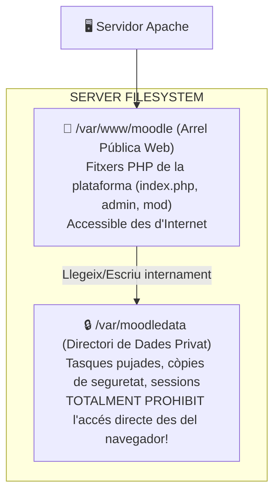
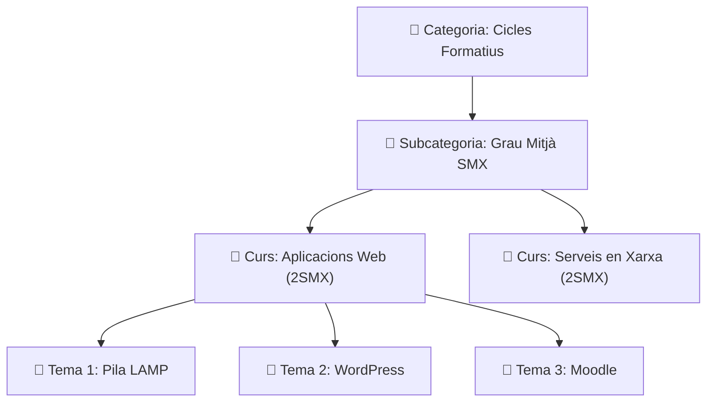

# UT03 — Plataformes de Formació Virtual (LMS): Moodle

Un **Sistema de Gestió de l'Aprenentatge (LMS - *Learning Management System*)** és una aplicació web dissenyada per a administrar, distribuir i avaluar processos formatius en línia o com a suport docent presencial. La plataforma més estesa en l'àmbit educatiu mundial i a la Comunitat Valenciana (a través del portal oficial *Aules*) és **Moodle**.

---

## 📌 1. Arquitectura Tècnica Específica de Moodle

A diferència d'un CMS com WordPress on tot s'ubica sota l'arrel web, Moodle imposa una arquitectura de fitxers estricta per a protegir la privadesa de les dades dels alumnes:



> [!CAUTION]
> El directori **`moodledata` mai s'ha d'ubicar dins de `/var/www/html`**. Si fóra accessible per HTTP, qualsevol persona podria descarregar exàmens confidencials o documents personals d'altres usuaris sense autenticar-se.

---

## 📌 2. Requisits Prèvis i Creació de la Base de Dades

Moodle requereix mòduls PHP addicionals d'internacionalització i tractament XML:

```bash
# Instal·lar extensions indispensables per a Moodle
sudo apt update && sudo apt install php-intl php-soap php-xmlrpc php-gd php-zip php-xml php-mbstring -y
```

### Creació de la Base de Dades a MariaDB:
```sql
sudo mysql

-- Crear base de dades amb format UTF-8 complet
CREATE DATABASE db_moodle CHARACTER SET utf8mb4 COLLATE utf8mb4_unicode_ci;

-- Crear usuari i concedir privilegis
CREATE USER 'moodle_user'@'localhost' IDENTIFIED BY 'MoodleClau2026!';
GRANT ALL PRIVILEGES ON db_moodle.* TO 'moodle_user'@'localhost';
FLUSH PRIVILEGES;
EXIT;
```

### Configuració de Directoris i Permisos:
```bash
# Crear el directori de dades fora de l'arrel web i donar permisos a Apache
sudo mkdir -p /var/moodledata
sudo chown -R www-data:www-data /var/moodledata
sudo chmod -R 775 /var/moodledata

# Descarregar i descomprimir Moodle a /var/www/moodle
sudo chown -R www-data:www-data /var/www/moodle
```

---

## 📌 3. Estructura Acadèmica: Categories i Cursos

A Moodle la informació s'organitza en una jerarquia d'arbres acadèmics:



---

## 📌 4. Recursos vs Activitats Avaluables

Dins d'un curs de Moodle, el professorat pot afegir dos tipus d'elements:

| Tipus d'Element | Descripció Didàctica | Exemples Clau |
| :--- | :--- | :--- |
| **Recursos (*Resources*)** | Elements passius d'estudi que l'alumnat consulta, llegeix o descarrega. No generen nota numèrica directa. | **Fitxer (PDF/Word)**, **Carpeta de documents**, **Etiqueta informativa**, **Pàgina web** i **Enllaç URL**. |
| **Activitats (*Activities*)** | Elements interactius on l'alumnat participa i que es connecten automàticament al **Llibre de Qualificacions (*Gradebook*)**. | **Tasca (*Assignment*)** (lliurament d'arxius), **Qüestionari (*Quiz*)** (autoavaluació tipus test), **Fòrum**, **Glossari**. |

---

## 📌 5. Mètodes de Matrícula i Rols en Moodle

### Rols Principals:
- **Administrador del Lloc:** Gestió global de servidors, connectors i comptes.
- **Professor:** Pot afegir recursos, crear tasques, matricular estudiants i posar notes.
- **Professor sense permís d'edició:** Pot avaluar estudiants però no pot canviar l'estructura del curs.
- **Estudiant:** Pot accedir als materials i enviar tasques.

### Mètodes de Matrícula:
1. **Matrícula manual:** El docent afegeix els estudiants un a un o mitjançant fitxer massiu CSV.
2. **Autoinscripció amb clau:** L'estudiant s'inscriu introduint una contrasenya de curs proporcionada pel docent el primer dia de classe.
3. **Sincronització externa LDAP / Active Directory:** Els usuaris es validen automàticament contra el servidor corporatiu del centre educatiu sense duplicar contrasenyes.
