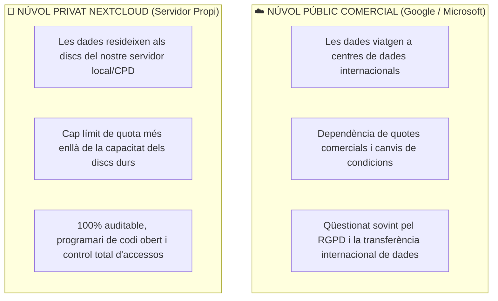
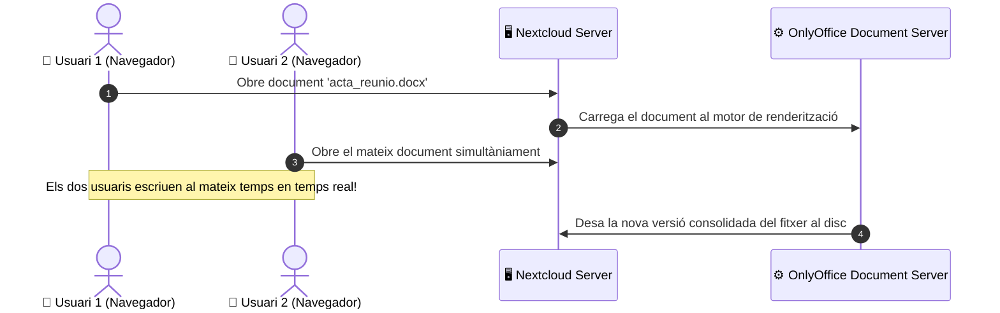

# UT04 — Serveis de Núvol Privat i Gestió d'Arxius: Nextcloud

El model de treball modern requereix accedir als fitxers corporatius des de qualsevol lloc i dispositiu. Un **núvol privat autogestionat (*Self-Hosted Private Cloud*)** com **Nextcloud** permet a les empreses disposar de les mateixes funcionalitats que Google Drive o Dropbox, però mantenint la sobirania total de les dades i garantint el compliment del RGPD.

---

## 📌 1. Núvol Públic vs Núvol Privat Corporatiu



---

## 📌 2. Funcionalitats Principals de Nextcloud Hub

1. **Nextcloud Files:** Emmagatzematge centralitzat, sincronització automàtica de carpetes en segon pla mitjançant el protocol **WebDAV** i control d'historial de versions de fitxers.
2. **Compartició Segura d'Arxius:**
   - **Compartició interna:** Entre usuaris o grups departamentals de l'empresa.
   - **Enllaços públics per a clients externs:** Permet assignar contrasenya d'accés, data de caducitat del vincle, permís de només lectura o bústia de només pujada (*File Drop* sense veure el contingut existent).
3. **Productivitat Integrada:**
   - **Groupware:** Sincronització de calendaris mitjançant **CalDAV** i agendes de contactes mitjançant **CardDAV**.
   - **Nextcloud Talk:** Missatgeria instantània i videotrucades xifrades d'extrem a extrem basades en WebRTC.

---

## 📌 3. Desplegament de Nextcloud sobre LAMP

```bash
# 1. Crear la base de dades a MariaDB
sudo mysql -e "CREATE DATABASE db_nextcloud CHARACTER SET utf8mb4 COLLATE utf8mb4_general_ci;"
sudo mysql -e "CREATE USER 'nc_user'@'localhost' IDENTIFIED BY 'NextcloudClau2026!';"
sudo mysql -e "GRANT ALL PRIVILEGES ON db_nextcloud.* TO 'nc_user'@'localhost'; FLUSH PRIVILEGES;"

# 2. Descarregar i extreure Nextcloud
cd /tmp
wget https://download.nextcloud.com/server/releases/latest.tar.bz2
tar -xjvf latest.tar.bz2
sudo mv nextcloud /var/www/nextcloud

# 3. Crear el directori de dades privat (fora de l'arrel web)
sudo mkdir -p /var/nextcloud_data
sudo chown -R www-data:www-data /var/nextcloud_data /var/www/nextcloud
sudo chmod -R 750 /var/nextcloud_data
```

### Configuració del Virtual Host a Apache (`/etc/apache2/sites-available/nextcloud.conf`):
```apache
<VirtualHost *:80>
    ServerName cloud.internal
    DocumentRoot /var/www/nextcloud

    <Directory /var/www/nextcloud>
        Require all granted
        AllowOverride All
        Options FollowSymLinks MultiViews
    </Directory>

    ErrorLog ${APACHE_LOG_DIR}/nextcloud_error.log
    CustomLog ${APACHE_LOG_DIR}/nextcloud_access.log combined
</VirtualHost>
```

```bash
# Activar mòduls necessaris d'Apache i reiniciar
sudo a2enmod rewrite headers env dir mime ssl
sudo a2ensite nextcloud.conf
sudo systemctl restart apache2
```

---

## 📌 4. Integració d'Edició Col·laborativa amb OnlyOffice

Un dels majors avanços en els servidors de gestió de fitxers moderns és la incorporació d'una suite ofimàtica integrada en el navegador:



Mitjançant la instal·lació de l'aplicació oficial *Community Document Server* i el connector *ONLYOFFICE* des de la botiga d'aplicacions de Nextcloud, els usuaris poden treballar en equip sobre fitxers de Word, Excel i PowerPoint sense descarregar ni un sol arxiu al seu disc local.
