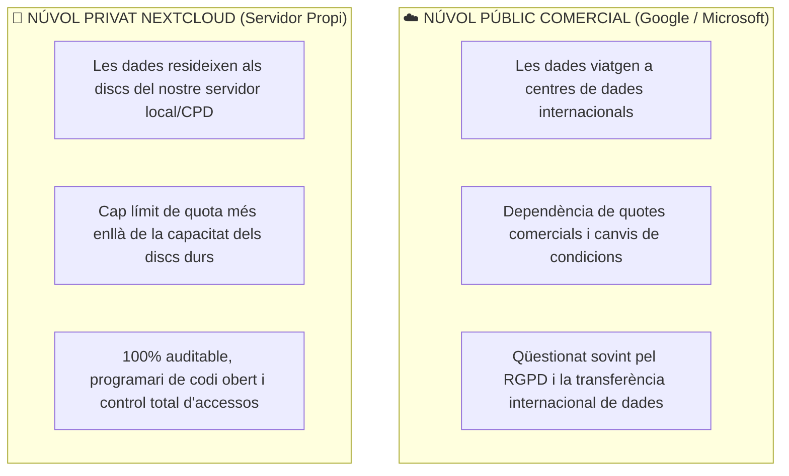
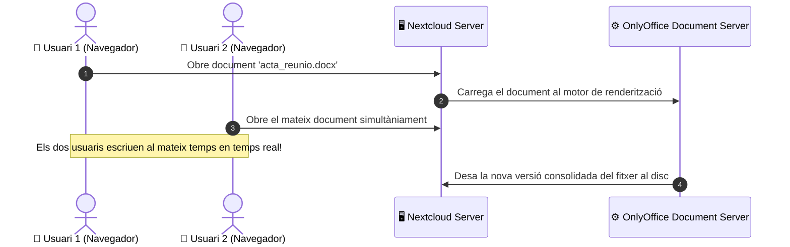

# UT04 — Serveis de Núvol Privat i Gestió d'Arxius: Nextcloud

El model de treball modern requereix accedir als fitxers corporatius des de qualsevol lloc i dispositiu. Un **núvol privat autogestionat (*Self-Hosted Private Cloud*)** com **Nextcloud** permet a les empreses disposar de les mateixes funcionalitats que Google Drive o Dropbox, però mantenint la sobirania total de les dades i garantint el compliment del RGPD.

---

## 📌 1. Núvol Públic vs Núvol Privat Corporatiu

<div style="background: linear-gradient(135deg, #0f172a 0%, #1e293b 100%); border-radius: 12px; padding: 20px; margin: 25px 0; box-shadow: 0 10px 25px -5px rgba(0, 0, 0, 0.3); border: 1px solid #334155;">
  <div style="text-align: center; margin-bottom: 15px;">
    <span style="background: #38bdf8; color: #0f172a; font-weight: 700; font-size: 0.75rem; text-transform: uppercase; letter-spacing: 0.05em; padding: 4px 10px; border-radius: 9999px;">Infografia Tècnica</span>
    <h3 style="color: #f8fafc; margin: 10px 0 5px 0; font-size: 1.25rem;">Arquitectura de Serveis de Núvol Privat Nextcloud Hub</h3>
    <p style="color: #94a3b8; font-size: 0.85rem; margin: 0;">Integració de protocols estàndard: Sincronització WebDAV, Groupware (CalDAV/CardDAV) i Processament Col·laboratiu</p>
  </div>
  <svg viewBox="0 0 860 280" width="100%" height="100%" xmlns="http://www.w3.org/2000/svg" style="display: block; font-family: system-ui, -apple-system, sans-serif;">
    <defs>
      <linearGradient id="ncClientGrad" x1="0%" y1="0%" x2="100%" y2="100%">
        <stop offset="0%" stop-color="#3b82f6" stop-opacity="0.25"/>
        <stop offset="100%" stop-color="#1e40af" stop-opacity="0.1"/>
      </linearGradient>
      <linearGradient id="ncServerGrad" x1="0%" y1="0%" x2="100%" y2="100%">
        <stop offset="0%" stop-color="#8b5cf6" stop-opacity="0.25"/>
        <stop offset="100%" stop-color="#6d28d9" stop-opacity="0.1"/>
      </linearGradient>
      <linearGradient id="ncStorageGrad" x1="0%" y1="0%" x2="100%" y2="100%">
        <stop offset="0%" stop-color="#10b981" stop-opacity="0.25"/>
        <stop offset="100%" stop-color="#047857" stop-opacity="0.1"/>
      </linearGradient>
    </defs>

    <!-- Bloc 1: Clients Multiplataforma -->
    <rect x="20" y="25" width="240" height="200" rx="8" fill="url(#ncClientGrad)" stroke="#38bdf8" stroke-width="1.5"/>
    <text x="140" y="52" fill="#38bdf8" font-size="12" font-weight="bold" text-anchor="middle">📱 CLIENTS I DISPOSITIUS</text>
    <text x="140" y="70" fill="#94a3b8" font-size="10" text-anchor="middle">Multiplataforma (PC, Mòbil, Web)</text>
    <line x1="35" y1="85" x2="245" y2="85" stroke="#334155"/>
    <text x="35" y="108" fill="#cbd5e1" font-size="10.5">• <tspan fill="#38bdf8" font-weight="bold">Client d'Escriptori:</tspan> Sincro local</text>
    <text x="35" y="128" fill="#cbd5e1" font-size="10.5">• <tspan fill="#38bdf8" font-weight="bold">App Mòbil:</tspan> Càrrega d'imatges</text>
    <text x="35" y="148" fill="#cbd5e1" font-size="10.5">• <tspan fill="#cbd5e1">Navegador Web:</tspan> Portal d'usuari</text>
    <text x="35" y="168" fill="#cbd5e1" font-size="10.5">• <tspan fill="#94a3b8">Clients Thunderbird / Outlook</tspan></text>
    <text x="140" y="205" fill="#38bdf8" font-size="10" text-anchor="middle" font-weight="bold">Protocols: HTTPS / TLS 1.3</text>

    <!-- Fletxa 1 a 2 -->
    <path d="M 265 110 L 295 110" stroke="#38bdf8" stroke-width="2"/>
    <text x="280" y="100" fill="#38bdf8" font-size="8" text-anchor="middle">WebDAV</text>
    <path d="M 295 130 L 265 130" stroke="#c084fc" stroke-width="2"/>
    <text x="280" y="145" fill="#c084fc" font-size="8" text-anchor="middle">Cal/Card</text>

    <!-- Bloc 2: Servidor Nextcloud -->
    <rect x="300" y="25" width="260" height="200" rx="8" fill="url(#ncServerGrad)" stroke="#c084fc" stroke-width="1.5"/>
    <text x="430" y="52" fill="#c084fc" font-size="12" font-weight="bold" text-anchor="middle">🖥️ NUCLI NEXTCLOUD HUB</text>
    <text x="430" y="70" fill="#94a3b8" font-size="10" text-anchor="middle">Apache2 + PHP 8.3 + Redis</text>
    <line x1="315" y1="85" x2="545" y2="85" stroke="#334155"/>
    <text x="315" y="108" fill="#cbd5e1" font-size="10.5">• <tspan fill="#c084fc" font-weight="bold">Nextcloud Files:</tspan> Motor WebDAV</text>
    <text x="315" y="128" fill="#cbd5e1" font-size="10.5">• <tspan fill="#c084fc" font-weight="bold">Groupware:</tspan> CalDAV / CardDAV</text>
    <text x="315" y="148" fill="#cbd5e1" font-size="10.5">• <tspan fill="#f59e0b" font-weight="bold">Redis Cache:</tspan> Memòria de bloqueig</text>
    <text x="315" y="168" fill="#cbd5e1" font-size="10.5">• <tspan fill="#94a3b8">Integració OnlyOffice / Talk</tspan></text>
    <text x="430" y="205" fill="#c084fc" font-size="10" text-anchor="middle" font-weight="bold">Eina d'administració: occ CLI</text>

    <!-- Fletxa 2 a 3 -->
    <path d="M 565 110 L 595 110" stroke="#c084fc" stroke-width="2"/>
    <text x="580" y="100" fill="#c084fc" font-size="8" text-anchor="middle">I/O Disc</text>
    <path d="M 595 130 L 565 130" stroke="#34d399" stroke-width="2"/>
    <text x="580" y="145" fill="#34d399" font-size="8" text-anchor="middle">SQL</text>

    <!-- Bloc 3: Magatzem de Dades i BD -->
    <rect x="600" y="25" width="240" height="200" rx="8" fill="url(#ncStorageGrad)" stroke="#34d399" stroke-width="1.5"/>
    <text x="720" y="52" fill="#34d399" font-size="12" font-weight="bold" text-anchor="middle">🗄️ PERSISTÈNCIA SEGURA</text>
    <text x="720" y="70" fill="#94a3b8" font-size="10" text-anchor="middle">Disc Local i Base de Dades</text>
    <line x1="615" y1="85" x2="825" y2="85" stroke="#334155"/>
    <text x="615" y="108" fill="#cbd5e1" font-size="10.5">• <tspan fill="#f87171" font-weight="bold">/var/nextcloud_data:</tspan> Dades</text>
    <text x="615" y="128" fill="#cbd5e1" font-size="10.5">• <tspan fill="#34d399" font-weight="bold">db_nextcloud:</tspan> MariaDB UTF-8</text>
    <text x="615" y="148" fill="#cbd5e1" font-size="10.5">• <tspan fill="#cbd5e1">Historial de versions</tspan> per fitxer</text>
    <text x="615" y="168" fill="#cbd5e1" font-size="10.5">• <tspan fill="#cbd5e1">Paperera de reciclatge</tspan> d'usuari</text>
    <text x="720" y="205" fill="#34d399" font-size="10" text-anchor="middle" font-weight="bold">chmod 750 (Privat www-data)</text>

    <!-- Peu informatiu -->
    <rect x="20" y="235" width="820" height="35" rx="6" fill="#1e293b" stroke="#334155"/>
    <text x="430" y="257" fill="#cbd5e1" font-size="10.5" text-anchor="middle">Sobirania Digital i RGPD: <tspan fill="#f59e0b" font-weight="bold">Les dades romanen als discos corporatius de l'empresa sense cap transmissió a proveïdors externs.</tspan></text>
  </svg>
</div>



---

## 📌 2. Funcionalitats Principals de Nextcloud Hub

1. **Nextcloud Files:** Emmagatzematge centralitzat, sincronització automàtica de carpetes en segon pla mitjançant el protocol **WebDAV** i control d'historial de versions de fitxers.
2. **Compartició Segura d'Arxius:**
   - **Compartició interna:** Entre usuaris o grups departamentals de l'empresa.
   - **Enllaços públics per a clients externs:** Permet assignar contrasenya d'accés, data de caducitat del vincle, permís de només lectura o bústia de només pujada (*File Drop* sense veure el contingut existent).
3. **Productivitat Integrada:**
   - **Groupware:** Sincronització de calendaris mitjançant **CalDAV** i agendes de contactes mitjançant **CardDAV**.
   - **Nextcloud Talk:** Missatgeria instantània i videotrucades xifrades d'extrem a extrem basades en WebRTC.

---

## 📌 3. Desplegament de Nextcloud sobre LAMP

```bash
# 1. Crear la base de dades a MariaDB
sudo mysql -e "CREATE DATABASE db_nextcloud CHARACTER SET utf8mb4 COLLATE utf8mb4_general_ci;"
sudo mysql -e "CREATE USER 'nc_user'@'localhost' IDENTIFIED BY 'NextcloudClau2026!';"
sudo mysql -e "GRANT ALL PRIVILEGES ON db_nextcloud.* TO 'nc_user'@'localhost'; FLUSH PRIVILEGES;"

# 2. Descarregar i extreure Nextcloud
cd /tmp
wget https://download.nextcloud.com/server/releases/latest.tar.bz2
tar -xjvf latest.tar.bz2
sudo mv nextcloud /var/www/nextcloud

# 3. Crear el directori de dades privat (fora de l'arrel web)
sudo mkdir -p /var/nextcloud_data
sudo chown -R www-data:www-data /var/nextcloud_data /var/www/nextcloud
sudo chmod -R 750 /var/nextcloud_data
```

### Configuració del Virtual Host a Apache (`/etc/apache2/sites-available/nextcloud.conf`):
```apache
<VirtualHost *:80>
    ServerName cloud.internal
    DocumentRoot /var/www/nextcloud

    <Directory /var/www/nextcloud>
        Require all granted
        AllowOverride All
        Options FollowSymLinks MultiViews
    </Directory>

    ErrorLog ${APACHE_LOG_DIR}/nextcloud_error.log
    CustomLog ${APACHE_LOG_DIR}/nextcloud_access.log combined
</VirtualHost>
```

```bash
# Activar mòduls necessaris d'Apache i reiniciar
sudo a2enmod rewrite headers env dir mime ssl
sudo a2ensite nextcloud.conf
sudo systemctl restart apache2
```

---

## 📌 4. Integració d'Edició Col·laborativa amb OnlyOffice

Un dels majors avanços en els servidors de gestió de fitxers moderns és la incorporació d'una suite ofimàtica integrada en el navegador:



Mitjançant la instal·lació de l'aplicació oficial *Community Document Server* i el connector *ONLYOFFICE* des de la botiga d'aplicacions de Nextcloud, els usuaris poden treballar en equip sobre fitxers de Word, Excel i PowerPoint sense descarregar ni un sol arxiu al seu disc local.

---

## 📝 Quadern d'Activitats Pràctiques i Reptes de Laboratori

### 🔵 Bloc A: Fonaments i Diagnòstic Tècnic

1. **Protocols de xarxa en Nextcloud:** Quines diferències fonamentals hi ha entre utilitzar el protocol **WebDAV** per a sincronització de fitxers i utilitzar **SMB/CIFS** o **FTP** a través d'Internet (suport HTTP natiu, pas a través de tallafocs per port 443, bloqueig transaccional)?
2. **Estandardització Groupware:** Quins estàndards RFC utilitza Nextcloud per a sincronitzar calendaris (**CalDAV**) i agendes de contactes (**CardDAV**) amb clients externs com Mozilla Thunderbird, Apple iOS o Android?
3. **Memòria cau de bloqueig transaccional (*Transactional File Locking*):** Per quina raó Nextcloud recomana instal·lar i configurar un servidor **Redis** en el mateix equip (`'filelocking.enabled' => true, 'memcache.locking' => '\OC\Memcache\Redis'`)? Què succeeix si dos usuaris sincronitzen el mateix fitxer alhora sense Redis?
4. **Bústies de només pujada (*File Drop*):** Quina utilitat té la funció de compartir una carpeta com a "Només pujada (*File Drop*)" amb un client extern? Com garanteix la privadesa entre diferents clients que pugen fitxers al mateix enllaç?
5. **Historial i deduplicació de versions:** Com gestiona Nextcloud l'historial de versions de fitxers per a no exhaurir l'espai en disc? Quina regla segueix l'algorisme de purga automàtica de versions antigues quan l'espai d'un usuari arriba al 50% de la seua quota?
6. **Mòdul `headers` d'Apache:** Per quina raó el panell d'administració de Nextcloud mostra un avís crític si el mòdul `headers` d'Apache no està habilitat o si no s'ha configurat la capçalera de seguretat `Strict-Transport-Security` (HSTS)?
7. **La utilitat d'administració `occ`:** Què és l'eina `occ` (*OwnCloud/Nextcloud Console*) de Nextcloud, amb quin intèrpret s'executa i per què s'ha d'executar sempre suplantant la identitat de l'usuari `www-data` (`sudo -u www-data php occ`)?
8. **Emmagatzematge Federat (*Federated Cloud Sharing*):** Explica en què consisteix l'emmagatzematge federat entre dos servidors Nextcloud diferents pertanyents a dues seus o instituts distints mitjançant la ID federada d'usuari (`usuari@servidor2.org`).
9. **Permisos de `/var/nextcloud_data`:** Per què el directori de dades ha de tindre permisos estrictes `chmod 750` en lloc de `755` o `777`? Quina fallada de seguretat detecta l'assistent d'instal·lació si altres usuaris locals poden llistar aquest directori?
10. **Requisits de xifratge en repòs (*Server-Side Encryption*):** Quins beneficis i quins inconvenients de rendiment i recuperació de desastres presenta activar el xifratge de dades al servidor a Nextcloud?

---

### 🟢 Bloc B: Reptes Pràctics de Laboratori i Comandes

#### 🛠️ Repte 1: Creació de la Base de Dades i Optimització MariaDB
Accedeix a MariaDB i crea la base de dades garantint suport UTF-8 de 4 bytes:
```bash
sudo mysql -u root -p -e "
CREATE DATABASE db_nextcloud CHARACTER SET utf8mb4 COLLATE utf8mb4_general_ci;
CREATE USER 'usr_nextcloud'@'localhost' IDENTIFIED BY 'NextcloudPass_SMX_2026!';
GRANT ALL PRIVILEGES ON db_nextcloud.* TO 'usr_nextcloud'@'localhost';
FLUSH PRIVILEGES;
"
```

#### 🛠️ Repte 2: Preparació del Magatzem Privat de Dades
Crea el directori de dades fora de `/var/www` i estableix la propietat i permisos recomanats per la documentació oficial:
```bash
sudo mkdir -p /var/nextcloud_data
sudo chown -R www-data:www-data /var/nextcloud_data
sudo chmod -R 750 /var/nextcloud_data
ls -ld /var/nextcloud_data
```

#### 🛠️ Repte 3: VirtualHost Apache2 amb Capçaleres de Seguretat HSTS
Crea el fitxer `/etc/apache2/sites-available/nextcloud.conf`:
```apache
<VirtualHost *:80>
    ServerName cloud.smx.internal
    DocumentRoot /var/www/nextcloud

    <Directory /var/www/nextcloud>
        Require all granted
        AllowOverride All
        Options FollowSymLinks MultiViews

        <IfModule mod_dav.c>
            Dav off
        </IfModule>
    </Directory>

    <IfModule mod_headers.c>
        Header always set Strict-Transport-Security "max-age=15552000; includeSubDomains"
    </IfModule>

    ErrorLog ${APACHE_LOG_DIR}/nextcloud_error.log
    CustomLog ${APACHE_LOG_DIR}/nextcloud_access.log combined
</VirtualHost>
```
Habilita els mòduls essencials i reinicia Apache2:
```bash
sudo a2enmod rewrite headers env dir mime ssl
sudo a2ensite nextcloud.conf
sudo apache2ctl configtest
sudo systemctl restart apache2
```

#### 🛠️ Repte 4: Gestió i Auditoria amb la Utilitat `occ`
Després de completar la instal·lació inicial, utilitza la comanda `occ` per a realitzar tasques de manteniment des de la consola del sistema operatiu:
```bash
# 1. Comprovar l'estat d'instal·lació del sistema
sudo -u www-data php /var/www/nextcloud/occ status

# 2. Afegir els índexs que falten a la base de dades
sudo -u www-data php /var/www/nextcloud/occ db:add-missing-indices

# 3. Convertir columnes a big-int per a rendiment òptim
sudo -u www-data php /var/www/nextcloud/occ db:convert-filecache-bigint --no-interaction

# 4. Crear un nou usuari per consola amb quota de 5 GB
sudo -u www-data php /var/www/nextcloud/occ user:add --password-from-env alumne_smx
sudo -u www-data php /var/www/nextcloud/occ user:setting alumne_smx files quota "5 GB"
```

#### 🛠️ Repte 5: Prova de Pujada i Descarrega WebDAV per Consola
Comprova el funcionament del protocol WebDAV pujant un fitxer de prova directament mitjançant `curl` simulant un client de sincronització:
```bash
# Crear fitxer de prova
echo "Document de prova sincronitzat per WebDAV SMX" > /tmp/prova_webdav.txt

# Pujar el fitxer mitjançant mètode HTTP PUT a la carpeta de l'usuari
curl -u alumne_smx:ContrasenyaAlumne2026! -T /tmp/prova_webdav.txt \
    http://cloud.smx.internal/remote.php/dav/files/alumne_smx/prova_webdav.txt

# Descarregar el fitxer per verificar la integritat
curl -u alumne_smx:ContrasenyaAlumne2026! \
    http://cloud.smx.internal/remote.php/dav/files/alumne_smx/prova_webdav.txt
```

---

### 🔴 Bloc C: Rúbrica d'Avaluació Competencial per Nivells

| Criteri d'Avaluació | Insuficient (1 - 4) | Suficient (5 - 6) | Notable (7 - 8) | Excel·lent (9 - 10) |
| :--- | :--- | :--- | :--- | :--- |
| **Arquitectura de Núvol Privat i WebDAV** | Confon el núvol privat amb un servidor FTP bàsic o desconeix WebDAV. | Entén el model de sincronització però no sap configurar clients ni enllaços públics. | Configura el servidor i sincronitza clients d'escriptori i mòbils amb enllaços segurs. | Domina els protocols WebDAV, CalDAV i CardDAV, configurant quotes i bústies File Drop. |
| **Seguretat de Dades i Permisos POSIX** | Ubica el directori de dades dins de l'arrel web o assigna permisos `777`. | Ubica `/var/nextcloud_data` fora de `/var/www` però comet errors de permisos. | Aplica estrictament permisos `750` amb propietat `www-data` i sense fallades de permisos. | Justifica l'aïllament, analitza capçaleres HSTS i configura xifratge o aïllament d'arxius. |
| **Administració Avançada amb `occ`** | Desconeix l'eina `occ` o intenta executar-la com a `root` trencant permisos. | Executa comandes bàsiques d'`occ` guiat per documentació per comprovar l'estat. | Utilitza `occ` amb `sudo -u www-data` per a reparar índexs i gestionar usuaris. | Automatitza la creació d'usuaris, quotes i manteniment mitjançant scripts bash amb `occ`. |
| **Integració d'Eines Col·laboratives** | No aconsegueix instal·lar connectors o bloqueja el servidor per manca de memòria. | Habilita aplicacions bàsiques de la botiga però no aconsegueix integrar OnlyOffice. | Integra correctament el visualitzador de documents i connexió amb servidors de text. | Desplega la suite OnlyOffice comunitària amb edició concurrent d'usuaris en temps real. |

