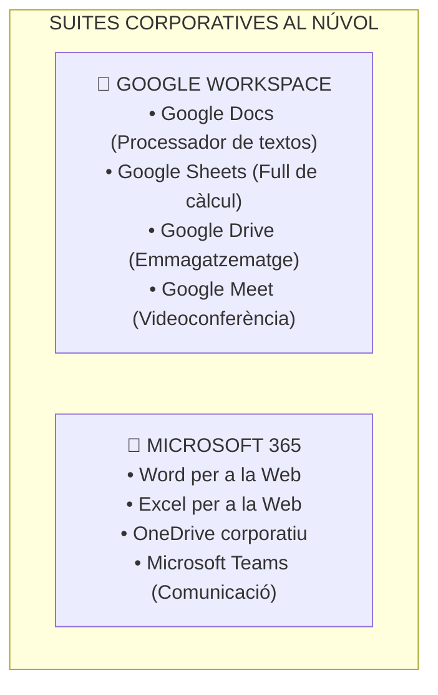
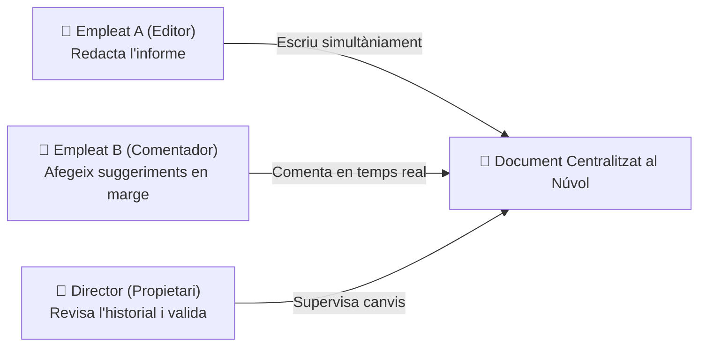
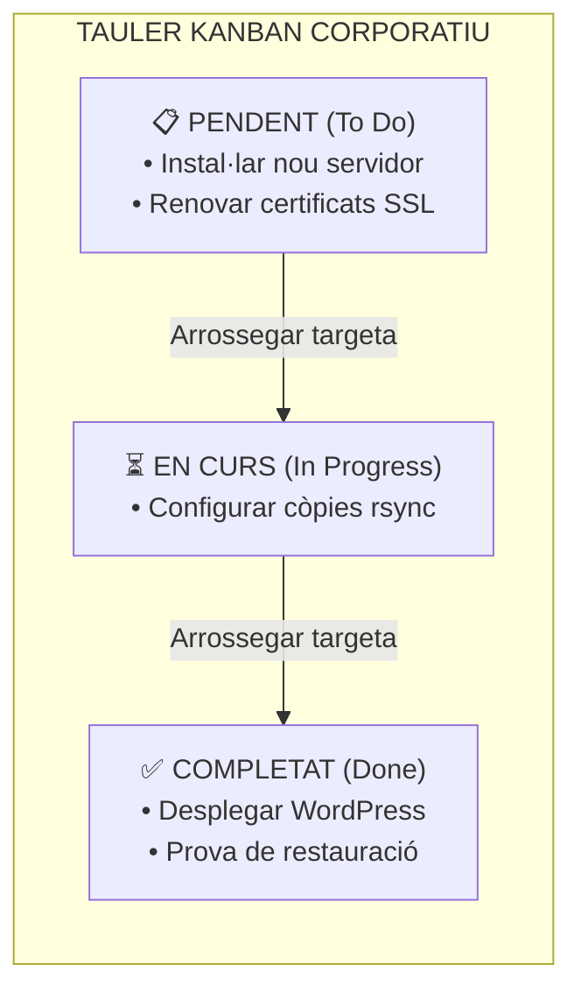

# UT05 — Aplicacions Web d'Escriptori i Ofimàtica Col·laborativa

L'evolució dels estàndards HTML5, WebAssembly i JavaScript ha permès traslladar complexes suites d'ofimàtica i gestió directament al navegador web. Avui dia, equips sencers de treball col·laboren en temps real sobre documents, fulls de càlcul i taulers de projecte sense necessitat d'instal·lar cap programari local a l'ordinador.

---

## 📌 1. Ecosistemes SaaS: Google Workspace i Microsoft 365

El model **SaaS (*Software as a Service*)** ofereix aplicacions completes allotjades en servidors de proveïdors al núvol a les quals s'accedeix mitjançant subscripció:

### Avantatges per a l'Empresa:
- **Zero manteniment local:** No cal instal·lar pedaços, actualitzacions de seguretat ni gestionar claus de llicència per màquina.
- **Accessibilitat universal:** Els documents estan disponibles des de qualsevol ordinador, tauleta o telèfon mòbil amb connexió a Internet.
- **Desat automàtic continu:** S'elimina el risc de perdre feina per un tall elèctric sobtat o un bloqueig del sistema operatiu.

---

## 📌 2. Treball Col·laboratiu Concurrent i Historial de Versions

En l'ofimàtica clàrsica d'escriptori, quan diverses persones volien revisar un document calia enviar-lo per correu adjuntant arxius amb noms com `pressupost_v1_revisat_final_definitiu.docx`, generant confusió i duplicitat. En l'ofimàtica web es treballa sobre **un únic document centralitzat**:

### Gestió de Rols de Compartició:
1. **Lector (*Viewer*):** Pot llegir el document, però no pot alterar cap caràcter ni afegir notes.
2. **Comentador (*Commenter*):** Pot seleccionar text i obrir fils de comentari o suggeriments que l'editor pot acceptar o rebutjar.
3. **Editor (*Editor*):** Té control total per a escriure, formatar, esborrar o afegir dades.
4. **Propietari (*Owner*):** Té la custòdia legal del document, pot canviar els permisos globals de compartició o eliminar-lo definitivament.

### L'Historial de Versions:
Totes les modificacions queden registrades en una línia de temps amb la data, hora exacta i el nom de l'usuari que va fer cada canvi amb un color identificatiu. És possible **revertir el document a qualsevol estat temporal anterior amb un sol clic**.

---

## 📌 3. Eines de Gestió Visual de Tasques: Metodologia Kanban

Per a coordinar departaments i projectes informàtics s'utilitzen taulers web visuals basats en la filosofia àgil **Kanban**:

- Eines comercials al núvol: **Trello**, **Microsoft Planner**, **Asana**.
- Eines de codi obert per a instal·lar en servidor propi: **Wekan**, **Taiga**, **Kanboard**.
