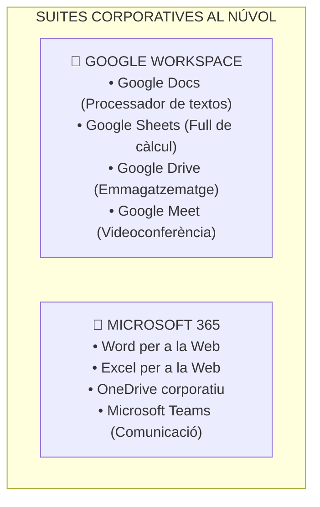
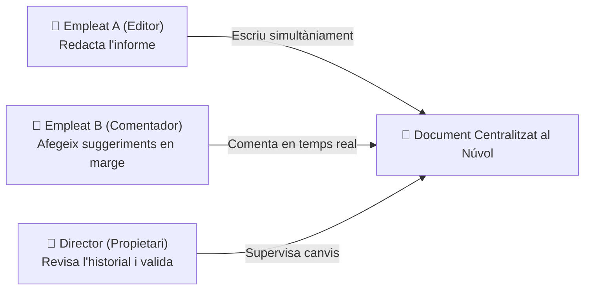
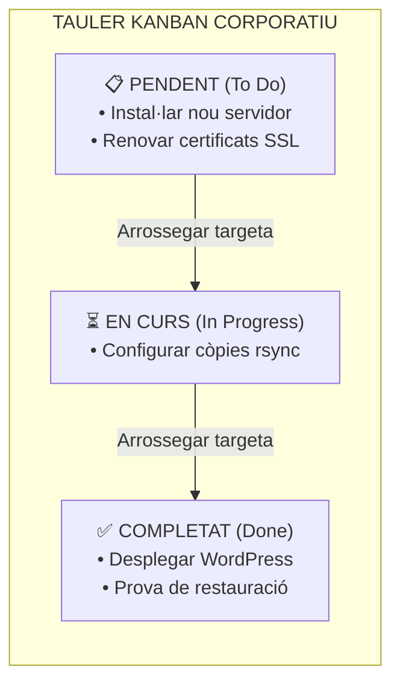

# UT05 — Aplicacions Web d'Escriptori i Ofimàtica Col·laborativa

L'evolució dels estàndards HTML5, WebAssembly i JavaScript ha permès traslladar complexes suites d'ofimàtica i gestió directament al navegador web. Avui dia, equips sencers de treball col·laboren en temps real sobre documents, fulls de càlcul i taulers de projecte sense necessitat d'instal·lar cap programari local a l'ordinador.

---

## 📌 1. Ecosistemes SaaS: Google Workspace i Microsoft 365

El model **SaaS (*Software as a Service*)** ofereix aplicacions completes allotjades en servidors de proveïdors al núvol a les quals s'accedeix mitjançant subscripció:

<div style="background: linear-gradient(135deg, #0f172a 0%, #1e293b 100%); border-radius: 12px; padding: 20px; margin: 25px 0; box-shadow: 0 10px 25px -5px rgba(0, 0, 0, 0.3); border: 1px solid #334155;">
  <div style="text-align: center; margin-bottom: 15px;">
    <span style="background: #38bdf8; color: #0f172a; font-weight: 700; font-size: 0.75rem; text-transform: uppercase; letter-spacing: 0.05em; padding: 4px 10px; border-radius: 9999px;">Infografia Tècnica</span>
    <h3 style="color: #f8fafc; margin: 10px 0 5px 0; font-size: 1.25rem;">Arquitectura d'Ofimàtica Col·laborativa al Núvol i Edició Concurrent</h3>
    <p style="color: #94a3b8; font-size: 0.85rem; margin: 0;">Sincronització en temps real mitjançant WebSockets, motors de resolució de conflictes (OT/CRDT) i custòdia centralitzada</p>
  </div>
  <svg viewBox="0 0 860 280" width="100%" height="100%" xmlns="http://www.w3.org/2000/svg" style="display: block; font-family: system-ui, -apple-system, sans-serif;">
    <defs>
      <linearGradient id="saasClientGrad" x1="0%" y1="0%" x2="100%" y2="100%">
        <stop offset="0%" stop-color="#3b82f6" stop-opacity="0.25"/>
        <stop offset="100%" stop-color="#1e40af" stop-opacity="0.1"/>
      </linearGradient>
      <linearGradient id="saasEngineGrad" x1="0%" y1="0%" x2="100%" y2="100%">
        <stop offset="0%" stop-color="#8b5cf6" stop-opacity="0.25"/>
        <stop offset="100%" stop-color="#6d28d9" stop-opacity="0.1"/>
      </linearGradient>
      <linearGradient id="saasCloudGrad" x1="0%" y1="0%" x2="100%" y2="100%">
        <stop offset="0%" stop-color="#10b981" stop-opacity="0.25"/>
        <stop offset="100%" stop-color="#047857" stop-opacity="0.1"/>
      </linearGradient>
    </defs>

    <!-- Bloc 1: Usuaris Concurrents -->
    <rect x="20" y="25" width="240" height="200" rx="8" fill="url(#saasClientGrad)" stroke="#38bdf8" stroke-width="1.5"/>
    <text x="140" y="52" fill="#38bdf8" font-size="12" font-weight="bold" text-anchor="middle">👥 TREBALL CONCURRENT</text>
    <text x="140" y="70" fill="#94a3b8" font-size="10" text-anchor="middle">Clients Web Connectats</text>
    <line x1="35" y1="85" x2="245" y2="85" stroke="#334155"/>
    <text x="35" y="108" fill="#38bdf8" font-size="10.5">• <tspan font-weight="bold">Usuari A (Editor):</tspan> Cursor Blau</text>
    <text x="35" y="128" fill="#34d399" font-size="10.5">• <tspan font-weight="bold">Usuari B (Editor):</tspan> Cursor Verd</text>
    <text x="35" y="148" fill="#c084fc" font-size="10.5">• <tspan font-weight="bold">Usuari C (Notes):</tspan> Comentaris</text>
    <text x="35" y="168" fill="#cbd5e1" font-size="10.5">• <tspan fill="#94a3b8">Visualització en viu de caràcters</tspan></text>
    <text x="140" y="205" fill="#38bdf8" font-size="10" text-anchor="middle" font-weight="bold">Latency &lt; 50 ms</text>

    <!-- Fletxa 1 a 2 -->
    <path d="M 265 110 L 295 110" stroke="#38bdf8" stroke-width="2"/>
    <text x="280" y="100" fill="#38bdf8" font-size="8" text-anchor="middle">WebSocket</text>
    <path d="M 295 130 L 265 130" stroke="#c084fc" stroke-width="2"/>
    <text x="280" y="145" fill="#c084fc" font-size="8" text-anchor="middle">Sync WSS</text>

    <!-- Bloc 2: Motor de Consistència -->
    <rect x="300" y="25" width="260" height="200" rx="8" fill="url(#saasEngineGrad)" stroke="#c084fc" stroke-width="1.5"/>
    <text x="430" y="52" fill="#c084fc" font-size="12" font-weight="bold" text-anchor="middle">⚙️ MOTOR DE CONSISTÈNCIA</text>
    <text x="430" y="70" fill="#94a3b8" font-size="10" text-anchor="middle">Operational Transformation / CRDT</text>
    <line x1="315" y1="85" x2="545" y2="85" stroke="#334155"/>
    <text x="315" y="108" fill="#cbd5e1" font-size="10.5">• <tspan fill="#c084fc" font-weight="bold">Reconciliació de caràcters</tspan> simultanis</text>
    <text x="315" y="128" fill="#cbd5e1" font-size="10.5">• <tspan fill="#cbd5e1">Control de conflictes</tspan> sense bloqueig</text>
    <text x="315" y="148" fill="#cbd5e1" font-size="10.5">• <tspan fill="#f59e0b" font-weight="bold">Registre continu:</tspan> Timestamps UTC</text>
    <text x="315" y="168" fill="#cbd5e1" font-size="10.5">• <tspan fill="#94a3b8">Indexació de comentaris i tasques</tspan></text>
    <text x="430" y="205" fill="#c084fc" font-size="10" text-anchor="middle" font-weight="bold">Zero pèrdua de canvis</text>

    <!-- Fletxa 2 a 3 -->
    <path d="M 565 110 L 595 110" stroke="#c084fc" stroke-width="2"/>
    <text x="580" y="100" fill="#c084fc" font-size="8" text-anchor="middle">Snapshots</text>
    <path d="M 595 130 L 565 130" stroke="#34d399" stroke-width="2"/>
    <text x="580" y="145" fill="#34d399" font-size="8" text-anchor="middle">Persist</text>

    <!-- Bloc 3: Magatzem i Versions -->
    <rect x="600" y="25" width="240" height="200" rx="8" fill="url(#saasCloudGrad)" stroke="#34d399" stroke-width="1.5"/>
    <text x="720" y="52" fill="#34d399" font-size="12" font-weight="bold" text-anchor="middle">☁️ CUSTÒDIA I VERSIONS</text>
    <text x="720" y="70" fill="#94a3b8" font-size="10" text-anchor="middle">Magatzem Objectual al Núvol</text>
    <line x1="615" y1="85" x2="825" y2="85" stroke="#334155"/>
    <text x="615" y="108" fill="#cbd5e1" font-size="10.5">• <tspan fill="#34d399" font-weight="bold">Historial de Versions:</tspan> Reversió 1-clic</text>
    <text x="615" y="128" fill="#cbd5e1" font-size="10.5">• <tspan fill="#cbd5e1">Diferenciació d'autors</tspan> per colors</text>
    <text x="615" y="148" fill="#cbd5e1" font-size="10.5">• <tspan fill="#f87171" font-weight="bold">Permisos RBAC:</tspan> Veure/Comentar/Editar</text>
    <text x="615" y="168" fill="#cbd5e1" font-size="10.5">• <tspan fill="#cbd5e1">Còpia de seguretat contínua</tspan> al CPD</text>
    <text x="720" y="205" fill="#34d399" font-size="10" text-anchor="middle" font-weight="bold">Disponibilitat SLA 99.9%</text>

    <!-- Peu informatiu -->
    <rect x="20" y="235" width="820" height="35" rx="6" fill="#1e293b" stroke="#334155"/>
    <text x="430" y="257" fill="#cbd5e1" font-size="10.5" text-anchor="middle">Desat Automàtic Transparent: <tspan fill="#f59e0b" font-weight="bold">S'elimina el risc de pèrdua per apagada sobtada: el document es desa caràcter a caràcter al servidor.</tspan></text>
  </svg>
</div>



### Avantatges per a l'Empresa:
- **Zero manteniment local:** No cal instal·lar pedaços, actualitzacions de seguretat ni gestionar claus de llicència per màquina.
- **Accessibilitat universal:** Els documents estan disponibles des de qualsevol ordinador, tauleta o telèfon mòbil amb connexió a Internet.
- **Desat automàtic continu:** S'elimina el risc de perdre feina per un tall elèctric sobtat o un bloqueig del sistema operatiu.

---

## 📌 2. Treball Col·laboratiu Concurrent i Historial de Versions

En l'ofimàtica clàrsica d'escriptori, quan diverses persones volien revisar un document calia enviar-lo per correu adjuntant arxius amb noms com `pressupost_v1_revisat_final_definitiu.docx`, generant confusió i duplicitat. En l'ofimàtica web es treballa sobre **un únic document centralitzat**:



### Gestió de Rols de Compartició:
1. **Lector (*Viewer*):** Pot llegir el document, però no pot alterar cap caràcter ni afegir notes.
2. **Comentador (*Commenter*):** Pot seleccionar text i obrir fils de comentari o suggeriments que l'editor pot acceptar o rebutjar.
3. **Editor (*Editor*):** Té control total per a escriure, formatar, esborrar o afegir dades.
4. **Propietari (*Owner*):** Té la custòdia legal del document, pot canviar els permisos globals de compartició o eliminar-lo definitivament.

### L'Historial de Versions:
Totes les modificacions queden registrades en una línia de temps amb la data, hora exacta i el nom de l'usuari que va fer cada canvi amb un color identificatiu. És possible **revertir el document a qualsevol estat temporal anterior amb un sol clic**.

---

## 📌 3. Eines de Gestió Visual de Tasques: Metodologia Kanban

Per a coordinar departaments i projectes informàtics s'utilitzen taulers web visuals basats en la filosofia àgil **Kanban**:



- Eines comercials al núvol: **Trello**, **Microsoft Planner**, **Asana**.
- Eines de codi obert per a instal·lar en servidor propi: **Wekan**, **Taiga**, **Kanboard**.

---

## 📝 Quadern d'Activitats Pràctiques i Reptes de Laboratori

### 🔵 Bloc A: Fonaments i Diagnòstic Tècnic

1. **Protocols d'intercanvi en viu:** Per quina raó tècnica les plataformes d'ofimàtica col·laborativa utilitzen connexions bidireccionals per **WebSockets (WSS)** en comptes del model tradicional de peticions i respostes HTTP periòdiques (*polling*)?
2. **Reconciliació de caràcters concurrents:** Què és l'algorisme de **Transformació Operacional (OT - *Operational Transformation*)** o els tipus **CRDT (*Conflict-free Replicated Data Types*)**? Com eviten que dos caràcters escrits exactament en el mateix mil·lisegon per dos usuaris diferents sobreescriguin l'un a l'altre?
3. **Model de responsabilitat compartida en SaaS:** Si una empresa contracta Google Workspace o Microsoft 365, quines capes de la infraestructura són responsabilitat exclusiva del proveïdor al núvol i quines capes continuen sent responsabilitat del tècnic de l'empresa (gestió de claus, configuració de doble factor MFA i assignació de rols)?
4. **Matriu de permisos col·laboratius:** Un directiu comparteix un full de càlcul amb un auditor extern. Si només necessita que revise les fórmules i deixe advertències sobre possibles errors sense alterar cap xifra, quin permís de compartició cal assignar-li (*Lector*, *Comentador* o *Editor*)?
5. **RGPD i sobirania al núvol:** Què són les Clàusules Contractuals Tipus (*SCC - Standard Contractual Clauses*) de la Unió Europea i per què són fonamentals quan una empresa europea utilitza suites d'ofimàtica de multinacionals nord-americanes?
6. **Desat automàtic i trànsit de xarxa:** Per què un processador de textos al núvol no envia tot el document sencer de 100 pàgines cada vegada que un usuari tecleja una lletra, sinó que transmet únicament operacions de canvi diferencial (*Deltas*)?
7. **Filosofia Kanban en suport tècnic:** Dins d'un departament de microinformàtica organitzat amb metodologia Kanban, quines són les tres columnes clàssiques mínimes d'un tauler i per què és important establir un límit de treball en curs (*WIP - Work In Progress*)?
8. **Interoperabilitat de formats ofimàtics:** Quines diferències hi ha entre el format lliure estàndard **ODF (*Open Document Format*, .odt/.ods)** i el format propietari obert **OOXML (.docx/.xlsx)**? Quins problemes de maquetació es poden donar en convertir entre ambdós?
9. **Autenticació federada Single Sign-On (SSO):** Com permet el protocol **SAML 2.0** o **OpenID Connect** que els usuaris d'una empresa inicien sessió en aplicacions SaaS de tercers utilitzant directament el seu compte del controlador de domini de l'organització?
10. **Bloqueig de proveïdor (*Vendor Lock-in*):** Quins riscos estratègics té per a una organització tindre tots els processos, calendaris i documents en una única plataforma SaaS sense cap política periòdica d'exportació i còpia externa de les dades?

---

### 🟢 Bloc B: Reptes Pràctics de Laboratori i Comandes

#### 🛠️ Repte 1: Desplegament Local d'un Tauler Kanban de Codi Obert (Kanboard)
Descarrega i desplega l'eina àgil de gestió de tasques de codi obert Kanboard en l'entorn LAMP local:
```bash
cd /tmp
wget https://github.com/kanboard/kanboard/archive/refs/tags/v1.2.36.tar.gz -O kanboard.tar.gz
tar -xzvf kanboard.tar.gz
sudo mv kanboard-1.2.36 /var/www/kanboard
sudo chown -R www-data:www-data /var/www/kanboard
sudo chmod -R 755 /var/www/kanboard
sudo chmod -R 775 /var/www/kanboard/data
```

#### 🛠️ Repte 2: Configuració del VirtualHost per a Kanboard
Crea el fitxer `/etc/apache2/sites-available/kanboard.conf`:
```apache
<VirtualHost *:80>
    ServerName tasques.smx.internal
    DocumentRoot /var/www/kanboard

    <Directory /var/www/kanboard>
        Options FollowSymLinks
        AllowOverride All
        Require all granted
    </Directory>

    ErrorLog ${APACHE_LOG_DIR}/kanboard_error.log
    CustomLog ${APACHE_LOG_DIR}/kanboard_access.log combined
</VirtualHost>
```
Habilita el lloc i recarrega el servei Apache:
```bash
sudo a2ensite kanboard.conf
sudo systemctl reload apache2
```

#### 🛠️ Repte 3: Creació de Projecte de Taller i Flux de Tasques
Accedeix a `http://tasques.smx.internal` amb les credencials per defecte (`admin`/`admin`) i realitza les accions següents:
1. Canvia la contrasenya de l'administrador per una de forta.
2. Crea un nou projecte anomenat: **Manteniment Taller Microinformàtica**.
3. Afegeix 3 columnes Kanban: `Pendent (Cua d'incidències)`, `En Reparació`, `Verificat / Enllestit`.
4. Crea dues tasques reals de diagnòstic:
   - *Tasca 1:* "Canvi de pasta tèrmica i neteja de pols al PC-04".
   - *Tasca 2:* "Instal·lació de disc SSD de 500 GB i clonació amb Clonezilla al PC-12".

#### 🛠️ Repte 4: Simulació de Conversió Massiva de Documents per Línia d'Ordres
Simula la conversió automàtica entre formats ofimàtics corporatius mitjançant el motor de consola de LibreOffice:
```bash
# Instal·lar el motor lliure en mode headless (sense entorn gràfic)
sudo apt update && sudo apt install libreoffice-core libreoffice-writer libreoffice-calc -y

# Crear un document de prova en format Markdown/Text
echo "Informe d'Auditoria de Sistemes SMX 2026" > /tmp/informe.txt

# Convertir el fitxer a document PDF corporatiu per línia d'ordres
soffice --headless --convert-to pdf /tmp/informe.txt --outdir /tmp/

# Verificar la generació del PDF
ls -lh /tmp/informe.pdf
file /tmp/informe.pdf
```

#### 🛠️ Repte 5: Auditoria d'Historial de Versions i Reversió
Crea un document compartit a l'entorn de treball ofimàtic i realitza la simulació següent:
1. Usuari 1 redacta el pressupost d'un servidor afegint un preu inicial de 1.200 €.
2. Usuari 2 modifica erròniament el pressupost deixant-lo en 120 €.
3. Com a responsable de sistemes, obre el panell d'**Historial de Versions**, compara les diferències visuals marcades pel sistema per autor i reverteix el canvi per a restaurar la versió correcta de l'Usuari 1.

---

### 🔴 Bloc C: Rúbrica d'Avaluació Competencial per Nivells

| Criteri d'Avaluació | Insuficient (1 - 4) | Suficient (5 - 6) | Notable (7 - 8) | Excel·lent (9 - 10) |
| :--- | :--- | :--- | :--- | :--- |
| **Arquitectura de Sincronització SaaS** | Desconeix com opera la sincronització concurrent o creu que es bloquegen els fitxers sencers. | Comprèn el model d'edició concurrent bàsic però no sap explicar la resolució de conflictes. | Explica clarament l'ús de WebSockets, canals segurs WSS i motors de consistència (OT/CRDT). | Domina l'arquitectura SaaS, analitza capçaleres de transmissió delta i audita el desat continu. |
| **Gestió de Permisos i Seguretat Col·laborativa** | Assigna permisos d'edició pública a qualsevol persona sense cap control d'accés. | Configura enllaços amb contrasenya bàsica però confon rols de comentador i lector. | Estableix polítiques d'accés segmentades per rols (Lector, Comentador, Editor) segons el cas. | Dissenya estructures col·laboratives complexes amb auditoria de canvis i caducitat d'enllaços. |
| **Desplegament d'Eines Àgils (Kanban)** | No aconsegueix instal·lar ni configurar un tauler de gestió visual de tasques. | Desplega l'eina però no sap personalitzar el flux ni crear columnes adaptades al treball. | Configura taulers Kanban adaptats a manteniment informàtic amb fluxos de treball fluids. | Automatitza notificacions del tauler, gestiona fites, assigna prioritats i audita mètriques d'equip. |
| **Interoperabilitat i Automatització d'Arxius** | Incapaç de convertir documents o desconeix la diferència entre formats lliures i propietaris. | Converteix fitxers manualment mitjançant menús gràfics sense conèixer la consola. | Utilitza eines de terminal com `soffice` en mode headless per a processar fitxers en lot. | Construeix scripts d'automatització bash per a convertir informes i generar PDFs corporatius. |

