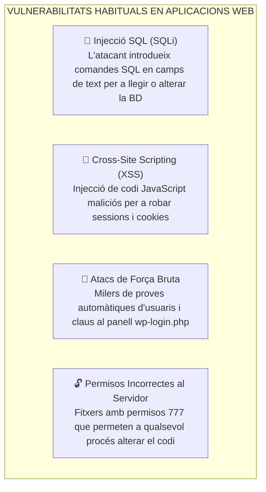
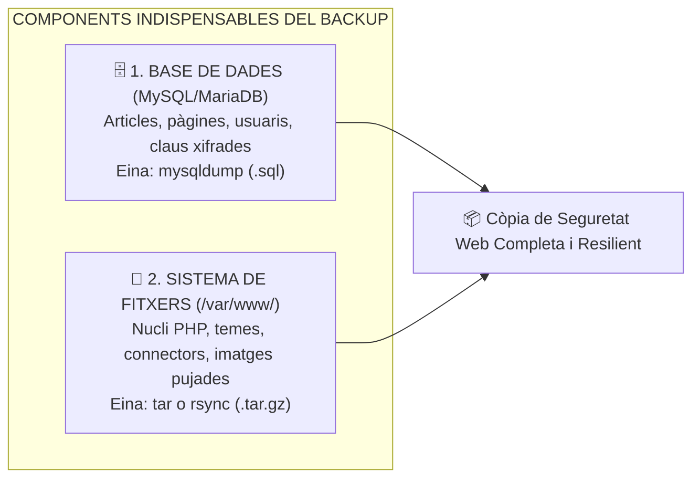

# UT06 — Seguretat, Còpies de Seguretat i Manteniment Web

Un servidor web és un equip exposat contínuament a Internet que rep centenars d'intents d'atac cada minut. La tasca de l'administrador de sistemes és mantindre les aplicacions protegides, actualitzades i amb un sistema automàtic de còpies de seguretat que permeta restaurar el servei en minuts davant qualsevol desastre o hackeig.

---

## 📌 1. Principals Vulnerabilitats Web (Projecte OWASP)

L'organització internacional **OWASP (*Open Web Application Security Project*)** publica periòdicament el llistat dels 10 riscos de seguretat més crítics en aplicacions web:



---

## 📌 2. El Procediment Dual de Còpia de Seguretat Web

> [!CAUTION]
> **L'error més comú de l'administrador principiant:**  
> Una aplicació web no és un simple directori de fitxers. **Està partida en dos components independents**: si només copies els fitxers de `/var/www/wordpress` i el servidor es trenca, hauràs perdut tots els articles, usuaris i configuracions perquè estan desats a la base de dades MariaDB!



### Script d'Automatització en Linux (`backup_web.sh`):
```bash
#!/bin/bash
# /opt/scripts/backup_web.sh
DATA=$(date +%F_%H%M)
DESTI="/mnt/backups/web"
BD="db_wordpress"
USUARI_BD="wp_user"
CLAU_BD="ClauMoltSegura2026!"
CARPETA_WEB="/var/www/wordpress"

mkdir -p $DESTI

# 1. Bolcat de la base de dades amb mysqldump
mysqldump -u $USUARI_BD -p$CLAU_BD $BD > $DESTI/${BD}_${DATA}.sql

# 2. Empaquetament comprimit del sistema de fitxers web
tar -czvf $DESTI/files_${DATA}.tar.gz -C /var/www wordpress

# 3. Eliminar còpies amb més de 30 dies d'antiguitat
find $DESTI -type f -mtime +30 -delete

echo "Còpia completada el $(date)" >> /var/log/backup_web.log
```

---

## 📌 3. Procediment de Restauració davant Desastres

Quan un atacant desfigura la web (*Defacement*) o una actualització fa caure el sistema, es restaura la còpia en tres passos:

```bash
# 1. Buidar la base de dades danyada i restaurar el fitxer SQL
mysql -u root -p -e "DROP DATABASE db_wordpress; CREATE DATABASE db_wordpress CHARACTER SET utf8mb4;"
mysql -u root -p db_wordpress < /mnt/backups/web/db_wordpress_2026-10-13_0200.sql

# 2. Restaurar els fitxers a l'arrel de publicació d'Apache
sudo rm -rf /var/www/wordpress
sudo tar -xzvf /mnt/backups/web/files_2026-10-13_0200.tar.gz -C /var/www/

# 3. Restablir els permisos de seguretat del servidor web
sudo chown -R www-data:www-data /var/www/wordpress
sudo find /var/www/wordpress/ -type d -exec chmod 755 {} \;
sudo find /var/www/wordpress/ -type f -exec chmod 644 {} \;
sudo systemctl restart apache2
```

---

## 📌 4. Manteniment Professional amb la Consola WP-CLI

**WP-CLI** és la interfície de línia d'ordres oficial per a administrar WordPress de forma professional i immediata sense necessitat d'obrir el navegador:

```bash
# Instal·lar WP-CLI al sistema
curl -O https://raw.githubusercontent.com/wp-cli/builds/gh-pages/phar/wp-cli.phar
chmod +x wp-cli.phar
sudo mv wp-cli.phar /usr/local/bin/wp

# Tasques habituals d'administració (executades com a www-data)
cd /var/www/wordpress

# Consultar l'estat i actualitzar el nucli de WordPress
sudo -u www-data wp core check-update
sudo -u www-data wp core update

# Llistar i actualitzar tots els connectors instal·lats amb una sola ordre
sudo -u www-data wp plugin list
sudo -u www-data wp plugin update --all

# Fer un backup ràpid de la base de dades abans de qualsevol canvi
sudo -u www-data wp db export backup_urgent.sql
```
