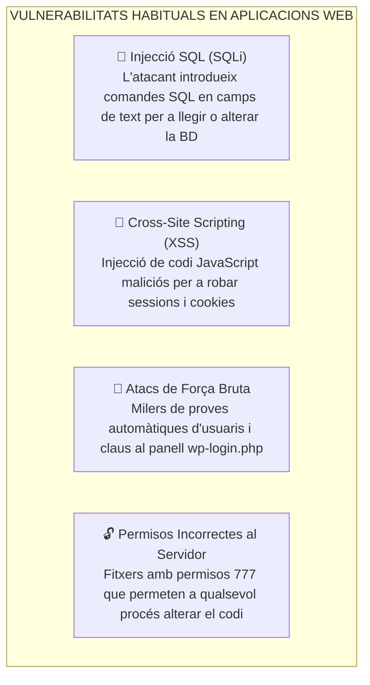
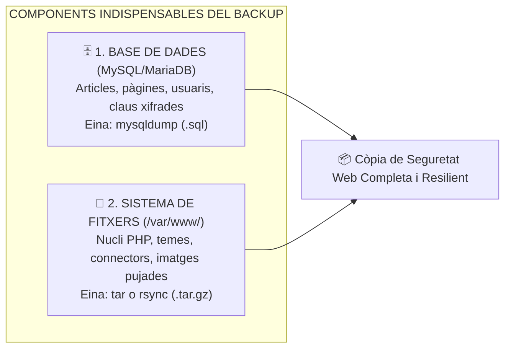

# UT06 — Seguretat, Còpies de Seguretat i Manteniment Web

Un servidor web és un equip exposat contínuament a Internet que rep centenars d'intents d'atac cada minut. La tasca de l'administrador de sistemes és mantindre les aplicacions protegides, actualitzades i amb un sistema automàtic de còpies de seguretat que permeta restaurar el servei en minuts davant qualsevol desastre o hackeig.

---

## 📌 1. Principals Vulnerabilitats Web (Projecte OWASP)

L'organització internacional **OWASP (*Open Web Application Security Project*)** publica periòdicament el llistat dels 10 riscos de seguretat més crítics en aplicacions web:



---

## 📌 2. El Procediment Dual de Còpia de Seguretat Web

> [!CAUTION]
> **L'error més comú de l'administrador principiant:**  
> Una aplicació web no és un simple directori de fitxers. **Està partida en dos components independents**: si només copies els fitxers de `/var/www/wordpress` i el servidor es trenca, hauràs perdut tots els articles, usuaris i configuracions perquè estan desats a la base de dades MariaDB!

<div style="background: linear-gradient(135deg, #0f172a 0%, #1e293b 100%); border-radius: 12px; padding: 20px; margin: 25px 0; box-shadow: 0 10px 25px -5px rgba(0, 0, 0, 0.3); border: 1px solid #334155;">
  <div style="text-align: center; margin-bottom: 15px;">
    <span style="background: #38bdf8; color: #0f172a; font-weight: 700; font-size: 0.75rem; text-transform: uppercase; letter-spacing: 0.05em; padding: 4px 10px; border-radius: 9999px;">Infografia Tècnica</span>
    <h3 style="color: #f8fafc; margin: 10px 0 5px 0; font-size: 1.25rem;">Estratègia Integral de Seguretat i Còpies de Seguretat Web</h3>
    <p style="color: #94a3b8; font-size: 0.85rem; margin: 0;">Protecció multicapa: Bastionat perimetral, protecció de directoris de pujada i el procediment dual de resiliència</p>
  </div>
  <svg viewBox="0 0 860 280" width="100%" height="100%" xmlns="http://www.w3.org/2000/svg" style="display: block; font-family: system-ui, -apple-system, sans-serif;">
    <defs>
      <linearGradient id="secWafGrad" x1="0%" y1="0%" x2="100%" y2="100%">
        <stop offset="0%" stop-color="#3b82f6" stop-opacity="0.25"/>
        <stop offset="100%" stop-color="#1e40af" stop-opacity="0.1"/>
      </linearGradient>
      <linearGradient id="secHardGrad" x1="0%" y1="0%" x2="100%" y2="100%">
        <stop offset="0%" stop-color="#8b5cf6" stop-opacity="0.25"/>
        <stop offset="100%" stop-color="#6d28d9" stop-opacity="0.1"/>
      </linearGradient>
      <linearGradient id="secBackGrad" x1="0%" y1="0%" x2="100%" y2="100%">
        <stop offset="0%" stop-color="#10b981" stop-opacity="0.25"/>
        <stop offset="100%" stop-color="#047857" stop-opacity="0.1"/>
      </linearGradient>
    </defs>

    <!-- Bloc 1: Bastionat Perimetral -->
    <rect x="20" y="25" width="240" height="200" rx="8" fill="url(#secWafGrad)" stroke="#38bdf8" stroke-width="1.5"/>
    <text x="140" y="52" fill="#38bdf8" font-size="12" font-weight="bold" text-anchor="middle">1️⃣ SEGURETAT PERIMETRAL</text>
    <text x="140" y="70" fill="#94a3b8" font-size="10" text-anchor="middle">Xifratge i Defensa d'Accés</text>
    <line x1="35" y1="85" x2="245" y2="85" stroke="#334155"/>
    <text x="35" y="108" fill="#cbd5e1" font-size="10.5">• <tspan fill="#38bdf8" font-weight="bold">HTTPS / Let's Encrypt:</tspan> Certbot</text>
    <text x="35" y="128" fill="#cbd5e1" font-size="10.5">• <tspan fill="#38bdf8" font-weight="bold">Fail2ban:</tspan> Filtre wp-login.php</text>
    <text x="35" y="148" fill="#cbd5e1" font-size="10.5">• <tspan fill="#cbd5e1">WAF / ModSecurity:</tspan> Anti-SQLi</text>
    <text x="35" y="168" fill="#cbd5e1" font-size="10.5">• <tspan fill="#94a3b8">Capçaleres HSTS i CSP</tspan></text>
    <text x="140" y="205" fill="#38bdf8" font-size="10" text-anchor="middle" font-weight="bold">Filtratge de trànsit hostil</text>

    <!-- Fletxa 1 a 2 -->
    <path d="M 265 110 L 295 110" stroke="#38bdf8" stroke-width="2"/>
    <text x="280" y="100" fill="#38bdf8" font-size="8" text-anchor="middle">Filtre</text>
    <path d="M 295 130 L 265 130" stroke="#c084fc" stroke-width="2"/>
    <text x="280" y="145" fill="#c084fc" font-size="8" text-anchor="middle">Logs</text>

    <!-- Bloc 2: Bastionat Intern -->
    <rect x="300" y="25" width="260" height="200" rx="8" fill="url(#secHardGrad)" stroke="#c084fc" stroke-width="1.5"/>
    <text x="430" y="52" fill="#c084fc" font-size="12" font-weight="bold" text-anchor="middle">2️⃣ BASTIONAT DEL SISTEMA</text>
    <text x="430" y="70" fill="#94a3b8" font-size="10" text-anchor="middle">Protecció de Fitxers i Motor</text>
    <line x1="315" y1="85" x2="545" y2="85" stroke="#334155"/>
    <text x="315" y="108" fill="#cbd5e1" font-size="10.5">• <tspan fill="#c084fc" font-weight="bold">chmod 600 wp-config.php</tspan></text>
    <text x="315" y="128" fill="#cbd5e1" font-size="10.5">• <tspan fill="#f59e0b" font-weight="bold">Bloqueig PHP</tspan> a carpeta /uploads</text>
    <text x="315" y="148" fill="#cbd5e1" font-size="10.5">• <tspan fill="#cbd5e1">Desactivació edició</tspan> per panell web</text>
    <text x="315" y="168" fill="#cbd5e1" font-size="10.5">• <tspan fill="#94a3b8">Auditoria WP-CLI checksums</tspan></text>
    <text x="430" y="205" fill="#c084fc" font-size="10" text-anchor="middle" font-weight="bold">Minimització de superfície d'atac</text>

    <!-- Fletxa 2 a 3 -->
    <path d="M 565 110 L 595 110" stroke="#c084fc" stroke-width="2"/>
    <text x="580" y="100" fill="#c084fc" font-size="8" text-anchor="middle">Cron</text>
    <path d="M 595 130 L 565 130" stroke="#34d399" stroke-width="2"/>
    <text x="580" y="145" fill="#34d399" font-size="8" text-anchor="middle">Backup</text>

    <!-- Bloc 3: Còpia Dual de Resiliència -->
    <rect x="600" y="25" width="240" height="200" rx="8" fill="url(#secBackGrad)" stroke="#34d399" stroke-width="1.5"/>
    <text x="720" y="52" fill="#34d399" font-size="12" font-weight="bold" text-anchor="middle">3️⃣ PROCEDIMENT DUAL</text>
    <text x="720" y="70" fill="#94a3b8" font-size="10" text-anchor="middle">Còpia Dual Independent</text>
    <line x1="615" y1="85" x2="825" y2="85" stroke="#334155"/>
    <text x="615" y="108" fill="#cbd5e1" font-size="10.5">• <tspan fill="#34d399" font-weight="bold">mysqldump (.sql):</tspan> Dades i usuaris</text>
    <text x="615" y="128" fill="#cbd5e1" font-size="10.5">• <tspan fill="#34d399" font-weight="bold">tar / rsync (.tar.gz):</tspan> Fitxers web</text>
    <text x="615" y="148" fill="#cbd5e1" font-size="10.5">• <tspan fill="#cbd5e1">Rotació:</tspan> Purga fitxers &gt; 14 dies</text>
    <text x="615" y="168" fill="#cbd5e1" font-size="10.5">• <tspan fill="#f59e0b" font-weight="bold">Destí fora del DocumentRoot</tspan></text>
    <text x="720" y="205" fill="#34d399" font-size="10" text-anchor="middle" font-weight="bold">Regla 3-2-1 de Seguretat</text>

    <!-- Peu informatiu -->
    <rect x="20" y="235" width="820" height="35" rx="6" fill="#1e293b" stroke="#334155"/>
    <text x="430" y="257" fill="#cbd5e1" font-size="10.5" text-anchor="middle">Regla d'Or de l'Administrador: <tspan fill="#f59e0b" font-weight="bold">MAI desis arxius de còpia de seguretat (.sql, .zip) dins de /var/www/html: qualsevol pot descarregar la teua BD per HTTP!</tspan></text>
  </svg>
</div>



### Script d'Automatització en Linux (`backup_web.sh`):
```bash
#!/bin/bash
# /opt/scripts/backup_web.sh
DATA=$(date +%F_%H%M)
DESTI="/mnt/backups/web"
BD="db_wordpress"
USUARI_BD="wp_user"
CLAU_BD="ClauMoltSegura2026!"
CARPETA_WEB="/var/www/wordpress"

mkdir -p $DESTI

# 1. Bolcat de la base de dades amb mysqldump
mysqldump -u $USUARI_BD -p$CLAU_BD $BD > $DESTI/${BD}_${DATA}.sql

# 2. Empaquetament comprimit del sistema de fitxers web
tar -czvf $DESTI/files_${DATA}.tar.gz -C /var/www wordpress

# 3. Eliminar còpies amb més de 30 dies d'antiguitat
find $DESTI -type f -mtime +30 -delete

echo "Còpia completada el $(date)" >> /var/log/backup_web.log
```

---

## 📌 3. Procediment de Restauració davant Desastres

Quan un atacant desfigura la web (*Defacement*) o una actualització fa caure el sistema, es restaura la còpia en tres passos:

```bash
# 1. Buidar la base de dades danyada i restaurar el fitxer SQL
mysql -u root -p -e "DROP DATABASE db_wordpress; CREATE DATABASE db_wordpress CHARACTER SET utf8mb4;"
mysql -u root -p db_wordpress < /mnt/backups/web/db_wordpress_2026-10-13_0200.sql

# 2. Restaurar els fitxers a l'arrel de publicació d'Apache
sudo rm -rf /var/www/wordpress
sudo tar -xzvf /mnt/backups/web/files_2026-10-13_0200.tar.gz -C /var/www/

# 3. Restablir els permisos de seguretat del servidor web
sudo chown -R www-data:www-data /var/www/wordpress
sudo find /var/www/wordpress/ -type d -exec chmod 755 {} \;
sudo find /var/www/wordpress/ -type f -exec chmod 644 {} \;
sudo systemctl restart apache2
```

---

## 📌 4. Manteniment Professional amb la Consola WP-CLI

**WP-CLI** és la interfície de línia d'ordres oficial per a administrar WordPress de forma professional i immediata sense necessitat d'obrir el navegador:

```bash
# Instal·lar WP-CLI al sistema
curl -O https://raw.githubusercontent.com/wp-cli/builds/gh-pages/phar/wp-cli.phar
chmod +x wp-cli.phar
sudo mv wp-cli.phar /usr/local/bin/wp

# Tasques habituals d'administració (executades com a www-data)
cd /var/www/wordpress

# Consultar l'estat i actualitzar el nucli de WordPress
sudo -u www-data wp core check-update
sudo -u www-data wp core update

# Llistar i actualitzar tots els connectors instal·lats amb una sola ordre
sudo -u www-data wp plugin list
sudo -u www-data wp plugin update --all

# Fer un backup ràpid de la base de dades abans de qualsevol canvi
sudo -u www-data wp db export backup_urgent.sql
```

---

## 📝 Quadern d'Activitats Pràctiques i Reptes de Laboratori

### 🔵 Bloc A: Fonaments i Diagnòstic Tècnic

1. **Perills de fitxers de backup a l'arrel web:** Per quina raó tècnica és un error greu de ciberseguretat deixar fitxers com `backup.sql`, `copia_bd.zip` o `wordpress_vell.tar.gz` dins de `/var/www/html/`? Com utilitzen els atacants motors de cerca i eines com `ffuf` o `gobuster` per a descarregar-los?
2. **Injecció de codi a `/wp-content/uploads/`:** Per què els atacants intenten pujar arxius PHP maliciosos (*Webshells*) disfressats d'imatges (`foto.php.jpg` o `shell.php`) a la carpeta de fitxers multimèdia? Com es bloqueja de forma taxativa l'execució de qualsevol fitxer `.php` en aqueixa subcarpeta mitjançant directives d'Apache2?
3. **Mecanisme de defensa de Fail2ban:** Com analitza el dimoni `fail2ban` el fitxer de logs `/var/log/apache2/other_vhosts_access.log` per a detectar atacs de força bruta a `wp-login.php` o `xmlrpc.php` i quina acció pren a la taula `iptables`/`nftables` del tallafocs del sistema?
4. **Certificats SSL amb Let's Encrypt:** Com valida el client `certbot` la propietat d'un domini mitjançant el desafiament HTTP-01 (`/.well-known/acme-challenge/`) i com programa automàticament la renovació abans dels 90 dies de caducitat mitjançant un temporitzador de `systemd`?
5. **Diferència entre còpia lògica i física:** Què diferencia una còpia lògica de base de dades generada per `mysqldump` d'una còpia física dels fitxers del directori `/var/lib/mysql`? Per què mai no s'han de copiar els fitxers de MariaDB mentre el dimoni `mysqld` està en funcionament?
6. **Integritat de fitxers amb WP-CLI:** Quina verificació criptogràfica executa la comanda `wp core verify-checksums` i com detecta si un atacant ha modificat silenciosament una línia de codi del fitxer `wp-blog-header.php` per a instal·lar una porta del darrere (*Backdoor*)?
7. **Política de retenció i càlcul d'espai:** Si una base de dades ocupa 500 MB i els fitxers ocupen 4 GB, quin espai mínim cal planificar al volum de còpies `/mnt/backups` si s'estableix una política de retenció de 7 dies de còpies diàries comprimides amb gzip (estimant una taxa de compressió del 50%)?
8. **Desactivació de l'editor de fitxers web:** Quina directiva de seguretat s'ha d'afegir al fitxer `wp-config.php` (`define('DISALLOW_FILE_EDIT', true);`) per a impedir que un usuari amb rol d'administrador puga editar directament el codi PHP dels temes o connectors des del panell de navegació web?
9. **Manteniment de la taula `wp_options`:** Què són els registres *transients* a WordPress, per què poden inflar la base de dades amb milers de files innecessàries i quina comanda de WP-CLI permet purgar-los immediatament?
10. **Ordre de restauració després d'un desastre:** Davant una corrupció total del disc del servidor web, quin és l'ordre lògic estricte d'operacions per a restablir el servei (restaurar BD abans o després de desplegar fitxers, verificació de permisos POSIX, comprovació de connexió a MariaDB i neteja de memòria cau)?

---

### 🟢 Bloc B: Reptes Pràctics de Laboratori i Comandes

#### 🛠️ Repte 1: Script Bash de Còpia Dual de Seguretat amb Rotació
Crea el script `/usr/local/bin/backup_portal.sh` amb suport complet de volcat de base de dades, empaquetament de fitxers i purga automàtica:
```bash
#!/bin/bash
set -e

DATA=$(date +%Y%m%d_%H%M%S)
DESTI="/mnt/backups/portal"
WEB_DIR="/var/www/portal"
BD_NOM="db_portal_smx"
BD_USER="usr_portal"
BD_PASS="WpPortal_SMX_2026!"

mkdir -p "$DESTI"

# 1. Còpia lògica de la base de dades
mysqldump -u "$BD_USER" -p"$BD_PASS" "$BD_NOM" | gzip > "$DESTI/db_${BD_NOM}_${DATA}.sql.gz"

# 2. Còpia dels fitxers del sistema web excloent logs temporals
tar -czf "$DESTI/files_portal_${DATA}.tar.gz" -C /var/www portal

# 3. Rotació de seguretat: eliminar còpies amb més de 14 dies
find "$DESTI" -type f -name "*.gz" -mtime +14 -delete

echo "[$(date)] Còpia de seguretat dual completada amb èxit a $DESTI"
```
Assigna permisos d'execució reservats exclusivament a `root`:
```bash
sudo chmod 700 /usr/local/bin/backup_portal.sh
sudo /usr/local/bin/backup_portal.sh
ls -lh /mnt/backups/portal
```

#### 🛠️ Repte 2: Programació Temporal amb Crontab de Sistema
Automatitza l'execució diària de la còpia de seguretat a les 03:30 de la matinada editant el crontab de `root`:
```bash
sudo crontab -e
```
Afegeix la línia:
```crontab
30 3 * * * /usr/local/bin/backup_portal.sh >> /var/log/backup_portal.log 2>&1
```

#### 🛠️ Repte 3: Bloqueig d'Execució PHP al Directori d'Imatges Pujades
Evita l'execució de codi maliciós a la carpeta multimèdia creant un fitxer `.htaccess` dins de `/var/www/portal/wp-content/uploads/.htaccess`:
```apache
# Bloqueig d'execució de qualsevol script PHP en aquest directori
<Files *.php>
    deny from all
</Files>
```
*Prova d'atac simulada:* Crea un fitxer de prova `test.php` dins d'`uploads` i verifica amb `curl`:
```bash
echo "<?php echo 'Vulnerable!'; ?>" | sudo tee /var/www/portal/wp-content/uploads/test.php
curl -I http://portal.smx.internal/wp-content/uploads/test.php
# Ha de retornar HTTP/1.1 403 Forbidden!
sudo rm /var/www/portal/wp-content/uploads/test.php
```

#### 🛠️ Repte 4: Auditoria d'Integritat del Nucli amb WP-CLI
Comprova que cap fitxer oficial de WordPress ha estat manipulat per codi maliciós:
```bash
cd /var/www/portal
sudo -u www-data wp core verify-checksums
```
*Simulació d'auditoria:* Afegeix un comentari de prova al final de `wp-settings.php` i comprova com WP-CLI detecta immediatament que el hash criptogràfic del fitxer no coincideix amb l'oficial del repositori central.

#### 🛠️ Repte 5: Simulació Completa de Desastre i Restauració de Servei
1. Simula la pèrdua accidental de dades esborrant una taula troncal o buidant la base de dades:
   ```bash
   sudo mysql -u root -p -e "DROP DATABASE db_portal_smx; CREATE DATABASE db_portal_smx;"
   ```
2. Comprova al navegador que el lloc mostra l'error: `Error establishing a database connection`.
3. Restaura la base de dades a partir de l'últim fitxer comprimit de backup:
   ```bash
   LATEST_SQL=$(ls -t /mnt/backups/portal/db_*.sql.gz | head -1)
   gunzip < "$LATEST_SQL" | mysql -u usr_portal -p'WpPortal_SMX_2026!' db_portal_smx
   ```
4. Comprova que el portal torna a carregar completament operatiu amb tots els seus articles i usuaris intactes.

---

### 🔴 Bloc C: Rúbrica d'Avaluació Competencial per Nivells

| Criteri d'Avaluació | Insuficient (1 - 4) | Suficient (5 - 6) | Notable (7 - 8) | Excel·lent (9 - 10) |
| :--- | :--- | :--- | :--- | :--- |
| **Procediment Dual de Còpia de Seguretat** | Només copia els fitxers de disc oblidant la base de dades o desa backups a `/var/www`. | Executa `mysqldump` manualment però no automatitza la rotació ni la compressió. | Construeix un script bash de còpia dual amb compressió gzip i rotació de fitxers antics. | Script impecable amb control d'errors `set -e`, verificació d'espai, logs i xifratge de claus. |
| **Mecanismes de Bastionat Web** | Deixa fitxers amb permisos 777 o permet execució de PHP en directoris de pujada. | Aplica permisos bàsics però no sap bloquejar l'execució d'scripts a `/uploads`. | Bloqueja scripts PHP a la carpeta multimèdia i protegeix `wp-config.php` amb `chmod 600`. | Implementa bastionat complet: regles `.htaccess`, desactivació de l'editor web i regles WAF. |
| **Manteniment i Auditoria amb WP-CLI** | Incapaç d'utilitzar la consola WP-CLI o trenca permisos executant com a `root`. | Utilitza comandes bàsiques per a actualitzar connectors des de la línia d'ordres. | Realitza auditories d'integritat amb `verify-checksums` i manté el nucli actualitzat. | Automatitza auditories periòdiques, neteja de taules residuals i generació de backups previs. |
| **Recuperació davant Desastres (DRP)** | Incapaç de restaurar el servei davant una caiguda de la base de dades o desfaci d'arxius. | Restaura la base de dades guiat per manuals però requereix assistència en permisos. | Restaura la base de dades i els fitxers recuperant la funcionalitat en un temps raonable. | Executa un procediment de recuperació complet de desastre de forma autònoma en pocs minuts. |

