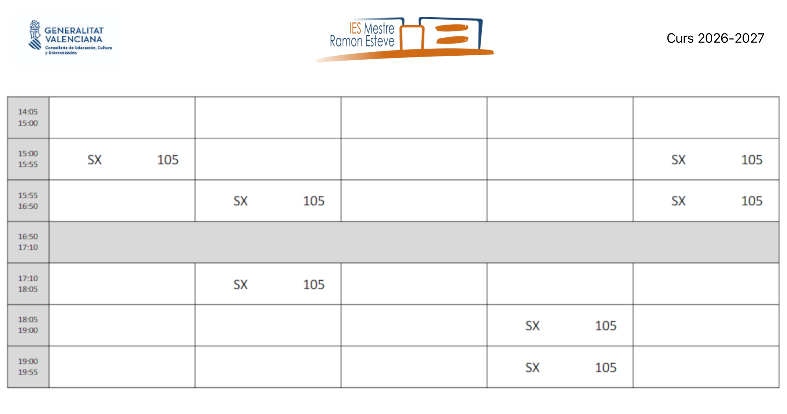
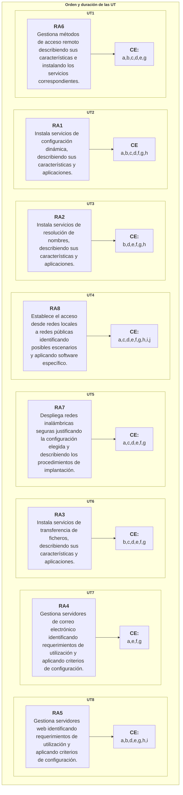

  

    🏆 <strong>Progrés d'aquesta secció:</strong> 0 de 4 superats (0%)
    ⭐ <strong>0 punts</strong>
  

  

    

  

# 0.1 Presentació del Mòdul, RAs i Temporalització

## 1 - Calendari escolar

## 2 - Horari de sessions

## 3 - Continguts del mòdul

Continguts disponibles ací.

> **📌 Instal·lació de serveis de configuració dinàmica de sistemes**
> 

> - Adreça IP, màscara de xarxa, porta d'enllaç.

> - DHCP. Rangs, exclusions, concessions i reserves.

> **📌 Instal·lació de serveis de resolució de noms**
> 

> - Sistemes de noms plànols i jeràrquics.

> - Zones primàries i secundarias. Transferències de zona.

> - Tipus de registres.

> **📌 Instal·lació de serveis de transferència de fitxers**
> 

> - Usuaris i grups. Accés anònim.

> - Permisos. Cuotas. Límit d'ample de banda.

> - Comandes de control, autenticació, gestió i transferència de fitxers.

> - Transferència en mode text i binari.

> **📌 Gestió de serveis de correu electrònic**
> 

> - Comptes de correu, àlies i buzones d'user.

> - Protocols i serveis de descarrega de correu.

> **📌 Gestió de servidors web**
> 

> - Servidors virtuals. Nom d'encapçalament d'host. Identificació d'un servidor virtual.

> - Accés anònim i autentificado. Mètodes d'autentificació.

> **📌 Gestió d'accés remoto**
> 

> - Terminals en mode text.

> - Terminals en mode gràfic.

> **📌 Desplegament de xarxes sense fils**
> 

> - Punts d'accés.

> - Encaminadors sense fils.

> - Seguretat en xarxes sense fils.

> **📌 Interconnexió de xarxes privades amb xarxes públiques**
> 

> - Passarel·les a nivell d'aplicació. Emmagatzematge en memòria caché.

> - Encaminament de trànsit entre interfícies de xarxa.

## 4 - Metodología d'aprenentatge

1. Exposició dels **aspectes teórics** perquè després **siguen aplicats mitjançant pràctiques i exercicis**.  

1. La metodología de treball serà el **Aprenentatge Basat en Problemes (ABP/PBL)**. Es propondrá un problema real i els alumnes hauran de cercar una solució, justificándola i comprobant que funciona. A més, si procede, incluirán un xicotet estudio de necessitats i costos per a valorar la seua viabilitat.  

1. Les pràctiques podran ser **individuals o colectivas**.

1. Realització de **activitats voluntarias** d'investigació i ampliació per a **profunditzar en els coneixements adquirits**.  

1. **Proyecció de vídeos**.

## 5 - Avaluació

1. L'avaluació es farà **per resultats d'aprenentatge RA**. [R.D. 659/2023](https://www.boe.es/boe/dias/2023/07/22/pdfs/BOE-A-2023-16889.pdf).

1. Els resultats d'aprenentatge i criteris d'avaluació associats al mòdul **Serveis en xarxa** constituyen els logros que els alumnes/as han d'assolir per a **superar el mòdul**.

1. Cada resultat d'aprenentatge **RA** es avalua a través dels criteris d'avaluació **CE**. Els **CE** actuen com “desglose” del **RA**, facilitant medir de forma objetiva si l'aprenentatge es ha alcanzado.

### 5.1 - Relació entre Criteris d'avaluació i Resultats d'aprenentatge

**Els criteris d'avaluació** associats als **resultats d'aprenentatge** del mòdul **Serveis en xarxa** són els següents:

#### 📌 RA 1

| RA1. Instal·la serveis de configuració dinàmica, describent les seues característiques i aplicacions. | Pes |
| --- | --- |
| **a)** Es ha reconegut el funcionament dels mecanismes automatitzats de configuració dels paràmetres de xarxa. | 10% |
| **b)** S'han identificat les avantatges que proporcionen. | 10% |
| **c)** Es han ilustrado els procediments i pautas que intervenen en una solicitud de configuració dels paràmetres de xarxa. | 15% |
| **d)** Es ha instal·lat un servei de configuració dinàmica dels paràmetres de xarxa. | 15% |
| **e)** `Se ha preparado el servicio para asignar la configuración básica a los sistemas de una red local.` | 10% |
| **f)** S'han realitzat asignacions dinàmiques i estátiques. | 10% |
| **g)** Es han integrat en el servei opcions addicionals de configuració. | 15% |
| **h)** Es ha verificant la correcta assignació dels paràmetres. | 15% |

#### 📌 RA 2

| RA2. Instal·la serveis de resolució de noms, describent les seues característiques i aplicacions. | Pes |
| --- | --- |
| **a)** `Se han identificado y descrito escenarios en los que surge la necesidad de un servicio de resolución de nombres.` | 10% |
| **b)** S'han classificat els principals mecanismes de resolució de noms. | 10% |
| **c)** `Se ha descrito la estructura, nomenclatura y funcionalidad de los sistemas de nombres jerárquicos.` | 15% |
| **d)** Es ha instal·lat un servei jeràrquic de resolució de noms. | 15% |
| **e)** Es ha preparado el servei per a emmagatzemar les respostes procedentes de servidors de xarxes públiques i servirlas als equips de la xarxa local. | 10% |
| **f)** Es han afegit registres de noms corresponents a una zona nova, amb opcions relativas a servidors de correu i àlies. | 10% |
| **g)** Es ha treballat en grup per a realitzar transferències de zona entre dos o més servidors. | 15% |
| **h)** Es ha comprobado el funcionament correcte del servidor. | 15% |

#### 📌 RA 3

| RA3. Instal·la serveis de transferència de fitxers, describent les seues característiques i aplicacions. | Pes |
| --- | --- |
| **a)** `Se ha establecido la utilidad y modo de operación del servicio de transferencia de ficheros.` | 10% |
| **b)** Es ha instal·lat un servei de transferència de fitxers. | 15% |
| **c)** S'han creat usuaris i grups per a accés remoto al servidor. | 15% |
| **d)** Es ha configurado l'accés anònim. | 15% |
| **e)** S'han establit límits en els distints modes d'accés. | 15% |
| **f)** Es ha comprobado l'accés al servidor, tant en mode activo com en mode pasivo. | 15% |
| **g)** S'han realitzat pruebas amb clients en línia de comandes i en mode gràfic. | 15% |

#### 📌 RA 4

| RA4. Gestiona servidors de correu electrònic identificant requeriments d'utilització i aplicant criteris de configuració. | Pes |
| --- | --- |
| **a)** S'han descrit els diferents protocols que intervenen en l'enviament i recogida del correu electrònic. | 10% |
| **b)** `Se ha instalado un servidor de correo electrónico.` | 15% |
| **c)** `Se han creado cuentas de usuario y verificado el acceso de las mismas.` | 15% |
| **d)** `Se han definido alias para las cuentas de correo.` | 15% |
| **e)** S'han aplicat mètodes per a impedir usos indebits del servidor de correu electrònic. | 15% |
| **f)** Es han instal·lat serveis per a permetre la recogida remota del correu existent en els buzones d'usuari. | 15% |
| **g)** Es han usat clients de correu electrònic per a enviar i rebre correu. | 15% |

#### 📌 RA 5

| RA5. Gestiona servidors web identificant requeriments d'utilització i aplicant criteris de configuració. | Pes |
| --- | --- |
| **a)** S'han descrit els fundamentos i protocols en els que es basa el funcionament d'un servidor web. | 10% |
| **b)** Es ha instal·lat un servidor web. | 10% |
| **c)** `Se han creado sitios virtuales.` | 10% |
| **d)** S'han verificat les possibilitats existents per a discriminar el lloc destí del trànsit entrante al servidor. | 10% |
| **e)** Es ha configurado la seguretat del servidor. | 10% |
| **f)** `Se ha comprobando el acceso de los usuarios al servidor.` | 10% |
| **g)** Es ha diferenciado i probado l'ejecució de codi en el servidor i en el client. | 10% |
| **h)** Es han instal·lat mòduls sobre el servidor. | 15% |
| **i)** S'han establit mecanismes per a assegurar les comunicacions entre el client i el servidor. | 15% |

#### 📌 RA 6

| RA6. Gestiona mètodes d'accés remoto describent les seues característiques i instalant els serveis corresponents. | Pes |
| --- | --- |
| **a)** S'han descrit mètodes d'accés i administració remota de sistemes. | 10% |
| **b)** Es ha instal·lat un servei d'accés remoto en línia de comandes. | 15% |
| **c)** Es ha instal·lat un servei d'accés remoto en mode gràfic. | 15% |
| **d)** Es ha comprobado el funcionament de tots dos mètodes. | 15% |
| **e)** S'han identificat les principals avantatges i deficiencias de cada un. | 15% |
| **f)** `Se han realizado pruebas de acceso remoto entre sistemas de distinta naturaleza.` | 15% |
| **g)** S'han realitzat pruebas d'administració remota entre sistemes de distinta naturalesa. | 15% |

#### 📌 RA 7

| RA7. Despliega xarxes sense fils seguras justificant la configuració elegida i describent els procediments d'implantació. | Pes |
| --- | --- |
| **a)** Es ha instal·lat un punt d'accés sense fils dins d'una xarxa local. | 10% |
| **b)** `Se han reconocido los protocolos, modos de funcionamiento y principales parámetros de configuración del punto de acceso.` | 15% |
| **c)** Es ha seleccionat la configuració més idónea sobre distints escenarios de prova. | 15% |
| **d)** Es ha establit un mecanisme adequat de seguretat per a les comunicacions sense fils. | 15% |
| **e)** Es han usat diversos tipus de dispositius i adaptadors sense fils per a comprovar la cobertura. | 15% |
| **f)** Es ha instal·lat un encaminador sense fils amb connexió a xarxa pública i serveis sense fils de xarxa local. | 15% |
| **g)** Es ha configurado i probado l'encaminador des dels ordinadors de la xarxa local. | 15% |

#### 📌 RA 8

| RA8. Estableix l'accés des de xarxes locals a xarxes públiques identificant possibles escenarios i aplicant programari específic. | Pes |
| --- | --- |
| **a)** Es ha instal·lat i configurado el maquinari d'un sistema amb accés a una xarxa privada local i a una xarxa pública. | 10% |
| **b)** `Se ha instalado una aplicación que actúe de pasarela entre la red privada local y la red pública.` | 10% |
| **c)** S'han reconegut i diferenciado les principals característiques i possibilitats de l'aplicació seleccionada. | 10% |
| **d)** Es han configurado els sistemes de la xarxa privada local per a accedir a la xarxa pública a través de la passarel·la. | 10% |
| **e)** S'han establit els procediments de control d'accés per a assegurar el trànsit que es transmet a través de la passarel·la. | 10% |
| **f)** Es han implementat mecanismes per a acelerar les comunicacions entre la xarxa privada local i la pública. | 10% |
| **g)** S'han identificat els possibles escenarios d'aplicació d'aquest tipus de mecanismes. | 10% |
| **h)** Es ha establit un mecanisme que permeta reenviar trànsit de xarxa entre dos o més interfícies d'un mateix sistema. | 10% |
| **i)** Es ha comprobado l'accés a una xarxa determinada des dels sistemes connectats a una altra xarxa distinta. | 10% |
| **j)** Es ha implantat i verificado la configuració per a accedir des d'una xarxa pública a un servei localitzat en una màquina d'una xarxa privada local. | 10% |

### 5.2 - Metodología d'avaluació

- L'avaluació serà **contínua**.

- Es basará en la comprovació de la superació dels **resultats d'aprenentatge (RA)**.

- L'avaluació es farà sobre **tots els RA i tots els CE** del currículo.

### 5.3 - Instruments d'avaluació

1. Exàmens.

  - Preguntes tipus test.

  - Examen escrit (exercicis).

1. Lliurament de tasques.  

1. Exposicions orals.  

1. **Pràctiques en empresa**.

### **5.4 - Responsable avaluació dels RA's i/o CE's**

1. 

Avaluació per professor:  

**Tots els que no seran evaluats en empresa**.

1. 

Avaluació per tutor empresa (dualizació dels RA i CE):  

#### 📌 RA 1

| Criteris d'avaluació. |
| --- |
| **e)** Es ha preparado el servei per a assignar la configuració bàsica als sistemes d'una xarxa local. |

#### 📌 RA 2

| Criteris d'avaluació. |
| --- |
| **a)** S'han identificat i descrit escenarios en els que surge la necessitat d'un servei de resolució de noms. |
| **c)** Es ha descrit l'estructura, nomenclatura i funcionalitat dels sistemes de noms jeràrquics. |

#### 📌 RA 3

| Criteris d'avaluació. |
| --- |
| **a)** Es ha establit la utilitat i mode d'operació del servei de transferència de fitxers. |

#### 📌 RA 4

| Criteris d'avaluació. |
| --- |
| **b)** Es ha instal·lat un servidor de correu electrònic. |
| **c)** S'han creat comptes d'usuari i verificado l'accés de les mateixes. |
| **d)** S'han definit àlies per a les comptes de correu. |

#### 📌 RA 5

| Criteris d'avaluació. |
| --- |
| **c)** S'han creat llocs virtuals. |
| **f)** Es ha comprobant l'accés dels usuaris al servidor. |

#### 📌 RA 6

| Criteris d'avaluació. |
| --- |
| **c)** Es ha instal·lat un servei d'accés remoto en mode gràfic. |

#### 📌 RA 7

| Criteris d'avaluació. |
| --- |
| **b)** S'han reconegut els protocols, modes de funcionament i principals paràmetres de configuració del punt d'accés. |

#### 📌 RA 8

| Criteris d'avaluació. |
| --- |
| **b)** Es ha instal·lat una aplicació que actúe de passarel·l'entre la xarxa privada local i la xarxa pública. |

## 6 - Criteri de superació del mòdul

### 6.1 - Nota final

La nota final serà la suma ponderada de **els resultats d'aprenentatge** obtinguts en cada avaluació.  

La superació del mòdul requerirá obtindre una mitjana mínima de **5 sobre 10 en cada resultat d'aprenentatge**.

En cas de no superar el mòdul, l'alumna/o dispondrá d'un procés de recuperació orientat a reforzar específicament els resultats d'aprenentatge no alcanzats.

| Resultat d'aprenentatge | Porcentage |
| --- | --- |
| **RA1.** Instal·la serveis de configuració dinàmica, describent les seues característiques i aplicacions. | 25% |
| **RA2.** Instal·la serveis de resolució de noms, describent les seues característiques i aplicacions. | 20% |
| **RA3.** Instal·la serveis de transferència de fitxers, describent les seues característiques i aplicacions. | 10% |
| **RA4.** Gestiona servidors de correu electrònic identificant requeriments d'utilització i aplicant criteris de configuració. | 10% |
| **RA5.** Gestiona servidors web identificant requeriments d'utilització i aplicant criteris de configuració. | 15% |
| **RA6.** Gestiona mètodes d'accés remoto describent les seues característiques i instalant els serveis corresponents. | 12.5% |
| **RA7.** Despliega xarxes sense fils seguras justificant la configuració elegida i describent els procediments d'implantació. | 2.5% |
| **RA8.** Estableix l'accés des de xarxes locals a xarxes públiques identificant possibles escenarios i aplicant programari específic. | 5% |

### 6.2 - Instruments de recuperació

- Es propondrá als alumnes una sèrie de **recuperacions** que li permitirán recuperar els **criteris d'avaluació** no superats. Eixes recuperacions podran ser exercicis o exàmens.

- Si l'alumne **no lliurament els treballs obligatoris o presenta tasas d'absentismo elevades**, perderá **l'avaluació contínua** i per a aprobar el mòdul, haurà de presentar-se a l'avaluació **ordinaria** i/o **extraordinaria**.

### 6.3 - Calendari d'evaluacions

1. Avaluació inicial (primer mes).

1. **Una avaluació parcial per cada trimestre**.

  - Es daran les notes dels **RA** completats i també la nota **parcial** dels **RA** incompletos.

  - Per a tindre l'aprobado serà necessari haver alcanzado una puntuació superior o igual a 5 en els **Resultats d'aprenentatge RA** completats.

1. **Avaluació ordinaria** i **extraordinaria**: Permitirán recuperar els **RA no superats**.

## 7 - Secuenciació i duració de cada Unitat de Treball

---

## 🎮 Reptes Interactius d'Autoavaluació (+100 XP)

Comprova el teu domini sobre **0.1 Presentació del Mòdul, RAs i Temporalització** superant aquests 4 reptes gamificats (+25 punts cadascun):

  
🎯 <strong>Repte 1 (+25 pts):</strong> Segons les normes de presentació de treballs escrits i pràctiques del mòdul, què ha d'aparéixer obligatòriament en les captures de pantalla de terminal?

  

    <button type="button" class="btn-mcq-opt" data-opt="A">A) Només l'última línia d'eixida retallada sense mostrar l'ordre executada.</button>
    <button type="button" class="btn-mcq-opt" data-opt="B">B) Un fons d'escriptori personalitzat sense consola.</button>
    <button type="button" class="btn-mcq-opt" data-opt="C">C) Cap de les anteriors és correcta.</button>
    <button type="button" class="btn-mcq-opt" data-opt="D">D) El prompt complet amb el nom d'usuari o nom de màquina de l'alumne que demostre l'autoria.</button>
  

  

  
🎯 <strong>Repte 2 (+25 pts):</strong> Quin paràmetre de configuració IP indica a un host a quina adreça ha d'enviar els paquets destinats fora de la seua pròpia subxarxa local?

  

    <button type="button" class="btn-mcq-opt" data-opt="A">A) L'adreça de difusió (Broadcast).</button>
    <button type="button" class="btn-mcq-opt" data-opt="B">B) Cap de les anteriors és correcta.</button>
    <button type="button" class="btn-mcq-opt" data-opt="C">C) La porta d'enllaç predeterminada (Default Gateway).</button>
    <button type="button" class="btn-mcq-opt" data-opt="D">D) L'adreça de loopback (127.0.0.1).</button>
  

  

  
✅ <strong>Repte 3 (Vertader o Fals · +25 pts):</strong> Els ports registrats en TCP/UDP comprenen el rang del 1024 al 49151, mentre que els ports ben coneguts (Well-Known Ports) van del 0 al 1023.

  

    <button type="button" class="btn-vf" data-opt="V">Vertader (V)</button>
    <button type="button" class="btn-vf" data-opt="F">Fals (F)</button>
  

  

  
⌨️ <strong>Repte 4 (+25 pts):</strong> Com s'anomena la metodologia d'aprenentatge basada en resoldre problemes reals emprada en el mòdul (sigles de 3 lletres)?

  

    <input type="text" class="quiz-input" placeholder="Escriu la resposta..." />
    <button type="button" class="btn-quiz-check">Comprovar</button>
  

  

### 📋 Llista de Comprovació i Rúbrica d'Assoliment

Marca cada criteri a mesura que completes l'estudi o la resolució pràctica d'aquesta pàgina (**0.1 Presentació del Mòdul, RAs i Temporalització**):

- [ ] He llegit detingudament la teoria o l'enunciat d'aquesta secció i he anotat els conceptes clau.
- [ ] He revisat els esquemes, taules o blocs de codi i he verificat que sé aplicar-los a l'entorn de treball.
- [ ] He resolt correctament els **4 reptes interactius** superiors obtenint els **100 punts XP**.
- [ ] He descarregat el comprovant oficial en PDF per a adjuntar-lo a la tasca d'**Aules**.

  <h3>📤 Comprovant de Lliurament per a Aules</h3>
  
Quan hages completat els reptes interactius i la llista d'autoavaluació d'aquesta pàgina, introdueix el teu nom i descarrega el teu certificat oficial en PDF per a adjuntar-lo a la tasca d'<strong>Aules</strong>.

  

    <label for="aules-student-name">👤 Nom i Cognoms de l'Alumne/a:</label>
    <input type="text" id="aules-student-name" class="aules-student-name" placeholder="Ex: Joan Garcia Pérez" />
  

  

    0/4 reptes completats (0%) · 0 punts · 0/4 criteris d'autoavaluació
  

  

    <button type="button" class="btn-aules-dl" data-module="SEX" data-unit="UD00" data-activity="ut0001">📥 Descarregar Comprovant PDF</button>
    <button type="button" class="btn-aules-copy">📋 Copiar Resum al Porta-retalls</button>
  

  

