

  

    🏆 <strong>Progrés d'aquesta secció:</strong> 0 de 4 superats (0%)
    ⭐ <strong>0 punts</strong>
  

  

    

  

# 0.3 Fonaments dels Sistemes en Xarxa i Interconnexió

## 1 - Introducció

Abans de començar a veure els diferents serveis de xarxa, és important repassar alguns conceptes fonamentals sobre xarxes d'ordinadors i protocols de comunicació.

En aquesta unitat ens repaserem brevement les arquitectures de xarxes així com els principis bàsics de funcionament dels protocols de comunicació.

## 2 - Definicions de xarxes d'ordinadors

### 2.1 Xarxa informàtica

**Una xarxa informàtica** és un conjunt d'equips interconnectats entre sí, que comparteixen informació i recursos.  

Una xarxa informàtica es compon de tres elements fonamentals **mitjans de transmissió**, **nodes** i **protocols**.

- **Mitjans de transmissió:** Poden ser tant físics com sense fils i són els canals que permeten la comunicació entre els equips d'una xarxa.

- **Nodes:** Dispositius que poden enviar, rebre o retransmitir dades en una xarxa.

- **Protocols:** Regles i convencions que regeixen la comunicació entre els equips d'una xarxa.

> **📌 Donar exemples de nodes**
> 

### 2.2 Classificació de les xarxes informàtiques

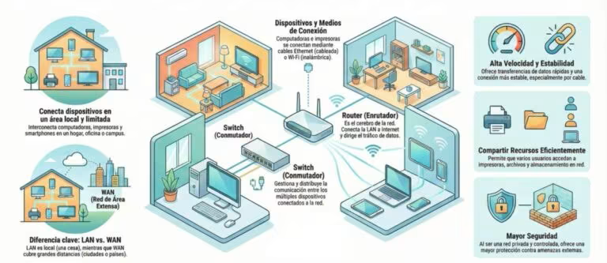

- 

Les xarxes informàtiques poden clasificar-se atenent a diferents criteris, com la seua àrea geográfica, el mitjà de transmissió, la topologia o la tecnologia utilitzada.

- 

Una de les clasificacions més habituals és la que té en compta l'àrea geográfica que abarca la xarxa.

#### 2.2.1 Xarxa de Àrea Personal (PAN)

- És el tipus de xarxa més bàsic (i xicotet).

- El seu abast es limita a uns pocs metros i està dissenyada per a connectar dispositius d'ús personal com smartphones, tabletas, ordinadors i periférics (auriculars, impresoras).

- La tecnologia més comú per al seu funcionament sense fils (WPAN) és el Bluetooth.

#### 2.2.2 Xarxa de Àrea Local (LAN i WLAN)

Una xarxa d'àrea local (LAN / WLAN) connecta dispositius dins d'un àrea geográfica limitada, com un hogar, oficina o edifici. Dins d'aquesta categoria s'inclouen dos tipus de xarxes:

- **LAN (Local Area Network):** Connecta dispositius en un espai físic limitat (casa, oficina, edifici, ...). Permet l'intercanvi ràpid de grans quantitats de dades i l'ús de recursos comuns com servidors i impresoras.  

- **WLAN (Wireless LAN):** És la versió sense fils de la LAN, comúnment coneguda com Wi-Fi, que ofereix la mateixa conectivitat local sense necessitat de cables físic.

#### 2.2.3 Xarxa de Àrea de Campus (CAN)

- Aquesta xarxa interconecta diverses xarxes locals (LAN) dins d'un recinto geogràfic específic, com un campus universitario, un hospital o un complex industrial.

- És més gran que una LAN però més xicoteta que una xarxa metropolitana.

#### 2.2.4 Xarxa de Àrea Metropolitana (MAN)

- La xarxa MAN dóna cobertura a un àrea geográfica més àmplia, com un municipio o una ciutat.

- **Sol estar composta per diverses xarxes LAN interconectades** a través d'infraestructura d'alta velocitat, com la fibra òptica, i és utilitzada freqüentment per empreses amb diverses sedes en la mateixa ciutat o per ayuntaments.

#### 2.2.5 Xarxa de Àrea Àmplia (WAN)

- Les xarxes WAN cubren distàncies considerables, extendiéndose per països o continentes. Utilitzen mitjans com satélites o cables submarinos per a connectar dispositius que estan a kilómetros de distància.

- L'exemple més representatiu i conegut d'una xarxa WAN és **Internet**.

#### 2.2.6 Xarxa de Àrea Global (GAN)

- Representa la xarxa de major escala, amb una cobertura global.

- Dóna suport a les comunicacions mòbils a nivell mundial i permet que dispositius en qualsevol punt del planeta es conecten entre sí utilitzant infraestructuras de xarxes d'àrea àmplia.

#### 2.2.7 Xarxes locals virtuals (VLAN)

- Les xarxes locals virtuals (VLAN) permeten segmentar el trànsit de forma lògica dins d'una infraestructura física ja existent per a millorar la seguretat i el rendiment.

> **📌 Què dispositiu permet segmentar una xarxa, és a dir crear i administrar VLAN's?**
> 

> **📌 Donar un exemple real de segmentació.**
> 

> **📌 Enumerar avantatges de tindre una xarxa segmentada.**
> 

> **📌 Un switch gestiona adreces IP o adreces físiques (MAC address)?**
> 

#### 2.2.8 Xarxes privades virtuals (VPN)

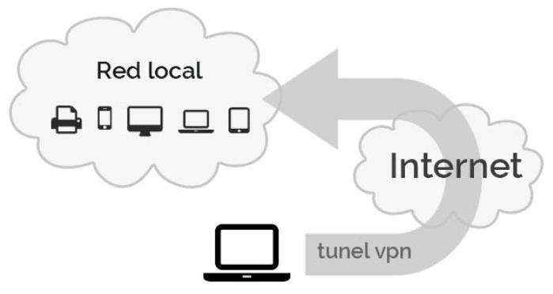

- Les VPN permeten als usuaris connectar-se de manera segura a una xarxa privada a través de qualsevol infraestructura de xarxa (normalment Internet), fent que els sistemes connectats es comporten com si estuvieran en la mateixa xarxa local, encara que estiguen separats físicament.

- La seguretat es aconsegueix mitjançant el cifrado de les dades, que viatgen encapsulats dins d'un túnel virtual entre client i servidor.

> **📌 Per què es ha popularitzat tant les VPN's dins de l'àmbit empresarial?**
> 

> **📌 Túneles de dades**
> 

> 

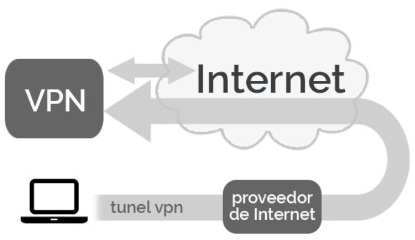

> - Un túnel VPN és el mecanisme pel qual les dades originals es encapsulan dins d'altres paquets per a poder viatjar de forma segura a través d'una xarxa pública (normalment Internet), de manera que en l'un altre extremo es puguen "desempaquetar" i recuperar les dades originals.

> - És particularme útil per a mantindre la privacitat durant la navegació o saltar-se restriccions regionals.

> **📌 Enumerar casos d'ús dels túneles de dades (no necessàriament dins de l'àmbit empresarial).**
> 

#### 2.2.9 Activitats

> **📌 Identificar el tipus de xarxa de les següents imatges i explicar les seues característiques i aplicacions.**
> 

> 

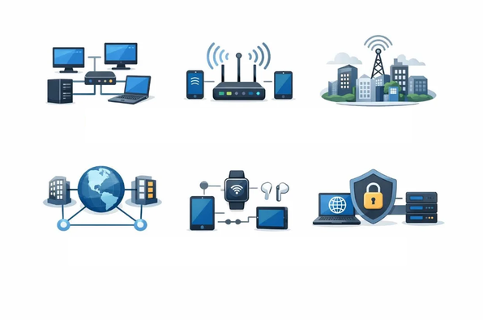

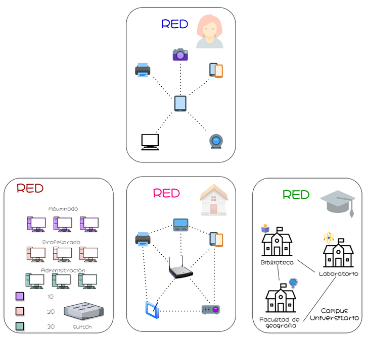

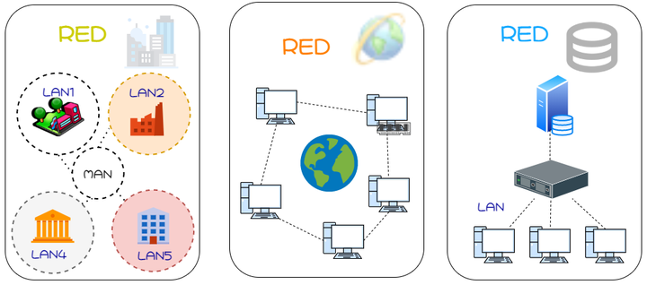

### 2.3 Elements d'una xarxa informàtica

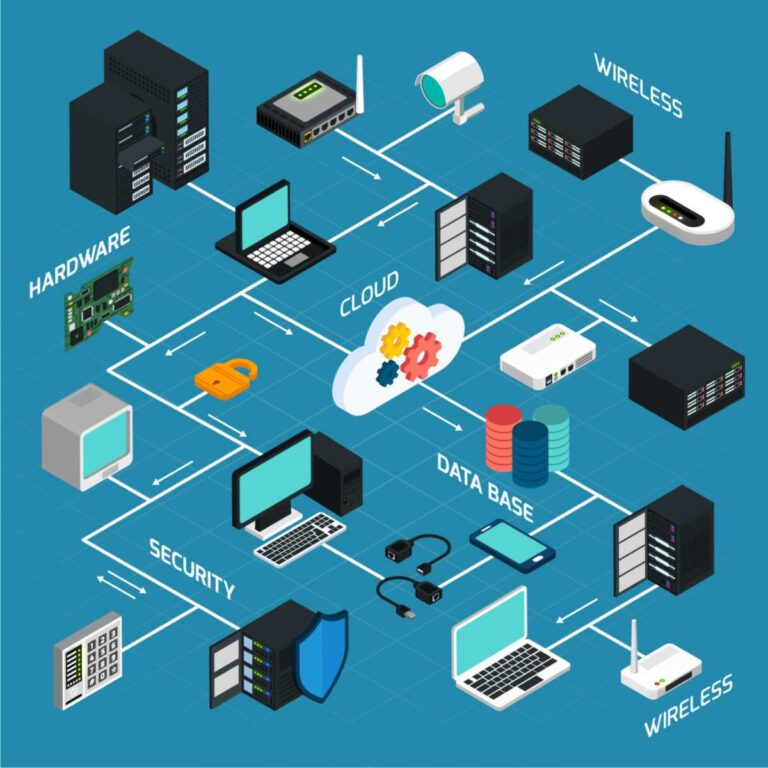

Perquè una xarxa informàtica funcione correctament, necessita una sèrie d'elements físics, lògics i de conectivitat que treballen de forma coordinada. Els principals són:

1. **Nodes:**  

**Un node és qualsevol dispositiu connectat a la xarxa**, és a dir, ordinadors, impresoras, módems o servidors capaços d'enviar, rebre, crear o emmagatzemar dades. Cada node necessita una forma d'identificació, habitualment una adreça IP o una adreça MAC, per a poder comunicar-se amb el resta.

1. **Adreça IP:**  

**És l'identificador numèric únic assignat a cada dispositiu dins de la xarxa.** Quan un dispositiu envia dades a un altre, els paquets inclouen les adreces IP d'origen i destí, el que permet que la informació arribe al lloc correcte.

1. **Encaminadors (routers):**  

**Analizan els paquets de dades i determinan la ruta óptima perquè arriben al seu destí.** S'encarreguen de dirigir el trànsit **entre xarxes distintes** de forma eficient.

1. **Conmutadors (switches):**  

**Connecten entre sí els dispositius d'una mateixa xarxa local**, gestionant el trànsit de dades amb major precisió que un encaminador en entorns d'àrea reducida.

1. **Mitjans de transmissió:**  

El canal pel que viatgen les dades pot ser **físic** (cables de coure, Ethernet o fibra òptica) o **sense fils**, mitjançant ondas electromagnètiques o de ràdio. L'elecció del mitjà condiciona la velocitat, l'abast i la seguretat de la xarxa.

1. **Protocols de comunicació:**  

Són les regles que permeten que dispositius distints es entenguen entre sí. El **TCP/IP és el més utilitzat**, però existeixen altres com HTTP, FTP o DNS, cada un amb funcions específiques dins de l'ecosistema de la xarxa.

1. **Tallafocs (firewalls) i sistemes de seguretat:**  

Protegen la xarxa controlant el trànsit entrante i saliente, bloqueant accessos no autoritzats i filtrant contingut potencialment dañino.

**Entendre la relació entre els components físics d'una xarxa** requereix també conèixer bé el **maquinari d'un ordinador i la diferència entre maquinari i programari**, ja que totes dues dimensions es integren en qualsevol infraestructura de xarxa.

### 2.4 Tipus de connexió entre nodes en una xarxa informàtica

- **Client-servidor:**  

Un servidor centralitzat gestiona els recursos i dóna servei a diversos dispositius clients. És el model dominante en empreses, plataformes web i serveis en la núvol.

- **P2P (Peer-to-Peer o xarxa entre iguals):**  

Tots els nodes actuen simultàniament com clients i servidors, compartent recursos de forma directa sense necessitat d'un servidor central. És el model que usen, per exemple, algunes plataformes d'intercanvi de fitxers.

### 2.5 Funcionament d'una xarxa informàtica

El funcionament d'una xarxa informàtica es basa en un procés ordenat de **encapsulació i transmissió de dades**, en el que intervenen diferents dispositius i protocols.

De forma simplificada, el procés pot describir-se de la següent manera:

1. 

**Emissor:** Dispositiu o usuari que genera el missatge o les dades que es desean transmetre.

1. 

**Segmentació:** Les dades poden dividir-se en unitats més xicotetes en la **capa de transport**. Per exemple, TCP pot dividir les dades en segmentos i afegir informació de control, com els números de seqüència.

1. 

**Paquetizació:** En la **capa de Internet**, els segmentos es encapsulan en **paquets IP**. Aquests paquets contenen, entre una altra informació, les adreces IP d'origen i destí.

1. 

**Encapsulació en tramas:** Abans de transmetre les dades pel mitjà físic, el paquet IP es encapsula dins d'una **trama** corresponent a la tecnologia utilitzada en la xarxa, com Ethernet o Wi-Fi. La trama inclou informació necessària per a realitzar la comunicació dins de la xarxa local, com les adreces MAC.

1. 

**Transmissió:** La trama es converteix en senyals eléctriques, óptiques o de ràdio i es transmet a través del **mitjà de transmissió**, com un cable de coure, fibra òptica o una connexió Wi-Fi.

1. 

**Encaminament:** Els **routers** reben les tramas destinades a ells, extraen el paquet IP i consulten la seua taula d'encaminament per a determinar cap a on ha d'enviar-se. El paquet pot atravesar diverses xarxes i routers abans d'arribar al seu destí.

1. 

**Recepció i desencapsulació:** El dispositiu receptor rep les tramas, extrae els paquets IP i, posteriorment, les dades de les capes superiors. En el cas de TCP, també es comprova la informació necessària i es reconstruyen les dades originals.

1. 

**Receptor:** Finalment, les dades reconstruits arriben a l'aplicació corresponent del dispositiu receptor i queden disponibles per a la seua utilització.

Aquest procés es produeix en fraccions de segon i està basat en la col·laboració de diferents **protocols de xarxa**. Cada capa afegeix i posteriorment elimina la informació necessària perquè les dades puguen arribar correctament des de l'emissor fins al receptor.

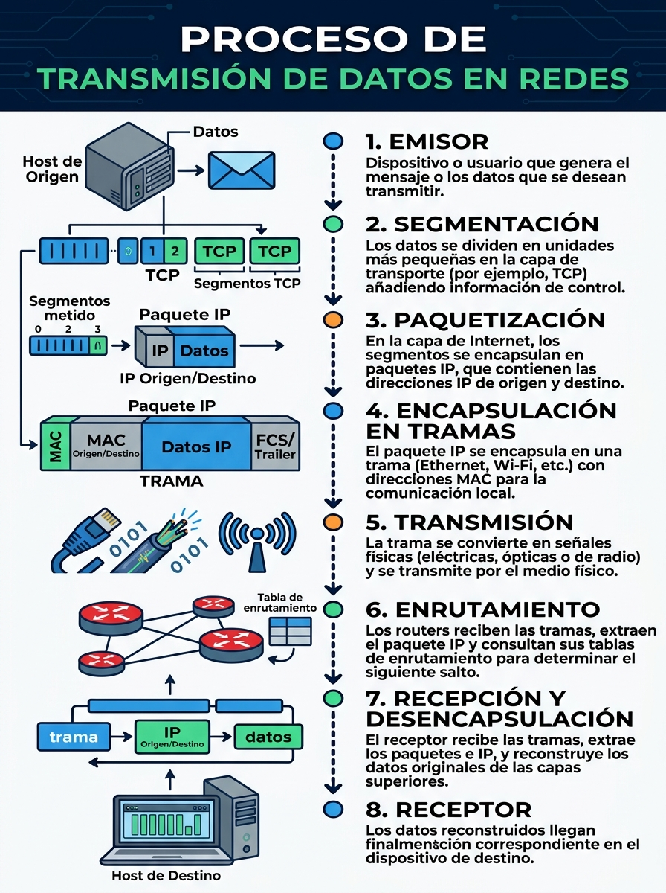

### 2.6 Protocols de xarxa / comunicació

- Acabamos de veure com les dades viatgen des d'un dispositiu emissor fins a un dispositiu receptor a través d'una xarxa. Perquè aquest procés siga possible, els dispositius han de **parlar el mateix idioma**, és a dir, utilitzar **protocols de comunicació** compatibles.

- Un protocol de comunicació és un conjunt de regles que defineix com han d'intercanviar informació dos o més dispositius d'una xarxa. Utilitzant una analogía, un protocol és per a una xarxa el que un idioma és per a les persones: si tots dos interlocutors utilitzen el mateix idioma, poden entenderse i comunicar-se.

- Els equips d'una xarxa poden utilitzar sistemes operatius, programes i maquinari molt diferents. No obstant això, si empren protocols compatibles, podran intercanviar informació sense problemes.

- Perquè dos dispositius puguen comunicar-se, tots dos han d'utilitzar els mateixos protocols o protocols compatibles. Per exemple, el protocol IP permet identificar i direccionar els dispositius dins d'una xarxa perquè els paquets arriben al seu destí.

- En les xarxes informàtiques existeixen numerosos protocols, cada un dissenyat per a realitzar una funció específica. Habitualment es estudian i classifiquen segons la capa del model OSI en la que exercixen la seua funció.

#### 2.6.1 Model OSI (Open Systems Interconnection)

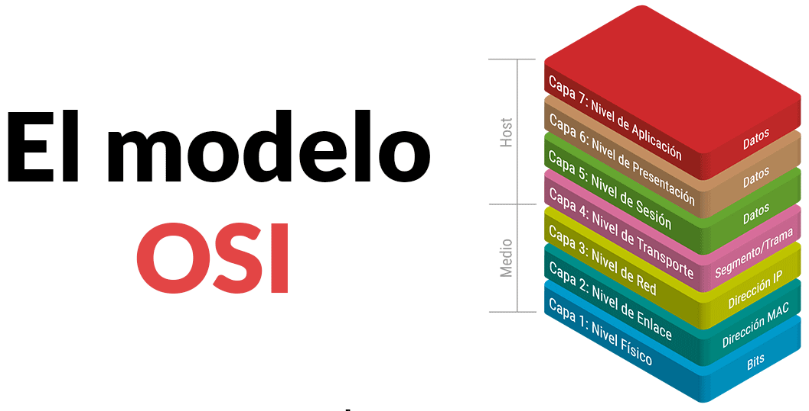

**El model d'interconnexió de sistemes oberts (OSI)** és una representació **abstracta** del funcionament de Internet.  

**Conté 7 capes:**

- Cada capa representa una categoria diferent de funcions de xarxa.

- Cada capa disposa d'un conjunt de protocols que permeten que els dispositius d'una xarxa puguen comunicar-se entre sí.

> **📌 7. Capa d'aplicació:**
> 

> 

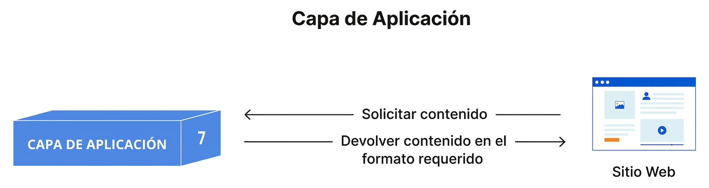

> - És la capa més cercana a l'usuari i la única que interactúa directament amb les aplicacions.

> - Proporciona serveis de xarxa als programes utilitzats pel usuari, com navegadors web, clients de correu electrònic o aplicacions de mensajería.

> - Les aplicacions (Firefox, Chrome, Thunderbird, Outlook, etc.) no formen part de la capa d'aplicació; utilitzen els serveis i protocols que aquesta proporciona.

> - S'encarrega de definir els protocols i les regles necessàries per a l'intercanvi d'informació entre aplicacions que s'executen en diferents equips.

> - Alguns protocols d'aquesta capa són **HTTP** (pàgines web), **HTTPS**, **FTP** (transferència de fitxers), **DNS** (resolució de noms), **SMTP** (enviament de correu electrònic), **POP3** e **IMAP** (recepció de correu electrònic).

> **📌 6. Capa de presentació:**
> 

> 

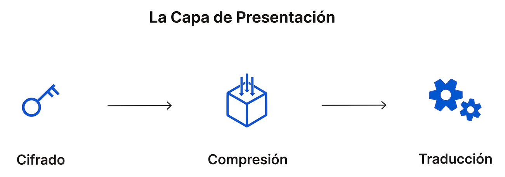

> - S'encarrega de representar les dades en un format comú perquè puguen ser interpretats per la capa d'aplicació de l'equip receptor.

> - Els seus principals funcions són la traducció de formats, el cifrado i el descifrado de la informació, així com la compresió i descompresió de les dades.

> - Si dos dispositius utilitzen representacions diferents de les dades (per exemple, distintes codificacions de caràcters), aquesta capa realitza la traducció necessària perquè tots dos puguen entendre la informació intercambiada.

> - En el model OSI, també és l'encargada de cifrar les dades abans de la seua transmissió i de descifrar-los quan arriben a l'equip receptor, garantint que només els destinatarios autoritzats puguen interpretar-los.

> - A més, pot comprimir les dades abans d'enviar-los per a reduir el volum d'informació transmitida i millorar l'eficiència de la comunicació. En el receptor, realitza l'operació inversa, descompriment les dades abans d'entregar-los a la capa d'aplicació.   

> **📌 5. Capa de sessió:**
> 

> 

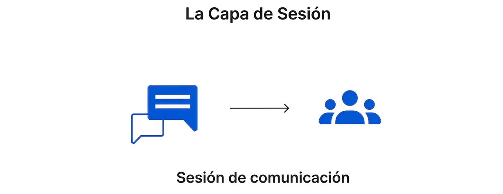

> - És l'encargada d'establir, mantindre i finalitzar les sessions de comunicació entre aplicacions que s'executen en diferents dispositius.

> - Una sessió és l'intercanvi d'informació que mantenen dos aplicacions des de que comença la comunicació fins a que finalitza.

> - La capa de sessió garanteix que la sessió permanezca activa mentre siga necessària i, una vegada finalitzada la comunicació, la tanca per a liberar els recursos utilitzats.

> - A més, pot sincronitzar la transferència de dades mitjançant punts de control (*checkpoints*). Si la comunicació s'interromp, aquests punts permeten reanudar la transferència des de l'últim punt de control en lloc de començar de nou des del principi.

> **📌 4. Capa de transport:**
> 

> 

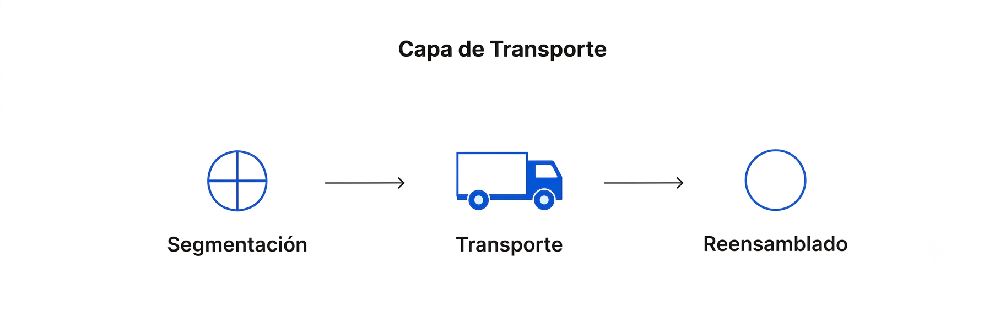

> - És l'encargada de proporcionar una comunicació extremo a extremo entre les aplicacions que s'executen en els dispositius d'origen i destí.

> - En l'equip emissor, rep les dades de la capa de sessió i els divideix en unitats més xicotetes denominades **segmentos**, que posteriorment lliurament a la capa de xarxa per a la seua transmissió.

> - En l'equip receptor, realitza el procés invers, reensamblant els segmentos recibits per a reconstruir les dades originals abans d'entregar-los a la capa de sessió.

> - També s'encarrega del **control de flux**, regulant la velocitat de transmissió per a evitar que un emissor ràpid envíe dades més deprisa del que el receptor pot procesar-los.

> - A més, realitza el **control d'errors**, comprobant que les dades arriben complets i en l'ordre correcte. Si detecta pérdides o errors, pot solicitar la retransmisió dels segmentos afectats.

> - Els protocols més coneguts d'aquesta capa són **TCP (Transmission Control Protocol)**, que ofereix una comunicació fiable i orientada a connexió, i **UDP (User Datagram Protocol)**, que prioriza la velocitat sobre la fiabilitat.

> **📌 3. Capa de xarxa:**
> 

> 

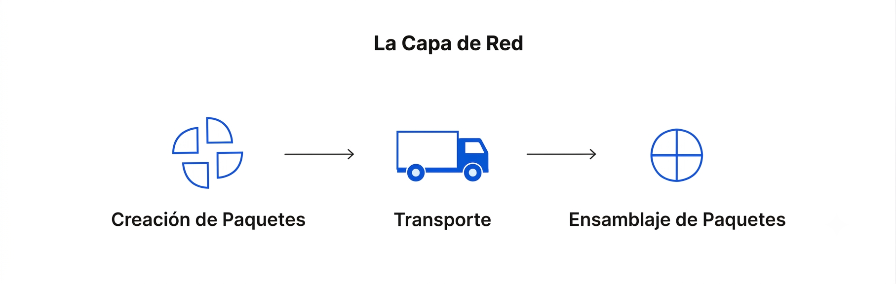

> - És l'encargada de permetre la comunicació entre dispositius que pertanyen a xarxes diferents.

> - En l'equip emissor, rep els segmentos de la capa de transport i els divideix en unitats de dades denominades **paquets**, que seran enviats a través de la xarxa.

> - En l'equip receptor, realitza el procés invers, reensamblant els paquets recibits abans d'entregar-los a la capa de transport.

> - També s'encarrega del **direccionament lògic**, identificant l'origen i el destí de cada paquet mitjançant adreces IP.

> - A més, determina la millor ruta que han de seguir els paquets per a arribar al seu destí. Aquest procés es coneix com **encaminament** (*routing*).

> - Entre els protocols més importants d'aquesta capa es troben **IP (Internet Protocol)**, responsable del direccionament i l'encaminament dels paquets, **ICMP (Internet Control Message Protocol)**, utilitzat per a l'enviament de missatges de control i diagnóstic, **IGMP (Internet Group Management Protocol)**, empleat per a la gestió de grups multicast, e **IPsec (Internet Protocol Security)**, un conjunt de protocols que proporciona autenticació i cifrado a les comunicacions IP.

> **📌 2. Capa d'enllaç de dades:**
> 

> 

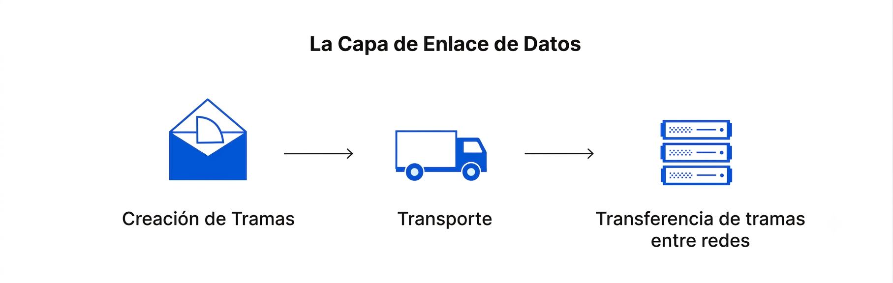

> - És l'encargada de permetre la comunicació entre dispositius que pertanyen a la mateixa xarxa local.

> - En l'equip emissor, rep els paquets de la capa de xarxa i els encapsula en unitats de dades denominades **tramas** (*frames*), que seran transmitides a través del mitjà físic.

> - En l'equip receptor, realitza el procés invers, extrayendo els paquets de les tramas abans d'entregar-los a la capa de xarxa.

> - També s'encarrega del **control de flux** i del **control d'errors** durant la comunicació dins d'una mateixa xarxa, garantint que les tramas arriben correctament al dispositiu de destí.

> - A més, utilitza les **adreces físiques o adreces MAC** per a identificar de forma única els dispositius dins de la xarxa local.

> - Entre les tecnologies i protocols més utilitzats en aquesta capa es troben **Ethernet (IEEE 802.3)**, **Wi-Fi (IEEE 802.11)** i **PPP (Point-to-Point Protocol)**.

> **📌 1. Capa física:**
> 

> 

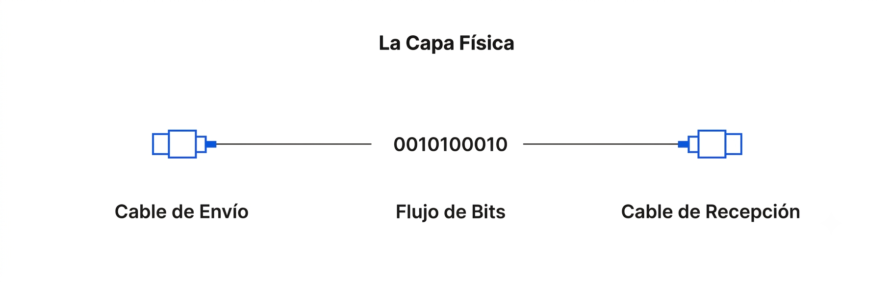

> - És la capa encargada de transmetre les dades a través del mitjà físic que connecta els dispositius de la xarxa.

> - Inclou els elements físics necessaris per a la comunicació, com els **cables**, **connectors**, **repetidors**, **hubs**, així com les característiques eléctriques, óptiques o de ràdio que permeten la transmissió de la informació.

> - En l'equip emissor, converteix les dades en una seqüència de **bits** (0 i 1) que pot transmitir-se pel mitjà físic. En l'equip receptor, realitza el procés invers, transformant el senyal recibida novament en bits.

> - Perquè la comunicació siga possible, tots dos dispositius han d'utilitzar el mateix mètode de codificació dels senyals, de forma que puguen distingir correctament els bits **0** i **1** durant la transmissió.

> - Entre les tecnologies associades a aquesta capa es troben els diferents mitjans de transmissió, com el **cable de parell trenat**, la **fibra òptica**, els **enllaços sense fils (Wi-Fi)** i els estàndards que defineixen les seues característiques físiques.

##### 2.6.1.1 Exemple de flux de dades per les capes del model OSI

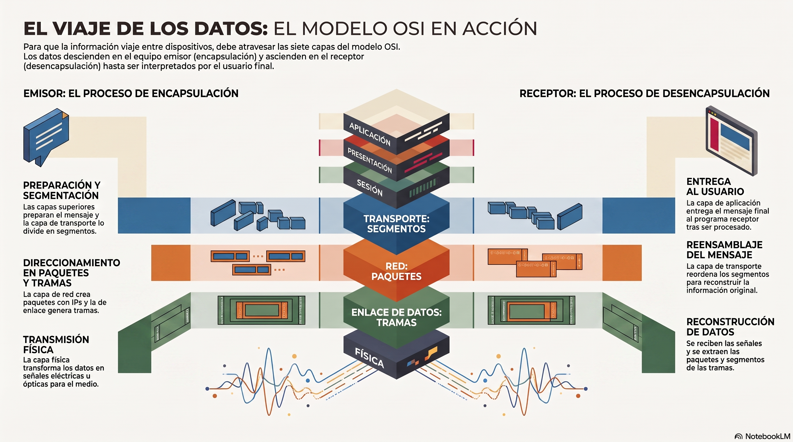

Perquè una informació puga viatjar des d'un dispositiu fins a un altre a través d'una xarxa, ha d'atravesar les **set capes del model OSI**.

En el **equip emissor**, les dades descienden des de la **capa d'aplicació** fins a la **capa física**, on es transmeten pel mitjà de comunicació. En el **equip receptor**, ocorre el procés contrari: les dades ascienden des de la **capa física** fins a la **capa d'aplicació**, on finalment són interpretats pel programa que els utilitza.

Suposem que **Ana** vol enviar un correu electrònic a **Luis**.

> **📌 Transmissió**
> 

> 1. Ana escriu el missatge en el seu client de correu electrònic i polsa el botó **Enviar**.

> 1. El client de correu lliurament el missatge a la **capa d'aplicació**, que utilitza el protocol **SMTP** per a  preparar l'enviament.

> 1. La **capa de presentació** adapta les dades al format adequat i, si és necessari, els comprime o xifra.

> 1. La **capa de sessió** estableix la comunicació entre tots dos dispositius i manté la sessió mentre dura l'intercanvi d'informació.

> 1. La **capa de transport** divideix el missatge en **segmentos** per a facilitar la seua transmissió.

> 1. La **capa de xarxa** encapsula els segmentos en **paquets**, els assigna les adreces IP d'origen i destí i  determina la ruta que seguirán fins a l'equip receptor.

> 1. La **capa d'enllaç de dades** converteix els paquets en **tramas**, afegint la informació necessària per a la  comunicació dins de la xarxa local.

> 1. Finalment, la **capa física** transforma les tramas en senyals eléctriques, óptiques o de ràdio, que es transmeten pel mitjà físic (per exemple, un cable de xarxa o una connexió Wi-Fi).

Quan els senyals arriben a l'equip de Luis, es realitza el procés invers:

> **📌 recepció**
> 

> 1. La **capa física** rep els senyals i les converteix novament en una seqüència de bits.

> 1. La **capa d'enllaç de dades** reconstruye les **tramas** i extrae d'elles els **paquets**.

> 1. La **capa de xarxa** verifica el direccionament i lliurament els paquets a la **capa de transport**.

> 1. La **capa de transport** reordena els **segmentos** i reconstruye el missatge original.

> 1. La **capa de sessió** manté la comunicació fins a que finalitza l'intercanvi d'informació i,   posteriorment, la tanca.

> 1. La **capa de presentació** descifra o descomprime les dades si és necessari.

> 1. Finalment, la **capa d'aplicació** lliurament el missatge al client de correu electrònic, que el mostra en la pantalla perquè Luis puga leer-lo.

> **📌 Què error conceptual es comete al dir que les dades viatgen per les capes del model OSI?**
> 

> **📌 Què error conceptual conté la imatge anterior?**
> 

##### 2.6.1.2 Encapsulació de les dades

1. 

Quan una aplicació envia informació a través d'una xarxa, les dades han d'atravesar totes les capes del model OSI fins a arribar al mitjà físic. Durant aquest recorregut, cada capa afegeix la seua pròpia informació de control, procés que rep el nom d'encapsulació.

1. 

Normalment, aquesta informació de control es incorpora mitjançant una capçalera (header) i, en alguns protocols, també mitjançant una cola (trailer o footer). Aquestes dades addicionals permeten que la capa equivalent de l'equip receptor puga interpretar correctament la informació recibida.

1. 

El resultat d'aquest procés és una Unitat de Dades de Protocol o PDU (Protocol Data Unit). Cada vegada que les dades descienden una capa, la PDU incorpora nova informació de control i aumenta ligerament la seua mida. Aquest procés continua fins a la capa d'enllaç de dades, que genera la trama completa abans de que la capa física la convertisca en senyals per a transmitirla pel mitjà de comunicació.

1. 

En l'equip receptor es realitza el procés contrari, denominat desencapsulació. Cada capa elimina la informació de control que añadió la seua homóloga en l'equip emissor i lliurament les dades a la capa superior. Finalment, la informació arriba a la capa d'aplicació en el mateix format en que va ser generada per l'aplicació de l'usuari.

1. 

Depenent de la capa en la que es trobe, la PDU rep un nom diferent:

  - Capes de Aplicació, Presentació i Sessió: Dades.

  - Capa de Transport: Segmentos (TCP) o Datagramas (UDP).

  - Capa de Xarxa: Paquets.

  - Capa de Enllaç de dades: Tramas (Frames).

  - Capa Física: Bits.

1. 

Encara que en el llenguatge cotidiano sol hablar-se de "paquets" per a referir-se a qualsevol informació transmitida per una xarxa, técnicament cada capa utilitza una denominació distinta per al seu PDU.

1. 

En la majoria dels protocols, la informació de control es afegeix al principi de les dades mitjançant una capçalera. No obstant això, alguns protocols de la capa d'enllaç de dades, com Ethernet, també incorporen un trailer que conté un CRC (Cyclic Redundancy Check), utilitzat per a detectar errors durant la transmissió.

**Exemple d'encapsulació.**

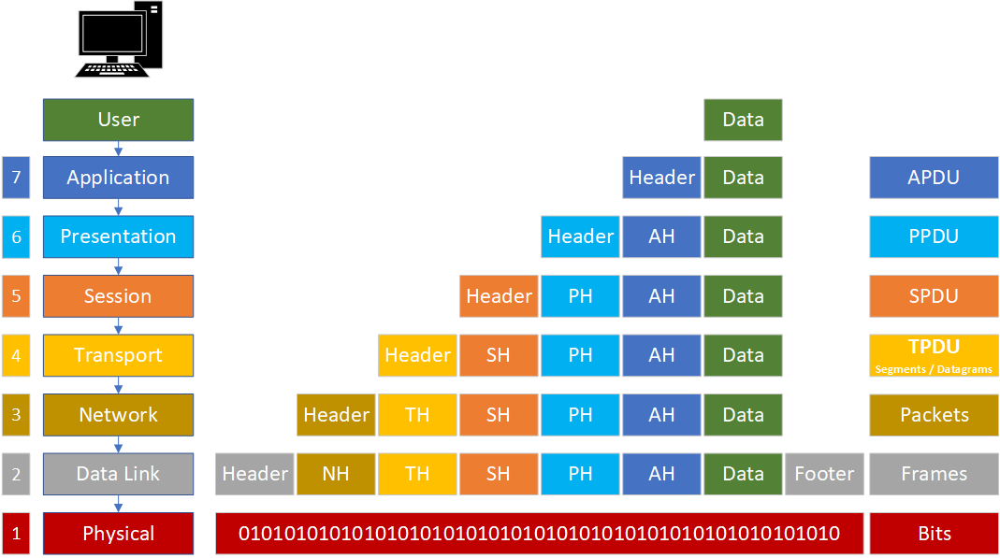

##### 2.6.1.3 Taula resum dels protocols per capa del model OSI

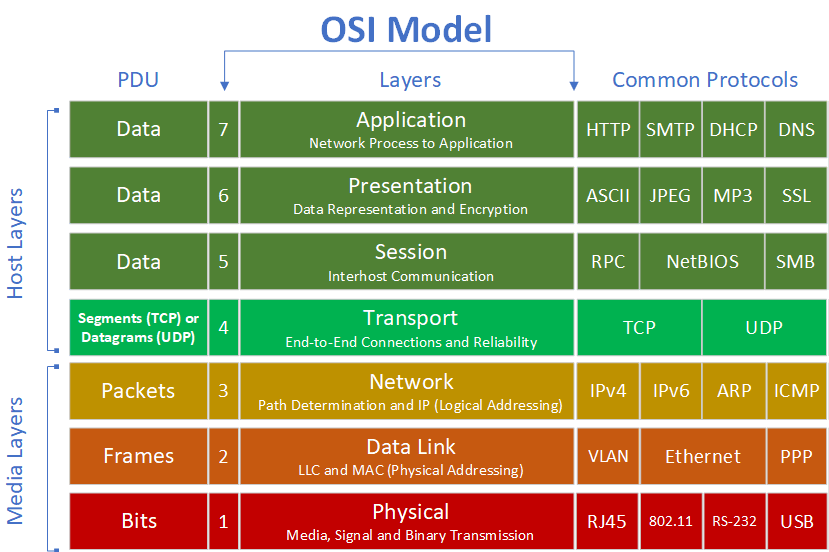

> **📌 Què tipus d'adreces maneja un switch de capa 2?**
> 

> **📌 Què tipus d'adreces maneja un switch de capa 3?**
> 

#### 2.6.2 Protocol TCP/IP

- 

El **model OSI**, un model de referència que descriu com es comuniquen els dispositius d'una xarxa mitjançant set capes. El model OSI encara que àmpliament utilitzat amb fines didáctics, **no és el model que s'empra en Internet**.

- 

**Internet és una xarxa pública i global** d'ordinadors que estan interconnectats mitjançant el **protocol de Internet** ( IP / Internet Protocol) i que es comuniquen mitjançant la conmutació de paquets.  

- 

Encara que existeix una gran diversitat d'arquitectures de xarxa, **la família/suite de protocols TCP/IP** (desenvolupat pel Departament de Defensa dels Estats Units) s'utilitza en **la majoria de les xarxes que conforman Internet**, així com en les intranets d'empreses, centres educativos, zones wifi, oficines i hogares.

- 

La denominació TCP/IP fa referència als seus dos protocols més importants: el **Protocol de Internet (IP)** i el **Protocol de Control de Transmissió (TCP)**.

- 

A l'igual que en el model **OSI**, el model **TCP/IP** divideix el procés de comunicació en diferents capes. No obstant això, el fa d'una forma **més senzilla**, **agrupant algunes de les funcions del model OSI**.

##### 2.5.2.1 Capes del model TCP/IP

Com acabamos de veure, **el model TCP/IP és l'arquitectura de xarxa en la que es basa Internet**. Es organitza de forma jeràrquica en 4 capes que gestionen com es empaqueta, envia i rep la informació: **Aplicació, Transport, Internet (o Xarxa) i Accés a la xarxa**.

- 

**Capa d'aplicació**  

És la més cercana a l'usuari i on operan les aplicacions i serveis de xarxa (com navegadors web o gestors de correu). Utilitza protocols principals com HTTP, FTP, SMTP i DNS.

- 

**Capa de transport**  

 Garanteix que les dades arriben de forma íntegra i ordenada entre l'emissor i el receptor. Els seus protocols clau són TCP (orientat a connexió i fiable) i UDP (ràpid, sense connexió).

- 

**Capa de Internet**  

S'encarrega del direccionament lògic i de l'encaminament dels paquets de dades a través de distintes xarxes fins a arribar al seu destí. El seu protocol principal és IP (Internet Protocol).

- 

**Capa d'accés a la xarxa**  

Controla el maquinari físic i els mitjans de transmissió (cables de coure, fibra òptica, xarxes sense fils). Defineix com les dades es converteixen en senyals eléctriques o de ràdio.

Aquestes quatre capes equivalen a les set capes del model OSI, tal com es mostra en la següent taula:

| Model OSI | Nº capa del model OSI | Model TCP/IP | Nº capa del model TCP/IP |
| --- | --- | --- | --- |
| Aplicació | 7 | Aplicació | 4 |
| Presentació | 6 | Aplicació | 4 |
| Sessió | 5 | Aplicació | 4 |
| Transport | 4 | Transport | 3 |
| Xarxa | 3 | Internet | 2 |
| Enllaç de dades | 2 | Accés a la xarxa | 1 |
| Física | 1 | Accés a la xarxa | 1 |

Com pot observar-se, el model TCP/IP integra les funcions de les capes de **Aplicació, Presentació i Sessió** del model OSI en una única **capa d'aplicació**, mentre que les capes **Física** i **Enllaç de dades** es agrupen en la **capa d'accés a la xarxa**.

A partir d'aquest moment estudiarem els protocols més importants de cada una d'aquestes quatre capes, ja que són els que utilitzen els dispositius per a comunicar-se en les xarxes actuals i Internet.

##### 2.6.2.2 Pila de protocols del model TCP/IP

**TCP/IP** és el nom genéric que es li dóna a tot el conjunt de protocols de comunicació que usa Internet.  

Com hem vist, no és un únic protocol, sinó un model de referència amb diverses capes, i TCP/IP engloba a muchísimos protocols (no només TCP i IP): també inclou HTTP, FTP, DNS, UDP, SMTP, etc.

1. 

**El protocol IP (Internet Protocol)**  

Pertany a la capa de xarxa (o capa de Internet). La seua funció és la de direccionament i encaminament: assigna les adreces IP als dispositius i s'encarrega de que els paquets de dades viajen des de l'origen fins al destí correcte, encara que tinguen que passar per diverses xarxes intermedias.

1. 

**El protocol TCP (Transmission Control Protocol)**  

Pertany a la capa de transport. La seua funció és garantir que les dades arriben de forma fiable i ordenada: divideix la informació en paquets, comprova que tots arriben, els reordena si és necessari i demana el reenvío dels que es hagen perdido.

##### 2.5.2.3 Protocols de comunicació del model TCP/IP

En la següent imatge podem veure com es distribuyen els protocols més habituals del model TCP/IP i com es mapearían dins del marco conceptual del model OSI.

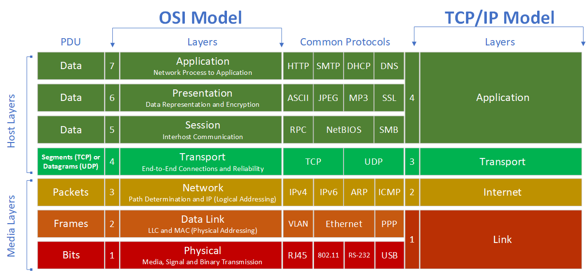

##### 2.6.2.4 Encapsulació de les dades amb el model TCP/IP

A l'igual que en el model OSI, TCP/IP també encapsula les dades mentre van descendent per les capes en l'emissor i ascendent en el receptor.

En el següent exemple mostrarem **una solicitud HTTP** entre client i servidor a l'hora d'accedir a una pàgina web.

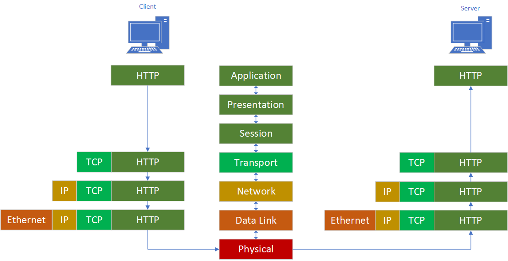

## 3 - Arquitectures de xarxes empresarials

### 3.1 Xarxes centralitzades vs. Xarxes descentralitzades

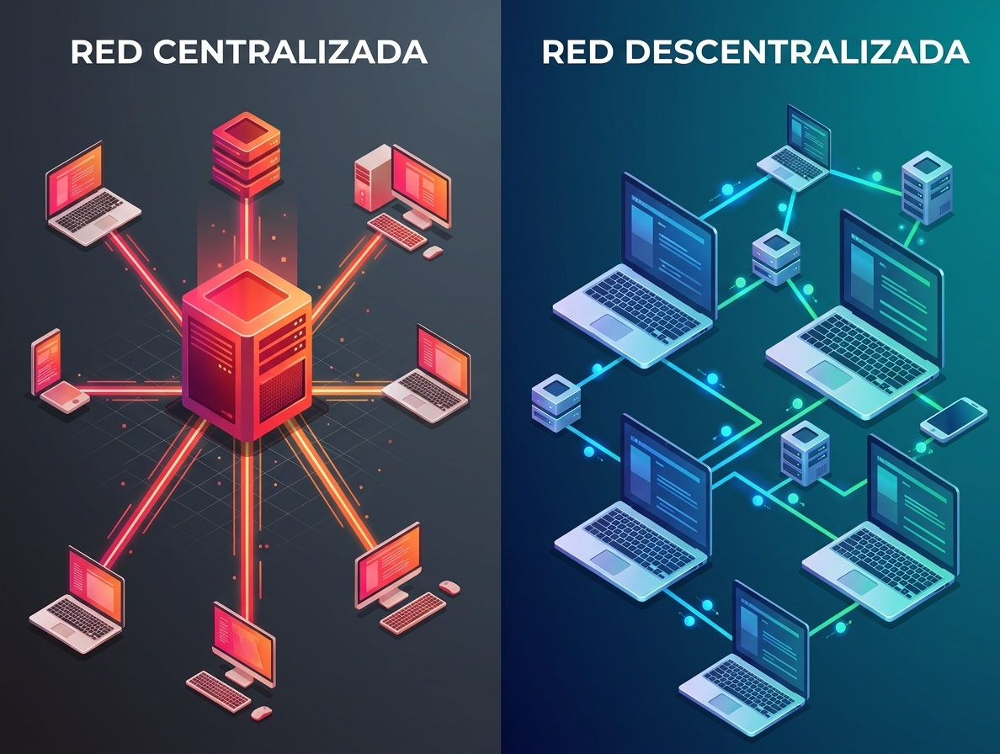

1. En una xarxa doméstica o xicoteta (model Grup de treball o Peer-to-Peer), els equips són independents. Cada ordinador gestiona els seus propis usuaris, obté el seu IP de forma estàtica o mitjançant un router bàsic, i resol noms localment.

1. No obstant això, a mesura que una xarxa corporativa crece, gestionar cada equip de forma individual es torna ineficiente, inseguro i inasumible. Per a solucionar açò, l'arquitectura de xarxa evoluciona cap a **un model client-servidor soportado per tres pilars fonamentals**: **DHCP, DNS i un Controlador de Domini (DC)**.

### 3.2 DHCP, DNS i Controlador de Domini

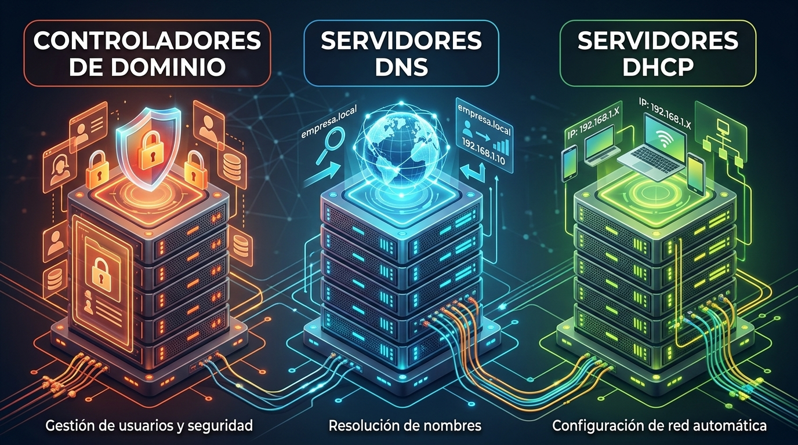

En la següent taula es resum les funcions de cada un d'aquests serveis i la necessitat que resolen dins d'una xarxa corporativa:

| Servei | Necessitat que resol | Què ocorre si no existeix? |
| --- | --- | --- |
| DHCP (Dynamic Host Configuration Protocol) | Automatització i gestió IP: Assigna adreces IP, màscares, portes d'enllaç i DNS automàticament a cada client que es connecta. | Hi hauria que configurar manualment cada equip. Risc constant de conflictos de IP duplicades i errors de configuració. |
| DNS (Domain Name System) | Resolució de noms e localització de serveis: Tradueix noms de domini llegibles (servidor.empresa.local) a adreces IP numèriques (192.168.1.50). | Hi hauria que memoritzar la IP de cada servidor, equip o pàgina web per a accedir a ells, o mantindre fitxers hosts manuals en cada client. |
| Controlador de Domini (DC) | Centralizació d'identitat i seguretat: Gestiona una base de dades única d'usuaris, equips, permisos i directivas de seguretat (com Active Directory o OpenLDAP). | Cada usuari tindria que ser creat localment en cada ordinador que necesite usar. No hi hauria control centralitzat sobre contrasenyes ni directivas de seguretat. |

### 3.3 Sinergia entre DHCP, DNS i Controlador de Domini

Aquests tres serveis no treballen de forma aïllada, sinó interconectada dins de la infraestructura:

1. L'equip es connecta a la xarxa i el servidor DHCP li lliurament una adreça IP, juntament amb la ruta per a trobar al servidor DNS.

1. El client consulta al servidor DNS per a localitzar on es troba el Controlador de Domini dins de la xarxa.

1. El client contacta amb el Controlador de Domini per a autenticar a l'usuari i aplicar les directivas de seguretat corresponents.

En les següents seccions estudiarem cada un d'aquests serveis i el seu funcionament dins d'una xarxa corporativa.

---

## 🎮 Reptes Interactius d'Autoavaluació (+100 XP)

Comprova el teu domini sobre **0.3 Fonaments dels Sistemes en Xarxa i Interconnexió** superant aquests 4 reptes gamificats (+25 punts cadascun):

  
🎯 <strong>Repte 1 (+25 pts):</strong> En una arquitectura de xarxa empresarial amb Active Directory (AD), quina és la sinergia principal entre DHCP i DNS?

  

    <button type="button" class="btn-mcq-opt" data-opt="A">A) El servidor DHCP assigna la IP dinàmicament i pot actualitzar automàticament els registres A/PTR en el servidor DNS (DDNS).</button>
    <button type="button" class="btn-mcq-opt" data-opt="B">B) El servidor DNS assigna les adreces MAC i el DHCP tradueix noms NetBIOS.</button>
    <button type="button" class="btn-mcq-opt" data-opt="C">C) El Controlador de Domini substitueix completament el protocol TCP/IP per IPX/SPX.</button>
    <button type="button" class="btn-mcq-opt" data-opt="D">D) Cap de les anteriors és correcta.</button>
  

  

  
🎯 <strong>Repte 2 (+25 pts):</strong> Quina és la seqüència correcta de tres passos (Three-Way Handshake) per a establir una connexió TCP?

  

    <button type="button" class="btn-mcq-opt" data-opt="A">A) DISCOVER -&gt; OFFER -&gt; REQUEST</button>
    <button type="button" class="btn-mcq-opt" data-opt="B">B) FIN -&gt; ACK -&gt; RST</button>
    <button type="button" class="btn-mcq-opt" data-opt="C">C) Cap de les anteriors és correcta.</button>
    <button type="button" class="btn-mcq-opt" data-opt="D">D) SYN -&gt; SYN-ACK -&gt; ACK</button>
  

  

  
✅ <strong>Repte 3 (Vertader o Fals · +25 pts):</strong> El protocol TCP és orientat a la connexió, garanteix el lliurament ordenat de segments i implementa control de flux i d'errors.

  

    <button type="button" class="btn-vf" data-opt="V">Vertader (V)</button>
    <button type="button" class="btn-vf" data-opt="F">Fals (F)</button>
  

  

  
⌨️ <strong>Repte 4 (+25 pts):</strong> Quin número de port estàndard (well-known port) utilitza el protocol SSH per defecte? (Escriu només el número)

  

    <input type="text" class="quiz-input" placeholder="Escriu la resposta..." />
    <button type="button" class="btn-quiz-check">Comprovar</button>
  

  

### 📋 Llista de Comprovació i Rúbrica d'Assoliment

Marca cada criteri a mesura que completes l'estudi o la resolució pràctica d'aquesta pàgina (**0.3 Fonaments dels Sistemes en Xarxa i Interconnexió**):

- [ ] He llegit detingudament la teoria o l'enunciat d'aquesta secció i he anotat els conceptes clau.
- [ ] He revisat els esquemes, taules o blocs de codi i he verificat que sé aplicar-los a l'entorn de treball.
- [ ] He resolt correctament els **4 reptes interactius** superiors obtenint els **100 punts XP**.
- [ ] He descarregat el comprovant oficial en PDF per a adjuntar-lo a la tasca d'**Aules**.

  <h3>📤 Comprovant de Lliurament per a Aules</h3>
  
Quan hages completat els reptes interactius i la llista d'autoavaluació d'aquesta pàgina, introdueix el teu nom i descarrega el teu certificat oficial en PDF per a adjuntar-lo a la tasca d'<strong>Aules</strong>.

  

    <label for="aules-student-name">👤 Nom i Cognoms de l'Alumne/a:</label>
    <input type="text" id="aules-student-name" class="aules-student-name" placeholder="Ex: Joan Garcia Pérez" />
  

  

    0/4 reptes completats (0%) · 0 punts · 0/4 criteris d'autoavaluació
  

  

    <button type="button" class="btn-aules-dl" data-module="SEX" data-unit="UD00" data-activity="ut0003">📥 Descarregar Comprovant PDF</button>
    <button type="button" class="btn-aules-copy">📋 Copiar Resum al Porta-retalls</button>
  

  

