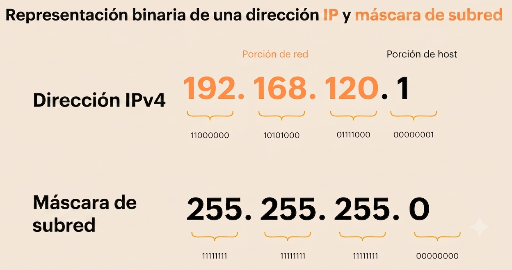
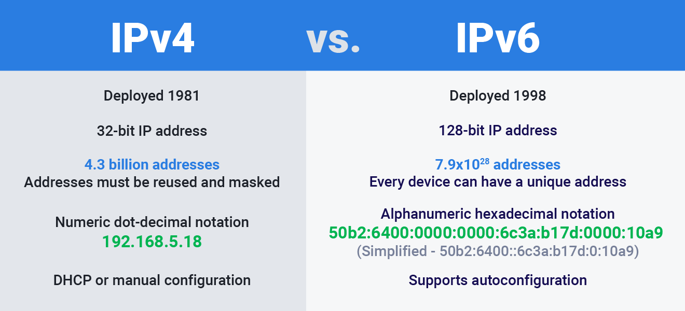

  

    🏆 <strong>Progrés d'aquesta secció:</strong> 0 de 4 superats (0%)
    ⭐ <strong>0 punts</strong>
  

  

    

  

# 0.4 El Protocol TCP/IP: Adreçament, Encaminament i Ports

## 1 - Introducció

1. 

**Internet és una xarxa pública i global** d'ordinadors que estan interconnectats mitjançant el protocol de Internet (Internet Protocol) i que es comuniquen mitjançant la conmutació de paquets.  

1. 

La denominació TCP/IP fa referència als seus **dos protocols més importants**:

  - **Protocol de Internet (IP)**.  

Conjunt de regles que assigna adreces úniques als dispositius i permet enviar (enrutar) paquets de dades a través de les xarxes i arribar al destí correcte.

  - **Protocol de Control de Transmissió (TCP)**.
És un estàndard de comunicació de la capa de transport que garanteix l'enviament segur, ordenat i sense errors de paquets de dades entre dispositius connectats a una xarxa.

> **📌 Citar altres protocols de comunicació de xarxes**
> 

## 2 - Protocol de Internet (IP)

### 2.1 Introducció

- 

La versió més utilitzada actualment del protocol IP és **IPv4**, definida en el RFC 791 de 1981. Permet **un total teóric de 2³² adreces**, encara que algunes estan reservades per a usos especials. Açò limita el número d'adreces IP disponibles, el que ha provocado que es agoten en moltes regiones del món.

- 

Hui en dia ja disposa d'un sucesor, **IPv6**, del qual ús es està extendent progresivament. Ofereix un espai d'adreces molt més ampli de **2¹²⁸ adreces** i altres mejoras, com la simplificació de l'encapçalament i l'eliminació de la necessitat de **traducció d'adreces de xarxa (NAT)**.

> **📌 Què és la traducció d'adreces de xarxa (NAT)?**
> 

- 

Totes les versions del protocol IP permeten l'enviament de paquets entre equips sense establir **cap tipus de connexió** (*connectionless*).

- 

Açò significa que l'equip d'origen envia dades al destinatari sense esperar cap confirmació de que la informació es haja rebut correctament.

- 

Encara que per a **enviar dades entre dos hosts basta amb el protocol IP**, aquest no ofereix cap garantía de que es envíen correctament ni de que arriben al seu destí. Tampoc garanteix que les dades arriben intactos, ja que el control d'errors només es realitza sobre les capçaleres i no sobre la carrega útil (les dades transmitits). Per això, les aplicacions que requereixen fiabilitat recurren al **protocol TCP** en la capa de transport.

### 2.2 Configuració d'un node IP

En primer lloc, és necessari **configurar els protocols TCP/IP locals**, inclosos per defecte en el nucli de qualsevol sistema operatiu modern. Per a configurar un equip es requereix la següent informació:

- L'adreça IP (ja siga IPv4 o IPv6).

- La màscara de subxarxa, que serveix per a identificar la xarxa o subred a la que pertany.

Si la comunicació es realitza amb equips d'altres subredes o amb Internet, es necesitará a més:

- L'adreça IP de la porta d'enllaç predeterminada (*default gateway*), que correspon al router a través del qual es redirige el trànsit cap a altres xarxes.

- Les adreces IP dels servidors DNS.

> **📌 Característiques principals del protocol IP**
> 

> - **Encaminament:** seleccionar la ruta més adequada per a l'enviament de paquets.

> - **Servei de lliurament *Best-Effort* (millor esforç):**

> - **No orientat a connexió:** cada paquet pot follow una ruta distinta, per la qual cosa poden arribar desordenats.

> - **No fiable:** els paquets es poden perdre, dañar o sufrir retardos.

> - **Direccionament lògic:** proporciona un esquema de direccionament lògic mitjançant adreces IP.

#### 2.2.1 Estructura d'una adreça IP (IPv4)

Una adreça IPv4 és un número de 32 bits que identifica a cada un dels dispositius connectats a una xarxa IP, així com a la pròpia xarxa.

Es divideix en dos parts:

- Una part identifica la xarxa (*Network ID*).

- La part restante identifica al dispositiu (*Host ID*).

Per a separar l'identificador de xarxa de l'identificador de dispositiu s'aplica la màscara de xarxa. Al realitzar l'operació lògica AND entre l'adreça IP i la màscara de xarxa, s'obté l'adreça de xarxa.

#### 2.2.2 Estructura d'una adreça IP (IPv6)

- 

**IPv6 (Internet Protocol version 6)** és la versió més reciente del protocol IP i va ser desarrollada per a solucionar principalment el problema d'agotament de les adreces IPv4.

- 

Mentre que IPv4 utilitza adreces de 32 bits, **IPv6 utilitza 128 bits**, el que proporciona una quantitat enorme d'adreces disponibles.

- 

Una adreça IPv6 es representa mitjançant huit grups de quatre dígitos hexadecimals, separats per dos punts.
Per a simplificar la seua escriptura es poden eliminar zeros i utilitzar :: per a representar un o diversos grups consecutius de zeros:

#### 2.2.3 Adreces IPv6 contra IPv4

Les principals diferències entre IPv4 i IPv6 són:

- 128 bits de direccionament, enfront dels 32 bits de IPv4.

- Un espai d'adreces enormement major.

- Autoconfiguració de les adreces, facilitant la configuració dels dispositius.

- Incorporació de mecanismes com Neighbor Discovery, que sustituye i amplia algunes funcions que en IPv4 realizaven ARP.

- No utilitza broadcast de la mateixa forma que IPv4; utilitza principalment multicast i anycast.

- Inclou suport per a IPsec com part de les especificacions del protocol, encara que el seu ús no implica que totes les comunicacions IPv6 estiguen cifrades.

> **📌 Identificació d'adreces IP**
> 

> 1. Tenéis un sèrie d'adreces IP, identificar quals són IPv4 i quals IPv6.

> 1. Identificar les IPv6 que estan en format reducido i escribirlas en format no reducido.

> **Adreces IP**

> - 192.168.1.1

> - 2001:db8::8a2e:370:7334

> - 8.8.8.8

> - 127.0.0.1

> - ff02::1

> - 2001:4860:4860::8888

> - 142.250.184.206

> - 2607:f8b0:4004:809::200e

#### 2.2.4 Classes d'adreces IPv4 (RFC 791)

Históricament, les adreces es dividían en tres classes principals segons els octetos destinats a la xarxa:

- **Classe A:** el primer octeto identifica la xarxa.

- **Classe B:** els dos primers octetos identifican la xarxa.

- **Classe C:** els tres primers octetos identifican la xarxa.

A més, existeixen dos classes especials:

- **Classe D:** reservada per a multidifusió (*multicast*).

- **Classe E:** reservada per a investigació i ús futuro.

**Taula resum de les classes d'adreces IPv4**  

| Classe | Rang camp de xarxa (bits de xarxa) | Rang camp d'adreces (bits d'hosts) | Màscara per defecte | Adreça de difusió (broadcast) |
| --- | --- | --- | --- | --- |
| A | 1 - 126 (8) | 0.0.0 - 255.255.255 (24) | 255.0.0.0 | x.255.255.255 |
| B | 128.0 - 191.255 (16) | 0.0 - 255.255 (16) | x.x.255.255 | x.255.255.255 |
| C | 192.0.0 - 223.255.255 (24) | 0 - 255 (8) | 255.255.255.0 | x.x.x.255 |
| D | 224.0.0 - 239.255.255 | No aplica |  |  |
| E | 240.0.0.0 – 247.255.255.255 | No aplica |  |  |

> **📌 Identificació d'adreces IP**
> 

> Amb l'ajuda de la taula anterior respondre a les següents preguntes.  

> 1. Calcular el rang d'adreces IP de cada classe.  

> 1. Calcular la quantitat de subredes disponibles per a cada classe.  

> 1. Calcular la quantitat de IP's (hosts) disponibles per a cada classe.  

#### 2.2.5 Adreces reservades i especials

1. **Adreça de xarxa:** identifica a la xarxa en el seu conjunt, no a un host concret. S'obté quan tots els bits de l'identificador d'host són 0 (ej.: 10.0.0.0).

1. **Adreça de difusió (broadcast):** permet enviar un paquet a tots els hosts d'una xarxa simultàniament. S'obté quan tots els bits de l'identificador d'host són 1 (ej.: 10.255.255.255).

1. **Adreça no especificada:** representa l'ausencia d'una adreça IP assignada. És 0.0.0.0, usada per un host que encara no té una adreça IP (per exemple, durant el procés de solicitud DHCP).

1. **Ruta per defecte:** entrada genérica en una taula d'encaminament que representa "qualsevol xarxa possible". Es escriu com 0.0.0.0 **no és l'adreça d'un host** i és la ruta que utilitza un router quan no troba una coincidencia més específica per a un paquet.

1. **Adreça de bucle de retorn (loopback):** permet a un equip comunicar-se amb si mateix amb fines de prova. La xarxa 127.0.0.0 està reservada per a això; els paquets no ixen a la xarxa física (127.0.0.1 fa referència al localhost).

1. **Adreces d'enllaç local (Link-Local / APIPA):** es autoasignan quan un dispositiu no pot contactar amb un servidor DHCP. El rang 169.254.0.0/16 s'usa amb aquest propòsit i no és enrutable en Internet.

1. **Adreces privades:** rangs reservats per a ús intern en xarxes locals, no enrutables en Internet:

#### 2.2.6 Exercicis de xarxes (RFC 791)

> **📌 Exercici 1**
> 

> Definir la classe de xarxa de les sigientes IP's.

| Adreça IP | Classe |
| --- | --- |
| 10.250.1.1 | A |
| 150.10.15.0 | B |
| 192.14.2.0 |  |
| 148.17.9.1 |  |
| 193.42.1.1 |  |
| 126.8.156.0 |  |
| 220.200.23.1 |  |
| 230.230.45.58 |  |
| 177.100.18.4 |  |
| 119.18.45.0 |  |
| 249.240.80.78 |  |
| 199.155.77.56 |  |
| 117.89.56.45 |  |
| 215.45.45.0 |  |
| 199.200.15.0 |  |
| 95.0.21.90 |  |
| 33.0.0.0 |  |
| 158.98.80.0 |  |
| 219.21.56.0 |  |

> **📌 Exercici 2**
> 

> Escriu la màscara de subxarxa per defecte corresponent a cada una d'aquestes adreces IP's.

> **📌 Identificar primer la classe de xarxa a la que pertany la IP**
> 

| Adreça IP | Classe | Màscara |
| --- | --- | --- |
| 177.100.18.4 | B | 255.255.0.0 |
| 119.18.45.0 | A | 255.0.0.0 |
| 191.249.234.191 |  |  |
| 223.23.223.109 |  |  |
| 10.10.250.1 |  |  |
| 126.123.23.1 |  |  |
| 223.69.230.250 |  |  |
| 192.12.35.105 |  |  |
| 77.251.200.51 |  |  |
| 189.210.50.1 |  |  |
| 88.45.65.35 |  |  |
| 128.212.250.254 |  |  |
| 193.100.77.83 |  |  |
| 125.125.250.1 |  |  |
| 1.1.10.50 |  |  |
| 220.90.130.45 |  |  |
| 134.125.34.9 |  |  |
| 95.250.91.99 |  |  |

> **📌 Exercici 3**
> 

> Amb l'ajuda de les definicions dels apartats anteriors, respondre a les següents preguntes.  

> 1. Proponer una IP d'una xarxa de classe C.

> 1. Calcular l'adreça de xarxa.  

> 1. Calcular l'adreça de broadcast.

> 1. Quants hosts admet eixa xarxa?

> 1. Què ocorre si, des de qualsevol IP de la xarxa, enviament un paquet a l'adreça de broadcast?

> 1. Poden, teorícament, ser enrutats cap a internet els paquets emitits per la IP de tipus 127.0.0.80?

#### 2.2.7 Direccionament sense classe CIDR (RFC 1519)

- 

Amb el ràpid creixement de Internet, el direccionament basat en classes quedó obsoleto. En 1993 es introdujo CIDR (*Classless Inter-Domain Routing*), un sistema que elimina la rigidez de les classes i optimitza la forma en que es interpretan i enrutan les adreces IP.

- 

En lloc de classes, s'utilitza **una notació amb prefix** per a indicar el número de bits a 1 en la màscara de xarxa. Les antigues classes A, B i C equivalen a màscares /8, /16 i /24, respectivament. Per exemple, la notació 192.168.0.0/16 indica que els primers 16 bits corresponen a la xarxa.

- 

Per a utilitzar CIDR, els routers han de ser capaços de processar adreces IP independentment de les classes convencionals.

**Exemples**  

- 10.0.0.0/8: permet adreces des de 10.0.0.1 fins a 10.255.255.254.  

- 192.168.0.0/16: permet adreces des de 192.168.0.1 fins a 192.168.1.253.

> **📌 Xarxes CIDR**
> 

> 1. Calcular la màscara de la xarxa 10.0.0.0/8.

> 1. Calcular la màscara de la xarxa 192.168.0.0/16.

> 1. Calcular la màscara de la xarxa 172.16.0.0/12.

> 1. Calcular el rang d'adreces de la xarxa: 172.16.0.0/12.

> 1. Calcular la IP de broadcast de la xarxa 172.16.0.0/12.

> 1. Cuantos hosts quedarían en les xarxes anteriors si la xarxa té accés a internet?

> 1. Com es anomena la IP reservada per a eixir de la xarxa?

#### 2.2.8 Mètodes de transmissió

En una xarxa IP, un paquet pot enviar-se seguint distints mètodes de transmissió segons quants destinatarios deban recibir-lo. L'elecció del mètode influye directament en l'ús de l'ample de banda i en el disseny d'aplicacions com streaming, videoconferencias o descubriment de dispositius.

- **Unidifusió (Unicast):**  

La informació s'envia des d'un únic origen a un únic destinatari. És el mètode més comú i el que s'usa en la inmensa majoria del trànsit de Internet (navegació web, correu electrònic, transferències de fitxers, etc.).

- **Multidifusió (Multicast):**  

La informació s'envia des d'un origen a un grup específic de dispositius suscritos.  

**Utilitza adreces reservades de la Classe D** (rang 224.0.0.0 – 239.255.255.255). Els dispositius es suscriben o abandonan un grup multicast mitjançant **el protocol IGMP** (Internet Group Management Protocol), i **els routers usen protocols com PIM** (Protocol Independent Multicast) per a reenviar el trànsit únicament cap a les ramas de xarxa on existeixen receptors interesats.  

- 

**Difusió (Broadcast):**  

La informació s'envia a tots els dispositius de la subred. Com es explicó en un apartat anterior, açò es aconsegueix utilitzant l'adreça de broadcast de la xarxa (ej.: 10.255.255.255). A nivell d'enllaç, la trama Ethernet usa la MAC de destí FF:FF:FF:FF:FF:FF, el que obliga al switch a reenviar-la (flood) per tots els seus ports.  

> **📌 Exemples d'ús del broadcast**
> 

>   - Solicitudes **DHCP (el client no coneix encara la IP del servidor)**, resolució d'adreces amb ARP (per a averiguar què MAC correspon a una IP).

>   - Desavantatge: genera trànsit innecesario en dispositius que no estan interesats en el paquet, i en xarxes grans pot provocar problemes de rendiment (broadcast storms).

#### 2.2.9 Subnetting

- 

El subnetting és un procés fonamental en l'administració de xarxes que permet dividir una xarxa gran en diverses subredes més xicotetes.

- 

Aquest procés optimitza l'ús d'adreces IP, millora la seguretat i facilita la gestió de xarxes complexes.

- 

Es aconsegueix "prestant" bits de la part d'host per a aumentar el número de subredes disponibles.  

> **📌 Conceptes Clau del Subnetting**
> 

> - **Notació CIDR:**
> 
Usa un sufix (com /24) per a mostrar de forma ràpida quants bits formen la xarxa.

> - **Màscara de subxarxa:**
> 
Indica què part de l'adreça IP identifica a la xarxa i què part identifica als equips o hosts.

> - **IP de xarxa i de broadcast:**
> 
Les adreces primera i última de cada subred es reservan per a identificar la xarxa i per a enviar missatges generals, per la qual cosa no es poden donar als equips.

> **📌 Avantatges de dividir una xarxa**
> 

> - **Menys trànsit:**
> 
A l'haver menys equips per secció, les dades viatgen més ràpid i sense choques d'informació.

> - **Més seguretat:**
> 
Permet separar departaments (com administració o vendes) i limitar l'accés entre ells.- **Ahorro de IP:** ajuda a aprofitar millor els recursos d'adreces disponibles.

[**Calculadora IP**](https://www.aprendaredes.com/cgi-bin/ipcalc/ipcalc_cgi1)

#### 2.2.9 Exercicis de xarxes i de subnetting

> **📌 Exercici 1**
> 

> 1. Disposem de l'adreça de xarxa: `172.16.0.0/16`

> 1. Determinar:

>   - Màscara de subxarxa per defecte:

>   - Nº total d'adreces d'host:

>   - Nº d'adreces útils:

> **📌 Exercici 2**
> 

> 1. Disposem de l'adreça de xarxa: `172.16.0.0/16`

> 1. Es desitja montar 2 subredes útils sobre eixa xarxa.

> 1. Es desitja saber:

>   1. Màscara de subxarxa per defecte:

>   1. Màscara de subxarxa adaptada:

>   1. Nº total de subredes:

>   1. Nº total d'adreces d'host:

>   1. Nº d'adreces útils  

>   1. Nº de subred de la 2ª subred útil  

> **📌 Exercici 3**
> 

> 1. Disposem de l'adreça de xarxa: `116.0.0.0/8`

> 1. Es desitja montar 126 subredes útils sobre eixa xarxa.

> 1. Es desitja saber:

>   1. Màscara de subxarxa per defecte:

>   1. Nº de bits cogits:  

>   1. Nº total de subredes:

>   1. Màscara de subxarxa adaptada a les 126 subredes:

>   1. Nº total d'adreces d'host:

>   1. Nº d'adreces útils  

>   1. Nº de subred de la 2ª subred útil?  

>   1. Quin és el 3º rang de subred útil?

> **📌 Exercici 4**
> 

> 1. Disposem de l'adreça de xarxa: `199.95.30.0/24`

> 1. Es desitja montar 62 subredes útils sobre eixa xarxa.

> 1. Es desitja saber:

>   1. Màscara de subxarxa per defecte:

>   1. Nº de bits cogits:  

>   1. Nº total de subredes:

>   1. Màscara de subxarxa adaptada a les 126 subredes:

>   1. Nº total d'adreces d'host:

>   1. Nº d'adreces útils  

>   1. Nº de subred de la 2ª subred útil?  

>   1. Quin és el 3º rang de subred útil?

## 3 - Protocol TCP

- 

El protocol TCP (Transmission Control Protocol o Protocol de Control de Transmissió) és un dels pilars fonamentals de les xarxes informàtiques i internet. Juntament amb IP, forma la base de la suite de protocols TCP/IP sobre la que funciona la comunicació en internet.

- 

TCP és el mecanisme que controla les transmissions de dades i es assegura de que els paquets enviats entre dispositius arriben complets, en ordre i sense canvis. A diferència d'altres protocols de transport com UDP, TCP prioriza la fiabilitat sobre la velocitat.

### 3.1 Model client-servidor en TCP

- 

En aquest model la comunicació es estableix entre un client i un servidor. El client és qui inicia la comunicació solicitant un servei o recurs, mentre que el servidor és qui respon a eixes solicitudes proporcionant les dades o serveis requerits.

- 

Aquest model és el més habitual en internet: per exemple, quan un navegador (client) solicita una pàgina web a un servidor web.

### 3.2 Model P2P en TCP

- 

En aquest model, tots els nodes de la xarxa actuen com iguals, és a dir, cada node pot funcionar tant com client com servidor. Açò permet que els nodes compartan recursos directament entre sí sense necessitat d'un servidor centralitzat.

- 

Aquest model s'utilitza, per exemple, en xarxes d'intercanvi de fitxers, on cada usuari pot tant descarregar com distribuir fragments del mateix fitxer.

### 3.3 Segmentació i reensamblatge de dades

- 

Entre altres mecanismes, TCP s'encarrega de **dividir** les transmissions en xicotets fragments anomenats segmentos (comúnment denominats també paquets, encara que técnicament el segmento és la unitat de TCP i el paquet la de IP), perquè puguen ser transferits de manera eficient per la xarxa.

- 

Cada segmento inclou un número de seqüència que permet identificar la seua posició dins del flux original de dades. Gràcies a aquesta numeració, TCP pot reensamblar els segmentos en l'ordre correcte en el destí, fins i tot si arriben desordenats per la xarxa.

### 3.4 Estableciment de la connexió (three-way handshake)

1. El three-way handshake és un procés que actua com salutació inicial entre el client i el servidor.

1. 

Consisteix en l'intercanvi de tres missatges que permeten a totes dues parts confirmar que estan preparades per a realitzar una transmissió fiable.

  - **SYN:** el client envia un missatge de sincronizació al servidor per a comprovar que està disponible i solicitar l'inici de la connexió.

  - **SYN-ACK:** el servidor respon confirmant que està listo per a rebre dades i que ha rebut la solicitud del client.

  - **ACK:** el client confirma la recepció de la resposta del servidor, i a partir d'aquest moment tots dos poden començar a intercanviar dades.

### 3.5 Control de flux i gestió d'errors en TCP

Una vegada iniciada la comunicació, TCP s'encarrega de controlar el flux de dades entre client i servidor mitjançant mecanismes com:

- **Control de flux:** regula la quantitat de dades que s'envien per a evitar saturar al receptor, utilitzant un sistema de finestra deslizante (sliding window).

- **Detecció d'errors:** cada segmento inclou una suma de verificació (checksum) que permet comprovar si les dades han llegado dañats.

- **Retransmisió:** si un segmento es perd o arriba dañado, TCP solicita el seu reenvío automàticament, garantint la integritat de la transmissió.

- **Acuses de recibo (ACK):** el receptor confirma la recepció de cada segmento, el que permet a l'emissor saber què dades han llegado correctament.

### 3.6 Finalizació de la connexió TCP

- Quan la transferència de dades ha finalitzat, el protocol encara ha de tancar la connexió de forma ordenada.

- En aquest procés, tant client com servidor intercambian missatges de FI (finalizació) i ACK (confirmació), en un procés que sol denominar-se four-way handshake, ja que cada extremo ha de tancar el seu propi flux de dades de manera independent.

- Açò garanteix que totes dues parts hagen acabat d'enviar i rebre informació abans de tancar la comunicació per complet.

### 3.7 Principals característiques del protocol TCP

1. **Confiabilitat en la transmissió de dades**  

TCP garanteix que les dades arriben sense errors i en l'ordre correcte, resolvent els possibles fallades que puguen surgir pel camino. Si un paquet es perd i no arriba al destí, TCP s'encarrega de reenviar-lo automàticament.

1. **Orientació a connexió**  

TCP gestiona tot el procés de connexió entre els integrantes de la transmissió. És a dir, abans de transferir dades, TCP estableix una connexió formal (mitjançant el three-way handshake) que es manté activa durant tot l'intercanvi.

1. **Control de congestión en la xarxa**  

Les xarxes poden arribar a congestionar-se. En eixos casos, TCP és capaç d'ajustar la velocitat de transmissió segons les condicions de la xarxa, evitant fallades debits a saturacions i adaptándose dinámicament mitjançant algoritmes com el slow start o el congestion avoidance.

1. **Garantía de lliurament de dades en l'ordre correcte**  

Un altre aspecte que assegura el protocol és que les dades arriben en l'ordre en que van ser enviats. Gràcies a això, és possible recomponerlos correctament una vegada arriben al client, fins i tot si els segmentos han pres rutes distintes per la xarxa.

1. **Compatibilitat amb altres protocols de la capa de transport**  

TCP és un protocol robusto i flexible, capaç de servir de base a molts altres protocols més specialitzats. TCP s'encarrega del transport de les comunicacions de protocols tan coneguts com HTTP, FTP, SMTP, SSH i molts altres.

1. 

**Casos d'ús del protocol TCP**  

  - **Protocol de missatges de control de Internet (ICMP)**
El rol de ICMP és enviar missatges d'error i informació operativa cada vegada que ocorre un problema.

  - **Protocol de gestió de grups de Internet (IGMP)**  

IGMP permet la multidifusió, és a dir, enviar els mateixos dades a múltiples dispositius al mateix temps.

  - **Protocol de resolució d'adreces (ARP)**
Com protocol de comunicació, ARP ajuda a connectar l'adreça de la capa de Internet a l'adreça de la capa d'enllaç.

  - **Protocol de transferència de fitxers (FTP)**
FTP permet transferir fitxers d'un client a un servidor. Per exemple, aquest protocol és el que ens permet accedir a les dades emmagatzemats en la núvol, llegix més sobre «el que és un iPaaS» per a obtindre més informació.

  - **Protocol de transferència d'hipertext (HTTP/HTTPS)**  

Comúnment conegut com l'ancestro de HTTPS, només que amb menys seguretat de dades, HTTP és el que fa possible la interacció entre el client i el servidor web. A menudo es li considera com la base per a la comunicació de dades.

  - **Protocol simple de transferència de correu (SMTP, IMAP i POP3)**  

Els SMTP permeten que els ordinadors i els servidors intercanvien dades perquè els usuaris puguen enviar i rebre correu electrònic.  

Els IMAP permeten que els usuaris accedan als seus correus electrònics des de múltiples dispositius, mantenint els missatges sincronitzats en tots ells. D'altra banda, els POP3 permeten que els usuaris descarguen els seus correus electrònics des del servidor al seu dispositiu local, eliminant els missatges del servidor després de la descarrega.  

Els POP3 són més simples i ligeros, però no permeten la sincronizació entre dispositius, mentre que els IMAP ofereixen una experiència més completa i flexible per a la gestió del correu electrònic.

  - **Aplicacions de streaming que requereixen fiabilitat en la lliurament**  

Els serveis de streaming, com la transmissió de video o àudio en temps real, requereixen que les dades arriben de manera confiable i en l'ordre correcte. TCP garanteix que els paquets de dades es entreguen sense errors, el que és crucial per a mantindre la qualitat del contingut transmitido.

  - **Connexions seguras en xarxes empresarials (SSH, VPN)**  

SSH (Secure Shell) i les VPN (Virtual Private Network) utilitzen TCP per a establir connexions seguras i cifrades entre dispositius. Açò és essencial per a protegir la informació sensible durant la transmissió a través de xarxes públiques o no confiables.

  - **Accés remoto i administració de sistemes**  

TCP és fonamental per a l'accés remoto a sistemes i l'administració de servidors. Eines com RDP (Remote Desktop Protocol) i VNC (Virtual Network Computing) depenen de TCP per a garantir que els comandes i dades enviats des del client arriben correctament al servidor, permetent una gestió eficient i segura dels recursos informàtics.

### 3.8 Ports en TCP

1. Un equip connectat a una xarxa TCP/IP executa múltiples processos alhora.

1. Açò implica que cada un d'ells genere dades que s'envien a través d'un protocol (TCP o UDP) de la capa de transport que els passa al protocol IP (capa d'internet) per a la seua transmissió a través de l'adreça IP de la interfície de xarxa.

1. Per a saber a què procés pertany cada enviament és necessària una adreça addicional que l'identifique dins d'una adreça IP concreta.

1. En el protocol TCP/IP, eixa adreça es anomena port.

1. Els ports són números que identifican de manera única a cada servei o aplicació que s'executa en un equip. Tant TCP com UDP utilitzen aquests ports, juntament amb l'adreça IP, per a dirigir les dades al procés correcte dins del sistema operatiu (aquesta combinació de IP i port es coneix com socket).

1. 

Els ports es divideixen en tres rangs principals:

  - **Ports bé coneguts (Well-known ports):** del 0 al 1023. Són utilitzats per serveis i aplicacions estàndard, com HTTP (port 80), HTTPS (port 443), FTP (ports 20 i 21) i SMTP (port 25).

  - **Ports registrats (Registered ports):** del 1024 al 49151. Són assignats a aplicacions i serveis específics per la IANA (Internet Assigned Numbers Authority).

  - **Ports dinàmics o privats (Dynamic or Private ports):** del 49152 al 65535. Són utilitzats per aplicacions i serveis temporals o personalitzats, i no estan assignats oficialment; solen emplear-se com ports d'origen en connexions salientes dels clients.

### 3.9 Exercicis sobre ports del protocol TCP/IP

> **📌 Exercici 1**
> 

> - Emplenar la taula següent.

| Port | Protocol/Servei | TCP/UDP/Tots dos | Funció principal | Rang |
| --- | --- | --- | --- | --- |
| 20/21 |  |  |  |  |
| 22 |  |  |  |  |
| 23 |  |  |  |  |
| 25 |  |  |  |  |
| 53 |  |  |  |  |
| 67/68 |  |  |  |  |
| 80 |  |  |  |  |
| 110 |  |  |  |  |
| 143 |  |  |  |  |
| 161 |  |  |  |  |
| 443 |  |  |  |  |
| 3306 |  |  |  |  |
| 3389 |  |  |  |  |

> **📌 Exercici 2**
> 

> - Per què DNS o DHCP usen UDP en lloc de TCP?

> **📌 Exercici 3**
> 

> - Diferències entre el protocol del port 80 i del 443?

> **📌 Exercici 4**
> 

> - Per què Telnet (23) és inseguro enfront de SSH (22)?

> **📌 Exercici 5**
> 

> - Donar un exemple de port registrat i el servei associat.

> - Diferència entre port registrat i port conegut?

> **📌 Exercici 6**
> 

> - Quins són els riscos de tindre ports oberts innecesariament?

---

## 🎮 Reptes Interactius d'Autoavaluació (+100 XP)

Comprova el teu domini sobre **0.4 El Protocol TCP/IP: Adreçament, Encaminament i Ports** superant aquests 4 reptes gamificats (+25 punts cadascun):

  
🎯 <strong>Repte 1 (+25 pts):</strong> Segons les normes de presentació de treballs escrits i pràctiques del mòdul, què ha d'aparéixer obligatòriament en les captures de pantalla de terminal?

  

    <button type="button" class="btn-mcq-opt" data-opt="A">A) Només l'última línia d'eixida retallada sense mostrar l'ordre executada.</button>
    <button type="button" class="btn-mcq-opt" data-opt="B">B) Un fons d'escriptori personalitzat sense consola.</button>
    <button type="button" class="btn-mcq-opt" data-opt="C">C) Cap de les anteriors és correcta.</button>
    <button type="button" class="btn-mcq-opt" data-opt="D">D) El prompt complet amb el nom d'usuari o nom de màquina de l'alumne que demostre l'autoria.</button>
  

  

  
🎯 <strong>Repte 2 (+25 pts):</strong> Quin paràmetre de configuració IP indica a un host a quina adreça ha d'enviar els paquets destinats fora de la seua pròpia subxarxa local?

  

    <button type="button" class="btn-mcq-opt" data-opt="A">A) L'adreça de difusió (Broadcast).</button>
    <button type="button" class="btn-mcq-opt" data-opt="B">B) Cap de les anteriors és correcta.</button>
    <button type="button" class="btn-mcq-opt" data-opt="C">C) La porta d'enllaç predeterminada (Default Gateway).</button>
    <button type="button" class="btn-mcq-opt" data-opt="D">D) L'adreça de loopback (127.0.0.1).</button>
  

  

  
✅ <strong>Repte 3 (Vertader o Fals · +25 pts):</strong> Els ports registrats en TCP/UDP comprenen el rang del 1024 al 49151, mentre que els ports ben coneguts (Well-Known Ports) van del 0 al 1023.

  

    <button type="button" class="btn-vf" data-opt="V">Vertader (V)</button>
    <button type="button" class="btn-vf" data-opt="F">Fals (F)</button>
  

  

  
⌨️ <strong>Repte 4 (+25 pts):</strong> Com s'anomena la metodologia d'aprenentatge basada en resoldre problemes reals emprada en el mòdul (sigles de 3 lletres)?

  

    <input type="text" class="quiz-input" placeholder="Escriu la resposta..." />
    <button type="button" class="btn-quiz-check">Comprovar</button>
  

  

### 📋 Llista de Comprovació i Rúbrica d'Assoliment

Marca cada criteri a mesura que completes l'estudi o la resolució pràctica d'aquesta pàgina (**0.4 El Protocol TCP/IP: Adreçament, Encaminament i Ports**):

- [ ] He llegit detingudament la teoria o l'enunciat d'aquesta secció i he anotat els conceptes clau.
- [ ] He revisat els esquemes, taules o blocs de codi i he verificat que sé aplicar-los a l'entorn de treball.
- [ ] He resolt correctament els **4 reptes interactius** superiors obtenint els **100 punts XP**.
- [ ] He descarregat el comprovant oficial en PDF per a adjuntar-lo a la tasca d'**Aules**.

  <h3>📤 Comprovant de Lliurament per a Aules</h3>
  
Quan hages completat els reptes interactius i la llista d'autoavaluació d'aquesta pàgina, introdueix el teu nom i descarrega el teu certificat oficial en PDF per a adjuntar-lo a la tasca d'<strong>Aules</strong>.

  

    <label for="aules-student-name">👤 Nom i Cognoms de l'Alumne/a:</label>
    <input type="text" id="aules-student-name" class="aules-student-name" placeholder="Ex: Joan Garcia Pérez" />
  

  

    0/4 reptes completats (0%) · 0 punts · 0/4 criteris d'autoavaluació
  

  

    <button type="button" class="btn-aules-dl" data-module="SEX" data-unit="UD00" data-activity="ut0004">📥 Descarregar Comprovant PDF</button>
    <button type="button" class="btn-aules-copy">📋 Copiar Resum al Porta-retalls</button>
  

  

