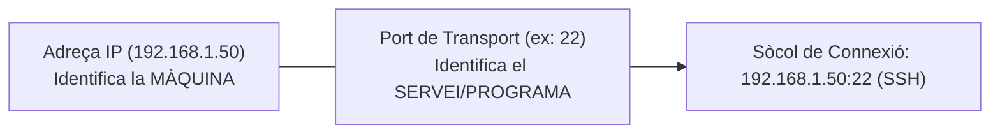

# UT01 — Introducció als Serveis en Xarxa i Arquitectura Client-Servidor

Els serveis en xarxa són el conjunt d'aplicacions i protocols que fan possible que múltiples dispositius interconnectats compartisquen recursos, fitxers, comunicacions i capacitats de càlcul de forma transparent.

---

## 📌 1. Models d'Arquitectura en Xarxa

En l'àmbit de les telecomunicacions i la informàtica corporativa predominen dos models fonamentals:

```mermaid
graph TD
    subgraph "🏛️ MODEL CLIENT-SERVIDOR"
        C1["💻 Client A"] -->|Sol·licitud (Request)| S["🖥️ SERVIDOR CENTRAL<br/>(Servei en escolta permanent)"]
        C2["💻 Client B"] -->|Sol·licitud| S
        C3["📱 Client C"] -->|Sol·licitud| S
        S -->|Resposta (Response)| C1
        S -->|Resposta| C2
        S -->|Resposta| C3
    end

    subgraph "🤝 MODEL ENTRE IGUALS (PEER-TO-PEER / P2P)"
        P1["💻 Node 1"] <--> P2["💻 Node 2"]
        P2 <--> P3["💻 Node 3"]
        P3 <--> P1
    end
```

### Comparativa Tècnica:
- **Client-Servidor:** Els rols estan clarament diferenciats. El **servidor** és un equip amb alta capacitat que executa un programa en segon pla (*dimoni* en Linux o *servei* en Windows) esperant peticions d'un o múltiples **clients**. Centralitza la gestió d'usuaris, la seguretat i les còpies de seguretat.
- **P2P (Peer-to-Peer):** Tots els nodes de la xarxa actuen simultàniament com a clients i servidors. És descentralitzat i resilient a fallades individuals, però complex d'administrar i assegurar en una empresa.

---

## 📌 2. Sòcols de Xarxa, Ports i la Capa de Transport

Perquè un paquet de dades arribe exactament a l'aplicació que li correspon dins d'una màquina, s'utilitza el concepte de **Sòcol de Xarxa (*Socket*)**:

$$\boxed{\text{Sòcol} = \text{Adreça IP} + \text{Port de Transport}}$$

Per exemple, si el servidor té la IP `192.168.1.100` i ofereix servei web segur, el sòcol d'escolta és: `192.168.1.100:443`.



### Classificació dels Ports segons la IANA ($0$ a $65535$):
1. **Ports Ben Coneguts (*Well-Known Ports*, $0 - 1023$):** Reservats per a serveis d'infraestructura estàndard del sistema. Requereixen privilegis d'administrador (`root` / `SYSTEM`) per a obrir-los:
   - `20 / 21`: FTP (Transferència de fitxers)
   - `22`: SSH (Consola remota segura)
   - `25`: SMTP (Enviament de correu)
   - `53`: DNS (Resolució de noms)
   - `67 / 68`: DHCP (Configuració IP dinàmica)
   - `80`: HTTP (Navegació web)
   - `110`: POP3 (Descàrrega de correu)
   - `143`: IMAP (Bústia de correu en xarxa)
   - `443`: HTTPS (Navegació web xifrada amb TLS)
2. **Ports Registrats ($1024 - 49151$):** Assignats per la IANA a aplicacions específiques comercials o de base de dades (p. ex., MySQL `3306`, RDP `3389`, PostgreSQL `5432`, Proxy Squid `3128`).
3. **Ports Dinàmics / Privats ($49152 - 65535$):** Assignats automàticament pel sistema operatiu del client com a ports efímers d'origen per a rebre les respostes dels servidors.

---

## 📌 3. Protocols de Transport: TCP vs UDP

| Característica | TCP (*Transmission Control Protocol*) | UDP (*User Datagram Protocol*) |
| :--- | :--- | :--- |
| **Connexió** | **Orientat a connexió** (*3-Way Handshake* SYN-SYN/ACK-ACK) | **Sense connexió** (Enviament directe de datagrames) |
| **Fiabilitat** | **100% fiable**: Reordena paquets i retransmet els perduts | No garanteix recepció ni ordre |
| **Control de flux** | Sí (Finestra lliscant i control de congestió) | No |
| **Capçalera** | Gran (20 bytes mínim) | Lleugera (8 bytes) |
| **Velocitat** | Menor velocitat per control d'errors | **Molt alta velocitat i baixa latència** |
| **Usos típics** | Web (HTTP/S), fitxers (FTP/SSH), correu (SMTP) | DNS ràpid, Streaming en directe, VoIP, jocs en línia |

---

## 📌 4. Gestió Pràctica de Serveis i Dimonis

### Administració en Linux mitjançant `systemd`:
Els serveis s'executen com a dimonis gestionats per l'ordre `systemctl`:

```bash
# Consultar si un servei (p. ex., ssh) està en execució
sudo systemctl status ssh

# Iniciar, aturar o reiniciar un servei
sudo systemctl start ssh
sudo systemctl stop ssh
sudo systemctl restart ssh

# Habilitar o deshabilitar perquè arrenque automàticament amb el sistema
sudo systemctl enable ssh
sudo systemctl disable ssh

# Inspeccionar ports i sòcols en escolta al servidor
sudo ss -tulpn
```

### Administració en Windows Server mitjançant PowerShell:
```powershell
# Obtenir la llista de serveis en execució
Get-Service | Where-Object Status -eq "Running"

# Reiniciar el servei de DNS o DHCP
Restart-Service -Name "DNS"

# Veure les connexions actives i ports d'escolta
netstat -ano | Select-String "LISTENING"
```
