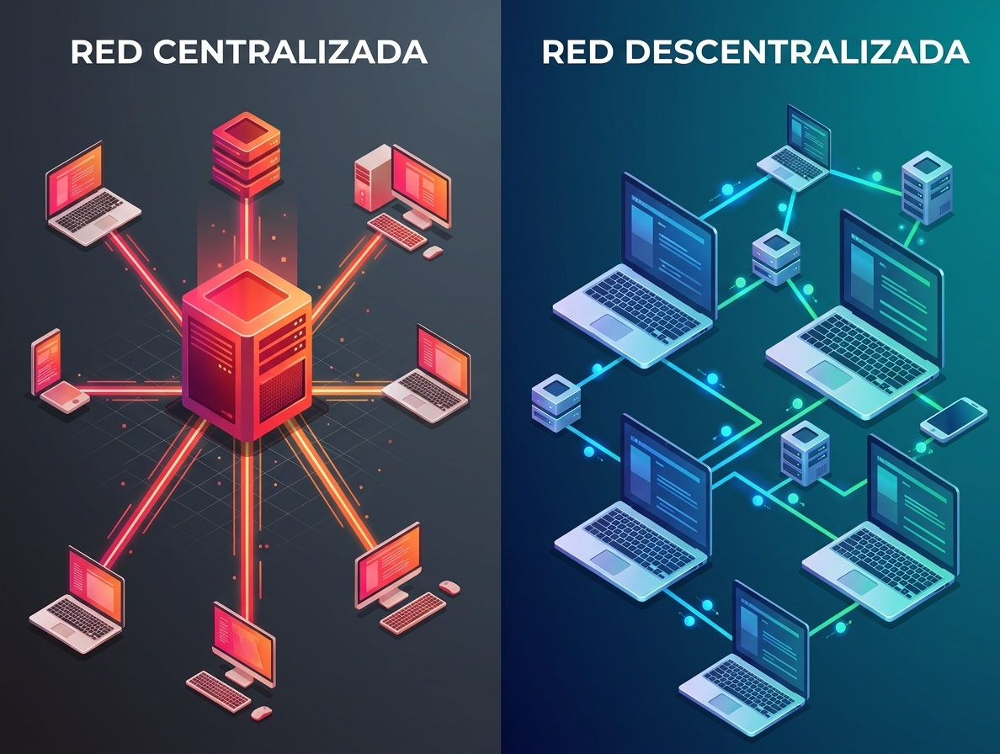
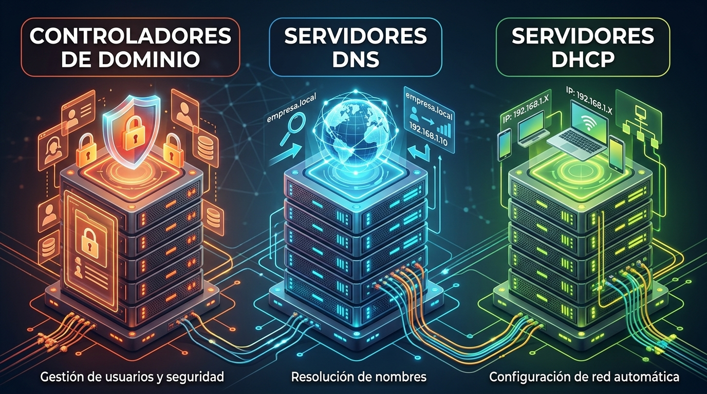

## 3 - Arquitecturas de redes empresariales

### 3.1 Redes centralizadas vs. Redes descentralizadas

1. En una red doméstica o pequeña (modelo Grupo de trabajo o Peer-to-Peer), los equipos son independientes. Cada ordenador gestiona sus propios usuarios, obtiene su IP de forma estática o mediante un router básico, y resuelve nombres localmente.
1. Sin embargo, a medida que una red corporativa crece, gestionar cada equipo de forma individual se vuelve ineficiente, inseguro e inasumible. Para solucionar esto, la arquitectura de red evoluciona hacia **un modelo cliente-servidor soportado por tres pilares fundamentales**: **DHCP, DNS y un Controlador de Dominio (DC)**.

### 3.2 DHCP, DNS y Controlador de Dominio

En la siguiente tabla se resumen las funciones de cada uno de estos servicios y la necesidad que resuelven dentro de una red corporativa:

|Servicio|Necesidad que resuelve|¿Qué ocurre si no existe?|
|--------|----------------------|-------------------------|
|DHCP (Dynamic Host Configuration Protocol)|Automatización y gestión IP: Asigna direcciones IP, máscaras, puertas de enlace y DNS automáticamente a cada cliente que se conecta.|Habría que configurar manualmente cada equipo. Riesgo constante de conflictos de IP duplicadas y errores de configuración.|
|DNS (Domain Name System)|Resolución de nombres e localización de servicios: Traduce nombres de dominio legibles (servidor.empresa.local) a direcciones IP numéricas (192.168.1.50).|Habría que memorizar la IP de cada servidor, equipo o página web para acceder a ellos, o mantener archivos hosts manuales en cada cliente.|
|Controlador de Dominio (DC)|Centralización de identidad y seguridad: Gestiona una base de datos única de usuarios, equipos, permisos y directivas de seguridad (como Active Directory u OpenLDAP).|Cada usuario tendría que ser creado localmente en cada ordenador que necesite usar. No habría control centralizado sobre contraseñas ni directivas de seguridad.|

### 3.3 Sinergia entre DHCP, DNS y Controlador de Dominio

Estos tres servicios no trabajan de forma aislada, sino interconectada dentro de la infraestructura:

1. El equipo se conecta a la red y el servidor DHCP le entrega una dirección IP, junto con la ruta para encontrar al servidor DNS.
1. El cliente consulta al servidor DNS para localizar dónde se encuentra el Controlador de Dominio dentro de la red.
1. El cliente contacta con el Controlador de Dominio para autenticar al usuario y aplicar las directivas de seguridad correspondientes.

En las siguientes secciones estudiaremos cada uno de estos servicios y su funcionamiento dentro de una red corporativa.

---

| **Licencia Creative Commons:** | |
| - | - |
|  { .by-nc-nd-eu_ } | **Reconocimiento-NoComercial-CompartirIgual CC BY-NC-SA:** No se permite un uso comercial de la obra original ni de las posibles obras derivadas, la distribución de la cuales se debe hace con una licencia igual a la que regula la obra original. |
