

  

    🏆 <strong>Progreso de esta sección:</strong> 0 de 4 superados (0%)
    ⭐ <strong>0 puntos</strong>
  

  

    

  

# 1.6 Tarea RA6-CEbcd-1 - Instalación y conexión remota a Windows Server 2025 en AWS

> **📌 Obligatorio seguir las normas para la presentación de trabajos escritos.**
> 

### 6.1 Instal·lació de Windows Server 2025 en AWS

- AWS (Amazon Web Services) és una plataforma de serveis en la núvol que permet als usuaris crear i gestionar servidors virtuals, coneguts com instàncies EC2 (Elastic Compute Cloud).

- Per a instal·lar Windows Server 2025 en AWS, s'han de seguir els següents passos:

#### 6.1.1 Primer accés a AWS

- Revisad els nostres correus electrònics, ja que habréis rebut un correu de AWS amb un enllaç per a crear la vostra compta.

- Per a la creació de la compta, debéis seguir els passos indicats en el següent [enllaç](https://javieregeablasco.github.io/Apuntes/DAW/DAW_2/AWS/UT.%203-AWS%20Academy/#2-learner-lab).

- Una vegada creada la compta accederem al laboratorio de AWS (learner lab).

#### 6.1.2 Accedir al curs

- Per a accedir al curs, debéis seguir els passos indicats en el següent [enllaç](https://javieregeablasco.github.io/Apuntes/DAW/DAW_2/AWS/UT.%203-AWS%20Academy/#23-acceso-al-curso).

#### 6.1.3 Accedir al laboratorio

- Per a accedir al laboratorio, debéis seguir els passos indicats en el següent [enllaç](https://javieregeablasco.github.io/Apuntes/DAW/DAW_2/AWS/UT.%203-AWS%20Academy/#24-acceder-al-laboratorio).

#### 6.1.4 Llançar el laboratorio

- Per a llançar el laboratorio, debéis seguir els passos indicats en el següent [enllaç](https://javieregeablasco.github.io/Apuntes/DAW/DAW_2/AWS/UT.%203-AWS%20Academy/#25-lanzar-el-laboratorio).

#### 6.1.5 Accedir al panell del laboratorio

- Per a accedir al panell del laboratorio, debéis seguir els passos indicats en el següent [enllaç](https://javieregeablasco.github.io/Apuntes/DAW/DAW_2/AWS/UT.%203-AWS%20Academy/#26-panel-de-aws).

#### 6.1.6 Creació d'una instància EC2

1. 

Una instància EC2 és un servidor virtual que s'executa en la infraestructura de AWS.

1. 

Per a crear una instància EC2 amb Windows Server 2025, farem el següent:

  - Anar al panell de control de AWS i seleccionar el servei EC2.

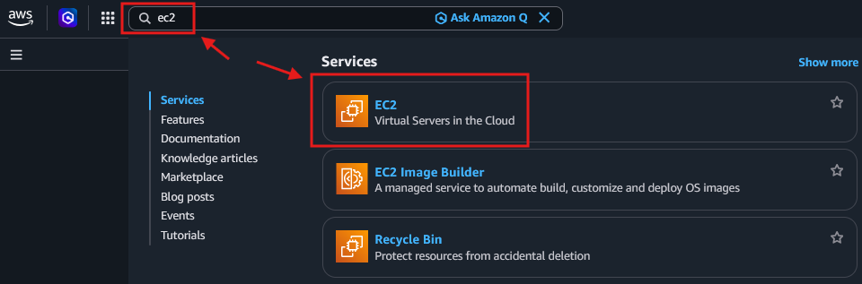

  - Una vegada en el menú de EC2, seleccionar "Llançar instància".

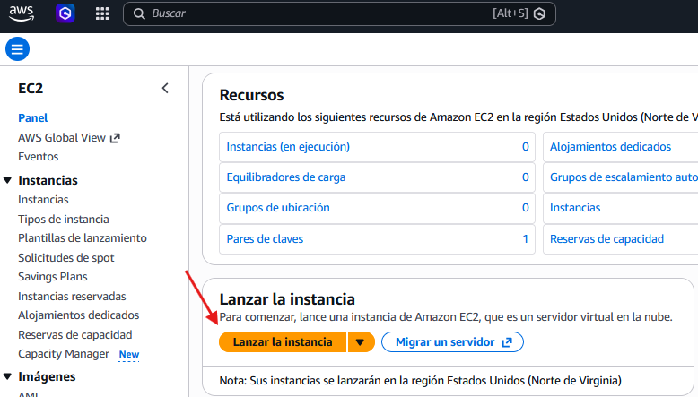

  - Seleccionar la imatge de Windows Server 2025.

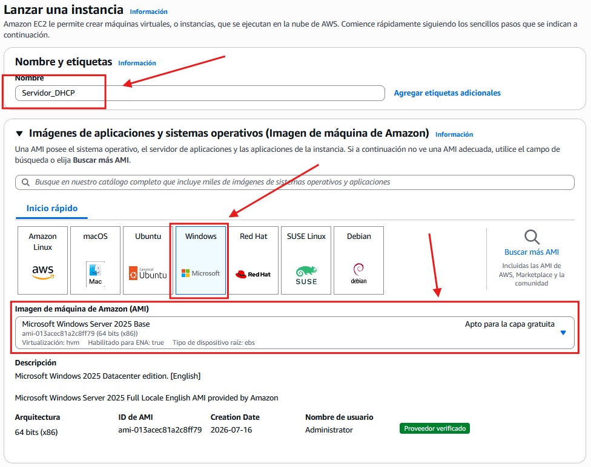

> **📌 Per al tipus d'instància seleccionar m7i.large**
> 

  - Configurar les opcions de la instància (tipus, parell de claus).

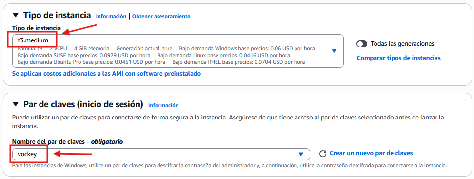

  - Configurar les opcions de xarxa.

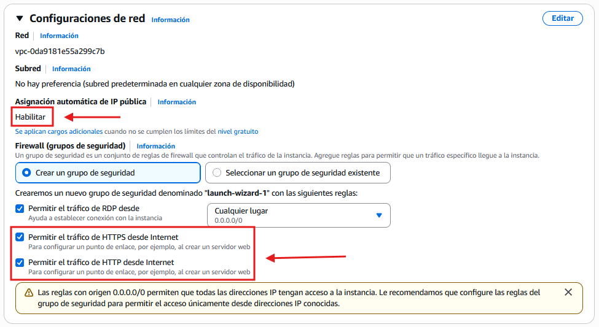

  - Configurar l'emmagatzematge.

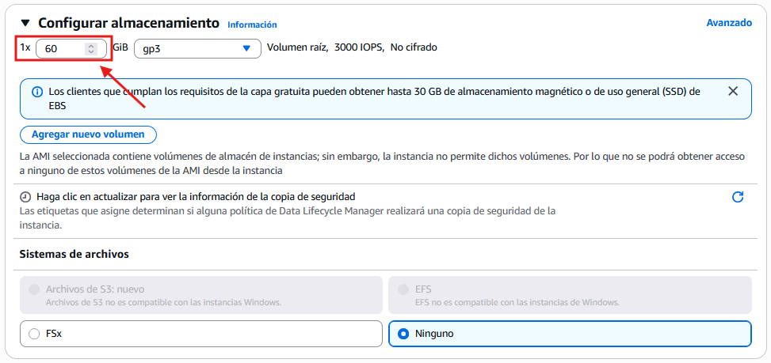

  - Cerquem el botó de llançar i el pulsamos.

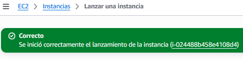

  - Tornem a la pàgina de EC2 i supervisamos l'estat de creació de la nostra instància.  

Realitzar captura de pantalla

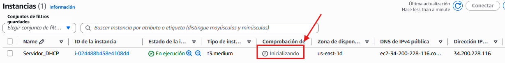

### 6.2 Connexió remota a la instància de Windows Server 2025 des de windows 10-11

1. 

En aquest cas usarem el protocol RDP (Remote Desktop Protocol) per a connectar-nos a la instància de Windows Server 2025. eixe protocol permet als usuaris connectar-se a un altre ordinador a través d'una interfície gràfica, proporcionant accés complet a l'escriptori del sistema remoto.

1. 

AWS facilita la connexió remota a través de RDP proporcionant un fitxer de connexió que conté l'adreça IP pública de la instància i les credencials necessàries per a accedir.

  - Seleccionem la instància a la que volem accedir i accedim al servei de connexió remota en AWS.

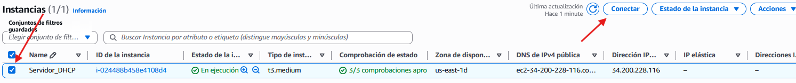

  - Seleccionem RDP. Descargamos el fitxer de connexió. De moment no l'abrimos ja que encara no tenim les credencials.

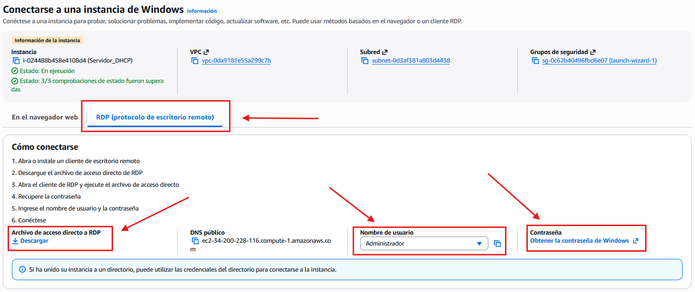

  - Tornem al learner lab pinchamos en AWS details i descargamos el fitxer de la clau privada **labuser.pem** i el guardamos en el nostre equip.

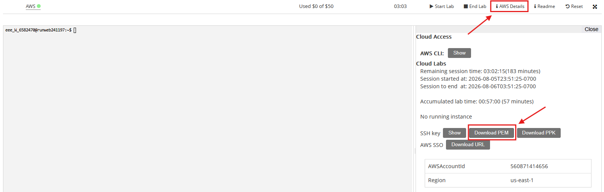

  - Tornem a la pàgina de EC2 i seleccionem la instància a la que volem accedir. Pinchamos en **Connectar** i després en **Obtindre    contrasenya**. Subimos el fitxer **labuser.pem** i obtenim la contrasenya d'accés.

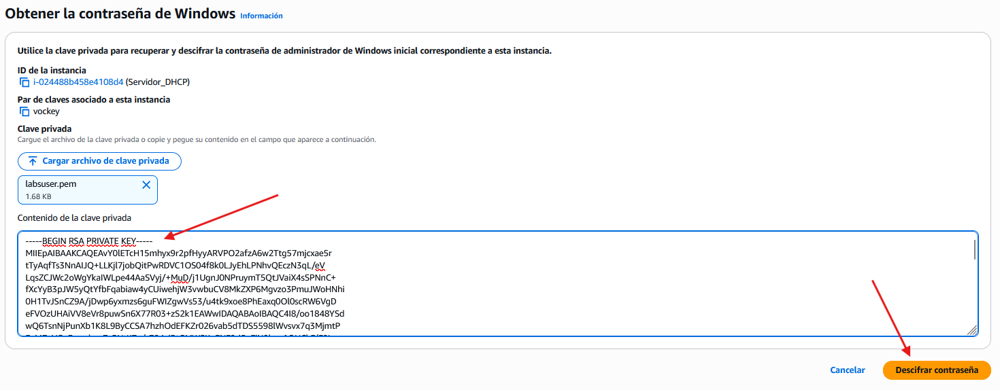

  - Contrasenya d'accés:  

Realitzar captura de pantalla

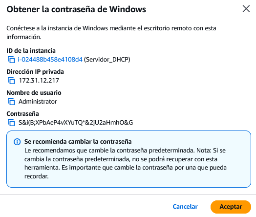

  - Abrimos el fitxer de connexió RDP que hem descargado anteriorment i pegamos la contrasenya generada per AWS.  

Accés a l'escriptori remoto de Windows Server 2025.

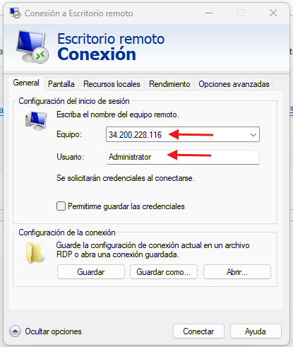

  

Pegamos la contrasenya generada per AWS.

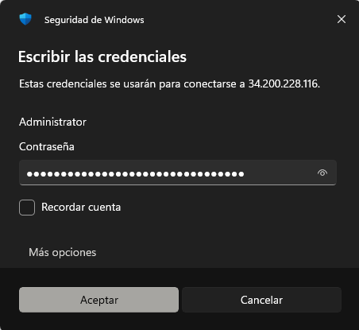

> **📌 Només per a usuaris amb nom d'equip vinculado a un Sistema de Informació i Control Empresarial (SICE).**
> 

>   - Anar a `Usar otra cuenta`:
> 

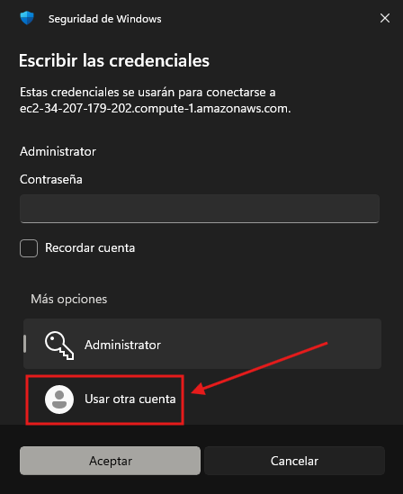

>   - Introduir `.\Administrator` en compte de solament Administrator.

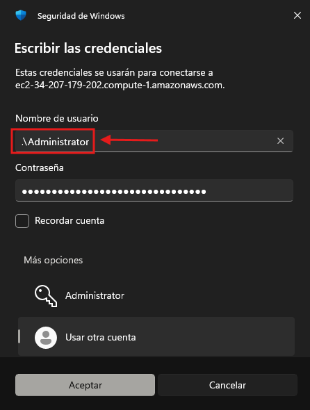

  - Aceptamos els riscos de seguretat i ens conectamos a l'escriptori remoto de Windows Server 2025.  

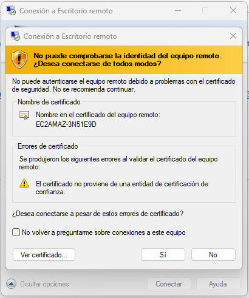

  - Una vegada conectdos, podem treballar amb l'escriptori remoto de Windows Server 2025 com si estuviéramos físicament enfront d'ell.  

Realitzar captura de pantalla

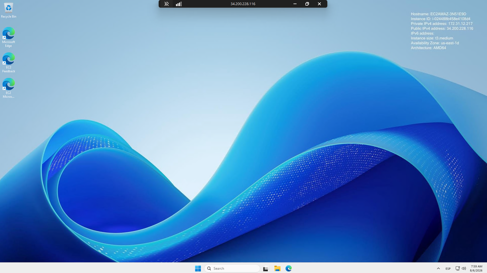

### 6.3 Configuracions preliminares de Windows Server 2025

> **📌 Obligatori!**
> 

Una vegada connectats a l'escriptori remoto de Windows Server 2025, és recomanable realitzar algunes configuracions preliminares per a assegurar el correcte funcionament del servidor i la seguretat del mateix.

- Canviar el nom de l'equip.

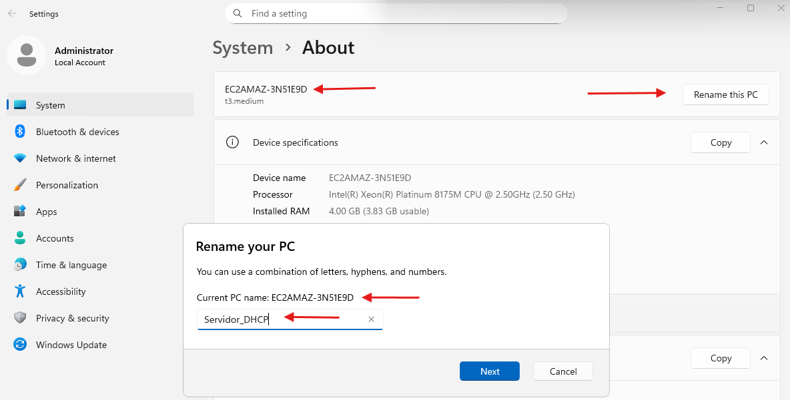

Si cambiamos el nom de l'equip, hem de reiniciar el servidor perquè els canvis tinguen efecte.

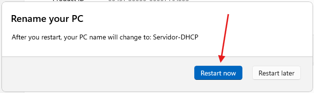

- Edició i versió del sistema operatiu.

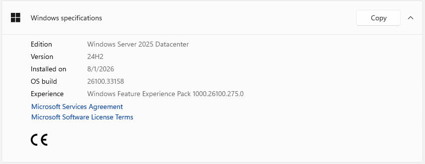

- Configurar el widget.

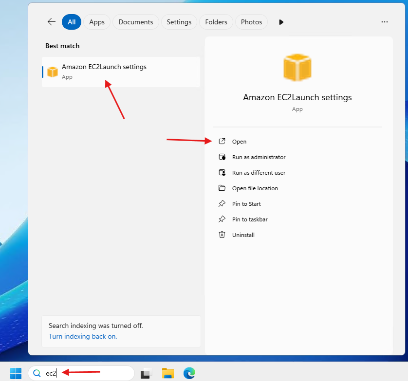

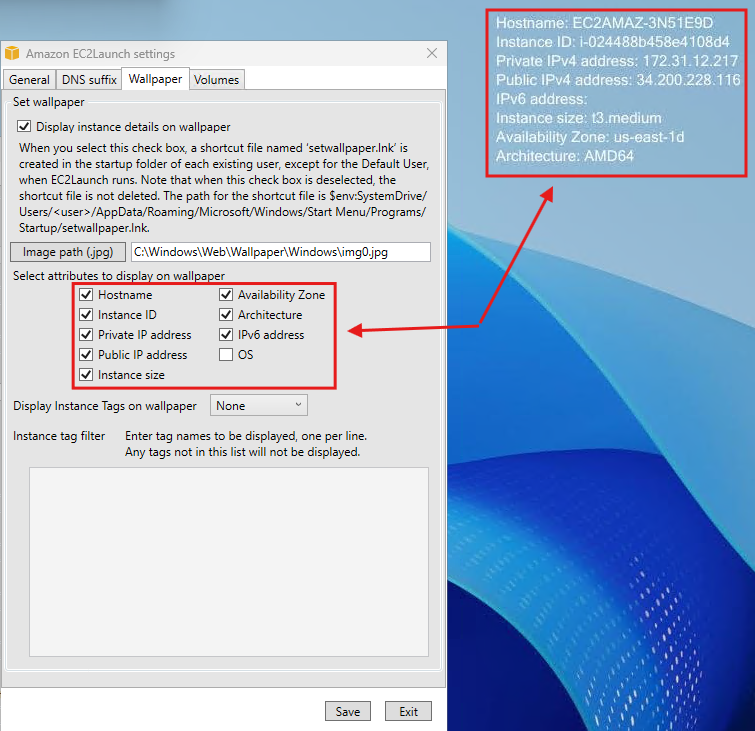

- Realitzar captura de pantalla del widget després d'haver cambiado el nom de la màquina.

### 6.4 Desconexión de la instància a Windows Server 2025

Podem fer-ho de diverses formes:

- Tancar la finestra de connexió remota.

- Tancar sessió des del menú d'inici de Windows Server 2025.

- Executar l'aplicació **Run** i escriure el comanda **logoff** per a tancar la sessió de forma immediata.

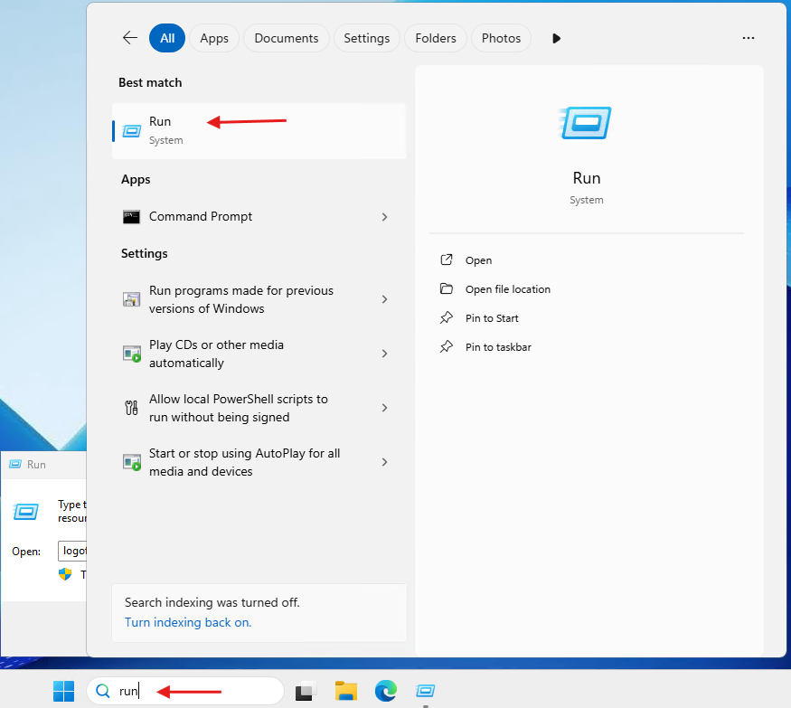

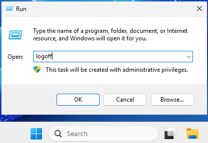

### 6.5 Tancar el laboratorio

- Hem de tancar el laboratorio de AWS per a liberar els recursos i evitar cargos innecesarios.

- Per a això, simplement finalizarem el laboratorio, pinchant en **End Lab** en la consola del laboratory i esperarem a que el testigo de AWS passe a **roig**.  

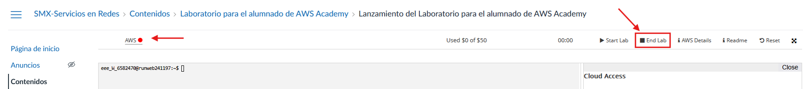

---

## 🎮 Reptes Interactius d'Autoavaluació (+100 XP)

Comprova el teu domini sobre **1.6 Tasca RA6-CEbcd-1 - Instal·lació i connexió remota a Windows Server 2025 en AWS** superant aquests 4 reptes gamificats (+25 puntos cadascun):

  
🎯 <strong>Repte 1 (+25 pts):</strong> Quina diferència fonamental existeix entre els protocols d'accés remot en línia d'ordres SSH i Telnet?

  

    <button type="button" class="btn-mcq-opt" data-opt="A">A) SSH xifra tota la sessió i les credencials d'autenticació, mentre que Telnet transmet tota la informació en text pla.</button>
    <button type="button" class="btn-mcq-opt" data-opt="B">B) Telnet utilitza xifratge asimètric RSA i SSH no utilitza cap xifratge.</button>
    <button type="button" class="btn-mcq-opt" data-opt="C">C) SSH només funciona en Windows Server i Telnet només en Ubuntu.</button>
    <button type="button" class="btn-mcq-opt" data-opt="D">D) Cap de les anteriors és correcta.</button>
  

  

  
🎯 <strong>Repte 2 (+25 pts):</strong> Quin client multiprotocol utilitzem en sistemes Linux (com Ubuntu Desktop/Server amb GUI) per a connectar-nos per RDP a una instància de Windows Server 2025 en AWS?

  

    <button type="button" class="btn-mcq-opt" data-opt="A">A) PuTTYgen</button>
    <button type="button" class="btn-mcq-opt" data-opt="B">B) nslookup</button>
    <button type="button" class="btn-mcq-opt" data-opt="C">C) Cap de les anteriors és correcta.</button>
    <button type="button" class="btn-mcq-opt" data-opt="D">D) Remmina</button>
  

  

  
✅ <strong>Repte 3 (Vertader o Fals · +25 pts):</strong> Exposar directament el port RDP (3389) a Internet sense mesures addicionals com VPN o restricció d'IP al grup de seguretat suposa un risc crític d'atacs de força bruta.

  

    <button type="button" class="btn-vf" data-opt="V">Vertader (V)</button>
    <button type="button" class="btn-vf" data-opt="F">Fals (F)</button>
  

  

  
⌨️ <strong>Repte 4 (+25 pts):</strong> Quin número de port TCP/UDP utilitza per defecte el protocol d'Escriptori Remot de Microsoft (RDP)?

  

    <input type="text" class="quiz-input" placeholder="Escriu la resposta..." />
    <button type="button" class="btn-quiz-check">Comprovar</button>
  

  

### 📋 Llista de Comprovació i Rúbrica d'Assoliment

Marca cada criteri a mesura que completes l'estudi o la resolució pràctica d'aquesta pàgina (**1.6 Tasca RA6-CEbcd-1 - Instal·lació i connexió remota a Windows Server 2025 en AWS**):

- [ ] He llegit detingudament la teoria o l'enunciat d'aquesta secció i he anotat els conceptes clau.
- [ ] He revisat els esquemes, taules o blocs de codi i he verificat que sé aplicar-los a l'entorn de treball.
- [ ] He resolt correctament els **4 reptes interactius** superiors obtenint els **100 puntos XP**.
- [ ] He descarregat el comprovant oficial en PDF per a adjuntar-lo a la tasca d'**Aules**.

  <h3>📤 Comprovant de Lliurament per a Aules</h3>
  
Quan hages completat els reptes interactius i la llista d'autoavaluació d'aquesta pàgina, introdueix el teu nom i descarrega el teu certificat oficial en PDF per a adjuntar-lo a la tasca d'<strong>Aules</strong>.

  

    <label for="aules-student-name">👤 Nom i Cognoms de l'Alumne/a:</label>
    <input type="text" id="aules-student-name" class="aules-student-name" placeholder="Ex: Joan Garcia Pérez" />
  

  

    0/4 reptes completats (0%) · 0 puntos · 0/4 criteris d'autoavaluació
  

  

    <button type="button" class="btn-aules-dl" data-module="SEX" data-unit="UD01" data-activity="ut0106">📥 Descarregar Comprovant PDF</button>
    <button type="button" class="btn-aules-copy">📋 Copiar Resum al Porta-retalls</button>
  

  

