<div class="interactive-progress-tracker">
  <div class="tracker-header">
    <span>🏆 <strong>Progreso de esta sección:</strong> <span class="tracker-count">0 de 4 superados (0%)</span></span>
    <span class="tracker-pts">⭐ <strong>0 puntos</strong></span>
  </div>
  <div class="tracker-bar">
    <div class="tracker-fill" style="width: 0%;"></div>
  </div>
</div>

# 1.7 Tarea RA6-CEbcd-2 - Instalación y conexión remota a Ubuntu Server 24.04 LTS en AWS

> **📌 Obligatorio seguir las normas para la presentación de trabajos escritos.**
> 

### 7.1 Instal·lació de Ubuntu Server 24.04 LTS en AWS

Repetirem els passos anteriors per a crear una instància EC2, però aquesta vegada seleccionarem la imatge de Ubuntu Server 24.04 LTS.

- Seleccionem la imatge de Ubuntu Server 24.04 LTS.

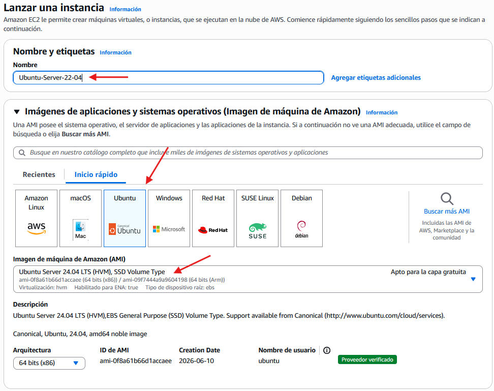

- Seleccionem el tipus d'instància i el parell de claus.

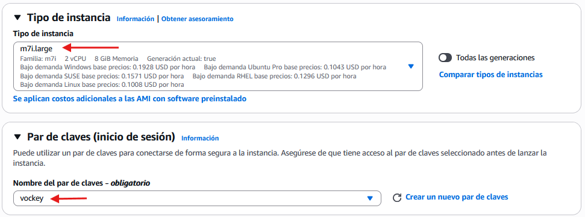

- Configuramos la xarxa on es desplegará la instància.

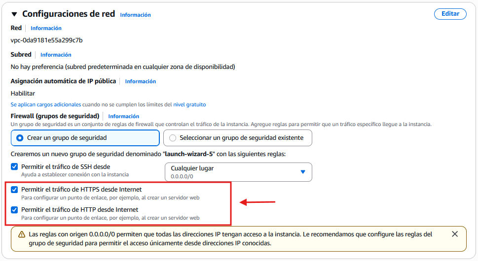

> **📌 Per a l'emmagatzematge seleccionar 50GiB**
> 

- Configuramos l'emmagatzematge de la instància.

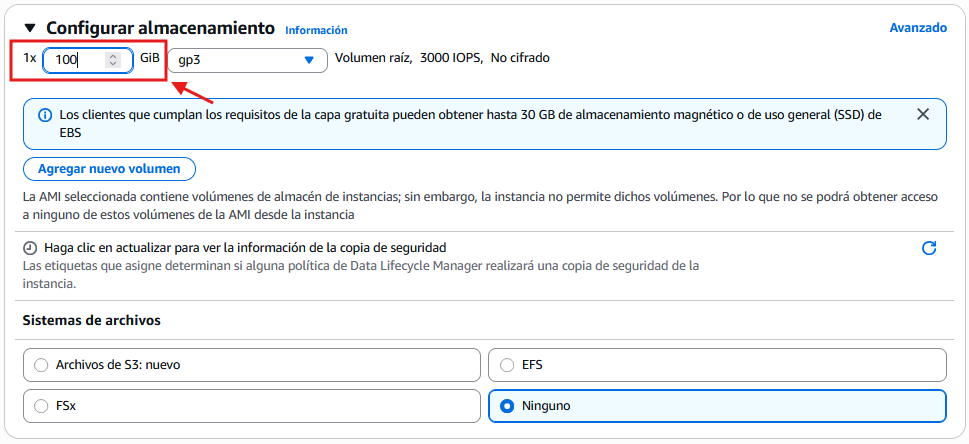

### 7.2 Connexió remota CLI a través del panell de control de AWS

- A l'igual que en el cas de Windows Server 2025, seleccionarem la instància en la consola de AWS i pulsarem connectar.

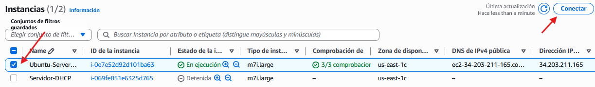

- AWS facilita la connexió remota a través de SSH de manera fàcil i intuitiva.

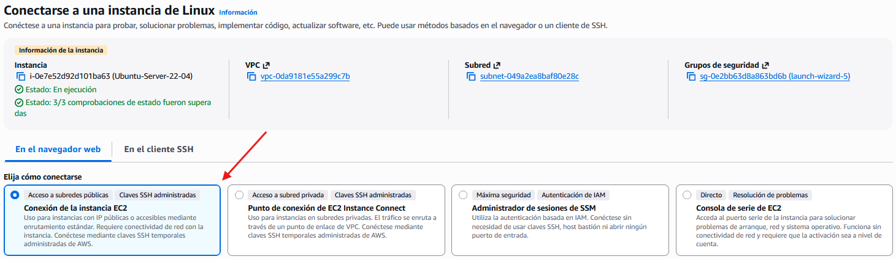

- Una vegada establecida la connexió, es ens obrirà una finestra de terminal amb la connexió SSH a la instància de Ubuntu Server 24.04 LTS.  

Realitzar captura de pantalla

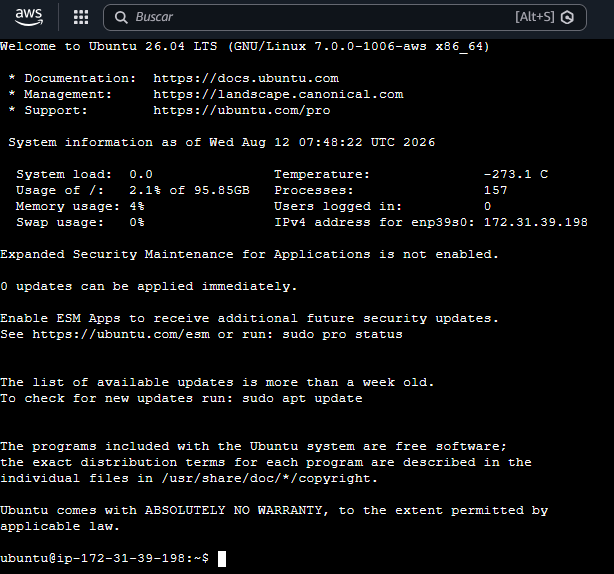

### 7.3 Connexió remota des de SO Windows

- Per a connectar-nos a la instància de Ubuntu Server 24.04 LTS des d'un sistema operatiu Windows, podem utilitzar l'aplicació de connexió a escriptori remoto **MSTSC**.

- No obstant això, haurem de preparar la instància per a permetre connexions així com instal·lar un client RDP i un entorn gràfic lleuger en la instància de Ubuntu Server 24.04 LTS.

#### 7.3.1 Obertura de ports en la instància

1. 

A l'obrir els ports necessaris en el firewall de la instància de Ubuntu Server 24.04 LTS, podrem permetre connexions remotas a través de RDP.

1. 

Encara que no siga una bona pràctica, per a fines educativos, no només abrirem el port 3389 per als protocols **TCP** i **UDP** sinó que abrirem tots els ports.

  - Anem a la consola de AWS i seleccionem la instància de Ubuntu Server 24.04 LTS.

  - En la secció de **Seguretat**, seleccionem el grup de seguretat associat a la instància.

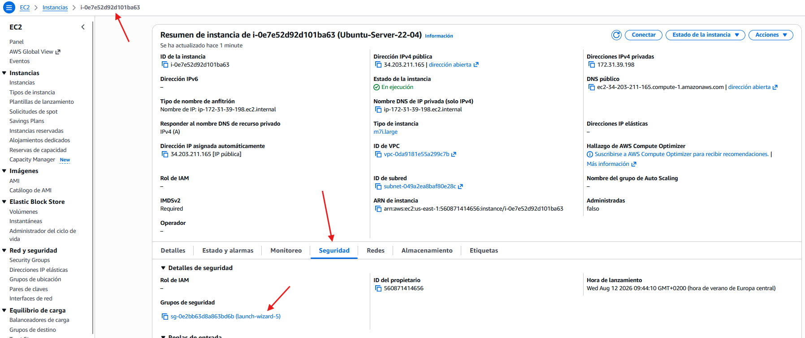

  - Editamos les regles d'entrada.

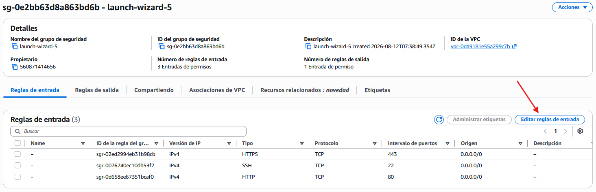

  - Agregamos una regla d'entrada per a permetre **el trànsit entrante des d'internet sobre qualsevol port**.

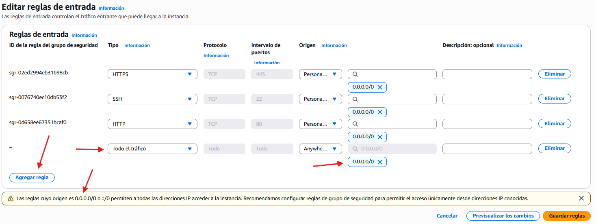

  

  - Al final, obtindrem el següent resultat:  

Realitzar captura de pantalla

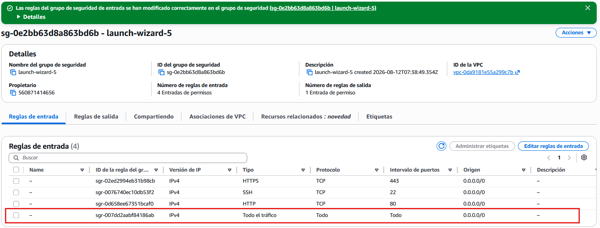

#### 7.3.2 Preparació de la instància de Ubuntu Server 24.04 LTS

En la instància de Ubuntu Server 24.04 LTS, instalarem un servidor RDP per a permetre connexions remotas des de sistemes Windows.

Per a això, primer ens conectarem a la instància a través de SSH i després instalarem el servidor RDP.

- 

Actualizamos els repositorios i actualizamos el sistema operatiu.

```bash
sudo apt update && sudo apt upgrade -y
```

- 

De moment no disposem d'interfície gràfica en la instància de Ubuntu Server 24.04 LTS, per la qual cosa instalarem un entorn d'escriptori lleuger com **XFCE**.

```bash
sudo apt install xfce4 xfce4-goodies -y
```

- 

Instalamos el servidor RDP **XRDP**.

```bash
sudo apt install xrdp -y
```

- 

Habilitamos el servei xrdp perquè es inicie automàticament a l'arrancar el sistema.

```bash
sudo systemctl enable xrdp
```

- 

Iniciamos el servei xrdp.

```bash
sudo systemctl start xrdp
```

- 

Verificamos que el servei xrdp estiga activo i en ejecució.

```bash
sudo systemctl status xrdp
```

- 

Obtindrem un resultat similar al següent.  

Realitzar captura de pantalla

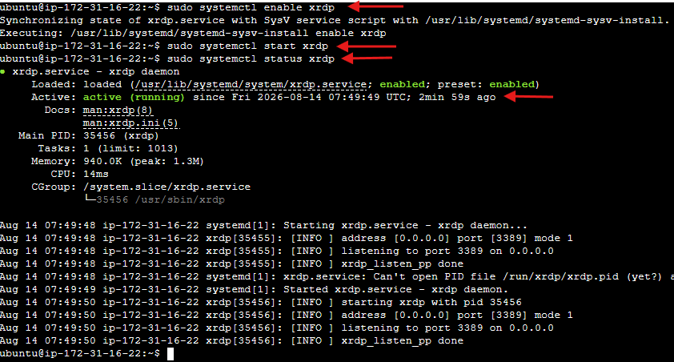

- 

Cambiamos la contrasenya de l'usuari perquè puga iniciar sessió a través de RDP.

```bash
sudo passwd <nombre_de_usuario>
```

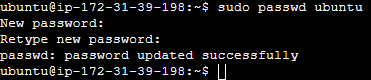

- 

Per a evitar conflictos amb l'elecció de la interfície gràfica per part de XFCE, figuramos el fitxer de sesion.

```bash
echo "startxfce4" > ~/.xsession
chmod +x ~/.xsession
```

- 

Ens aseguramos que la interfície s'aplica al servei globalment.

```bash
sudo sed -i.bak 's/exec \/etc\/X11\/Xsession/exec startxfce4/' /etc/xrdp/startwm.sh
```

- 

Reiniciamos el servei XFCE

```bash
sudo systemctl restart xrdp
sudo systemctl status xrdp
```

#### 7.3.3 Connexió remota des de SO windows

- 

Lanzamos l'aplicació de connexió a escriptori remoto **MSTSC** en el nostre sistema operatiu Windows.

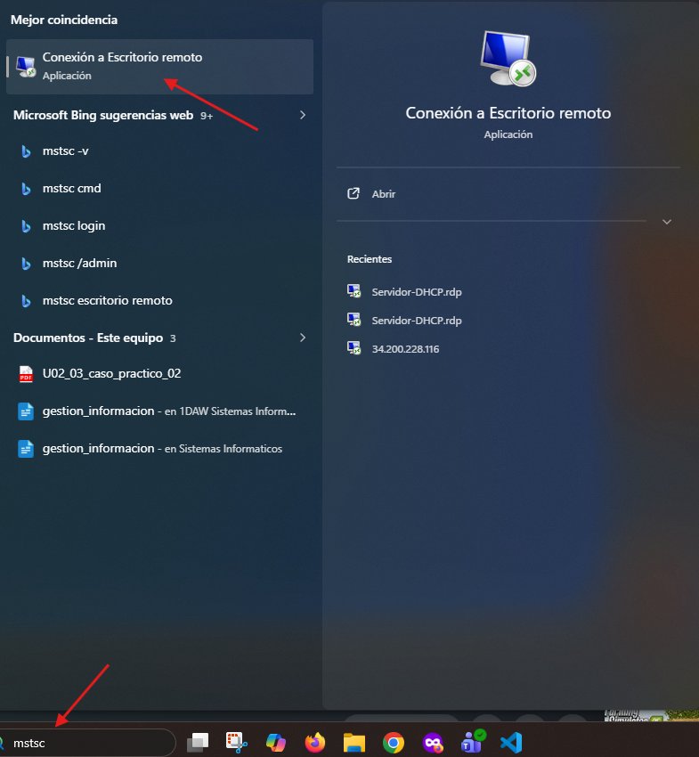

- 

Escrivim la **IP pública** de la instància a la que no anem a connectar.

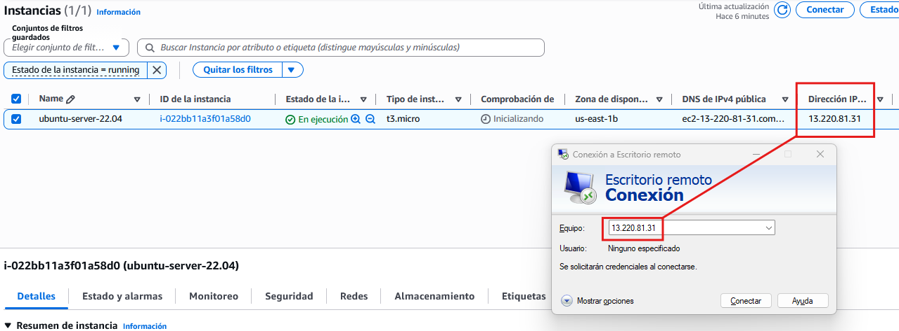

- 

Obviamos les advertencias de seguretat.

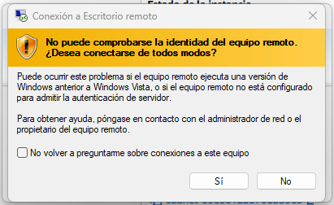

- 

Una vegada connectats introducimos les credencials.

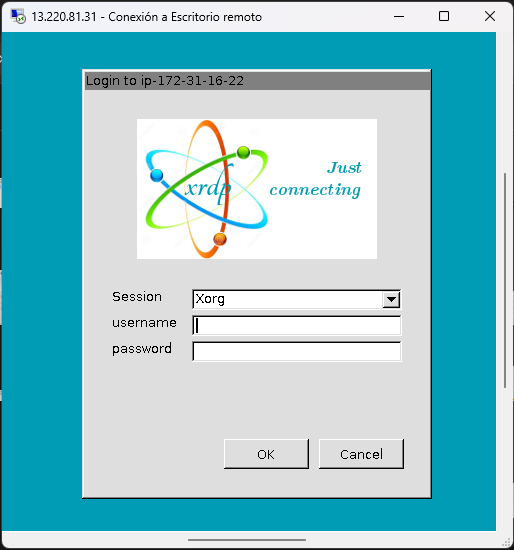

- 

Si tot ha anat bé obtindrem una interfície similar a la següent imatge.  

Realitzar captura de pantalla

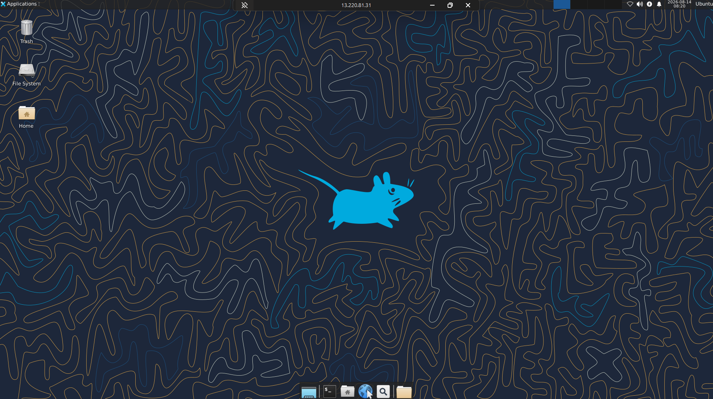


---

## 🎮 Reptes Interactius d'Autoavaluació (+100 XP)

Comprova el teu domini sobre **1.7 Tasca RA6-CEbcd-2 - Instal·lació i connexió remota a Ubuntu Server 24.04 LTS en AWS** superant aquests 4 reptes gamificats (+25 puntos cadascun):

<div class="interactive-mcq" data-answer="A" data-hint="Revisa els conceptes teòrics i pràctics d'aquesta secció.">
  <div class="mcq-question">🎯 <strong>Repte 1 (+25 pts):</strong> Quina diferència fonamental existeix entre els protocols d'accés remot en línia d'ordres SSH i Telnet?</div>
  <div class="mcq-options">
    <button type="button" class="btn-mcq-opt" data-opt="A">A) SSH xifra tota la sessió i les credencials d'autenticació, mentre que Telnet transmet tota la informació en text pla.</button>
    <button type="button" class="btn-mcq-opt" data-opt="B">B) Telnet utilitza xifratge asimètric RSA i SSH no utilitza cap xifratge.</button>
    <button type="button" class="btn-mcq-opt" data-opt="C">C) SSH només funciona en Windows Server i Telnet només en Ubuntu.</button>
    <button type="button" class="btn-mcq-opt" data-opt="D">D) Cap de les anteriors és correcta.</button>
  </div>
  <div class="quiz-feedback"></div>
</div>

<div class="interactive-mcq" data-answer="D" data-hint="Comprova l'apartat corresponent de la unitat.">
  <div class="mcq-question">🎯 <strong>Repte 2 (+25 pts):</strong> Quin client multiprotocol utilitzem en sistemes Linux (com Ubuntu Desktop/Server amb GUI) per a connectar-nos per RDP a una instància de Windows Server 2025 en AWS?</div>
  <div class="mcq-options">
    <button type="button" class="btn-mcq-opt" data-opt="A">A) PuTTYgen</button>
    <button type="button" class="btn-mcq-opt" data-opt="B">B) nslookup</button>
    <button type="button" class="btn-mcq-opt" data-opt="C">C) Cap de les anteriors és correcta.</button>
    <button type="button" class="btn-mcq-opt" data-opt="D">D) Remmina</button>
  </div>
  <div class="quiz-feedback"></div>
</div>

<div class="interactive-vf" data-answer="V" data-hint="Verifica l'afirmació amb els apuntos de la unitat.">
  <div class="vf-statement">✅ <strong>Repte 3 (Vertader o Fals · +25 pts):</strong> Exposar directament el port RDP (3389) a Internet sense mesures addicionals com VPN o restricció d'IP al grup de seguretat suposa un risc crític d'atacs de força bruta.</div>
  <div class="vf-buttons">
    <button type="button" class="btn-vf" data-opt="V">Vertader (V)</button>
    <button type="button" class="btn-vf" data-opt="F">Fals (F)</button>
  </div>
  <div class="quiz-feedback" style="width: 100%;"></div>
</div>

<div class="interactive-quiz" data-answer="3389" data-hint="Comença per 33 i acaba en 89.">
  <div class="quiz-question">⌨️ <strong>Repte 4 (+25 pts):</strong> Quin número de port TCP/UDP utilitza per defecte el protocol d'Escriptori Remot de Microsoft (RDP)?</div>
  <div class="quiz-controls">
    <input type="text" class="quiz-input" placeholder="Escriu la resposta..." />
    <button type="button" class="btn-quiz-check">Comprovar</button>
  </div>
  <div class="quiz-feedback"></div>
</div>

### 📋 Llista de Comprovació i Rúbrica d'Assoliment

Marca cada criteri a mesura que completes l'estudi o la resolució pràctica d'aquesta pàgina (**1.7 Tasca RA6-CEbcd-2 - Instal·lació i connexió remota a Ubuntu Server 24.04 LTS en AWS**):

- [ ] He llegit detingudament la teoria o l'enunciat d'aquesta secció i he anotat els conceptes clau.
- [ ] He revisat els esquemes, taules o blocs de codi i he verificat que sé aplicar-los a l'entorn de treball.
- [ ] He resolt correctament els **4 reptes interactius** superiors obtenint els **100 puntos XP**.
- [ ] He descarregat el comprovant oficial en PDF per a adjuntar-lo a la tasca d'**Aules**.

<div class="aules-delivery-card">
  <h3>📤 Comprovant de Lliurament per a Aules</h3>
  <p>Quan hages completat els reptes interactius i la llista d'autoavaluació d'aquesta pàgina, introdueix el teu nom i descarrega el teu certificat oficial en PDF per a adjuntar-lo a la tasca d'<strong>Aules</strong>.</p>
  <div class="aules-student-field">
    <label for="aules-student-name">👤 Nom i Cognoms de l'Alumne/a:</label>
    <input type="text" id="aules-student-name" class="aules-student-name" placeholder="Ex: Joan Garcia Pérez" />
  </div>
  <div class="aules-score-badge">
    <span class="aules-score-count">0/4 reptes completats (0%) · 0 puntos · 0/4 criteris d'autoavaluació</span>
  </div>
  <div class="aules-actions">
    <button type="button" class="btn-aules-dl" data-module="SEX" data-unit="UD01" data-activity="ut0107">📥 Descarregar Comprovant PDF</button>
    <button type="button" class="btn-aules-copy">📋 Copiar Resum al Porta-retalls</button>
  </div>
  <div class="aules-toast"></div>
</div>

